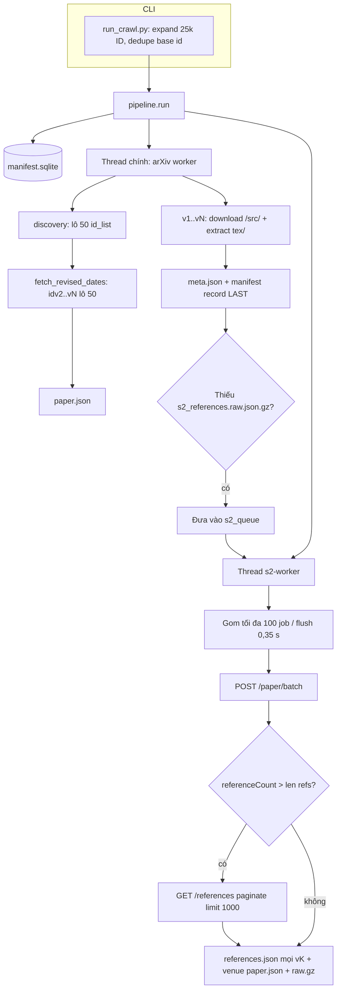

# arxiv-pipeline — Mô tả dự án và luồng xử lý hiện tại

> **Mục đích tài liệu:** Mô tả luồng end-to-end **đúng với mã** (28/10/2026), làm nền cho pilot và các bước còn lại trong `plans/Plan cải thiện pipeline arXiv – rút ngắn thời gian crawl 25.000 ID.md`.
>
> **Trạng thái code:** **180 test pass**, `ruff` sạch; chưa crawl 25.000 ID thật. Chi tiết đề vs repo: `STATUS.md` mục 0.

---

## 1. Bối cảnh dự án

| Khía cạnh | Nội dung |
| --- | --- |
| Môn / dự án | Nhập môn Khoa học Dữ liệu — pipeline arXiv (M1 thu thập → M2 parse LaTeX → M3 matching BibTeX) |
| Phạm vi hiện tại | **Chỉ Milestone 1:** thu `.tex`/`.bib` mọi phiên bản, metadata arXiv, **toàn bộ** tham khảo S2 (lưu local; bảng HF chỉ lọc ref có arXiv ID) |
| Quy mô | `src/id_ranges.csv`: **5 dải × 5.000 = 25.000** ID (tháng 6–8/2024), hai đầu inclusive |
| Vận hành | **Một máy** chạy `run_crawl.py` (quyết định D8); manifest SQLite **resume**; không chạy hai crawler cùng `data/` |
| Repo liên quan | Mã: repo này. Báo cáo: Jupyter Book [arxiv-book](https://github.com/GiaaPhuc/arxiv-book) (repo riêng) |

---

## 2. Nguồn dữ liệu và ràng buộc lịch sự

| Host | Dùng cho | Host thực tế | Giới hạn trong code | Hành vi đặc biệt |
| --- | --- | --- | --- | --- |
| arXiv | Atom API `id_list` + tải `/src/{id}vN` | **`export.arxiv.org`** (một Session, **một** `RateLimiter`) | ≥ **3 s** giữa hai request (tính từ **kết thúc** request trước) | **403/429 → dừng cả lần chạy** (exit 3), không retry client, báo nhóm |
| Semantic Scholar | Metadata + references (batch) | `api.semanticscholar.org` | Nền **1,1 s** (`AdaptiveRateLimiter`, key ≈ 1 req/s); tăng khoảng cách sau 429, giảm dần sau 50 request thành công | Header `x-api-key` nếu có `S2_API_KEY`. **429:** chờ `Retry-After` (30–600 s), retry **cả lô** tối đa 4 lần; tổng thời gian chờ 429 liên tiếp không có success ≥ **30 phút** → tắt worker S2. **403:** tắt worker S2 |

**Không được (đề + CONTRIBUTING):** crawl `arxiv.org` bulk; nhiều kết nối arXiv; tăng tốc khi bị 403/429; commit `data/`, key, parquet, sqlite.

**Rủi ro R3:** key S2 trên máy crawl cần xác nhận pilot — không key → 429 nặng, worker S2 có thể tắt sớm.

---

## 3. Kiến trúc module (Milestone 1)

```
src/run_crawl.py          CLI: mở rộng id_ranges → pipeline.run()
src/crawler/
  config.py               env: CRAWLER_CONTACT, S2_API_KEY, CRAWLER_DATA_DIR; s2_min_interval=1.1
  http.py                 HostClient; RateLimiter (arXiv); AdaptiveRateLimiter (S2)
  ids.py                  chuẩn hóa ID, expand dải, tên thư mục
  discovery.py            Atom API: metadata, N phiên bản, ngày v2..vN (lô 50)
  source.py               GET /src/, trích .tex/.bib (giữ cây thư mục)
  s2.py                   batch POST + fallback /references (limit 1000)
  manifest.py             SQLite: trạng thái từng (paper, version)
  pipeline.py             2 worker (thread): arXiv (main) + S2 (batch queue)
  metrics.py              stage + RAM/đĩa + counters S2 → logs/metrics.json
  export.py               bảng papers/references + thống kê
src/validate_corpus.py    kiểm tra bất biến corpus
src/export_data.py        xuất stats/
src/crawler/models.py     **hợp đồng dữ liệu** (SCHEMA_VERSION=1, đừng đổi ngầm)
```

**Vai trò nhóm (tham khảo):** A — http, manifest, pipeline, metrics · B — ids, discovery, s2 · C — source · D — export/corpus · E — validate + sách.

---

## 4. Luồng end-to-end (một lần chạy `run_crawl.py`)



### 4.1. Khám phá (discovery) — trên luồng arXiv

1. Chia danh sách ID thành chunk **50** (`discovery_batch_size`).
2. Với mỗi ID trong chunk:
   - Nếu đã có `paper.json` → đọc lại, bỏ qua discovery.
   - Nếu manifest báo `not_found` (v1) → bỏ qua.
   - Còn lại → gom vào lô gọi `discover()`.
3. **`discover`:** một request Atom `id_list` (50 ID gốc). Entry trả về dạng `.../abs/{id}vN` → `N` = số phiên bản; `published` = ngày v1; `journal_ref` → `venue` nếu có.
4. ID không có trong lô → gọi **từng ID một lần**; vẫn không có → `not_found` (manifest v1, không tạo thư mục bài).
5. **`fetch_revised_dates`:** bài có `N ≥ 2` → lô `id_list` các `idv2,…,idvN` (tối đa 50 entry/lô); `updated` mỗi entry = ngày phiên bản đó. Thiếu ngày → vẫn crawl nhưng counter `revised_dates_incomplete`.
6. Ghi `data/papers/<dirname>/paper.json`.

**Số request arXiv (discovery, xấp xỉ):** ~25.000/50 ≈ **500** lô discover + request xác nhận missing + lô revised_dates theo N. Mọi request **dùng chung limiter 3 s** với tải `/src/`.

### 4.2. Tải và trích nguồn — trên luồng arXiv

Với mỗi bài, với `version = 1 .. num_versions`:

1. Manifest: nếu cặp `(id, version)` đã **final** (`ok`, `ok_no_tex`, `no_source`, `not_found`, `corrupt`) → **skip**.
2. Tải `GET /src/{arxiv_id}v{version}` (stream ra file tạm).
3. Trích chỉ `.tex`/`.bib` vào `.vK.part/tex/`, ghi `meta.json`, **atomic replace** → `vK/`.
4. **Manifest ghi sau cùng** (resume an toàn).
5. Lỗi một cặp → `failed`, **lô vẫn tiếp**. 403/429 arXiv → `StopCrawl`.

**Số request arXiv (/src/):** tổng **Σ N_i** trên 25.000 bài (pilot chưa có V̄; ước V̄ ≈ 2 → ~50.000 request /src/, chỉ riêng tải ≈ **42 h** ở 3 s/request nếu discovery+src tuần tự trên một limiter).

### 4.3. Semantic Scholar — worker nền (batch)

**Khi nào một bài vào queue S2?**

- Sau khi xử lý xong **mọi** phiên bản của bài (kể cả skip manifest).
- **Và** chưa có file marker `data/papers/<id>/s2_references.raw.json.gz`.
- Bài arXiv `not_found` không có thư mục → không enqueue.

**Gom lô (`_collect_s2_batch`):**

- Lấy job đầu (blocking); trong **0,35 s** tiếp theo gom thêm job đến tối đa **100** (`S2_BATCH_SIZE`).
- Một lô = một (hoặc vài) lần gọi mạng tùy fallback từng bài.

**Mỗi lô S2 (tối đa 100 base ID):**

| Bước | API | Ghi chú |
| --- | --- | --- |
| 1 | `POST /graph/v1/paper/batch` | `fields`: `venue`, `referenceCount`, `references.*` (paperId, externalIds, title, authors, publicationDate, year) |
| 2a | Phần tử `null` | `found=False`, raw `{status: 404}` — tương đương chưa index S2 |
| 2b | `referenceCount` > số phần tử `references` lồng nhau | **Fallback** `GET .../references` với `limit=1000`, paginate `next` |
| 3 | Ghi disk | `references.json` **giống nhau** mọi `vK/`; cập nhật `venue` trên `paper.json` nếu batch trả venue và arXiv chưa có; **cuối cùng** `s2_references.raw.json.gz` (marker) |

**Đường legacy:** `fetch_references` / `fetch_venue` vẫn tồn tại cho fallback và test; luồng chính không gọi `fetch_venue` riêng khi batch đã trả `venue`.

**Quy ước dữ liệu S2 (T0.4 / `s2.py`):**

- Một lần fetch references **per base id**; `s2_scope: "paper"` trên `VersionMeta`.
- Giữ **mọi** reference; lọc arXiv ID chỉ ở `export.py`.
- Ngày ref: `publicationDate`, không có thì `year` (string).
- Raw: `{source: "batch", arxiv_id, payload}` hoặc `{source: "references", pages, ...}` hoặc `{status: 404}`.

**Xử lý lỗi S2 (pipeline):**

| HTTP / lỗi | Hành vi |
| --- | --- |
| 429 | Chờ `Retry-After`, `note_429()` trên limiter, **re-queue cả lô**, thử lại (≤ 4 lần/lô). Cumulative chờ 429 không success ≥ 30 ph → `s2_disabled`, re-queue |
| 403 | Tắt worker S2, re-queue lô (resume lần sau) |
| 5xx / mạng / lỗi parse | Log, re-queue lô; thử lại lần chạy sau |
| Success | Reset cumulative 429 wait; `note_success()` trên limiter |

**Đồng bộ arXiv ↔ S2:**

- Hai thread **không** gọi host của nhau; đồng bộ qua **đĩa + manifest + queue in-memory**.
- Queue **không persist**: process chết → bài thiếu `raw.gz` enqueue lại khi arXiv worker qua `_process_paper`.
- arXiv có thể **đi trước** S2 → log `progress ... s2 queue N`.

---

## 5. Cấu trúc corpus trên đĩa

```
data/
  manifest.sqlite                 # (paper_id, version) → status, lỗi, ...
  logs/crawl.log, metrics.json
  papers/<dirname>/               # dirname từ ids.id_to_dirname()
    paper.json                    # PaperMeta
    s2_references.raw.json.gz     # raw S2 (marker xong S2)
    v1/
      meta.json                   # VersionMeta + status
      references.json             # list Reference (S2, shared all versions)
      tex/ ...                    # chỉ .tex / .bib
    v2/ ...
  stats/                          # sau export_data.py
```

**Trạng thái manifest (tóm tắt):** `pending` / `failed` → retry lần sau; các status final → skip. S2 **không** có hàng manifest riêng — hoàn thành S2 = có `s2_references.raw.json.gz`.

---

## 6. Resume và “crawl lại” — hành vi thực tế

| Tình huống | Hành vi hiện tại |
| --- | --- |
| Ctrl+C / máy tắt | Chạy lại **cùng lệnh**, cùng `--data-dir`. Cặp version final → skip; `failed` → thử lại. Bài thiếu `raw.gz` → S2 chạy lại khi arXiv worker tới bài (enqueue). |
| arXiv xong, S2 tắt (403 / 30 ph chờ 429) | Lần chạy sau: arXiv skip hầu hết (nhanh), vẫn **lặp 25k ID theo chunk**; mỗi bài thiếu raw → queue S2 theo lô batch. **Chưa có `--s2-only`.** |
| Chạy lại từ đầu corpus mới | Xóa/đổi `data/` → crawl lại toàn bộ arXiv + S2. |
| Hai process cùng `data/` | **Cấm** — corrupt manifest / ghi đè. |

**Còn thiếu (plan S4, chưa code):** `s2_state.sqlite`, staging `data/s2_staging/`, CLI `--s2-only` / `--no-s2`, bước materialize — xem plan mục S4–S5.

---

## 7. Ước lượng thời gian (công thức; cần pilot)

Ký hiệu: \(P = 25\,000\) bài; \(\bar{V}\) = số phiên bản trung bình/bài; \(B \approx P/100\) = số lô batch S2; \(F\) = số bài cần fallback `/references` (phụ thuộc phân phối ref).

**arXiv (một limiter 3 s):**

\[
T_{\text{arxiv}} \approx 3\text{ s} \times \big(N_{\text{discovery}} + \sum_i V_i\big)
\]

**S2 (sau batch, limiter ~1,1 s nền):**

\[
T_{\text{s2}} \approx 1{,}1\text{ s} \times \big(B + F \times R_{\text{fb}}\big)
\]

- **Sàn (chỉ batch, không fallback):** \(B \approx 250\) → **~5–15 ph** wall-clock nếu không 429 (chưa tính thời gian xử lý response lớn).
- **Thực tế:** fallback thêm 1+ request/bài; 429 và `AdaptiveRateLimiter` kéo dài wall-clock — đọc `metrics.json` sau pilot 30 ID.
- **So với luồng cũ (1 req/bài + pagination + venue):** số round-trip giảm ~200–500×; đây là lý do ưu tiên batch trước `--s2-only`.

**Crawl lại chỉ phần S2 (corpus arXiv đã đủ, hiện tại):** gần \(T_{\text{s2}}\) + overhead duyệt 25k ID (I/O, manifest) — overhead nhỏ so với S2 nếu queue drain nhanh; **S4** sẽ bỏ overhead duyệt arXiv.

---

## 8. Hợp đồng dữ liệu (ảnh hưởng mọi thay đổi luồng)

- **`Reference`** (`models.py`): `ref_s2_id`, `ref_arxiv_id`, `ref_title`, `ref_authors`, `ref_submission_date` — không đổi ngầm.
- **Raw S2:** batch hoặc pages hoặc `{status: 404}`; `export.py` / stats đọc raw để báo cáo.
- **Export HF (M3):** bảng `references` chỉ hàng có `ref_arxiv_id`; vẫn **giữ đủ ref trên máy** theo đề.

---

## 9. Plan S2 — đối chiếu triển khai (28/10)

| Hạng mục plan | Trạng thái | Ghi chú |
| --- | --- | --- |
| S1 API key | 🟡 | Code + env sẵn; pilot xác nhận trên máy crawl |
| S2 Batch + fallback limit 1000 | ✅ | `s2.py`, `pipeline._handle_s2_batch`, test fixture |
| S3 Limiter thích ứng + 429 lô + metrics | ✅ | `AdaptiveRateLimiter`, ngưỡng 30 ph, `metrics.json` → `s2.*` |
| S4 `--s2-only`, state SQLite, staging | ⬜ | Chưa có trong `run_crawl.py` |
| S5 Phân biệt 404 vs failed bền | 🟡 | 404 ghi raw + marker; lỗi tạm re-queue, chưa SQLite `next_retry_at` |

**Việc pilot kế tiếp (theo plan §5):**

1. `python src/run_crawl.py --ranges src/id_ranges.csv --limit 30` với `CRAWLER_CONTACT`, `S2_API_KEY`.
2. Đối chiếu batch vs `/references` (10 ID / 5 bài).
3. Đọc `logs/metrics.json` (`s2.batches`, `s2.http_429`, `s2.retry_wait_seconds`) → go/no-go 25k.

---

## 10. Lệnh và file tham chiếu nhanh

```bash
# Kế hoạch (không mạng)
python src/run_crawl.py --ranges src/id_ranges.csv --dry-run

# Pilot
python src/run_crawl.py --ranges src/id_ranges.csv --limit 30

# Full (một máy, resume)
python src/run_crawl.py --ranges src/id_ranges.csv --data-dir data

python src/validate_corpus.py --data-dir data
python src/export_data.py --data-dir data
```

| File | Vai trò trong luồng |
| --- | --- |
| `src/crawler/s2.py` | `fetch_references_batch`, fallback `fetch_references` |
| `src/crawler/pipeline.py` | `_s2_worker`, `_handle_s2_batch`, `_store_s2`, queue |
| `src/crawler/http.py` | `AdaptiveRateLimiter`, `make_s2_client` |
| `src/crawler/metrics.py` | Gộp counters S2 vào `metrics.json` |
| `CONTRIBUTING.md` | Chính sách 403/429 arXiv và S2 |
| `STATUS.md` §0 | Đề vs hiện trạng, rủi ro R1/R3 |

**Counters run (log cuối) và `metrics.json` (cumulative):**

- Run: `s2_batches`, `s2_ok`, `s2_not_indexed`, `s2_429`, `s2_retry_wait_seconds`.
- File: `stage_seconds.s2`, object `s2`: `batches`, `papers_ok`, `papers_not_indexed`, `http_429`, `retry_wait_seconds`.

---

## 11. Giới hạn đã biết

- Unit test **không** gọi mạng thật (`responses` + fixture).
- Chưa có số đo pilot: V̄, refs trung bình, % fallback, % S2 404, phân phối thời gian stage `s2`.
- Windows: antivirus có thể khóa file → vài cặp `failed` (R8).
- Schema disk khóa 18/10 — đổi layout raw/refs cần PR + bump `SCHEMA_VERSION`.

---

*Tài liệu đồng bộ với mã tại `arxiv-pipeline` (28/10/2026). Cập nhật lại khi merge S4 hoặc đổi hành vi pipeline.*
