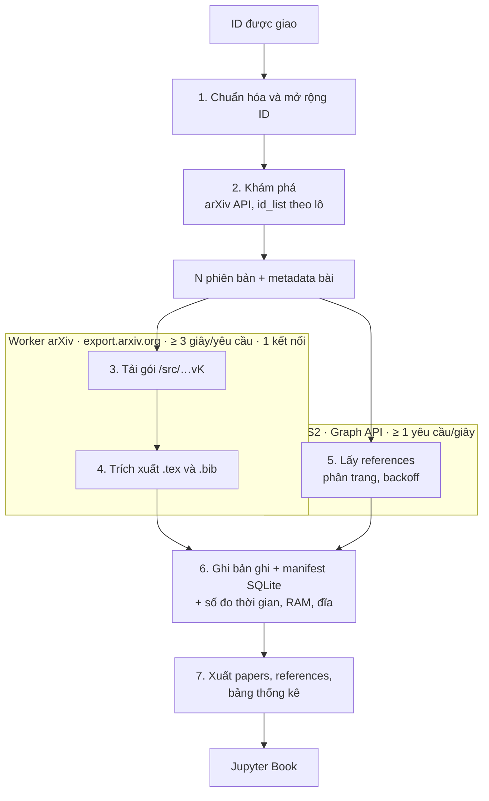

# Kế hoạch triển khai Milestone 1 — Thu thập dữ liệu arXiv

> Nhóm 5 thành viên · Môn Nhập môn Khoa học Dữ liệu · Trạng thái: **Phase 0 đã chốt 18/10; họp 21/10 giao Phase 1 (code + pilot, hạn trưa 25/10); Phase 2 là crawl và nộp (đóng băng sáng 4/11); hạn Moodle cứng 5/11**
> Căn cứ: `arxiv-project-statement-vi.md`, `milestone1-data-crawling-vi.md`. Trạng thái sống: `STATUS.md`.
> **Lịch chạy việc** nằm ở playbook leader (ngoài repo): nộp mục tiêu **chiều 4/11**, crawl bắt đầu **tối 25/10**, hạn Moodle **5/11** là hạn cứng. Thiết kế D1–D5 giữ nguyên. Đã chốt thêm ngày 18/10: hợp đồng `models.py`, lô 50 ID, 5 dải / 25.000 ID, sách Jupyter Book v1. Việc vẫn làm mỏng: pilot 30–50 ID, đo hiệu năng nằm trong pipeline, sách viết trong lúc crawl.

---

## 0. Tóm tắt một trang (để duyệt nhanh)

**Bài toán.** Giảng viên thực hành giao một dải arXiv ID. Với **mỗi bài**, phải lấy **mọi phiên bản** (v1…vN): chỉ giữ file `.tex`/`.bib` (bỏ ảnh và mọi file khác), siêu dữ liệu bài báo, và siêu dữ liệu tài liệu tham khảo từ Semantic Scholar (S2). Không nộp dữ liệu ở M1; dữ liệu là đầu vào cho M2/M3. Nộp: repo mã nguồn chung + Jupyter Book (repo riêng, GitHub Pages) qua Moodle. **Không nhận nộp trễ.**

**Hướng đi đề xuất (5 quyết định cốt lõi):**

| #   | Quyết định                                                                                                                                                             | Lý do ngắn                                                                                                                    |
| --- | ---------------------------------------------------------------------------------------------------------------------------------------------------------------------- | ----------------------------------------------------------------------------------------------------------------------------- |
| D1  | Chỉ dùng **arXiv API (**`id_list`**) + endpoint** `/src/{id}vN` **trên** `export.arxiv.org` **+ S2 Graph API**. Không dùng OAI-PMH, Kaggle, S3 cho luồng chính.        | Đề nói rõ phạm vi là ID được giao, không crawl toàn kho; S3 tốn phí.                                                          |
| D2  | **Pipeline resumable**, trạng thái lưu trong **SQLite manifest** theo từng cặp (bài, phiên bản); `ghi file kiểu "ghi tạm → đổi tên nguyên tử".                         | Crawl bị giới hạn tốc độ nên chạy nhiều giờ; Colab có thể ngắt; cần chạy lại không mất việc, không tải trùng.                 |
| D3  | **Hai worker song song theo host** (arXiv/export và S2), mỗi host có bộ giới hạn tốc độ riêng, tuân thủ ≥ 3 s/yêu cầu (arXiv) và 1 req/s (S2, nên dùng API key).       | Hai host độc lập → tăng hiệu năng mà không vi phạm quy tắc. Không "đua" bằng cách vượt giới hạn (bị chặn IP là hỏng cả nhóm). |
| D4  | **Trích xuất an toàn, giữ nguyên cấu trúc thư mục** của gói nguồn, chỉ giữ `.tex`/`.bib`; nhận diện loại file bằng **magic bytes**, không tin phần mở rộng.            | M2 cần `\input{sections/intro}` còn phân giải được; gói nguồn có thể là tar.gz, file .gz đơn, PDF, docx…                      |
| D5  | **"Lưu thô trước, suy diễn sau"**: lưu nguyên JSON phản hồi arXiv/S2 (nén gz) + bản chuẩn hóa; bảng `papers`/`references` sinh ra từ dữ liệu cục bộ bằng script riêng. | M2/M3 đổi yêu cầu thì không phải crawl lại; kiểm chứng được số liệu báo cáo.                                                  |
| D8  | **Một corpus crawl chung** cho nhóm (và cho cả ba milestone): gom **toàn bộ** ID trong `src/id_ranges.csv` (**25.000**), **một máy crawler** chạy một luồng (manifest resume). Mỗi người vẫn **một dải 5.000 ID** để theo dõi, chạy lại lỗi và **trích dữ liệu riêng lúc nộp Hugging Face (M3)** — không crawl riêng từng dải trên năm Colab. | Khuyến nghị giảng viên: tiết kiệm tài nguyên; tránh crawl trùng; M1/M2 dùng chung kho làm việc.                               |

**Đã chốt 18/10** (chi tiết §11): dải ID là bốn cột trong `src/id_ranges.csv` (5 dải, 25.000 ID); ID không tồn tại là `not_found`; S2 một lần mỗi bài; tỷ lệ tham khảo báo cả ba cách ở §8. **Đã chốt 19/10** (§5): A, B, C viết crawler; D giữ bảng và notebook; E giữ sách. Còn mở, không chặn code: tên B–E, API key S2, bảo vệ nhánh `main`.

---

## 1. Yêu cầu của đề → hệ quả thiết kế

| Yêu cầu trong đề                                                                                                              | Hệ quả                                                                                                                                                    |
| ----------------------------------------------------------------------------------------------------------------------------- | --------------------------------------------------------------------------------------------------------------------------------------------------------- |
| Thu thập **tất cả phiên bản** của mỗi bài                                                                                     | Bước khám phá phải ra được **N (số phiên bản)**: tra `id_list` bằng ID gốc → đọc hậu tố `vN` của bản mới nhất. Tải `v1..vN` riêng lẻ qua `/src/{id}v{k}`. |
| Tải từ mirror `export.arxiv.org`, **không** từ `arxiv.org`; User-Agent mô tả rõ; ≥ 3 s/yêu cầu, 1 kết nối/lần                 | Tầng HTTP dùng chung với rate limiter theo host, UA có email liên hệ, **không** tải song song trên arXiv.                                                 |
| `arxiv.py` 4.x **không còn** `download_`\* và `search.results()`                                                              | Dùng `client.results(search)`; tự tải gói bằng HTTP client. Ghim phiên bản thư viện trong `requirements.txt`.                                             |
| Chỉ giữ `.tex`, `.bib`; bỏ ảnh/file khác **bằng cách trích xuất**, giữ nguyên lệnh `\includegraphics`, `figure`               | Không sửa nội dung file; không dọn nội dung TeX. Chỉ lọc theo phần mở rộng khi trích xuất.                                                                |
| Phiên bản không có TeX (PDF/docx…) → **giữ bản ghi rỗng**, không bỏ qua                                                       | Mỗi (bài, phiên bản) luôn có một bản ghi + trạng thái; không có thư mục thì cũng phải có dòng trong manifest/`meta.json`.                                 |
| Siêu dữ liệu tham khảo qua **S2 API**; giữ **toàn bộ** tham khảo cục bộ, chỉ tham khảo có arXiv ID vào bảng `references` cuối | Lưu đầy đủ; có bước xuất bảng lọc `ref_arxiv_id` không null. ID kiểu cũ (`hep-th/9901001`) phải giữ nguyên.                                               |
| Bảng quy định: `papers`, `references` (cột và kiểu ở đề)                                                                      | Định nghĩa schema ngay từ đầu (§4.3) và kiểm chứng bằng script.                                                                                           |
| Báo cáo: Jupyter Book ở repo riêng, hình/bảng **sinh khi build**                                                              | Book đọc các bảng thống kê nhỏ đã xuất (không đọc corpus thô) và vẽ trong notebook khi compile.                                                           |
| Hiệu năng: thời gian chạy + RAM + đĩa, **đo kiểm chứng được**, môi trường chấm là **Colab chỉ CPU**                           | Gắn công cụ đo vào pipeline ngay từ đầu; chạy đo cuối cùng trên Colab.                                                                                    |
| Repo chỉ chứa mã nguồn (`src/`, `requirements.txt`, `README.md`), **không** chứa dữ liệu                                      | `.gitignore` chặn `data/`; kiểm tra trước khi push.                                                                                                       |

---

## 2. Kiến trúc và quyết định thiết kế

### 2.1 Luồng xử lý

Bảy bước, ba giai đoạn: **chuẩn bị (tuần tự) → thu thập (hai worker song song) → chốt (tuần tự)**. Hai worker không gọi chéo host và không chờ nhau; cả hai gặp lại ở manifest.



| Bước | Giai đoạn        | Việc                                                                                                          | Kết quả                                |
| ---- | ---------------- | ------------------------------------------------------------------------------------------------------------- | -------------------------------------- |
| 1    | Chuẩn bị         | Chuẩn hóa và mở rộng dải ID được giao. ID kiểu cũ giữ nguyên văn.                                             | Danh sách arXiv ID                     |
| 2    | Chuẩn bị         | Khám phá bằng arXiv API: `id_list` theo ID gốc, lô 50. Chung bộ giới hạn tốc độ với bước 3 (cùng host).       | N phiên bản + metadata bài             |
| 3    | Thu thập · arXiv | Tải `/src/{id}vK` cho từng phiên bản `v1..vN` từ `export.arxiv.org`.                                          | Gói thô trên đĩa tạm                   |
| 4    | Thu thập · arXiv | Nhận diện bằng magic bytes; giữ `.tex`/`.bib` đúng cấu trúc thư mục. Không có TeX thì vẫn tạo bản ghi rỗng.  | Thư mục phiên bản, hoặc bản ghi rỗng   |
| 5    | Thu thập · S2    | Lấy toàn bộ references, có phân trang. Một lần mỗi bài, rồi gắn vào từng phiên bản (D6).                      | `references.json`                      |
| 6    | Ghi              | Ghi file tạm rồi đổi tên; chỉ cập nhật manifest sau khi ghi xong. Kèm số đo thời gian, RAM, đĩa.             | Trạng thái từng cặp (bài, phiên bản)   |
| 7    | Xuất             | Xuất `papers`, `references` và bảng thống kê từ dữ liệu cục bộ, không gọi mạng.                               | Đầu vào cho Jupyter Book               |

Bước 3→4 và bước 5 chạy cùng lúc. Bước 7 chạy một lần, sau khi mọi cặp (bài, phiên bản) đã có trạng thái cuối.
### 2.2 Các quyết định chính và đánh đổi

**D1 — Nguồn dữ liệu.** arXiv API cho metadata và số phiên bản; `/src/` cho nguồn; S2 cho tham khảo. OAI-PMH/Kaggle chỉ là "hộp công cụ" theo đề. _Tùy chọn:_ dùng bộ Kaggle để **đối chiếu ngày phiên bản** nếu tải được (không bắt buộc, không nằm trong luồng chính).

**D2 — Resumable + idempotent.**

- Manifest SQLite, mỗi dòng = (arxiv_id, version) với trạng thái: `pending`, `ok`, `ok_no_tex` (gói có nhưng không chứa `.tex/.bib`), `no_source` (PDF/docx/định dạng không phải TeX), `not_found` (404), `corrupt` (gói hỏng), `failed` (hết lần thử lại; tự thử lại ở lần chạy sau).
- Ghi vào thư mục tạm rồi đổi tên nguyên tử; chỉ cập nhật manifest **sau** khi ghi xong → chạy lại an toàn khi bị ngắt giữa chừng.
- Ghi `crawled_at` cho mỗi bản ghi (một bài có thể có phiên bản mới xuất hiện giữa lúc crawl → corpus là một "ảnh chụp" tại thời điểm đó).

**D3 — Giới hạn tốc độ và song song.**

- Mỗi host một `RateLimiter` + `Session` riêng. arXiv chờ ≥ 3 s tính từ lúc **kết thúc** yêu cầu trước. Đây là quy ước làm việc từ 18/10, không đo từ lúc bắt đầu.
- Một kết nối tại một thời điểm cho arXiv (API và `/src/` cùng dùng một limiter — chúng cùng thuộc `export.arxiv.org`).
- S2: **một API key trên máy đang crawl đủ 25.000 ID** (đọc từ biến môi trường, **không commit**; thường là key của B). Mỗi người vẫn có thể xin key riêng cho pilot/dev trên Colab cá nhân. Xử lý `429` bằng backoff mũ + tôn trọng `Retry-After`. Chưa có key lúc 18/10; không có key thì giới hạn thực tế ≈ 100 yêu cầu/5 phút.
- Dùng **thread** (tác vụ I/O, chỉ 2 worker) thay vì asyncio — đơn giản, dễ debug, đủ cho bài toán bị chặn bởi giới hạn tốc độ.
- Tối ưu hợp lệ: gom nhiều ID vào một lần gọi `id_list` khi khám phá; chồng lấn hai host; bỏ qua cặp đã `ok` trong manifest; không giữ cả gói trong RAM (stream xuống đĩa tạm).

**D4 — Trích xuất.**

1. Tải stream xuống file tạm; ghi `Content-Length`/kích thước thực làm `raw_archive_bytes`.
2. Xem **mã HTTP trước**, rồi mới đọc magic bytes (404 là HTML, không phải một loại gói). gzip (`1f 8b`) và có `ustar` → tar; gzip không phải tar → **một file** `.gz` chứa đúng một file TeX; `%PDF` hoặc zip (`PK`, có thể là docx) → `no_source`; gzip hỏng → `corrupt`. Spike 18/10 đã gặp tar.gz có `.tex` + `.eps`, PDF (`2408.01045v1`, nằm trong dải được giao) và 404. Gzip đơn và zip chưa gặp; fixture vẫn dựng giả.
3. Duyệt thành viên tar, **chặn path traversal / symlink / hardlink / file thiết bị**, giới hạn tổng kích thước giải nén (chống zip-bomb), chỉ ghi `.tex` và `.bib` (không phân biệt hoa thường: `.TEX`, `.Bib`).
4. **Giữ cấu trúc thư mục tương đối**; không "làm phẳng" (tránh trùng tên và giữ được `\input`/`\include`).
5. Không đổi mã hóa/ký tự xuống dòng; lưu `sha256` từng file để kiểm chứng.
6. Ghi `raw_uncompressed_bytes` (tổng mọi thành viên) và `kept_bytes` (tổng `.tex`+`.bib`) — để so sánh "trước/sau khi bỏ ảnh" một cách công bằng (nén vs. không nén), báo cáo cả hai.

**D5 — Siêu dữ liệu bài báo.** `title`, `authors`, `submission_date` (ngày v1), `revised_dates` (ngày các phiên bản sau), `venue` (nullable). `venue` lấy từ `journal_ref` của arXiv, nếu rỗng thì dùng `venue` của S2, nếu vẫn rỗng thì `null`. Cách lấy ngày, chốt 18/10 theo đề và API manual (chưa gọi API; đối chiếu 10 ID thật là việc T2.1): một lần `id_list` trên **ID gốc**, lô **50**, hậu tố `vN` của bản mới nhất là số phiên bản; `published` là ngày v1; `updated` của lần gọi gốc chỉ là ngày bản mới nhất. Bài có từ 2 phiên bản thì gọi thêm `idvK` để lấy ngày từng bản. ID được hỏi mà không có trong kết quả, sau một lần gọi riêng vẫn không có, ghi `not_found`. Lỗi mạng sau khi hết lần thử ghi `failed`.

**D6 — Tham khảo từ S2 và "cho từng phiên bản".** Đề nói sự khác biệt giữa các phiên bản có thể không được phân biệt. Chốt 18/10: gọi S2 **một lần cho mỗi bài** (ID gốc), lưu bản thô ở mức bài và ghi `references.json` vào từng thư mục phiên bản (`s2_scope: "paper"`). Không gọi theo `vN`.

- Trường lấy: `paperId`, `title`, `authors`, `year`, `publicationDate`, `externalIds.ArXiv`. Ngày tham khảo dùng `publicationDate`; không có thì lưu năm dạng `YYYY`, không bịa ngày-tháng.
- Không tin mảng `references` nhúng trong một phản hồi là đủ. Luôn lấy tiếp bằng `.../references` với `offset` và `limit` cho đến trang ngắn.
- Khi xuất bảng `references`, `arxiv_id` của bài trích dẫn lấy từ thư mục bài. Một cặp trích dẫn chỉ một dòng, không nhân theo số phiên bản.

**D7 — Quy ước đặt tên.** `2310.12345` → thư mục `2310-12345`; ID kiểu cũ `hep-th/9901001` → `hep-th-9901001`. **ID gốc luôn được lưu nguyên văn** trong metadata (không suy ngược từ tên thư mục).

**D8 — Vận hành crawl (M1 → M3).** Khuyến nghị giảng viên: trong suốt đồ án **có thể chạy chung**, không bắt mỗi thành viên crawl riêng dải ID của mình.

1. **Gom ID:** `ids.load_ranges("src/id_ranges.csv")` mở rộng **cả 5 dải** → một hàng đợi **25.000** ID (không chồng). File CSV vẫn giữ 5 dòng để gán trách nhiệm và lọc sau này.
2. **Một máy crawl đủ:** Sau go/no-go, **một** môi trường ổn định (ưu tiên máy local / VM có đủ đĩa; Colab nếu session đủ dài) chạy:

   `python src/run_crawl.py --ranges src/id_ranges.csv --data-dir data`

   Pipeline resumable: ngắt giữa chừng thì chạy lại **cùng lệnh** trên **cùng** `data/` (hoặc copy `data/` + manifest đã sao lưu). Không khởi chạy song song hai máy cùng manifest.
3. **Vai khi crawl:** **A** vận hành máy chính, sao lưu định kỳ `data/` (và `manifest.sqlite`) ra Drive dùng chung. **B–E** không bật crawl full trên Colab riêng; theo dõi tiến độ, viết sách/README, và **T4.2** chạy lại `failed` **trong dải được giao** (có thể trên máy chính hoặc pilot nhỏ `--limit`).
4. **Báo cáo M1:** Thống kê và hiệu năng trên **toàn bộ 25.000 ID** (một lần đo end-to-end). Sách có thể thêm bảng phụ theo từng dải nếu cần so sánh nội bộ.
5. **M2/M3:** Parse và đối sánh trên **cùng** thư mục `data/` — không crawl lại trừ khi bổ sung ID mới (nếu đề mở rộng phạm vi).
6. **Hugging Face (cuối M3):** Xuất/upload **subset** theo dải từng thành viên (lọc `papers`/`references` và thư mục `data/papers/` theo danh sách ID trong dải đó). Corpus đầy đủ vẫn giữ nội bộ cho nhóm.

**Dự phòng (chỉ khi máy chính không kịp):** Chia **phần còn lại** của hàng đợi (theo manifest `pending`/`failed`) cho tối đa một máy phụ, vẫn **một manifest** do A ghép — không quay lại mô hình “5 Colab × 5.000 ID” mặc định.

---

## 3. Công nghệ đề xuất

| Mảng         | Lựa chọn                                                                                          | Ghi chú                                           |
| ------------ | ------------------------------------------------------------------------------------------------- | ------------------------------------------------- |
| Ngôn ngữ     | Python (chạy được trên Colab hiện tại; chốt phiên bản trong README)                               | Đề dùng Python.                                   |
| arXiv        | `arxiv` 4.x (ghim phiên bản)                                                                      | Chỉ dùng `Client().results(Search(...))`.         |
| HTTP         | `requests` + `urllib3.Retry`, limiter tự viết                                                     | Tầng dùng chung `http.py`.                        |
| Nén/tar/zip  | thư viện chuẩn (`tarfile`, `gzip`, `zipfile`)                                                     | Nhận diện bằng magic bytes tự viết, ít phụ thuộc. |
| Trạng thái   | `sqlite3` (thư viện chuẩn)                                                                        | Một file, truy vấn thống kê dễ.                   |
| Dữ liệu      | `pandas` + `pyarrow` (Parquet)                                                                    | Khớp định dạng bộ dữ liệu cuối ở M3.              |
| Schema       | `dataclasses` trong `models.py` (đã khóa 18/10)                                                     | `SCHEMA_VERSION` = 1. Đổi trường bằng PR riêng.                 |
| Đo hiệu năng | `psutil` (lấy mẫu RSS định kỳ, gồm tiến trình con), `time.perf_counter`, `du`, `/usr/bin/time -v` | Đề cho phép các công cụ này.                      |
| Kiểm thử     | `pytest`, `responses` (giả lập HTTP)                                                              | Không gọi mạng thật trong unit test.              |
| Chất lượng   | `ruff` (lint+format), `pre-commit`                                                                | Tiêu chí "mã sạch, dễ đọc".                       |
| Báo cáo      | Jupyter Book v1 + `matplotlib`/`plotly` + GitHub Actions → GitHub Pages                              | Bố cục `_config.yml` / `_toc.yml`. Cài không được thì E ghi bản đã đổi.      |
| Chạy chấm    | Notebook runner trên Colab (CPU)                                                                  | Khóa API qua Colab Secrets.                       |

---

## 4. Cấu trúc dự án

### 4.1 Repo mã nguồn (công khai, dùng chung cả 3 milestone)

> Đề yêu cầu repo **chỉ chứa mã**; test là file `.py` nên được phép, đặt trong `src/` để bám sát cây thư mục đề nêu.

```
<group-repo>/
├── src/
│   ├── crawler/                 # package của Milestone 1
│   │   ├── models.py            # hợp đồng dữ liệu, khóa 18/10
│   │   ├── config.py            # tham số: UA, độ trễ, đường dẫn, API key (env)
│   │   ├── http.py              # Session + RateLimiter theo host + retry/backoff
│   │   ├── ids.py               # chuẩn hóa/mở rộng ID, ánh xạ ID ↔ tên thư mục
│   │   ├── discovery.py         # arXiv API: metadata + danh sách phiên bản
│   │   ├── source.py            # tải /src/, nhận diện loại, trích xuất .tex/.bib an toàn
│   │   ├── s2.py                # Semantic Scholar: references (phân trang, 429)
│   │   ├── manifest.py          # SQLite: trạng thái, số đo, resume
│   │   ├── pipeline.py          # điều phối 2 worker, resume, ghi nguyên tử
│   │   ├── metrics.py           # thời gian, RAM, đĩa
│   │   └── export.py            # xuất papers/references/bảng thống kê (Parquet)
│   ├── corpus.py                # API ĐỌC corpus dùng cho M2/M3 (xem §9)
│   ├── run_crawl.py             # điểm vào dòng lệnh
│   ├── colab_run.ipynb          # runner cho Colab
│   ├── validate_corpus.py       # kiểm tra bất biến sau khi crawl
│   ├── id_ranges.csv            # 5 dải được giao, 25.000 ID
│   ├── id_ranges.example.csv    # một dòng mẫu định dạng
│   ├── tests/                   # pytest + fixture tổng hợp
│   └── requirements.txt
├── .gitignore                   # chặn data/, *.tar.gz, *.parquet, .env ...
└── README.md                    # cài môi trường + chạy với các cấu hình cụ thể
```

### 4.2 Repo báo cáo (công khai, **riêng**, GitHub Pages)

```
<book-repo>/
├── _config.yml  _toc.yml  requirements.txt
├── m1/                  # phần 1 của sách (M2 sẽ thêm m2/)
│   ├── 01_overview.md           # mục tiêu, kiến trúc, công cụ/thư viện
│   ├── 02_implementation.md     # cách thu thập: khám phá, tải, trích xuất, S2
│   ├── 03_data_statistics.ipynb # thống kê + biểu đồ sinh khi build
│   ├── 04_performance.ipynb     # thời gian, RAM, đĩa
│   └── 05_issues_lessons.md
├── stats/               # bảng thống kê NHỎ do crawler xuất (commit được)
└── .github/workflows/   # build + deploy Pages
```

### 4.3 Bố cục dữ liệu làm việc (KHÔNG commit)

```
data/
├── papers/
│   └── 2310-12345/
│       ├── paper.json            # metadata bài (thô + chuẩn hóa), ID gốc nguyên văn
│       ├── s2_references.raw.json.gz
│       ├── v1/
│       │   ├── meta.json         # ngày, trạng thái, kích thước trước/sau, sha256, thời gian
│       │   ├── references.json   # toàn bộ tham khảo đã crawl (s2_scope: "paper")
│       │   └── tex/ ...          # .tex/.bib giữ cấu trúc tương đối
│       └── v2/ ...
├── manifest.sqlite
└── logs/
```

**Schema bảng xuất (theo đề):**

- `papers`: `arxiv_id` (string, not null), `title`, `authors` (list[string]), `submission_date` (ISO string), `revised_dates` (list[string]), `venue` (string, nullable).
- `references`: `arxiv_id` (bài trích dẫn, not null), `ref_arxiv_id` (not null), `ref_title`, `ref_authors` (list[string]), `ref_submission_date`, `ref_s2_id`. **Một dòng cho mỗi cặp trích dẫn–được trích dẫn**; chỉ tham khảo có arXiv ID mới vào bảng này, bản đầy đủ vẫn ở `references.json`.

---

## 5. Phân công và thứ tự triển khai (5 thành viên)

**Vai trò** (chốt 19/10; họp 21/10 điền tên B–E). **A, B, C viết crawler. D giữ số liệu. E giữ sách.** Mỗi người **một dải 5.000 ID** (trách nhiệm theo dõi, chạy lại lỗi, trích subset M3) — **không** crawl riêng dải đó trên Colab cá nhân ở Phase 2 (D8). D và E vẫn mỗi người một commit và viết sao cho nói được cả luồng thu thập.

- **A** leader — `http`, `manifest`, `pipeline`, `metrics`.
- **B** — `ids`, `discovery`, `s2`. Hai client JSON cùng một người.
- **C** — fixture và `source`.
- **D** — `export`, `corpus`, notebook thống kê. D gửi link trang xin key, không gửi giá trị key.
- **E** — Jupyter Book và `validate_corpus`.

`s2.py` thuộc B. Test giả của `s2` hạn sáng 24/10, sau `discovery` (hết 23/10). Năm bài thật vẫn trước trưa 25/10. B xin key của B. `s2` trễ quá sáng 24/10 thì A ghép `discovery` và `source` rồi pair với B trong ngày 24/10. Không chuyển `s2` sang D.

### Phase 0 — đã chốt 18/10

Hợp đồng là `src/crawler/models.py`, không viết tài liệu hợp đồng riêng. Họp 21/10 thông báo, không làm lại spike.

| Mã   | Việc gốc                                                                                                                             | Kết quả 18/10                                                                                          |
| ---- | ------------------------------------------------------------------------------------------------------------------------------------ | ------------------------------------------------------------------------------------------------------ |
| T0.1 | Hợp đồng dữ liệu: schema, trạng thái, bố cục thư mục                                                                                 | Khóa `models.py`. Không đổi trường                                                                     |
| T0.2 | Hành vi `id_list`, cỡ lô, ID không tồn tại                                                                                           | Lô 50; ngày theo D5. Chưa gọi API; 10 ID thật là T2.1                                                  |
| T0.3 | Loại gói `/src/`                                                                                                                     | Đã gặp tar.gz, PDF trong dải, 404. Gzip đơn và zip chưa gặp. Chi tiết ở `STATUS.md`                   |
| T0.4 | S2: phiên bản, ID cũ, phân trang, ngày, API key                                                                                      | Một lần mỗi bài; phân trang bắt buộc. **Key chưa có.** B xin trong Phase 1; D gửi link trang đăng ký   |
| T0.5 | Các câu §11                                                                                                                          | Dùng phương án ở §11. Chưa hỏi giảng viên, không chặn code                                             |
| T0.6 | Repo, lint, quy ước PR                                                                                                               | Khung đã ở `main`. Thêm `CONTRIBUTING.md`. Còn mời người, bảo vệ `main`, xác nhận Actions. Sách là T1.4 |
| T0.7 | File dải ID                                                                                                                          | `src/id_ranges.csv`: 5 dải × 5.000 = 25.000 ID. Mỗi người một dải (gán trách nhiệm), crawl **một lần** trên một máy với **cả file** (D8) |

Hai lần giao việc còn lại. Mã task (T1.1, T2.1, …) giữ nguyên trong docstring. Ngày ghi trong cột **Mốc** là thứ tự bên trong phase, không phải một phiếu giao mới.

### Phase 1 — Code và pilot (giao họp 21/10, hạn trưa 25/10)

Một phiếu cho cả nền tảng, module nghiệp vụ, tích hợp và pilot. Hạn phase là **trưa 25/10** (go/no-go). Ai xong mốc của mình sớm thì làm tiếp task sau trong cùng phase.

B và C làm module bằng test giả, không đợi `http.py`. B làm `s2` sau `discovery` của chính B, cũng bằng test giả. D xuất bảng và E kiểm tra kho trên thư mục mẫu mỗi người tự tạo, không đợi crawl và không đợi nhau. Hai chỗ phải đợi: A ghép `pipeline.py` sau khi PR `discovery` (B), `source` (C) và `s2` (B) xanh; pilot sáng 25/10 đợi pipeline chạy lại được. Phiếu chi tiết nằm ngoài repo, `Leader/phase1-phan-cong-vi.md`.

| Mã   | Việc                                                                                                                  | PT                | Mốc        | Xong khi                                                       |
| ---- | --------------------------------------------------------------------------------------------------------------------- | ----------------- | ---------- | -------------------------------------------------------------- |
| T1.1 | `http.py`: Session, UA, RateLimiter theo host, retry/backoff, ghi nhật ký mọi yêu cầu                                 | A                 | hết 22/10  | Test với đồng hồ giả chứng minh khoảng cách ≥ 3 s              |
| T1.2 | `manifest.py` + `config.py` + ghi nguyên tử                                                                           | A                 | hết 22/10  | Test: ngắt giữa chừng → chạy lại không tải trùng, không để rác |
| T1.3 | `ids.py`: chuẩn hóa ID, mở rộng dải (4 số trước 2015, 5 số từ 2015), ánh xạ thư mục, đọc `id_ranges.csv`              | B                 | hết 22/10  | Dải mẫu ra 5.000 ID `2408.11045`…`2408.16044`; `1045` tháng 8 ra `2408.01045` |
| T1.4 | Khung Jupyter Book v1 + CI build/deploy Pages (nội dung giả)                                                          | E                 | hết 22/10  | Trang Pages công khai build thành công                         |
| T1.5 | Bộ **fixture tổng hợp** (tar.gz có tex+png+bib, `.gz` đơn, PDF, zip, gzip hỏng, tar có `../`, tên trùng, đuôi in hoa) | C                 | hết 22/10  | Dùng được trong test của mọi module                            |
| T2.1 | `discovery.py`: gọi theo lô, lấy metadata, N phiên bản, ngày từng phiên bản, `venue`                                  | B                 | hết 23/10  | Với 10 ID mẫu: đúng N và ngày so với trang arXiv               |
| T2.2 | `source.py`: tải stream → nhận diện → trích xuất an toàn → số đo kích thước/sha256 → bản ghi rỗng cho phiên bản không có TeX | C          | hết 23/10  | Toàn bộ fixture qua test; không bao giờ ghi file ngoài thư mục đích |
| T2.3 | `s2.py`: lấy references, phân trang, 429/backoff, ánh xạ trường, giữ ID gốc kiểu cũ                                   | B                 | sáng 24/10 | Test giả sáng 24/10; 5 bài thật trước trưa 25/10               |
| T2.4 | `metrics.py`: bộ lấy mẫu RAM (RSS tổng gồm tiến trình con), thời gian theo giai đoạn, kích thước đĩa                  | A                 | hết 24/10  | Số đo ghi vào manifest/log, đối chiếu thử với `/usr/bin/time -v` |
| T2.5 | Notebook thống kê **dựng sẵn trên dữ liệu pilot/giả** (mọi số liệu đề yêu cầu, §8)                                    | D                 | trưa 25/10 | Notebook ra đủ số §8 từ file mẫu, ghi “số mẫu”. E nhúng vào sách |
| T3.1 | `pipeline.py`: 2 worker, hàng đợi, resume, xử lý lỗi từng cặp mà không dừng cả lô                                     | A (+B, C hỗ trợ)  | hết 24/10  | Chạy end-to-end 10–20 ID thật                                  |
| T3.2 | `export.py` + `corpus.py` + `validate_corpus.py`                                                                      | D + E             | hết 24/10  | Bảng `papers`/`references` đúng schema; validate PASS          |
| T3.3 | **Pilot 30–50 ID trên Colab**: đo thời gian/RAM/đĩa, **nhân ra giờ crawl đủ 25.000 ID trên một máy**, soát lỗi lạ   | A + cả nhóm       | trưa 25/10 | Có ước lượng giờ/RAM/đĩa cho **một** máy trước khi bật crawl tối 25/10 |
| T3.4 | Review chéo mã (mỗi module do người **khác** review), dọn lint                                                        | Cả nhóm           | trưa 25/10 | Không còn cảnh báo lint; README thử chạy lại từ máy sạch       |

### Phase 2 — Crawl, sách và nộp (giao sau go/no-go trưa 25/10; đóng băng sáng 4/11; nộp chiều 4/11)

Một phiếu cho crawl đủ, chạy lại lỗi, số liệu, sách và nộp. Hạn phase là **sáng 4/11** (đóng băng). Hạn Moodle cứng vẫn là **5/11**.

| Mã   | Việc                                                                                            | PT                | Mốc        | Xong khi                                             |
| ---- | ----------------------------------------------------------------------------------------------- | ----------------- | ---------- | ---------------------------------------------------- |
| T4.1 | **Một máy** crawl **25.000 ID** (`--ranges src/id_ranges.csv`); A vận hành; sao lưu `data/` + manifest ra Drive dùng chung; B–E theo dõi + viết sách | A (vận hành); cả nhóm (sao lưu/theo dõi) | 29/10 | Mọi cặp (bài, phiên bản) đã khám phá có trạng thái cuối trên corpus chung |
| T4.2 | Chạy lại các cặp `failed` — **owner theo dải** (B: arXiv/S2 trong dải B; C: gói nguồn; …); chạy trên máy chính hoặc pilot có `--limit` | Owner từng dải + A | 1/11 | Danh sách thất bại còn lại kèm lý do, không retry vô hạn |
| T4.3 | `validate_corpus.py` toàn bộ + kiểm tra mẫu thủ công ≥ 20 phiên bản với trang arXiv             | E                 | 1/11       | Báo cáo kiểm chứng                                   |
| T4.4 | Xuất bảng thống kê → commit vào `stats/` của repo sách                                          | D                 | 1/11       | File thống kê khớp manifest                          |
| T5.1 | Hoàn thiện báo cáo Jupyter Book (mô tả cách thu thập, công cụ, thống kê, hiệu năng, hạn chế). Viết nháp trong lúc crawl. D và E viết sao cho nói được cả luồng | E ghép; D viết số; A/B/C một đoạn module | 3/11 | Pages build sạch; hình/bảng sinh lúc build |
| T5.2 | Hoàn thiện `README.md`; thử chạy lại hướng dẫn từ đầu trên Colab mới                            | A                 | 3/11       | Người khác làm theo được trên Colab mới              |
| T5.3 | Đóng băng: checklist §10; không dữ liệu/khóa; gỡ file làm việc nếu đề không cho giữ             | Cả nhóm           | sáng 4/11  | Checklist §10 đọc xong                               |
| T5.4 | Dán 2 liên kết (repo mã + Jupyter Book) lên Moodle                                              | A                 | chiều 4/11 | Cả nhóm thấy bài nộp. Trượt thì nộp lại trong ngày 5/11 |

**Đường găng:** họp 21/10 giao **cả Phase 1** (điền tên và dải) → mốc 22/10 `http.py` + `ids.py` + fixture → mốc 23/10 `discovery` và `source` → sáng 24/10 `s2` (B) rồi pipeline trong ngày 24/10 → trưa 25/10 pilot 30–50 ID rồi giao **Phase 2**, **tối 25/10 bật crawl đủ trên một máy** → 1/11 số liệu → đóng băng sáng 4/11, nộp chiều 4/11 (hạn cứng 5/11). Crawl là đoạn dài nhất và không nén được dưới giới hạn 3 giây. Đường găng code đi qua A và qua B.

**Ước lượng, chưa đo tường** (thay bằng số pilot): P = 25.000, lô = 50. arXiv ≈ 3 s × (P/50 + P·V̄), một kết nối, chưa cộng thời gian tải. V̄ = 2 thì **một máy** khoảng **42 giờ chờ** (+ tải/trích xuất) — đây là kịch bản mặc định (D8). S2 trên cùng máy: ~25.000 yêu cầu × 1 s ≈ **7 giờ** (chồng với arXiv qua hai worker). Pilot sáng 25/10 quyết định máy chính (local vs Colab) và lịch sao lưu.

---

## 6. Rủi ro và cạm bẫy

| Rủi ro                                                                                          | Cách phòng                                                                                                                          |
| ----------------------------------------------------------------------------------------------- | ----------------------------------------------------------------------------------------------------------------------------------- |
| **Bị chặn 403/429** do tải sai host hoặc quá nhanh                                              | Chỉ dùng `export.arxiv.org`; UA rõ ràng; limiter bảo thủ; dừng và backoff khi gặp 403/429 thay vì thử dồn dập.                      |
| `/src/` trả về **không phải tar.gz** (`.gz` đơn, PDF, docx)                                     | Xem mã HTTP trước magic bytes. PDF/docx → `no_source`, vẫn có bản ghi. `2408.01045v1` trong dải được giao đã trả PDF.                                                  |
| Gói chứa `.tex` ở **thư mục con** hoặc tên trùng                                                | Giữ cấu trúc tương đối, không làm phẳng.                                                                                            |
| Tar độc hại (`../`, symlink, zip-bomb)                                                          | Kiểm tra từng thành viên; giới hạn kích thước; từ chối thành viên nguy hiểm và ghi nhật ký.                                         |
| ID **kiểu cũ** (`hep-th/9901001`) làm hỏng đường dẫn/URL                                        | Ánh xạ thư mục riêng; lưu ID gốc; test riêng.                                                                                       |
| **Dải ID** có "lỗ" (ID không tồn tại), độ rộng số khác nhau (4 chữ số trước 2015, 5 chữ số sau) | Mở rộng đúng độ rộng (5 số từ 2015: `1045` tháng 8 thành `2408.01045`). ID không có sau một lần gọi riêng → `not_found`, tách khỏi `failed`.    |
| Phiên bản mới xuất hiện **trong lúc crawl**                                                     | Lưu `crawled_at`; kiểm tra thêm `v(N+1)` ở bước kiểm chứng.                                                                         |
| S2 **chưa lập chỉ mục** bài mới (trễ 1–7 ngày), thiếu dữ liệu, tham khảo thiếu arXiv ID         | Ghi nhận như trạng thái hợp lệ, không retry vô hạn; đối chiếu `.bib` ở M2; báo cáo tỷ lệ.                                           |
| S2 **429** / giới hạn 100 req/5 phút khi không có key                                           | Mỗi Colab một key (chưa xin lúc 18/10). Backoff theo `Retry-After`. Key chỉ ở biến môi trường hoặc Colab Secrets.                                     |
| Phản hồi references bị **cắt** do bài có rất nhiều tham khảo                                    | Luôn gọi `.../references` với `offset`/`limit` đến trang ngắn. Không coi một mảng nhúng là đủ.                                                                                       |
| **Colab ngắt kết nối / đĩa tạm** mất dữ liệu                                                    | Ưu tiên **một máy ổn định** (local/VM). Resume qua manifest trên cùng `data/`; sao lưu định kỳ ra Drive. Máy chết: khôi phục backup rồi tiếp tục — không mặc định tách 5 Colab. Chạy một lần đo "sạch" cho số liệu hiệu năng. |
| Số đo hiệu năng **sai lệch** (resume nhiều lần, chạy trên máy khác Colab)                       | Ghi thời gian hoạt động tích lũy theo giai đoạn; số liệu nộp lấy từ chạy trên Colab CPU; nêu rõ nếu có resume.                      |
| Lỡ **commit dữ liệu/khóa API** vào repo                                                         | `.gitignore`, `pre-commit` chặn file lớn/khóa, kiểm tra ở T5.3.                                                                     |
| Hình/bảng trong sách là **ảnh tĩnh**                                                            | Mọi hình vẽ từ notebook khi build; kiểm tra bằng build sạch trong CI.                                                               |
| Nộp trễ (không được chấp nhận)                                                                  | Đóng băng sáng 4/11, nộp mục tiêu chiều 4/11, hạn cứng 5/11. Người dán Moodle có người dự phòng, không phải A.                                                   |
| B ôm `discovery` lẫn `s2`; `s2` xong sáng 24/10                                                 | Trễ thì A pair với B trong ngày 24/10. Không chuyển `s2` sang D.                                                                    |

---

## 7. Chiến lược kiểm thử và xác thực

**Nguyên tắc:** unit test **không gọi mạng thật** (dùng `responses` + fixture); chỉ smoke/pilot mới gọi mạng thật, với số lượng nhỏ và đúng giới hạn tốc độ.

1. **Unit test theo module**
   - `ids`: ID mới/cũ/có `vN`, mở rộng dải, ánh xạ thư mục hai chiều.
   - `http`: khoảng cách giữa các yêu cầu ≥ ngưỡng (đồng hồ giả), retry/backoff, tôn trọng `Retry-After`.
   - `source`: toàn bộ fixture ở T1.5; khẳng định **chỉ** `.tex/.bib` được ghi, cấu trúc thư mục giữ nguyên, nội dung từng byte giống bản gốc, không có thành viên nào ghi ra ngoài thư mục đích.
   - `s2`: phân trang, 429, bài không có references, tham khảo thiếu trường/thiếu arXiv ID, ID kiểu cũ.
   - `manifest/pipeline`: ngắt giữa chừng rồi chạy lại cho cùng kết quả (idempotent); một cặp lỗi không làm dừng cả lô.
2. **Smoke test (mạng thật, 10–20 ID)** bao gồm: bài 1 phiên bản; bài ≥ 4 phiên bản; ID kiểu cũ; bài chỉ có PDF; bài ít/không có references trên S2; bài bị rút lại; ID không tồn tại.
3. **Bất biến sau crawl (**`validate_corpus.py`**)**
   - Mọi phiên bản `1..N` đều có bản ghi (không thiếu phiên bản giữa chừng).
   - Không có file nào ngoài `.tex/.bib` (và file metadata) trong thư mục dữ liệu.
   - `kept_bytes` ≤ `raw_uncompressed_bytes`; `sha256` khớp lại file trên đĩa.
   - `papers`/`references` đúng kiểu cột và không null ở cột bắt buộc; `references` chỉ chứa dòng có `ref_arxiv_id`.
   - Số `ok + ok_no_tex + no_source + not_found + failed` = tổng cặp (bài, phiên bản) đã khám phá.
4. **Kiểm chứng độc lập:** lấy mẫu ≥ 20 phiên bản và so với trang arXiv (số phiên bản, ngày, tiêu đề, tác giả); so tổng số tham khảo với trang S2 của vài bài.
5. **Tái lập:** người **không** viết README làm theo README trên một Colab mới và chạy ra kết quả giống nhau trên tập mẫu.
6. **Kiểm tra báo cáo:** build sách sạch trong CI từ đầu; không có ảnh chụp màn hình; số liệu trong sách khớp `stats/` và manifest.

---

## 8. Đo hiệu năng và thống kê cho báo cáo

**Thống kê dữ liệu (đề yêu cầu):**

- Số bài thu thập thành công; tỷ lệ thành công chung (nêu **định nghĩa** rõ: phân biệt `ok`, `ok_no_tex/no_source` — hợp lệ nhưng không có TeX, `not_found`, `failed`).
- Kích thước trung bình của bài (byte) **trước** và **sau** khi bỏ ảnh (báo cả dạng nén và dạng đã giải nén).
- Số tham khảo trung bình mỗi bài; tỷ lệ thành công trung bình khi lấy siêu dữ liệu tham khảo (đã chốt 18/10, báo cả ba: (a) % bài lấy được dữ liệu từ S2; (b) trung bình theo bài của % tham khảo có đủ tiêu đề/tác giả/năm; (c) % tham khảo có arXiv ID).
- Phân phối số phiên bản/bài, tỷ lệ phiên bản không có TeX, phân phối kích thước, các nguyên nhân thất bại.

**Hiệu năng (đo kiểm chứng được, trên Colab CPU):**

- **Thời gian (wall time end-to-end):** tổng thời gian khám phá; tổng thời gian xử lý mỗi bài; trung bình mỗi bài; tách theo giai đoạn (khám phá / tải / trích xuất / S2).
- **RAM:** đỉnh (lấy mẫu RSS định kỳ + đối chiếu `/usr/bin/time -v`) và trung bình (từ mẫu định kỳ); tính **tổng** cho toàn hệ thống nếu nhiều tiến trình.
- **Đĩa:** đỉnh trong lúc chạy (lấy mẫu `du`, tính cả file tạm), và dung lượng đầu ra cuối cùng.
- Ghi rõ cấu hình Colab (CPU, RAM, đĩa) và ngày chạy.

---

## 9. Chuẩn bị cho Milestone 2

M2 sẽ phân tích cú pháp từng phiên bản thành cây phân cấp và chuyển `\bibitem` sang BibTeX. Vì vậy M1 cần để lại:

- **Bố cục ổn định, có version hóa schema** (`schema_version` trong `meta.json`) để M2 không phải đoán.
- **Cấu trúc thư mục TeX nguyên vẹn** (D4) → phân giải `\input/\include`; `.bib` được giữ riêng.
- `src/corpus.py`: API đọc duy nhất (duyệt bài, duyệt phiên bản, đọc file TeX/bib, đọc metadata/references). M2/M3 gọi qua đây, **không** tự dựng đường dẫn.
- **Manifest** là nguồn sự thật về trạng thái → M2 biết phiên bản nào "bản ghi rỗng".
- **Dữ liệu thô S2/arXiv** được giữ lại → có thể đối chiếu `.bib`/`\bibitem` với S2 mà không crawl lại.
- **Corpus chung (D8):** M2/M3 đọc cùng `data/` sau một lần crawl M1. **Cuối M3:** script xuất subset theo dải từng thành viên cho Hugging Face (lọc theo ID trong `id_ranges.csv`).
- Quy ước: mỗi milestone thêm package riêng trong `src/` (vd. `src/parsing/`) và commit tích lũy vào cùng repo; báo cáo M2 thêm `m2/` vào cùng Jupyter Book.

---

## 10. Sản phẩm bàn giao và checklist

**Sản phẩm nộp qua Moodle (theo nhóm, trước hạn):**

1. Liên kết **repo mã nguồn** công khai (dùng chung cả dự án).
2. Liên kết **Jupyter Book** (GitHub Pages của repo sách riêng).

**Không nộp dữ liệu ở M1** (giữ nội bộ cho M2/M3).

### Checklist đối chiếu đề

**Thu thập & khám phá**

- [ ] Đã xử lý đúng dải ID được giao; ID không tồn tại có trạng thái rõ ràng.
- [ ] Mỗi bài: đã lấy **mọi phiên bản** `v1..vN` (N lấy từ hậu tố của bản mới nhất).
- [ ] Tải từ `export.arxiv.org/src/{id}vN` (không từ `arxiv.org`); UA mô tả rõ; ≥ 3 s giữa các lần gọi; một kết nối/lần.
- [ ] Chỉ dùng `client.results(search)` của `arxiv.py` 4.x; không dùng API đã bị loại bỏ.
- [ ] Chỉ giữ `.tex` và `.bib`; **không** có ảnh/file khác; lệnh `\includegraphics`, `figure` còn nguyên.
- [ ] Phiên bản không có TeX → **bản ghi rỗng**, không bị bỏ qua.
- [ ] Siêu dữ liệu bài: tiêu đề, tác giả, ngày nộp, ngày chỉnh sửa, venue (nếu có).
- [ ] Siêu dữ liệu tham khảo từ S2: tiêu đề, tác giả, ngày, arXiv ID (nếu có), S2 ID; **giữ toàn bộ** tham khảo cục bộ; ID kiểu cũ giữ nguyên.
- [ ] S2: tôn trọng giới hạn (1 req/s), xử lý 429.

**Dữ liệu**

- [ ] Bố cục theo quy ước gợi ý (thư mục/bài, tex+bib mọi phiên bản, metadata + references từng phiên bản).
- [ ] Bảng `papers` và `references` xuất được đúng schema đề (kiểu, not null).
- [ ] `validate_corpus.py` PASS; mẫu thủ công ≥ 20 phiên bản khớp arXiv.

**Mã nguồn / repo**

- [ ] Repo công khai, **chỉ có mã** (`src/`, `requirements.txt`, `README.md`); không dữ liệu/khóa API/file biên dịch. Trước khi nộp, gỡ `STATUS.md`, `AGENTS.md`, `CONTRIBUTING.md`, `plans/` và `project requirements/` nếu giảng viên không cho giữ.
- [ ] Lịch sử commit thể hiện đóng góp của cả 5 thành viên, theo thời gian.
- [ ] `README.md`: phiên bản Python, cài đặt (`pip`), cách chạy với cấu hình cụ thể (gồm cách chạy trên Colab và cách đặt API key).
- [ ] Mã có chú thích rõ ràng, qua lint, test PASS; trích dẫn nguồn tham khảo nếu dùng mã/tài liệu ngoài.

**Báo cáo (Jupyter Book)**

- [ ] Repo riêng, công khai, đã deploy GitHub Pages; M1 là phần đầu của sách.
- [ ] Mô tả cách thu thập, công cụ/thư viện đã dùng.
- [ ] Đủ thống kê: số bài thành công, tỷ lệ thành công, kích thước trung bình trước/sau bỏ ảnh, số tham khảo trung bình/bài, tỷ lệ thành công crawl tham khảo.
- [ ] Đủ hiệu năng: thời gian (tổng/bài/khám phá), RAM (đỉnh/trung bình), đĩa (đỉnh/đầu ra), đo kiểm chứng được trên Colab CPU.
- [ ] Mọi hình/bảng **sinh khi build sách** (không ảnh chụp tĩnh).

**Quy chế**

- [ ] Trích dẫn đầy đủ mọi tài liệu tham khảo; bài làm là của nhóm (vi phạm trung thực → 0 điểm).
- [ ] Nộp đúng hạn (không nhận nộp trễ).

### Ánh xạ tiêu chí chấm điểm → phần kế hoạch

| Tiêu chí                   | Phần liên quan                        |
| -------------------------- | ------------------------------------- |
| Báo cáo (Jupyter Book)     | §4.2, §8, T1.4/T2.5/T5.1              |
| Mã nguồn                   | §3 (ruff, pre-commit), §4.1, §7, T3.4 |
| Khám phá & Thu thập        | D1–D4, T2.1–T2.3, §6                  |
| Dữ liệu thu được           | D4–D7, §4.3, §7 (validate), T4.1–T4.3 |
| Hiệu năng so với nhóm khác | D3, §8, T2.4, T3.3, T4.1              |

---

## 11. Điểm đã chốt ngày 18/10

Các câu dưới đây từng để mở. Code đi theo bảng này. Hỏi giảng viên sau không đổi phần đang viết, trừ khi câu trả lời bác một điểm — lúc đó sửa `models.py` bằng PR riêng.

| # | Câu | Cách làm |
| --- | --- | --- |
| 1 | Định dạng dải và ID không tồn tại | Bốn cột trong `src/id_ranges.csv`. 5 dải cùng tháng, mỗi dải 5.000 ID, tổng 25.000, tính cả hai đầu. ID không có sau một lần gọi riêng → `not_found`, không gộp vào `failed` |
| 2 | Tham khảo cho từng phiên bản | Một lần S2 mỗi bài trên ID gốc. Gắn cùng bản tham khảo vào mọi phiên bản. `s2_scope: "paper"` |
| 3 | Tỷ lệ thành công tham khảo | Báo cả (a), (b), (c) ở §8 |
| 4 | Chờ 3 giây | Tính từ lúc yêu cầu arXiv trước kết thúc. Mỗi Colab tự chờ |
| 5 | Bản ghi rỗng | Thư mục không có TeX + `meta.json` có trạng thái |
| 6 | Sách, key, đóng băng | Jupyter Book v1. Một key S2 trên máy crawl chính (B); mỗi người vẫn có thể xin key cho pilot. Đóng băng sáng 4/11. Nộp mục tiêu chiều 4/11. Hạn Moodle cứng 5/11 |
| 7 | Crawl chung / HF M3 | Gom 25.000 ID, **một máy** crawl (D8). Subset Hugging Face **cuối M3** theo dải từng người; M1 không tách corpus theo thành viên |

**Còn mở, không chặn Phase 1:** gán tên B–E và người nhận từng dải (họp 21/10; A đã là leader); xin API key S2 trước tối 25/10; mời thành viên, bảo vệ `main`, xác nhận Actions.

Bước tiếp theo là **Phase 1**, giao một lần ở họp 21/10, hạn **trưa 25/10**: từ `http.py` đến pilot 30–50 ID. **Phase 2** (crawl, sách, nộp) giao sau go/no-go cùng ngày, hạn đóng băng sáng 4/11.
