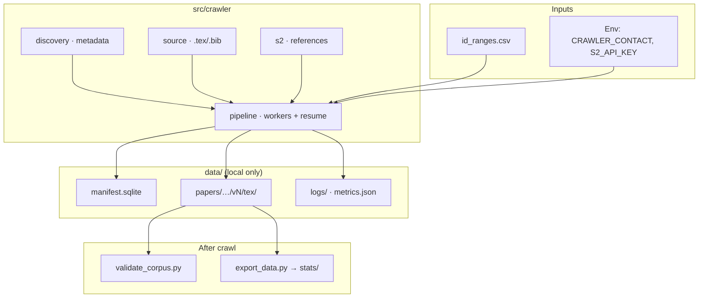

<div align="center">

# arxiv-pipeline

**Resumable arXiv + Semantic Scholar crawler** for an Introduction to Data Science course project.

Collect LaTeX sources and metadata now (Milestone 1); parse and match references later (Milestones 2–3).

<br>

[](https://github.com/GiaaPhuc/arxiv-pipeline/actions/workflows/ci.yml)

-brightgreen)

<br>

[Quick start](#quick-start) ·
[Run](#running-the-crawler) ·
[Milestone 2](#milestone-2--parsing-normalization--dedup) ·
[Milestone 3](#milestone-3--reference-matching-evaluation--hugging-face-export) ·
[Colab](#google-colab) ·
[Layout](#source-layout) ·
[Contributing](CONTRIBUTING.md)

</div>

---

## Overview

This repo implements **Milestone 1** under `src/crawler/`, **Milestone 2** under `src/parsing/`, and **Milestone 3** under `src/matching/`. For Milestone 1, for each assigned arXiv ID it:

| Step | What happens |
| --- | --- |
| Discover | All versions and dates via the arXiv Atom API |
| Download | Each version from `export.arxiv.org/src/{id}vN` |
| Extract | Keep only `.tex` / `.bib`; preserve folder structure inside the tarball |
| Enrich | Paper-level references and venue hints from Semantic Scholar |
| Persist | JSON on disk + SQLite manifest for **resume** |

Crawled corpora live under `data/` and are **never committed** (git-ignored).

**Libraries:** `requests` (one rate limiter per host), `psutil`, `pyarrow` / `pandas`, plus stdlib `tarfile`, `gzip`, and `sqlite3`.



<details>
<summary><strong>Documentation &amp; links</strong></summary>

| Resource | Description |
| --- | --- |
| [`STATUS.md`](STATUS.md) | Team status — read **section 0** first |
| [`docs/huong-dan-crawl-colab-vi.md`](docs/huong-dan-crawl-colab-vi.md) | Colab walkthrough (Vietnamese) |
| [arxiv-book](https://giaaphuc.github.io/arxiv-book/) | Milestone 1 Jupyter Book report |
| [`CONTRIBUTING.md`](CONTRIBUTING.md) | Branches, review roles, PR checklist |

</details>

---

## Quick start

<table>
<tr>
<td width="50%" valign="top">

**Prerequisites**

- Python **3.11** (3.10+ OK; Colab default is fine)
- Git
- Live crawl: `CRAWLER_CONTACT` + Semantic Scholar API key

**Install (full dev)**

```bash
python -m venv .venv
# Windows:  .venv\Scripts\activate
# Linux/macOS:  source .venv/bin/activate
pip install -r src/requirements-dev.txt
pre-commit install
pytest
```

</td>
<td width="50%" valign="top">

**Fast lint + test (~3 s)**

Uses `src/requirements-ci.txt` (no pandas/pyarrow) — same as GitHub Actions.

```bash
pip install -r src/requirements-ci.txt
```

Windows:

```powershell
.\scripts\check.ps1
```

Linux / macOS:

```bash
ruff check . && ruff format --check . && pytest -q
```

> Slow CI is usually **runner queue** or **cold pip install**, not pytest (~1 s).

</td>
</tr>
</table>

### Environment

Set in the shell, a git-ignored `.env`, or Colab **Secrets**. Do not commit secrets.

| Variable | Role |
| --- | --- |
| `CRAWLER_CONTACT` | Email or URL in the User-Agent — **required** for live crawl |
| `S2_API_KEY` | Semantic Scholar API key |
| `CRAWLER_DATA_DIR` | Output root (default `./data`) |

---

## Running the crawler

Assigned IDs: `src/id_ranges.csv` — **25,000** IDs in five ranges. Full corpus runs **once on one machine** (decision D8).

Range CSV columns: `start_month,start_id,end_month,end_id` (inclusive). Example: `src/id_ranges.example.csv`.

```bash
python src/run_crawl.py --ranges src/id_ranges.csv --dry-run
python src/run_crawl.py --ranges src/id_ranges.csv --limit 30
python src/run_crawl.py --ranges src/id_ranges.csv --data-dir data
python src/validate_corpus.py --data-dir data
python src/export_data.py --data-dir data
```

| Flag / command | Purpose |
| --- | --- |
| `--dry-run` | Expand ranges and print plan — no network |
| `--limit N` | Pilot on first *N* IDs |
| `--data-dir` | Output directory (default `./data`) |
| `validate_corpus.py` | Check invariants — exit **0** = PASS |
| `export_data.py` | Parquet/CSV + summary → `data/stats/` |

### Resume

Interrupt with **Ctrl+C** (or lose the machine), then run the **same command** on the same `data/`:

- Final states → skipped
- `failed` → retried
- Incomplete Semantic Scholar → queued again

> **One crawler per `data/` directory.** Never run two processes on the same folder.

### Exit codes

| Code | Meaning |
| ---: | --- |
| `0` | Finished |
| `2` | Bad setup (missing contact, bad ranges, …) |
| `3` | arXiv **403/429** — stop and notify the team; do not speed up |
| `130` | Interrupted |

### Output tree

`data/` is git-ignored.

```
data/
├── manifest.sqlite          # resume state
├── logs/
│   ├── crawl.log
│   └── metrics.json         # wall time, RAM, disk (cumulative across resumes)
├── stats/                   # after export_data.py
└── papers/<arxiv_id>/
    ├── paper.json
    ├── s2_references.raw.json.gz
    └── v<N>/
        ├── meta.json
        ├── references.json
        └── tex/             # .tex / .bib only
```

---

## Google Colab

Notebook: [`src/colab_run.ipynb`](src/colab_run.ipynb)

| Session step | Action |
| --- | --- |
| 1 | Secrets: `S2_API_KEY`, set `CRAWLER_CONTACT` in notebook |
| 2 | Mount Drive |
| 3 | **Restore** `data/` from Drive → local disk |
| 4 | **Crawl** (same command every time; manifest skips done work). Optional: `CRAWLER_BACKUP_DIR` + `CRAWLER_BACKUP_EVERY_IDS=1000` for automatic Drive checkpoints |
| 5 | On stop: interrupt runtime, then **backup** `data/` to Drive (redundant if auto-backup ran recently) |

Crawl on **local Colab disk** (`/content/data`), not on Drive FUSE — SQLite and network filesystems do not mix well.

Detailed guide (Vietnamese): [`docs/huong-dan-crawl-colab-vi.md`](docs/huong-dan-crawl-colab-vi.md).

---

## Milestone 2 — Parsing, Normalization & Dedup

Milestone 2 (`src/parsing/`) parses extracted TeX/BibTeX sources across every paper version into deduplicated structural elements, versioned containment hierarchies, and canonical references.

### Running the parser

```bash
# Dry-run paper count
python src/run_parse.py --data-dir data --dry-run

# Pilot (first 100 papers)
python src/run_parse.py --data-dir data --limit 100 --workers 2

# Full local run (or resume an interrupted/partial run)
python src/run_parse.py --data-dir data --workers 4 --batch-size 500 --resume
```

- Exit codes: `0` finished (check `data/parsed/_errors.jsonl` if individual papers failed), `2` invalid CLI/setup, `130` interrupted (`--resume` skips papers in `_done.txt` and retries previously failed papers).
- Colab workflow: [`src/colab_parse.ipynb`](src/colab_parse.ipynb) runs a 100-paper pilot (`--workers 1 --limit 100`), resumes the remaining corpus (`--resume`), and runs `src/validate_m2.py`.

### Validating & inspecting outputs

```bash
# Full audit (Parquet invariants + M1 Corpus coverage + stats CSV/JSON)
python src/validate_m2.py --data-dir data

# Parquet-only audit without checking M1 raw source directories
python src/validate_m2.py --data-dir data --skip-corpus-check
```

Outputs are written under:
- `data/parsed/` — ZSTD-compressed Parquet shards for `elements/`, `hierarchy/`, `bibtex/`, plus `_done.txt` and optional `_errors.jsonl`.
- `data/stats/` — `m2_papers_stats.csv`, `m2_elements_kind.csv`, `m2_summary.json`, and `m2_performance.json`.

---

## Milestone 3 — Reference Matching, Evaluation & Hugging Face Export

Milestone 3 (`src/matching/` + `src/run_matching.py`) links each paper's extracted BibTeX entries (`bibtex`) to its Semantic Scholar candidate arXiv references (`references`), ranks the top-5 candidates (`cand1..cand5`), evaluates retrieval quality with dual-denominator `MRR@5`, and packages all 6 dataset tables for Hugging Face.

> [!IMPORTANT]
> **Non-LLM & Non-Pretrained Compliance:** Milestone 3 uses **zero LLMs** and **zero pretrained neural embeddings** (`sentence-transformers`, `SciBERT`, `SPECTER`, or remote inference APIs are never used). Text similarity relies strictly on classical lexical metrics (`rapidfuzz`), deterministic ASCII/TeX normalization, AST citation context, per-paper local character n-gram TF-IDF (`char_wb` 3–5 fitted solely on that paper's unlabelled titles), `LogisticRegression`, and `LightGBM` LambdaMART trained from scratch.

### 1. Ground truth & paper-level splits

Labels live under `data/groundtruth/range_<k>/` (never committed):

| File | Format & Schema | Purpose |
| --- | --- | --- |
| `manual_annotations.json` | JSON array of objects with 5 keys: `arxivid` (base ID), `citationkey`, `groundtrutharxivid` (original matched `ref_arxiv_id` preserving version suffix if any, or `null` for non-arXiv/negative-only entries), `source` (`"manual"`), `partition` (`"train"\|"valid"\|"test"`) | Gold-standard manual labels (resumable & atomically checkpointed via CLI; requires $\ge 5$ papers, $\ge 20$ queries/paper, $\ge 100$ total, and $\ge 2$ papers with $\ge 3$ positive & $\ge 3$ negative queries for `valid`/`test`) |
| `auto_annotations.parquet` | ZSTD Parquet with columns `(arxivid, citationkey, groundtrutharxivid, source, partition)` | Conservative 3-tier heuristic annotations (`arXiv ID` $\rightarrow$ `DOI` $\rightarrow$ `title/author/year` fuzzy + conflict resolution) sampled over $\ge 10\%$ of remaining papers in the range |
| `splits.json` | JSON map `{"<arxivid>": "train" \| "valid" \| "test"}` | Deterministic (`seed=42`) paper-level split preventing within-paper candidate leakage across partitions |

```bash
# 1. List qualified papers (at least 20 BibTeX items & 5 arXiv candidates) in range 0
PYTHONPATH=src python -m matching.labelling --range-index 0 --data-dir data

# 2. Interactive resumable manual labeling for 5 selected papers
PYTHONPATH=src python -m matching.labelling --range-index 0 --data-dir data --paper-ids 2408.11045 ...

# 3. Optional: compute Cohen's kappa against a second annotator file
PYTHONPATH=src python -m matching.labelling --range-index 0 --data-dir data --compare-path data/groundtruth/range_0/manual_peer.json

# 4. Run audited auto-matcher + coverage check + paper-level splits standalone
PYTHONPATH=src python -m matching.auto_matcher --range-index 0 --data-dir data --auto-fraction 0.10
```

### 2. Running the matching pipeline, HF export & poster plots

```bash
# Inspect available M1/M2 rows and manual annotations for slice 0 without ML
python src/run_matching.py --data-dir data --range-index 0 --dry-run

# End-to-end: preclean -> 21 features -> train LambdaMART + baselines/ablation
#              -> evaluate MRR@5 -> export & verify 6-table HF dataset -> 300-DPI PNGs
python src/run_matching.py --data-dir data --range-index 0 --export-hf --verify-hf --plot-figures

# Re-render 300-DPI Poster charts standalone from evaluation_results.json
PYTHONPATH=src python -m matching.plots --input data/matching/range_0/evaluation_results.json --out-dir docs/poster/figures
```

- **Two-Stage Retrieval & Ranking:** When a paper has $> 50$ candidate references, Stage-1 blocking (`extract_paper_features`) retains the union of Top-20 `rapidfuzz.fuzz.QRatio` titles plus any exact arXiv ID, exact DOI, or first-author surname matches. Stage-2 `MatchingRanker` trains `LGBMRanker` (`objective="lambdarank"`, `metric="ndcg"`, `eval_at=[1, 3, 5]`, query weights `Manual=3.0` / `Auto=1.0`, Valid-Manual early stopping) alongside 3 baselines (`fuzzy`, `tfidf`, `logistic`) and an 18-feature M2 ablation, applies a Hard Anchor tier (`arxiv_id_in_bib_text` or `doi_exact_match`), deduplicates candidate IDs, and pads `cand1..cand5` with `None` (`groundtrutharxivid` preserved verbatim).
- **Outputs under `data/matching/range_<k>/`:** `predictions.parquet`, `evaluation_results.json` (including `audit_auto_matcher`, `test`/`valid` `MRR@5` overall/manual/auto slices, `models`, `ablation`, `feature_importance_gain`, `ranker_metadata`), `ranker_metadata.json`, `matching_summary.json`, and optional `figures/*.png`.
- **Hugging Face 6-Table Export (`data/hf_range_<k>/`):** ZSTD-compressed shards (`data/<table>/train-00000-of-0000N.parquet`, $\le 80\text{ MB}$/shard) for `papers`, `references`, `elements`, `hierarchy`, `bibtex`, and `predictions`, accompanied by a YAML Dataset Card `README.md` verified with `datasets.load_dataset`.

### 3. The 21-feature contract (`FEATURE_COLUMNS`)

| # | Feature | Group | Definition |
| ---: | --- | --- | --- |
| 1 | `title_exact_match` | Lexical (B) | `1` if normalized BibTeX and candidate titles are identical and non-empty |
| 2 | `title_levenshtein_ratio` | Lexical (B) | Character-level normalized Levenshtein ratio in `[0, 1]` |
| 3 | `title_token_sort_ratio` | Lexical (B) | Token-order-invariant RapidFuzz similarity in `[0, 1]` |
| 4 | `title_jaccard_word_3gram` | Lexical (B) | Jaccard overlap over title word 3-grams (`< 3` words falls back to full tuple) |
| 5 | `title_tfidf_cosine` | Lexical (B) | Cosine similarity from local `char_wb` (3–5) TF-IDF fitted per paper |
| 6 | `title_length_ratio` | Lexical (B) | `min(len_bib, len_ref) / max(len_bib, len_ref)` in `[0, 1]` |
| 7 | `first_author_surname_match` | Author (B) | `1` if normalized first-author surnames match |
| 8 | `first_author_initial_match` | Author (B) | `1` if both first-author surname and first initial match |
| 9 | `authors_jaccard_sim` | Author (B) | Jaccard similarity over full normalized author surname sets |
| 10 | `author_count_diff` | Author (B) | `\|count_bib - count_ref\|` (`99` when either author list is empty) |
| 11 | `year_diff` | Temporal (B) | `\|year_bib - year_ref\|` (`999` when either year is missing) |
| 12 | `year_match` | Temporal (B) | `1` if both years exist and `year_diff == 0` |
| 13 | `year_missing` | Temporal (B) | `1` if either publication year is missing |
| 14 | `arxiv_id_in_bib_text` | Anchor (B) | `1` if BibTeX `url`/`journal`/`doi` yields a normalized arXiv ID matching candidate |
| 15 | `doi_exact_match` | Anchor (B) | `1` if normalized DOIs match (including S2 `externalIds.DOI` enrichment) |
| 16 | `cite_frequency` | M2 AST (E) | Number of in-body `\cite*` occurrences of `citationkey` (latest paper version) |
| 17 | `first_cite_section_type` | M2 AST (E) | Section category of first citation (`-1` none, `0` Intro, `1` Related, `2` Method/Exp, `3` Other) |
| 18 | `first_cite_section_depth` | M2 AST (E) | Tree depth of the first citing node in the M2 `hierarchy` table |
| 19 | `title_sim_rank_in_query` | Relative (A) | 1-based descending rank of `title_token_sort_ratio` within the query's candidates |
| 20 | `title_sim_diff_from_max` | Relative (A) | Difference `score - max_query_score` (`<= 0.0`) |
| 21 | `title_sim_margin_to_top2` | Relative (A) | Margin against the runner-up candidate title similarity in the same query |

## Source layout

<details open>
<summary><code>src/</code> — click to collapse</summary>

```
src/
├── crawler/
│   ├── models.py       shared data contract
│   ├── config.py       environment settings
│   ├── http.py         session, rate limits, retries
│   ├── manifest.py     SQLite + resume
│   ├── ids.py          IDs and range expansion
│   ├── discovery.py    arXiv Atom API
│   ├── source.py       /src/ download + extract
│   ├── s2.py           Semantic Scholar
│   ├── metrics.py      timing and resource use
│   ├── pipeline.py     orchestration
│   └── export.py       tables and stats
├── parsing/              Milestone 2 parser, normalizer & dedup modules
│   ├── models.py
│   ├── gathering.py
│   ├── hierarchy.py
│   ├── cleaner.py
│   ├── math_normalizer.py
│   ├── sentence_splitter.py
│   ├── bib_extractor.py
│   ├── dedup.py
│   ├── export_m2.py
│   └── pipeline.py
├── matching/             Milestone 3 feature extraction, matching & HF export
│   ├── models.py            shared 21-feature & evaluation contracts
│   ├── cleaner.py           TeX/Unicode folding & AuthorTokens normalization
│   ├── lexical_features.py  15 pairwise features + local char 3-5 TF-IDF
│   ├── hierarchy_features.py M2 AST PaperCitationIndex & section context
│   ├── features.py          Stage-1 blocking (n>50) & 3 query-relative features
│   ├── auto_matcher.py      3-tier cascade auto-matcher & precision/recall audit
│   ├── labelling.py         manual labeling CLI, Cohen's kappa & paper splits
│   ├── train_ranker.py      grouped weighted training (LightGBM / Logistic)
│   ├── ranker.py            MatchingRanker baselines + LambdaMART & Top-5 tiering
│   ├── evaluation.py        dual-denominator MRR@5, Hit@K, MAP & Null F1
│   ├── export_hf.py         6-table ZSTD shard packager & datasets verifier
│   ├── pipeline.py          end-to-end M3 orchestrator & ablation runner
│   └── plots.py             300-DPI Poster PNG chart generator
├── corpus.py             read API (Milestones 2–3)
├── audit_corpus.py
├── enrich_references.py
├── validate_corpus.py
├── validate_m2.py
├── export_data.py
├── run_crawl.py
├── run_parse.py
├── run_matching.py
├── colab_run.ipynb
├── colab_parse.ipynb
└── tests/                pytest, mocked HTTP only
```

Each module docstring lists owner, reviewer, task code, and “done when” criteria.

</details>

---

## Server etiquette

| Host | Rule |
| --- | --- |
| arXiv | Only `export.arxiv.org` · ≥ **3 s** between requests · **one** connection |
| Semantic Scholar | ≥ **1 s** between requests · backoff after 429 |
| Either | On arXiv **403/429**: **stop**, tell the team — do not increase rate or parallelize |

---

## Development

```bash
ruff check . && ruff format . && pytest
```

- Tests use `responses` and fixtures — **no real network** in unit tests.
- Never commit `data/`, `.env`, keys, `*.gz`, `*.parquet`, `*.sqlite`.
- Branches and reviewers: [`CONTRIBUTING.md`](CONTRIBUTING.md).
- CI ([`.github/workflows/ci.yml`](.github/workflows/ci.yml)): ruff, pytest, block tracked secrets/data.

<div align="center">

<br>

*Milestone 1 crawler · Milestone 2 AST parser & dedup · Milestone 3 reference matching & HF packaging*

</div>
