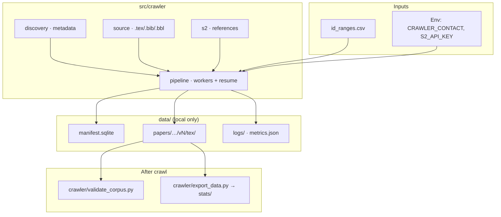

<div align="center">

# arxiv-pipeline

**End-to-end arXiv data pipeline** for an Introduction to Data Science course project.

Crawl LaTeX sources & metadata (**Milestone 1**) · Parse AST & deduplicate references (**Milestone 2**) · Match citations & package Hugging Face datasets (**Milestone 3**).

<br>

[](https://github.com/GiaaPhuc/arxiv-pipeline/actions/workflows/ci.yml)


<br>

[Quick start](#quick-start) ·
[Milestone 1](#running-the-crawler) ·
[Milestone 2](#milestone-2--parsing-normalization--dedup) ·
[Milestone 3](#milestone-3--reference-matching-evaluation--hugging-face-export) ·
[Colab](#google-colab) ·
[Layout](#source-layout) ·
[Team](#team) ·
[Contributing](CONTRIBUTING.md)

</div>

---

## Overview

This repository implements the complete three-milestone pipeline under `src/`:

- **Milestone 1 (`src/crawler/`, `src/run_crawl.py`):** Resumable arXiv + Semantic Scholar crawler with SQLite manifest, zero-copy streaming `.tex`/`.bib`/`.bbl` extraction, corpus validation, and Parquet/CSV export.
- **Milestone 2 (`src/parsing/`, `src/run_parse.py`):** Multi-process LaTeX/BibTeX parser that resolves includes, expands macros, normalizes math, splits sentences, builds versioned containment trees, deduplicates elements & BibTeX across versions, and validates 8 invariants.
- **Milestone 3 (`src/matching/`, `src/run_matching.py`):** Non-LLM reference matching pipeline with 21 features, Stage-1 blocking, manual/auto ground truth & Cohen's kappa, LightGBM LambdaMART + baselines & M2 AST ablation, dual-denominator `MRR@5`, 300-DPI Poster charts, and 6-table Hugging Face packaging.

For Milestone 1, for each assigned arXiv ID the crawler executes:

| Step | What happens |
| --- | --- |
| Discover | All versions and dates via arXiv Atom API (+ OAI-PMH / Kaggle snapshot option) |
| Download | Each version from `export.arxiv.org/src/{id}vN` with HTTP 206 Range resume |
| Extract | Keep only `.tex`, `.bib`, and `.bbl`; preserve folder structure inside the tarball |
| Enrich | Paper-level references and venue hints from Semantic Scholar (+ local `.bib`/`.bbl` fallback) |
| Persist | JSON on disk + SQLite manifest for **resume** |

Crawled and processed data live under `data/` and are **never committed** (git-ignored).

**Core libraries:** `requests`, `psutil`, `pyarrow` / `pandas`, `numpy`, `rapidfuzz`, `scikit-learn`, `lightgbm`, `datasets`, `matplotlib`, plus stdlib `tarfile`, `gzip`, and `sqlite3`.



<details>
<summary><strong>Documentation &amp; links</strong></summary>

| Resource | Description |
| --- | --- |
| [`STATUS.md`](STATUS.md) | Team status — read **section 0** first |
| [`docs/du-an-va-luong-xu-ly-hien-tai-vi.md`](docs/du-an-va-luong-xu-ly-hien-tai-vi.md) | Full M1–M3 technical architecture & processing flow (Vietnamese) |
| [`docs/huong-dan-crawl-colab-vi.md`](docs/huong-dan-crawl-colab-vi.md) | Milestone 1 Colab walkthrough (Vietnamese) |
| [`docs/huong-dan-chay-m2-m3-huggingface-vi.md`](docs/huong-dan-chay-m2-m3-huggingface-vi.md) | Local `.tar.gz` → M2 → M3 → Hugging Face guide (Vietnamese) |
| [arxiv-book](https://giaaphuc.github.io/arxiv-book/) | Milestone 1–2 Jupyter Book report |
| [`CONTRIBUTING.md`](CONTRIBUTING.md) | Branches, review roles, PR checklist |

</details>

---

## Quick start

<table>
<tr>
<td width="50%" valign="top">

**Prerequisites**

- Python **3.11** (3.10+ OK; Colab default is fine)
- Git
- Live crawl: `CRAWLER_CONTACT` + Semantic Scholar API key

**Install (full dev)**

```bash
python -m venv .venv
# Windows:  .venv\Scripts\activate
# Linux/macOS:  source .venv/bin/activate
pip install -r src/requirements-dev.txt
pre-commit install
pytest
```

</td>
<td width="50%" valign="top">

**Fast lint + test (~3 s)**

Uses `src/requirements-ci.txt` (no pandas/matplotlib) — same as GitHub Actions.

```bash
pip install -r src/requirements-ci.txt
```

Windows:

```powershell
.\scripts\check.ps1
```

Linux / macOS:

```bash
ruff check . && ruff format --check . && pytest -q
```

> Slow CI is usually **runner queue** or **cold pip install**, not unit tests.

</td>
</tr>
</table>

### Environment

Set in the shell, a git-ignored `.env`, or Colab **Secrets**. Do not commit secrets.

| Variable | Role |
| --- | --- |
| `CRAWLER_CONTACT` | Email or URL in the User-Agent — **required** for live crawl |
| `S2_API_KEY` | Semantic Scholar API key |
| `CRAWLER_DATA_DIR` | Output root (default `./data`) |

---

## Running the crawler

Assigned IDs: `src/id_ranges.csv` — **25,000** IDs in five ranges. Full corpus runs **once on one machine** (decision D8).

Range CSV columns: `start_month,start_id,end_month,end_id` (inclusive).

```bash
python src/run_crawl.py --ranges src/id_ranges.csv --dry-run
python src/run_crawl.py --ranges src/id_ranges.csv --limit 30
python src/run_crawl.py --ranges src/id_ranges.csv --data-dir data
python src/crawler/audit_corpus.py --data-dir data --output data/stats/audit_report.json
python src/crawler/enrich_references.py --data-dir data
python src/crawler/validate_corpus.py --data-dir data
python src/crawler/export_data.py --data-dir data
```

| Flag / command | Purpose |
| --- | --- |
| `--dry-run` | Expand ranges and print plan — no network |
| `--limit N` | Pilot on first *N* IDs |
| `--data-dir` | Output directory (default `./data`) |
| `crawler/audit_corpus.py` | Cross-check disk files & SHA-256 against `manifest.sqlite` |
| `crawler/enrich_references.py` | Offline backfill of missing references from local `.bib`/`.bbl` |
| `crawler/validate_corpus.py` | Check corpus invariants — exit **0** = PASS |
| `crawler/export_data.py` | Export Parquet/CSV tables + summary → `data/stats/` |

### Resume

Interrupt with **Ctrl+C** (or lose the machine), then run the **same command** on the same `data/`:

- Final states → skipped
- `failed` → retried
- Incomplete Semantic Scholar → queued again

> **One crawler per `data/` directory.** Never run two processes on the same folder.

### Exit codes

| Code | Meaning |
| ---: | --- |
| `0` | Finished |
| `2` | Bad setup (missing contact, bad ranges, …) |
| `3` | arXiv **403/429** — stop and notify the team; do not speed up |
| `130` | Interrupted |

### Output tree

`data/` is git-ignored.

```text
data/
├── manifest.sqlite          # resume state
├── logs/
│   ├── crawl.log
│   └── metrics.json         # wall time, RAM, disk (cumulative across resumes)
├── stats/                   # after crawler/export_data.py & M2 parse
└── papers/<arxiv_id>/
    ├── paper.json
    ├── s2_references.raw.json.gz
    └── v<N>/
        ├── meta.json
        ├── references.json
        └── tex/             # .tex / .bib / .bbl only
```

---

## Google Colab

Notebooks: [`src/notebooks/colab_crawl.ipynb`](src/notebooks/colab_crawl.ipynb) (Milestone 1 crawl) and [`src/notebooks/colab_parse.ipynb`](src/notebooks/colab_parse.ipynb) (Milestone 2 parse).

| Session step | Action |
| --- | --- |
| 1 | Secrets: `S2_API_KEY`, set `CRAWLER_CONTACT` in notebook |
| 2 | Mount Drive |
| 3 | **Restore** `data/` from Drive → local disk |
| 4 | **Crawl** (same command every time; manifest skips done work). Optional: `CRAWLER_BACKUP_DIR` + `CRAWLER_BACKUP_EVERY_IDS=1000` for automatic Drive checkpoints |
| 5 | On stop: interrupt runtime, then **backup** `data/` to Drive (redundant if auto-backup ran recently) |

Crawl and parse on **local Colab disk** (`/content/data`), not on Drive FUSE — SQLite and network filesystems do not mix well.

Detailed guide (Vietnamese): [`docs/huong-dan-crawl-colab-vi.md`](docs/huong-dan-crawl-colab-vi.md).

---

## Milestone 2 — Parsing, Normalization & Dedup

Milestone 2 (`src/parsing/`) parses extracted TeX/BibTeX sources across every paper version into deduplicated structural elements, versioned containment hierarchies, and canonical references.

### Running the parser

```bash
# Dry-run paper count
python src/run_parse.py --data-dir data --dry-run

# Pilot (first 100 papers)
python src/run_parse.py --data-dir data --limit 100 --workers 2

# Full local run (or resume an interrupted/partial run)
python src/run_parse.py --data-dir data --workers 4 --batch-size 500 --resume
```

- Exit codes: `0` finished (check `data/parsed/_errors.jsonl` if individual papers failed), `2` invalid CLI/setup, `130` interrupted (`--resume` skips papers in `_done.txt` and retries previously failed papers).
- Colab workflow: [`src/notebooks/colab_parse.ipynb`](src/notebooks/colab_parse.ipynb) runs a 100-paper pilot (`--workers 1 --limit 100`), resumes the remaining corpus (`--resume`), and runs `src/parsing/validate_m2.py`.

### Validating & inspecting outputs

```bash
# Full audit (Parquet invariants + M1 Corpus coverage + stats CSV/JSON)
python src/parsing/validate_m2.py --data-dir data

# Parquet-only audit without checking M1 raw source directories
python src/parsing/validate_m2.py --data-dir data --skip-corpus-check
```

Outputs are written under:
- `data/parsed/` — ZSTD-compressed Parquet shards for `elements/`, `hierarchy/`, `bibtex/`, plus `_done.txt` and optional `_errors.jsonl`.
- `data/stats/` — `m2_papers_stats.csv`, `m2_elements_kind.csv`, `m2_summary.json`, and `m2_performance.json`.

---

## Milestone 3 — Reference Matching, Evaluation & Hugging Face Export

Milestone 3 (`src/matching/` + `src/run_matching.py`) links each paper's extracted BibTeX entries (`bibtex`) to its Semantic Scholar candidate arXiv references (`references`), ranks the top-5 candidates (`cand1..cand5`), evaluates retrieval quality with dual-denominator `MRR@5`, and packages all 6 dataset tables for Hugging Face.

> [!IMPORTANT]
> **Non-LLM & Non-Pretrained Compliance:** Milestone 3 uses **zero LLMs** and **zero pretrained neural embeddings** (`sentence-transformers`, `SciBERT`, `SPECTER`, or remote inference APIs are never used). Text similarity relies strictly on classical lexical metrics (`rapidfuzz`), deterministic ASCII/TeX normalization, AST citation context, per-paper local character n-gram TF-IDF (`char_wb` 3–5 fitted solely on that paper's unlabelled titles), `LogisticRegression`, and `LightGBM` LambdaMART trained from scratch.

### 1. Ground truth & paper-level splits

Labels live under `data/groundtruth/range_<k>/` (never committed):

| File | Format & Schema | Purpose |
| --- | --- | --- |
| `manual_annotations.json` | JSON array of objects with 5 keys: `arxivid` (base ID), `citationkey`, `groundtrutharxivid` (original matched `ref_arxiv_id` preserving version suffix if any, or `null` for non-arXiv/negative-only entries), `source` (`"manual"`), `partition` (`"train"\|"valid"\|"test"`) | Gold-standard manual labels (resumable & atomically checkpointed via CLI; requires $\ge 5$ papers, $\ge 20$ queries/paper, $\ge 100$ total, and $\ge 2$ papers with $\ge 3$ positive & $\ge 3$ negative queries for `valid`/`test`) |
| `auto_annotations.parquet` | ZSTD Parquet with columns `(arxivid, citationkey, groundtrutharxivid, source, partition)` | Conservative 3-tier heuristic annotations (`arXiv ID` $\rightarrow$ `DOI` $\rightarrow$ `title/author/year` fuzzy + conflict resolution) sampled over $\ge 10\%$ of remaining papers in the range |
| `splits.json` | JSON map `{"<arxivid>": "train" \| "valid" \| "test"}` | Deterministic (`seed=42`) paper-level split preventing within-paper candidate leakage across partitions |

```bash
# 1. List qualified papers (at least 20 BibTeX items & 5 arXiv candidates) in range 0
PYTHONPATH=src python -m matching.labelling --range-index 0 --data-dir data

# 2. Interactive resumable manual labeling for 5 selected papers
PYTHONPATH=src python -m matching.labelling --range-index 0 --data-dir data --paper-ids 2408.11045 ...

# 3. Optional: compute Cohen's kappa against a second annotator file
PYTHONPATH=src python -m matching.labelling --range-index 0 --data-dir data --compare-path data/groundtruth/range_0/manual_peer.json

# 4. Run audited auto-matcher + coverage check + paper-level splits standalone
PYTHONPATH=src python -m matching.auto_matcher --range-index 0 --data-dir data --auto-fraction 0.10
```

### 2. Running the matching pipeline, HF export & poster plots

```bash
# Inspect available M1/M2 rows and manual annotations for slice 0 without ML
python src/run_matching.py --data-dir data --range-index 0 --dry-run

# End-to-end: preclean -> 21 features -> train LambdaMART + baselines/ablation
#              -> evaluate MRR@5 -> export & verify 6-table HF dataset -> 300-DPI PNGs
python src/run_matching.py --data-dir data --range-index 0 --export-hf --verify-hf --plot-figures

# Re-render 300-DPI Poster charts standalone from evaluation_results.json
PYTHONPATH=src python -m matching.plots --input data/matching/range_0/evaluation_results.json --out-dir docs/poster/figures
```

- **Two-Stage Retrieval & Ranking:** When a paper has $> 50$ candidate references, Stage-1 blocking (`extract_paper_features`) retains the union of Top-20 `rapidfuzz.fuzz.QRatio` titles plus any exact arXiv ID, exact DOI, or first-author surname matches. Stage-2 `MatchingRanker` trains `LGBMRanker` (`objective="lambdarank"`, `metric="ndcg"`, `eval_at=[1, 3, 5]`, query weights `Manual=3.0` / `Auto=1.0`, Valid-Manual early stopping) alongside 3 baselines (`fuzzy`, `tfidf`, `logistic`) and an 18-feature M2 ablation, applies a Hard Anchor tier (`arxiv_id_in_bib_text` or `doi_exact_match`), deduplicates candidate IDs, and pads `cand1..cand5` with `None` (`groundtrutharxivid` preserved verbatim).
- **Outputs under `data/matching/range_<k>/`:** `predictions.parquet`, `evaluation_results.json` (including `audit_auto_matcher`, `test`/`valid` `MRR@5` overall/manual/auto slices, `models`, `ablation`, `feature_importance_gain`, `ranker_metadata`), `ranker_metadata.json`, `matching_summary.json`, and optional `figures/*.png`.
- **Hugging Face 6-Table Export (`data/hf_range_<k>/`):** ZSTD-compressed shards (`data/<table>/train-00000-of-0000N.parquet`, $\le 80\text{ MB}$/shard) for `papers`, `references`, `elements`, `hierarchy`, `bibtex`, and `predictions`, accompanied by a YAML Dataset Card `README.md` verified with `datasets.load_dataset`.

### 3. The 21-feature contract (`FEATURE_COLUMNS`)

| # | Feature | Group | Definition |
| ---: | --- | --- | --- |
| 1 | `title_exact_match` | Lexical (B) | `1` if normalized BibTeX and candidate titles are identical and non-empty |
| 2 | `title_levenshtein_ratio` | Lexical (B) | Character-level normalized Levenshtein ratio in `[0, 1]` |
| 3 | `title_token_sort_ratio` | Lexical (B) | Token-order-invariant RapidFuzz similarity in `[0, 1]` |
| 4 | `title_jaccard_word_3gram` | Lexical (B) | Jaccard overlap over title word 3-grams (`< 3` words falls back to full tuple) |
| 5 | `title_tfidf_cosine` | Lexical (B) | Cosine similarity from local `char_wb` (3–5) TF-IDF fitted per paper |
| 6 | `title_length_ratio` | Lexical (B) | `min(len_bib, len_ref) / max(len_bib, len_ref)` in `[0, 1]` |
| 7 | `first_author_surname_match` | Author (B) | `1` if normalized first-author surnames match |
| 8 | `first_author_initial_match` | Author (B) | `1` if both first-author surname and first initial match |
| 9 | `authors_jaccard_sim` | Author (B) | Jaccard similarity over full normalized author surname sets |
| 10 | `author_count_diff` | Author (B) | `\|count_bib - count_ref\|` (`99` when either author list is empty) |
| 11 | `year_diff` | Temporal (B) | `\|year_bib - year_ref\|` (`999` when either year is missing) |
| 12 | `year_match` | Temporal (B) | `1` if both years exist and `year_diff == 0` |
| 13 | `year_missing` | Temporal (B) | `1` if either publication year is missing |
| 14 | `arxiv_id_in_bib_text` | Anchor (B) | `1` if BibTeX `url`/`journal`/`doi` yields a normalized arXiv ID matching candidate |
| 15 | `doi_exact_match` | Anchor (B) | `1` if normalized DOIs match (including S2 `externalIds.DOI` enrichment) |
| 16 | `cite_frequency` | M2 AST (E) | Number of in-body `\cite*` occurrences of `citationkey` (latest paper version) |
| 17 | `first_cite_section_type` | M2 AST (E) | Section category of first citation (`-1` none, `0` Intro, `1` Related, `2` Method/Exp, `3` Other) |
| 18 | `first_cite_section_depth` | M2 AST (E) | Tree depth of the first citing node in the M2 `hierarchy` table |
| 19 | `title_sim_rank_in_query` | Relative (A) | 1-based descending rank of `title_token_sort_ratio` within the query's candidates |
| 20 | `title_sim_diff_from_max` | Relative (A) | Difference `score - max_query_score` (`<= 0.0`) |
| 21 | `title_sim_margin_to_top2` | Relative (A) | Margin against the runner-up candidate title similarity in the same query |

---

## Source layout

<details open>
<summary><code>src/</code> — click to collapse</summary>

```text
src/
├── run_crawl.py                 Milestone 1 CLI entrypoint
├── run_parse.py                 Milestone 2 CLI entrypoint
├── run_matching.py              Milestone 3 CLI entrypoint
├── corpus.py                    Shared read API (Milestones 2–3)
├── id_ranges.csv                Assigned 25,000 IDs (5 × 5,000 slices)
├── requirements.txt             Full runtime dependencies (Milestones 1–3)
├── requirements-ci.txt          CI lint + test dependencies
├── requirements-dev.txt         Full dev dependencies
├── crawler/                     Milestone 1 crawler, checkpoint & validation
│   ├── models.py                Shared M1 data contract
│   ├── config.py                Environment settings
│   ├── http.py                  Session, rate limits, retries
│   ├── manifest.py              SQLite + resume
│   ├── ids.py                   IDs and range expansion
│   ├── discovery.py             arXiv Atom API + OAI-PMH fallback
│   ├── snapshot.py              Offline Kaggle metadata snapshot filter
│   ├── source.py                /src/ streaming download + .tex/.bib/.bbl extract
│   ├── s2.py                    Semantic Scholar + local .bib/.bbl fallback
│   ├── checkpoint.py            Atomic tar.gz backup/restore & shrink protection
│   ├── metrics.py               Timing, diagnostics, and resource use
│   ├── pipeline.py              Multi-threaded crawler orchestration
│   ├── export.py                Parquet/CSV tables and report stats
│   ├── audit_corpus.py          Disk vs manifest checksum auditor CLI
│   ├── enrich_references.py     Offline .bib/.bbl reference backfill CLI
│   ├── validate_corpus.py       M1 post-crawl invariant checker CLI
│   └── export_data.py           M1 Parquet/CSV/stats exporter CLI
├── parsing/                     Milestone 2 parser, normalizer, dedup & validator
│   ├── models.py                Shared M2 AST & table contracts
│   ├── gathering.py             Root selection, comment stripping & include DFS
│   ├── hierarchy.py             Containment tree builder & reference separation
│   ├── cleaner.py               Macro expansion & LaTeX presentation cleanup
│   ├── math_normalizer.py       Inline/block math state-machine normalization
│   ├── sentence_splitter.py     Protect-Mask-Guard-Split-Restore splitter
│   ├── bib_extractor.py         BibTeX/BibLaTeX & .bbl entry parser
│   ├── dedup.py                 Two-level cross-version element & BibTeX dedup
│   ├── export_m2.py             Sharded ZSTD Parquet exporter & rollback
│   ├── pipeline.py              Multi-process M2 orchestration
│   └── validate_m2.py           8-invariant M2 Parquet & coverage validator CLI
├── matching/                    Milestone 3 feature extraction, matching & HF export
│   ├── models.py                Shared 21-feature & evaluation contracts
│   ├── cleaner.py               TeX/Unicode folding & AuthorTokens normalization
│   ├── lexical_features.py      15 pairwise features + local char 3–5 TF-IDF
│   ├── hierarchy_features.py    M2 AST PaperCitationIndex & section context
│   ├── features.py              Stage-1 blocking (n>50) & 3 query-relative features
│   ├── auto_matcher.py          3-tier cascade auto-matcher & precision/recall audit
│   ├── labelling.py             Manual labeling CLI, Cohen's kappa & paper splits
│   ├── train_ranker.py          Grouped weighted training (LightGBM / Logistic)
│   ├── ranker.py                MatchingRanker baselines + LambdaMART & Top-5 tiering
│   ├── evaluation.py            Dual-denominator MRR@5, Hit@K, MAP & Null F1
│   ├── export_hf.py             6-table ZSTD shard packager & datasets verifier
│   ├── pipeline.py              End-to-end M3 orchestrator & ablation runner
│   └── plots.py                 300-DPI Poster PNG chart generator
├── notebooks/                   Colab notebooks
│   ├── colab_crawl.ipynb        Milestone 1 Colab crawler notebook
│   └── colab_parse.ipynb        Milestone 2 Colab parser notebook
└── tests/                       Offline pytest suite (765 tests; mocked HTTP/fixtures)
    ├── conftest.py              Shared archive fixtures & M3 fixture path
    ├── m1/                      Milestone 1 unit & pipeline tests
    ├── m2/                      Milestone 2 parser, dedup & validator tests
    └── m3/                      Milestone 3 matching, ranker, evaluation & HF tests
```

Each module docstring lists owner, reviewer, task code, and “done when” criteria.

</details>

---

## Server etiquette

| Host | Rule |
| --- | --- |
| arXiv | Only `export.arxiv.org` · ≥ **3 s** between requests · **one** connection |
| Semantic Scholar | ≥ **1 s** between requests · backoff after 429 |
| Either | On arXiv **403/429**: **stop**, tell the team — do not increase rate or parallelize |

---

## Development

```bash
ruff check . && ruff format . && pytest
```

- Unit tests (`765` total across `src/tests/m1/`, `src/tests/m2/`, `src/tests/m3/`) use `responses` and synthetic fixtures — **no real network** in tests.
- Never commit `data/`, `.env`, keys, `*.gz`, `*.parquet`, `*.sqlite`.
- Branches and reviewers: [`CONTRIBUTING.md`](CONTRIBUTING.md).
- CI ([`.github/workflows/ci.yml`](.github/workflows/ci.yml)): ruff, pytest, block tracked secrets/data.

---

## Team

| Role | Member | Milestone 1 | Milestone 2 | Milestone 3 |
| :---: | --- | --- | --- | --- |
| **A** | **Võ Gia Phúc** *(Leader)* | Pipeline orchestration, HTTP/rate limits, manifest, checkpoint, metrics | Shared contracts (`models.py`), `run_parse.py`, M2 orchestration & profiling | Shared contracts (`matching/models.py`), blocking & relative features, `run_matching.py`, HF export |
| **B** | **Trần Thanh Sơn** | Range/ID utilities, Atom & OAI-PMH discovery, Semantic Scholar client | Macro/presentation cleanup (`cleaner.py`), math normalization, sentence splitting | TeX/Unicode precleaning (`cleaner.py`), 15 lexical features & local char TF-IDF |
| **C** | **Phạm Trường Quỳnh** | Synthetic archive fixtures, `/src/` streaming download & extraction | Multi-file TeX gathering (`gathering.py`), hierarchy tree building & ref separation | Interactive manual labeling CLI, paper-level splits, Cohen's kappa, 3-tier auto-matcher & audit |
| **D** | **Trần Nguyễn Lâm Gia Thụ** | Corpus API (`corpus.py`), Parquet/CSV export & summary stats | BibTeX/BibLaTeX & `.bbl` extraction, two-level dedup, sharded Parquet exporter | Grouped weighted training (`train_ranker.py`), baselines & LightGBM LambdaMART (`ranker.py`) |
| **E** | **Thân Nguyễn Quang Triệu** | Post-crawl corpus validator (`crawler/validate_corpus.py`), Jupyter Book report | 8-invariant M2 Parquet & coverage validator (`parsing/validate_m2.py`) | M2 AST citation index (`hierarchy_features.py`), dual-denominator `MRR@5` eval & 300-DPI Poster charts |

<div align="center">

<br>

*Milestone 1 crawler · Milestone 2 AST parser & dedup · Milestone 3 reference matching & HF packaging*

</div>
