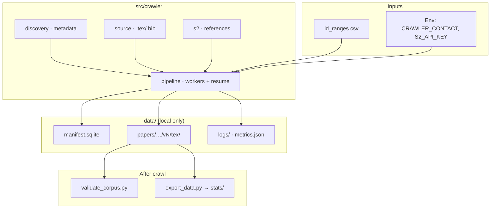

<div align="center">

# arxiv-pipeline

**Resumable arXiv + Semantic Scholar crawler** for an Introduction to Data Science course project.

Collect LaTeX sources and metadata now (Milestone 1); parse and match references later (Milestones 2–3).

<br>

[](https://github.com/GiaaPhuc/arxiv-pipeline/actions/workflows/ci.yml)

-informational)

<br>

[Quick start](#quick-start) ·
[Run](#running-the-crawler) ·
[Colab](#google-colab) ·
[Layout](#source-layout) ·
[Contributing](CONTRIBUTING.md)

</div>

---

## Overview

This repo implements **Milestone 1** under `src/crawler/`. For each assigned arXiv ID it:

| Step | What happens |
| --- | --- |
| Discover | All versions and dates via the arXiv Atom API |
| Download | Each version from `export.arxiv.org/src/{id}vN` |
| Extract | Keep only `.tex` / `.bib`; preserve folder structure inside the tarball |
| Enrich | Paper-level references and venue hints from Semantic Scholar |
| Persist | JSON on disk + SQLite manifest for **resume** |

Crawled corpora live under `data/` and are **never committed** (git-ignored).

**Libraries:** `requests` (one rate limiter per host), `psutil`, `pyarrow` / `pandas`, plus stdlib `tarfile`, `gzip`, and `sqlite3`.



<details>
<summary><strong>Documentation &amp; links</strong></summary>

| Resource | Description |
| --- | --- |
| [`STATUS.md`](STATUS.md) | Team status — read **section 0** first |
| [`docs/huong-dan-crawl-colab-vi.md`](docs/huong-dan-crawl-colab-vi.md) | Colab walkthrough (Vietnamese) |
| [arxiv-book](https://giaaphuc.github.io/arxiv-book/) | Milestone 1 Jupyter Book report |
| [`CONTRIBUTING.md`](CONTRIBUTING.md) | Branches, review roles, PR checklist |

</details>

---

## Quick start

<table>
<tr>
<td width="50%" valign="top">

**Prerequisites**

- Python **3.11** (3.10+ OK; Colab default is fine)
- Git
- Live crawl: `CRAWLER_CONTACT` + Semantic Scholar API key

**Install (full dev)**

```bash
python -m venv .venv
# Windows:  .venv\Scripts\activate
# Linux/macOS:  source .venv/bin/activate
pip install -r src/requirements-dev.txt
pre-commit install
pytest
```

</td>
<td width="50%" valign="top">

**Fast lint + test (~3 s)**

Uses `src/requirements-ci.txt` (no pandas/pyarrow) — same as GitHub Actions.

```bash
pip install -r src/requirements-ci.txt
```

Windows:

```powershell
.\scripts\check.ps1
```

Linux / macOS:

```bash
ruff check . && ruff format --check . && pytest -q
```

> Slow CI is usually **runner queue** or **cold pip install**, not pytest (~1 s).

</td>
</tr>
</table>

### Environment

Set in the shell, a git-ignored `.env`, or Colab **Secrets**. Do not commit secrets.

| Variable | Role |
| --- | --- |
| `CRAWLER_CONTACT` | Email or URL in the User-Agent — **required** for live crawl |
| `S2_API_KEY` | Semantic Scholar API key |
| `CRAWLER_DATA_DIR` | Output root (default `./data`) |

---

## Running the crawler

Assigned IDs: `src/id_ranges.csv` — **25,000** IDs in five ranges. Full corpus runs **once on one machine** (decision D8).

Range CSV columns: `start_month,start_id,end_month,end_id` (inclusive). Example: `src/id_ranges.example.csv`.

```bash
python src/run_crawl.py --ranges src/id_ranges.csv --dry-run
python src/run_crawl.py --ranges src/id_ranges.csv --limit 30
python src/run_crawl.py --ranges src/id_ranges.csv --data-dir data
python src/validate_corpus.py --data-dir data
python src/export_data.py --data-dir data
```

| Flag / command | Purpose |
| --- | --- |
| `--dry-run` | Expand ranges and print plan — no network |
| `--limit N` | Pilot on first *N* IDs |
| `--data-dir` | Output directory (default `./data`) |
| `validate_corpus.py` | Check invariants — exit **0** = PASS |
| `export_data.py` | Parquet/CSV + summary → `data/stats/` |

### Resume

Interrupt with **Ctrl+C** (or lose the machine), then run the **same command** on the same `data/`:

- Final states → skipped
- `failed` → retried
- Incomplete Semantic Scholar → queued again

> **One crawler per `data/` directory.** Never run two processes on the same folder.

### Exit codes

| Code | Meaning |
| ---: | --- |
| `0` | Finished |
| `2` | Bad setup (missing contact, bad ranges, …) |
| `3` | arXiv **403/429** — stop and notify the team; do not speed up |
| `130` | Interrupted |

### Output tree

`data/` is git-ignored.

```
data/
├── manifest.sqlite          # resume state
├── logs/
│   ├── crawl.log
│   └── metrics.json         # wall time, RAM, disk (cumulative across resumes)
├── stats/                   # after export_data.py
└── papers/<arxiv_id>/
    ├── paper.json
    ├── s2_references.raw.json.gz
    └── v<N>/
        ├── meta.json
        ├── references.json
        └── tex/             # .tex / .bib only
```

---

## Google Colab

Notebook: [`src/colab_run.ipynb`](src/colab_run.ipynb)

| Session step | Action |
| --- | --- |
| 1 | Secrets: `S2_API_KEY`, set `CRAWLER_CONTACT` in notebook |
| 2 | Mount Drive |
| 3 | **Restore** `data/` from Drive → local disk |
| 4 | **Crawl** (same command every time; manifest skips done work). Optional: `CRAWLER_BACKUP_DIR` + `CRAWLER_BACKUP_EVERY_IDS=1000` for automatic Drive checkpoints |
| 5 | On stop: interrupt runtime, then **backup** `data/` to Drive (redundant if auto-backup ran recently) |

Crawl on **local Colab disk** (`/content/data`), not on Drive FUSE — SQLite and network filesystems do not mix well.

Detailed guide (Vietnamese): [`docs/huong-dan-crawl-colab-vi.md`](docs/huong-dan-crawl-colab-vi.md).

---

## Source layout

<details open>
<summary><code>src/</code> — click to collapse</summary>

```
src/
├── crawler/
│   ├── models.py       shared data contract
│   ├── config.py       environment settings
│   ├── http.py         session, rate limits, retries
│   ├── manifest.py     SQLite + resume
│   ├── ids.py          IDs and range expansion
│   ├── discovery.py    arXiv Atom API
│   ├── source.py       /src/ download + extract
│   ├── s2.py           Semantic Scholar
│   ├── metrics.py      timing and resource use
│   ├── pipeline.py     orchestration
│   └── export.py       tables and stats
├── corpus.py             read API (Milestones 2–3)
├── validate_corpus.py
├── export_data.py
├── run_crawl.py
├── colab_run.ipynb
└── tests/                pytest, mocked HTTP only
```

Each module docstring lists owner, reviewer, task code, and “done when” criteria.

</details>

---

## Server etiquette

| Host | Rule |
| --- | --- |
| arXiv | Only `export.arxiv.org` · ≥ **3 s** between requests · **one** connection |
| Semantic Scholar | ≥ **1 s** between requests · backoff after 429 |
| Either | On arXiv **403/429**: **stop**, tell the team — do not increase rate or parallelize |

---

## Development

```bash
ruff check . && ruff format . && pytest
```

- Tests use `responses` and fixtures — **no real network** in unit tests.
- Never commit `data/`, `.env`, keys, `*.gz`, `*.parquet`, `*.sqlite`.
- Branches and reviewers: [`CONTRIBUTING.md`](CONTRIBUTING.md).
- CI ([`.github/workflows/ci.yml`](.github/workflows/ci.yml)): ruff, pytest, block tracked secrets/data.

<div align="center">

<br>

*Milestone 1 crawler · LaTeX collection today · parsing & matching in later milestones*

</div>
