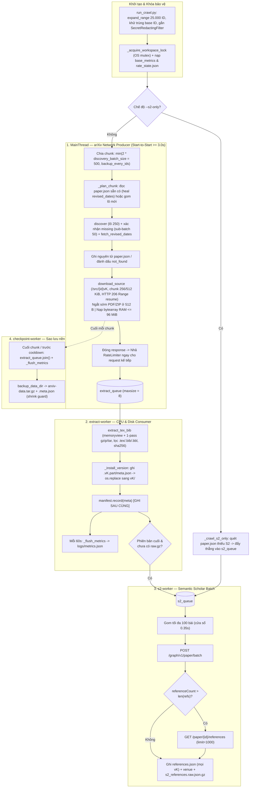

# arxiv-pipeline — Mô tả dự án và luồng xử lý hiện tại

> **Mục đích tài liệu:** Mô tả kiến trúc và luồng end-to-end **đúng 100% với mã nguồn** sau các đợt tối ưu **O1–O6**, **S1–S7**, kiến trúc **v3 Producer–Consumer**, **v3.1 Resilience & QA Alignment (`U1–U6`)** và **v3.2 Sub-7h Speed Tuning (`T1–T5`)** (cập nhật **07/11/2026**). Nền tảng phân tích hiệu năng và thiết kế chi tiết xem tại `docs/plans/Plan-toi-uu-luong-crawl-5000-id-vi.md`.
>
> **Trạng thái code:** **243 unit tests pass**, `ruff` sạch; Pilot 30 ID hoàn tất ✅ (`57` cặp phiên bản: `51` `ok`, `6` `no_source`, `0` `failed`); đang chạy **Milestone 1 Phase 2** (crawl 25.000 ID trên một máy) và đã khởi động **Milestone 2 Phase 0** (khóa `src/parsing/models.py` + khung pipeline đa nhân). Chi tiết đối chiếu đề bài: `STATUS.md` mục 0.

---

## 1. Bối cảnh dự án

| Khía cạnh | Nội dung |
| --- | --- |
| Môn / dự án | Nhập môn Khoa học Dữ liệu — pipeline arXiv (M1 thu thập dữ liệu → M2 parse LaTeX & khử trùng lặp → M3 matching BibTeX & huấn luyện mô hình) |
| Phạm vi tài liệu này | Trọng tâm **Milestone 1** (thu `.tex`/`.bib`/`.bbl` mọi phiên bản, metadata arXiv, toàn bộ tham khảo S2, xuất thống kê) và điểm nối sang **Milestone 2** (`src/parsing/`) |
| Quy mô dữ liệu | `src/id_ranges.csv`: **5 dải × 5.000 = 25.000** ID gốc (tháng 06–08/2024), tính cả hai đầu (`inclusive`) |
| Vận hành | **Một máy** chạy `run_crawl.py` (quyết định D8); SQLite manifest hỗ trợ **resume** an toàn; khóa tiến trình cục bộ `_acquire_workspace_lock` (`msvcrt`/`fcntl` tại `tempfile.gettempdir()`) tự động chặn chạy trùng 2 tiến trình crawler trên cùng thư mục `data/` |
| Repo liên quan | Mã nguồn: repo này. Báo cáo: Jupyter Book [arxiv-book](https://github.com/GiaaPhuc/arxiv-book) (repo riêng, triển khai GitHub Pages) |

**Tiến hóa hiệu năng crawl (ước lượng cho 5.000 ID $\approx 8.187$ phiên bản):**
- **v0 (Baseline):** ~15,0 giờ (`End-to-Start 3,5 s`, tuần tự 1 luồng, giải nén 2-pass, backup đồng bộ).
- **v1 (O1–O6 cơ bản):** ~10,8 giờ (`Start-to-Start 3,0 s`, tách `extract-worker`, 1-pass extract, nhưng bị nghẽn bởi ghi/đọc đĩa tạm ~40,6 GB).
- **v2 (S1–S7):** ~7,0 – 7,4 giờ (đệm RAM 32 MiB, tối ưu S2 batch + streaming checkpoint, nhưng còn kẹt trần thích ứng 429 ở 6,0 s).
- **v3 + v3.1 (`U1–U6`) + v3.2 (`T1–T5` — Mã hiện tại):**
  - **Giờ trống / ít 429:** **~6,85 – 6,95 giờ (< 7,0 giờ)** — đạt ~98,5% trần lý thuyết `6,85 giờ` của chuẩn lịch sự **Start-to-Start ≥ 3,0 s** trên 1 kết nối đơn.
  - **Giờ cao điểm / nhiều 429 & đứt stream:** **~6,95 – 7,25 giờ (< 7,5 giờ)** — chỉ trễ thêm ~15–25 phút nhờ xóa phạt kép 429 (`+0,15 s`, trần `3,30 s`), khôi phục luồng đứt bằng `HTTP 206 Partial Content`, và tự động hoãn ID nghẽn (`--auto-resume-rate-limit`).

---

## 2. Nguồn dữ liệu và ràng buộc lịch sự (Politeness Policy)

| Host | Dùng cho | Host thực tế | Giới hạn trong code | Hành vi đặc biệt khi gặp lỗi / Rate-limit |
| --- | --- | --- | --- | --- |
| **arXiv** | Atom API (`/api/query?id_list=...`) + tải gói nguồn (`/src/{id}vN`) | **`export.arxiv.org`** (1 `Session`, 1 `RateLimiter`, `_SingleConnAdapter(pool_connections=1, pool_maxsize=1)` với `SO_RCVBUF = 1 MiB` & `TCP_NODELAY`, header `/src/` đặt `Accept-Encoding: identity`) | $\ge \mathbf{3,0\text{ s}}$ **Start-to-Start** giữa hai request (`CRAWLER_ARXIV_MIN_INTERVAL`, sàn cứng 3,0 s) | • **HTTP 403:** dừng toàn bộ lần chạy (`StopCrawl`, exit code `3`).<br/>• **HTTP 429 (T1 & U1):** chờ `Retry-After` (hoặc backoff bậc thang `15 s → 30 s → 60 s` khi vắng header), gọi `limiter.note_429()` chỉ nhích nhẹ **`+0,15 s`** với trần cứng **`3,30 s`** (`min_interval + 0,30 s`), thử lại cùng request tối đa **4 lần**. Khi vượt quá 4 lần: nếu bật `--auto-resume-rate-limit` (**U1**) sẽ tự động lưu backup, hoãn ID nghẽn xuống cuối hàng đợi (`deferred_ids`), ngủ cooldown (`180 s`), `reset_interval()` về `3,0 s` và chạy tiếp; nếu không bật sẽ ném `StopCrawl` (exit code `3`).<br/>• **HTTP 2xx (T1):** sau mỗi chuỗi **5 request thành công** (`note_success()`), nhịp tự thu hẹp `-0,15 s` về sàn `3,0 s`.<br/>• **5xx / lỗi mạng tạm thời (T4):** retry tối đa `max_retries=5` với đồng hồ hợp nhất `schedule_retry_backoff` (`max(min_interval, 2**attempt)` tính từ `_last_request_at`, không ngủ chồng 2 lần). |
| **Semantic Scholar (S2)** | Metadata bổ sung (`venue`) + danh sách trích dẫn (`references`) | `api.semanticscholar.org` | Nền $\mathbf{1,1\text{ s}}$ **End-to-Start** + jitter `0..0,05 s` (`AdaptiveRateLimiter`, chuẩn key 1 req/s) | • Đính kèm header `x-api-key` nếu có `S2_API_KEY` (`SecretRedactingFilter` tự động che mọi khóa trong log — **U5**).<br/>• **HTTP 429:** chờ `Retry-After` (kẹp trong `30–600 s`), `note_429()` nhân đôi khoảng nghỉ (tối đa 5,0 s), **re-queue cả lô** thử lại tối đa 4 lần. Nếu tổng thời gian chờ 429 liên tiếp không có request thành công $\ge \mathbf{30\text{ phút}}$ $\rightarrow$ tắt `s2-worker` (`s2_disabled=True`, có thể vét bù sau bằng `--s2-only` — **U2**).<br/>• **HTTP 403:** tắt `s2-worker` ngay lập tức (bảo toàn arXiv crawl). |

**Quy tắc bất khả xâm phạm (`AGENTS.md` & `CONTRIBUTING.md`):**
- Không crawl từ `arxiv.org` (chỉ dùng `export.arxiv.org`).
- Không mở nhiều kết nối song song tới arXiv (`_StreamResponse` giữ khóa `RateLimiter` cho tới khi đóng luồng đọc; trạng thái cooldown được lưu liên tiến trình vào `data/logs/rate_state.json` — **U3**).
- Không commit `data/`, `.env`, API keys, `*.gz`, `*.parquet`, `*.sqlite`.

---

## 3. Kiến trúc module và đa luồng

### 3.1. Cây thư mục mã nguồn

```text
src/
├── id_ranges.csv             # 5 dải ID được giao (5 x 5.000 = 25.000 ID)
├── run_crawl.py              # CLI Milestone 1: mở rộng dải ID -> pipeline.run() (--auto-resume-rate-limit, --s2-only)
├── validate_corpus.py        # Kiểm tra toàn vẹn corpus (manifest vs đĩa, .tex/.bib/.bbl, sha256, JSON...)
├── export_data.py            # Xuất bảng papers/references (.parquet/.csv) + summary.json + performance.json
├── corpus.py                 # Tiện ích đọc/duyệt corpus trên đĩa
├── colab_run.ipynb           # Notebook vận hành crawl + auto-backup trên Google Colab
├── crawler/                  # Package thu thập dữ liệu (Milestone 1)
│   ├── models.py             # Hợp đồng dữ liệu M1 (SCHEMA_VERSION=1, không tự ý sửa)
│   ├── config.py             # Cấu hình từ biến môi trường / .env + CLI overrides
│   ├── http.py               # HostClient, _SingleConnAdapter (SO_RCVBUF 1MiB), RateLimiter (+0.15s, trần 3.3s), rate_state.json
│   ├── ids.py                # Chuẩn hóa ID, tách version, expand_range, id_to_dirname
│   ├── discovery.py          # Atom API lô 250 ID, tận dụng <updated>, xác nhận sub-batch 50 (T3)
│   ├── source.py             # download_source (RAM <=96 MiB, Range 206 resume), extract_tex_bib (1-pass .tex/.bib/.bbl, memoryview)
│   ├── s2.py                 # POST /paper/batch (100 ID) + fallback GET /references (limit 1000)
│   ├── manifest.py           # SQLite manifest + atomic_write
│   ├── pipeline.py           # Điều phối Producer-Consumer + auto-resume 429 + --s2-only + OS mutex + diagnostics.jsonl
│   ├── checkpoint.py         # Sao lưu nền nguyên tử (.tar.gz / mirror) + shrink guard + restore
│   ├── metrics.py            # Đo stage, ResourceSampler O(1), redact_secrets, source_code_hash, aggregate_sessions
│   └── export.py             # Tổng hợp bảng Hugging Face & thống kê báo cáo (cross_version_dedup + benchmark_summary)
├── run_parse.py              # CLI Milestone 2 (Phase 0): khung chạy parser đa nhân
└── parsing/                  # Package xử lý LaTeX & BibTeX (Milestone 2 Phase 0)
    ├── models.py             # Hợp đồng dữ liệu M2 (khóa ở Phase 0)
    └── pipeline.py           # Khung điều phối parse song song & profiler
```

**Phân công phụ trách (Milestone 1):** A — `http`, `manifest`, `pipeline`, `metrics`, `checkpoint` · B — `ids`, `discovery`, `s2` · C — `source`, fixtures · D — `export`, `corpus` · E — `validate_corpus`, Jupyter Book.

### 3.2. Năm luồng thực thi trong một phiên `pipeline.run()`

| Luồng (Thread) | Vai trò chính | Cô lập tài nguyên |
| --- | --- | --- |
| **1. `MainThread` (arXiv Producer)** | Chia chunk ID; gọi `discover` & `fetch_revised_dates` (lô **250** ID); tải `/src/{id}vK` theo chunk `256 KiB` (`512 KiB` cho gói $\ge 25\text{ MiB}$) vào `bytearray` RAM ($\le 96\text{ MiB}$), tự nối tiếp bằng `HTTP 206 Range` nếu đứt stream; **đóng HTTP stream & nhả `RateLimiter` ngay lập tức**; đẩy `_ExtractJob` vào `extract_queue` (`maxsize=8`). | Chỉ gọi `export.arxiv.org`; không giải nén tar, không gọi S2. |
| **2. `extract-worker` (Consumer)** | Lấy gói từ `extract_queue`; đọc qua `_ZeroCopyBytesReader` (`memoryview`) và giải nén **1-pass** gzip/tar chỉ giữ `.tex`/`.bib`/`.bbl` vào `.vK.part/tex/`, tính `sha256`; ghi `meta.json`, hoán đổi nguyên tử sang `vK/`; ghi `manifest.sqlite` **sau cùng**; định kỳ mỗi **60 s** gọi `_flush_metrics`; đẩy `_S2Job` sang `s2_queue` khi xong phiên bản cuối của bài. | Thuần CPU + Disk I/O; chạy song song 100% với lượt tải mạng kế tiếp. |
| **3. `s2-worker`** | Gom tối đa **100 bài** từ `s2_queue` (chờ gom 0,35 s); gọi `POST /paper/batch`; gọi fallback phân trang `/references` nếu bị cắt; ghi `references.json` vào mọi `vK/`, cập nhật `venue` cho `paper.json`, và ghi `s2_references.raw.json.gz` làm marker hoàn tất. | Chỉ gọi `api.semanticscholar.org`. |
| **4. `checkpoint-worker`** | Được kích hoạt ở nền mỗi khi đi qua `CRAWLER_BACKUP_EVERY_IDS` ID mới (cũng như khi nghỉ cooldown `U1` và một lần cuối khi kết thúc): chụp snapshot SQLite bằng `sqlite3.Connection.backup`, đóng gói `papers/`, `logs/`, `stats/` ra `.tar.gz` (hoặc thư mục đích) kèm kiểm tra chống tụt lùi dữ liệu (`shrink protection`). | Không chặn `MainThread` (trừ bước `extract_queue.join()` ngắn trước khi mở snapshot). |
| **5. `resource-sampler`** | Luồng daemon của `metrics.ResourceSampler`: đo RSS RAM (mỗi 5 s) và dung lượng đĩa (mỗi 300 s) ở nền, giúp `sampler.snapshot()` đọc cực trị `O(1)` không tốn chi phí quét tiến trình trên luồng chính. | Chỉ đọc thông số hệ thống ở nền. |

---

## 4. Luồng xử lý End-to-End (`run_crawl.py`)



### 4.1. Khám phá siêu dữ liệu (Discovery — tối ưu O2 + T3)

1. **Chia chunk:** Danh sách ID được duyệt theo từng chunk kích thước `2 * discovery_batch_size = 500` ID (hoặc nhỏ hơn nếu `backup_every_ids > 0`).
2. **Kiểm tra trạng thái cục bộ (`_plan_chunk`):**
   - Nếu đã có `data/papers/<dirname>/paper.json`: đọc lại `PaperMeta`. Nếu bài có `num_versions >= 2` nhưng `revised_dates` chưa đủ `(num_versions - 1)` phần tử (do lần chạy trước bị gián đoạn), đưa vào danh sách **auto-heal** để gọi bổ sung `fetch_revised_dates`.
   - Nếu `manifest.sqlite` đã ghi `(arxiv_id, 1)` là `not_found`: bỏ qua ngay.
   - Các ID còn lại được gom vào danh sách cần khám phá.
3. **Gọi Atom API theo lô 250 (`discover` — T3):**
   - Gửi `GET /api/query?id_list=...&max_results=250` (`discovery_batch_size = 250`).
   - Từ mỗi `<entry>`, tách hậu tố `vN` của `<id>` làm tổng số phiên bản `num_versions = N`; `<published>` là `submission_date` (ngày của `v1`); `<updated>` là ngày của phiên bản mới nhất `vN`.
   - **Tận dụng `<updated>` (O2):** Với bài có đúng `N = 2` phiên bản, `<updated>` chính là ngày của `v2` $\rightarrow$ điền luôn `revised_dates = [updated]`, tiết kiệm 100% truy vấn phụ cho các bài 2 phiên bản! Với bài `N >= 3`, giữ `<updated>` cho `vN` và chỉ cần hỏi thêm `v2 .. v{N-1}`.
4. **Xác nhận ID vắng mặt theo sub-batch 50 (T3):**
   - Các ID không xuất hiện trong kết quả lô 250 được kiểm tra lại theo từng cụm **50 ID** (`_CONFIRM_BATCH_SIZE = 50`; chỉ tách lẻ từng ID nếu feed trả về `/api/errors`). Nếu vẫn không tồn tại $\rightarrow$ ghi manifest `(id, 1) = not_found` (không tạo thư mục bài).
5. **Lấy ngày phiên bản trung gian (`fetch_revised_dates`):**
   - Gom các định danh `idv2 .. idv{N-1}` vào các lô 250 (kèm cơ chế re-check sub-batch 50 nếu thiếu). Nếu sau khi re-check vẫn khuyết ngày của phiên bản nào, giữ chuỗi rỗng `""` tại vị trí đó và tăng bộ đếm `revised_dates_incomplete` (vẫn tiếp tục tải gói nguồn).
6. **Lưu đĩa:** Ghi nguyên tử `data/papers/<dirname>/paper.json`.

### 4.2. Tải gói nguồn & Giải nén bất đồng bộ (Producer–Consumer v3 + v3.1/v3.2)

Với mỗi bài hợp lệ, duyệt `version = 1 .. paper.num_versions`:

**A. Trên `MainThread` (`_download_version` $\rightarrow$ `download_source`):**
1. Đăng ký `(arxiv_id, version)` vào manifest (trạng thái `pending` nếu chưa có). Nếu trạng thái hiện tại đã thuộc nhóm kết thúc (`is_final`: `ok`, `ok_no_tex`, `no_source`, `not_found`, `corrupt`) $\rightarrow$ **bỏ qua**.
2. Gọi `GET /src/{arxiv_id}v{version}` với `stream=True` và đọc theo khung **`256 KiB`** (tự động nâng lên **`512 KiB`** khi `Content-Length >= 25 MiB` — **T5**).
3. **Ngắt sớm ở 512 bytes đầu (`O5` / `S2`):**
   - Ngay khi đọc đủ 4–512 bytes đầu tiên, kiểm tra magic bytes. Nếu là **`%PDF`** hoặc **`ZIP`** (`PK\x03\x04`, `PK\x05\x06`, `PK\x07\x08`): ngắt luồng tải ngay lập tức (nếu phần còn lại của phản hồi $\le 64\text{ KiB}$ thì đọc nốt để tái sử dụng kết nối TCP Keep-Alive), giữ lại đúng 512 bytes stub và ghi nhận `raw_archive_bytes` từ `Content-Length`.
4. **Đệm RAM Zero-Copy (`spool_max_bytes = 96 MiB`) & Khôi phục luồng đứt bằng `HTTP 206 Range` (`T2`):**
   - Mọi gói nguồn $\le 96\text{ MiB}$ (>99,5% tổng số bài trên arXiv) được nối trực tiếp vào `bytearray` trong RAM — **0 byte ghi xuống `data/.tmp/`**. Chỉ những gói khổng lồ $> 96\text{ MiB}$ mới tự động chuyển sang file tạm trong `data/.tmp/`.
   - **Nối tiếp luồng đứt (`T2`):** Nếu luồng tải bị đứt giữa chừng (`ChunkedEncodingError` / `ConnectionError` / `IncompleteRead`), `download_source` giữ nguyên các byte đã tải trong `mem_buf` (hoặc file tạm) và gửi kèm header `Range: bytes={written}-` ở lần retry kế tiếp. Nếu server trả về **`206 Partial Content`**, chỉ tải nốt phần đuôi còn thiếu (nếu trả về `200 OK` mới xóa buffer tải lại từ đầu).
5. **Nhả kết nối tức thì:** Ngay khi tải xong byte cuối (hoặc ngắt ở 512 B), khối `with response:` đóng lại, giải phóng slot `RateLimiter` để nhịp `Start-to-Start 3,0 s` của gói kế tiếp không bị trễ bởi thời gian giải nén. Các gói $\ge 50\text{ MiB}$ hoặc sự kiện đứt stream/retry được ghi tự động vào `data/logs/diagnostics.jsonl` (**U5**). `DownloadResult` được đẩy vào `extract_queue`.

**B. Trên `extract-worker` (`_consume_extract_job` $\rightarrow$ `extract_tex_bib`):**
1. **Đọc Zero-Copy (`_ZeroCopyBytesReader` — T5) & Giải nén 1-pass mở Gzip duy nhất 1 lần (`O4`):**
   - Bọc `bytearray` bằng `_ZeroCopyBytesReader` sử dụng `memoryview` để đọc tuần tự mà không nhân bản bộ nhớ (`bytes(buf)`).
   - Kiểm tra 512 bytes đầu: nếu là `%PDF` hoặc `ZIP` $\rightarrow$ trả về `Status.NO_SOURCE`.
   - Nếu là Gzip (`\x1f\x8b`): mở `gzip.GzipFile` **một lần duy nhất**, đọc thử 512 bytes giải nén đầu tiên để kiểm tra header tar (`ustar` hoặc checksum octal hợp lệ) rồi ghép lại bằng `_PrefixedReader` để truyền thẳng vào `tarfile.open(fileobj=..., mode="r|")` hoặc bộ ghi file `.tex` đơn.
2. **Lọc `.tex`/`.bib`/`.bbl` (`U4`) & An toàn giải nén:**
   - Chặn triệt để path traversal (`..`, đường dẫn tuyệt đối, tên thiết bị Windows `CON`/`NUL`..., symlink/hardlink/device) và giới hạn dung lượng giải nén `max_extract_bytes = 2 GiB` (chống zip-bomb).
   - Với member không phải `.tex`/`.bib`/`.bbl` (ảnh `.png`, `.pdf`, `.eps`...): cộng `member.size` vào `raw_uncompressed_bytes` và **bỏ qua ngay ở mức stream** (không đọc xuất ra đĩa, không băm `sha256`).
   - Với member **`.tex`, `.bib` hoặc `.bbl` (file bibliography đã biên dịch phụ trợ — U4)**: vừa ghi vào `.vK.part/tex/<relative_path>`, vừa băm `sha256`. Nếu trong cùng một gói tar có 2 member trùng đường dẫn (ví dụ `JSSC.bib`), member sau **ghi đè an toàn** lên member trước theo đúng chuẩn POSIX tar (`S3`).
   - Cuối luồng tar: đọc cạn các block đệm 0 còn lại trên cùng luồng gzip để kiểm tra trọn vẹn trailer CRC32/ISIZE mà không cần mở file lần hai.
   - Nếu gói hợp lệ nhưng không có file nguồn nào $\rightarrow$ `Status.OK_NO_TEX`; nếu có $\ge 1$ file $\rightarrow$ `Status.OK`; nếu archive hỏng hoặc vi phạm an toàn $\rightarrow$ `Status.CORRUPT`.
3. **Cài đặt nguyên tử & Ghi Manifest sau cùng:**
   - Ghi `.vK.part/meta.json` (kèm `version_date`, `crawled_at`, `s2_scope="paper"`). Nếu thư mục `vK/` cũ đã có `references.json` thì chép sang `.vK.part/`.
   - Hoán đổi nguyên tử `.vK.part` $\rightarrow$ `vK/`.
   - **Ghi `manifest.sqlite` ở bước cuối cùng:** đảm bảo nếu máy tắt giữa chừng, lần chạy sau sẽ tự động dọn `.vK.part` (bằng `os.scandir` nhanh) và tải lại sạch sẽ.

### 4.3. Semantic Scholar — Worker nền theo lô (`s2-worker`) & Chế độ `--s2-only` (`U2`)

1. **Điều kiện vào hàng đợi (`s2_queue`):**
   - Trong luồng crawl chuẩn: bài đã hoàn tất xử lý mọi phiên bản `1..num_versions` (do `extract-worker` đẩy vào khi xử lý xong phiên bản cuối, hoặc do `MainThread` đẩy vào khi resume các bài đã `is_final` trên manifest) **và** chưa có file marker `data/papers/<dirname>/s2_references.raw.json.gz` (hoặc còn thiếu `references.json` ở bất kỳ `vK/` nào).
   - **Trong chế độ độc lập `--s2-only` (`_crawl_s2_only` — U2):** Bỏ qua 100% các lệnh gọi mạng tới `export.arxiv.org`, chỉ quét nhanh các thư mục bài đã có `paper.json` trên đĩa nhưng thiếu trích dẫn S2 và đẩy thẳng vào `s2_queue`.
2. **Gom lô (`_collect_s2_batch`):**
   - Lấy job đầu tiên (blocking), sau đó chờ tối đa **`0,35 s`** để gom thêm các bài vừa xong gần nhau, tối đa **`100` bài/lô** (`S2_BATCH_SIZE = 100`).
3. **Truy vấn Batch & Fallback phân trang:**
   - Gọi `POST /graph/v1/paper/batch` với danh sách `["ARXIV:<id>", ...]` và các trường `venue,referenceCount,references.paperId,references.externalIds,references.title,references.authors,references.publicationDate,references.year`.
   - Nếu phần tử trả về `null`: bài chưa được S2 lập chỉ mục $\rightarrow$ ghi nhận `s2_not_indexed`, lưu raw `{"status": 404}` và danh sách `references.json = []`.
   - Nếu `referenceCount > len(references)` (S2 cắt bớt danh sách trích dẫn lồng trong batch): tự động gọi **fallback** `GET /graph/v1/paper/ARXIV:<id>/references?limit=1000` (phân trang `offset` đến hết).
4. **Lưu trữ nguyên tử (`_store_s2`):**
   - Ghi cùng một danh sách `references.json` vào **mọi thư mục phiên bản `v1..vN`** của bài (`s2_scope: "paper"`).
   - Nếu S2 trả về `venue` và `paper.json` chưa có `venue` từ arXiv $\rightarrow$ cập nhật bổ sung vào `paper.json`.
   - **Ghi `s2_references.raw.json.gz` sau cùng** làm dấu hiệu hoàn tất S2 cho bài đó.

---

## 5. Cấu trúc thư mục dữ liệu (`data/`)

```text
data/
├── manifest.sqlite                     # Bảng version_pairs: (arxiv_id, version) -> status, timestamps, metrics, error
├── logs/
│   ├── crawl.log                       # Log chi tiết (đã lọc qua SecretRedactingFilter tự che API key/token)
│   ├── metrics.json                    # Thời gian từng stage, đỉnh RAM/Disk, sessions, git_commit, source_code_hash
│   ├── diagnostics.jsonl               # Sự kiện bất thường (HTTP 429/403/5xx, đứt stream, gói >= 50 MiB) (U5)
│   └── rate_state.json                 # Lưu mốc cooldown (arxiv_cooldown_until, s2_cooldown_until) liên tiến trình (U3)
├── .tmp/                               # Thư mục tạm (trống >99,5% thời gian nhờ đệm RAM 96 MiB)
├── papers/
│   └── <dirname>/                      # Tên thư mục từ ids.id_to_dirname() (VD: 2408.01045)
│       ├── paper.json                  # PaperMeta (title, authors, submission_date, revised_dates, venue...)
│       ├── s2_references.raw.json.gz   # Phản hồi S2 gốc nén gzip (marker đã xong S2)
│       ├── v1/
│       │   ├── meta.json               # VersionMeta (status, raw/kept bytes, danh sách files kèm sha256)
│       │   ├── references.json         # Danh sách Reference từ S2
│       │   └── tex/                    # Cây thư mục chỉ chứa các file .tex, .bib và .bbl giữ nguyên cấu trúc
│       └── v2/
│           └── ...
└── stats/                              # Sinh ra bởi src/export_data.py
    ├── papers.parquet / papers.csv     # Bảng papers chuẩn bị cho Hugging Face (Milestone 3)
    ├── references.parquet / .csv       # Bảng references (chỉ giữ tham khảo có ref_arxiv_id)
    ├── summary.json                    # Thống kê báo cáo M1 + cross_version_dedup + benchmark_summary (U6)
    └── performance.json                # Tóm tắt hiệu năng (wall time, active stage seconds, RAM/Disk peak)
```

---

## 6. Cơ chế Resume, Auto-Resume 429, Checkpoint nền & Live Telemetry

| Tình huống vận hành | Hành vi của hệ thống |
| --- | --- |
| **Ngắt giữa chừng (Ctrl+C / mất kết nối Colab)** | Khối `finally` của `pipeline.run()` đợi `extract-worker` và `s2-worker` kết thúc an toàn, dừng `ResourceSampler`, flush `metrics.json`, và chạy một bản backup cuối (nếu cấu hình). Khi chạy lại **cùng câu lệnh**: các cặp `(id, version)` đã `is_final` được bỏ qua ngay; cặp `failed`/`pending` được tải lại; bài thiếu `s2_references.raw.json.gz` được đưa lại vào `s2_queue`. |
| **Tự động vượt qua đợt phạt 429 (`--auto-resume-rate-limit` — `U1`)** | Khi một request arXiv bị `429` quá 4 lần thử liên tiếp và bật cờ `--auto-resume-rate-limit` (hoặc `CRAWLER_AUTO_RESUME_RATE_LIMIT=1`):<br/>1. Đợi `extract_queue.join()`, flush `metrics.json` và chạy 1 bản backup an toàn.<br/>2. Đẩy ID đang bị nghẽn xuống cuối hàng đợi (`deferred_ids`) để không vấp lại ngay.<br/>3. Lưu `rate_state.json`, ngủ chờ hết chu kỳ cooldown (`rate_limit_cooldown_seconds`, mặc định `180 s`, log tiến độ mỗi 15 s), `reset_interval()` về sàn `3,0 s` và **tự động chạy tiếp** trong cùng tiến trình. |
| **Lưu Cooldown liên tiến trình & Khóa OS Mutex (`U3`)** | • File `data/logs/rate_state.json` lưu mốc thời gian phạt còn dư (`arxiv_cooldown_until`, `s2_cooldown_until`); nếu người dùng tắt và bật lại lệnh ngay lúc đang bị phạt, tiến trình mới tự động chờ hết thời gian phạt trước khi gọi API.<br/>• Hàm `_acquire_workspace_lock` tạo khóa tiến trình cấp hệ điều hành tại `tempfile.gettempdir()` giúp chặn tuyệt đối lỗi chạy trùng 2 tiến trình trên cùng thư mục `data/`. |
| **Checkpoint tự động lên Google Drive (`O6`)** | Khi đặt `--backup-dir` (hoặc `CRAWLER_BACKUP_DIR`) và `--backup-every-ids N` (trên Colab thường đặt `N = 1000`):<br/>• Khi khởi động lại (resume), hàm `_count_leading_done_ids` đếm số ID đầu dải đã hoàn tất cả arXiv lẫn S2 để đặt mốc `checkpoint_last_seen`, tránh backup lại ngay lập tức.<br/>• Cứ mỗi `N` ID mới đi qua, luồng chính gọi `extract_queue.join()` + `_flush_metrics`, rồi bật `checkpoint-worker` nén streaming sang `arxiv-data.tar.gz` ở nền.<br/>• **Shrink Protection (`checkpoint.py`):** Kèm file cạnh `arxiv-data.tar.gz.meta.json` lưu `(final_pairs, total_pairs)`. Bản backup mới **không bao giờ ghi đè** lên bản backup cũ trên Drive nếu có số cặp hoàn tất ít hơn. |
| **Live Metrics Checkpointing (`V3-3`) & Tổng hợp đa phiên (`U6`)** | • `pipeline.py` nạp `base_metrics` lúc bắt đầu và gọi `metrics.flush_run` **mỗi 60 giây trên `extract-worker`**, **cuối mỗi chunk**, **trước mỗi lần backup**, và **trong khối `finally`** mà không bị cộng trùng (`idempotent` trong cùng phiên).<br/>• Hàm `aggregate_sessions()` tự động khử trùng lặp lịch sử các phiên chạy Colab, loại bỏ khoảng thời gian chết (`idle_gap_seconds`) giữa hai phiên, và bóc tách tường minh **Thời gian xử lý thực (`active_wall_seconds`)** so với **Thời gian chờ phạt/Retry (`cooldown_retry_seconds`)** trong `summary.json` (`benchmark_summary`). |
| **Khử trùng lặp xuyên phiên bản (`V3-4`)** | Khi chạy `export_data.py`, module `export.py` đối chiếu mã băm `sha256` của từng file `.tex`/`.bib`/`.bbl` giữa `v1..vN` để xuất trường `cross_version_dedup` trong `summary.json` (số phiên bản giữ nguyên 100% nội dung nguồn, số file và số byte trùng lặp), nối trực tiếp sang bài toán Deduplication của Milestone 2. |

---

## 7. Công thức và Ước lượng Thời gian

Ký hiệu: $P$ là số bài cần crawl ($5.000$ ID/dải hoặc $25.000$ ID toàn cục); $\bar{V}$ là số phiên bản trung bình mỗi bài (thực tế dải lớn $\bar{V} \approx 1,64 \implies R \approx 8.187$ phiên bản, hoặc theo pilot $\bar{V} \approx 1,90 \implies R \approx 9.500$ phiên bản); $R = \sum_{i=1}^{P} V_i$ là tổng số phiên bản.

1. **Số request tới `export.arxiv.org`:**
   $$N_{\text{arxiv}} = N_{\text{discovery\_batches}} + N_{\text{confirm\_subbatches}} + N_{\text{revised\_batches}} + R$$
   Với lô `250` ID, sub-batch `50` ID (`T3`) và tối ưu `<updated>` (`O2`), phần discovery cho $5.000$ ID chỉ tốn $\approx 20 + 5 + 5 \approx 30$ requests ($\approx 1,5\text{ phút}$).

2. **Thời gian tầng arXiv (`Start-to-Start >= 3,0 s` + Producer–Consumer `v3.1/v3.2`):**
   - Sàn lý thuyết của bộ điều nhịp: $T_{\text{floor}} = 3,0\text{ s} \times N_{\text{arxiv}}$.
   - Nhờ nhịp **Start-to-Start** và giải nén tách sang `extract-worker`, mọi gói nguồn có thời gian tải mạng $\le 3,0\text{ s}$ đều đạt chu kỳ đúng $3,0\text{ s/request}$; các gói PDF/ZIP được ngắt ngay ở byte 512 chỉ mất $\sim 0,1\text{ s}$ mạng.
   - **Cho 1 dải 5.000 ID ($R \approx 8.187$ phiên bản, sàn lý thuyết `6,85 giờ`):**
     - **Giờ trống / ít 429 (`10:00 – 18:00` giờ VN):** chu kỳ trung bình `~3,01 – 3,05 s/phiên bản` $\rightarrow$ **`~6,85 – 6,95 giờ` (< 7,0 giờ)**.
     - **Giờ cao điểm / nhiều 429 & đứt stream (`19:00 – 03:00` giờ VN):** chu kỳ trung bình `~3,08 – 3,18 s/phiên bản` $\rightarrow$ **`~6,95 – 7,25 giờ` (< 7,5 giờ)** (chỉ trễ thêm ~15–25 phút nhờ `T1` xóa phạt kép và `T2` nối luồng `HTTP 206 Range`).
   - **Cho toàn bộ 25.000 ID ($R \approx 41.000$ phiên bản):** **~34,5 – 36,5 giờ** chạy tích lũy (~1,5 ngày treo máy với cơ chế `Auto-Resume` + `Backup Google Drive` mỗi 1.000 ID).

3. **Thời gian tầng Semantic Scholar (`s2-worker` chạy song song):**
   $$T_{\text{s2}} \approx 1,1\text{ s} \times \left(\lceil P / 100 \rceil + F_{\text{fallback}}\right)$$
   Do chạy trên luồng riêng song song hoàn toàn với arXiv, $T_{\text{s2}}$ bị che khuất (hidden) bên dưới thời gian chờ arXiv khi có `S2_API_KEY` ổn định. Nếu cần chạy bù độc lập bằng `--s2-only`, 5.000 ID chỉ mất **~3 – 6 phút**.

---

## 8. Hợp đồng dữ liệu (Data Contracts)

- **Milestone 1 (`src/crawler/models.py` — `SCHEMA_VERSION = 1`, bất biến):**
  - `PaperMeta`, `VersionMeta`, `FileEntry` (`path`, `size`, `sha256`), `Reference` (`ref_s2_id`, `ref_arxiv_id`, `ref_title`, `ref_authors`, `ref_submission_date`).
  - Hai bảng xuất cho Hugging Face (nộp ở Milestone 3):
    - `papers`: `arxiv_id, title, authors, submission_date, revised_dates, venue`.
    - `references`: chỉ lọc các tham khảo **có `ref_arxiv_id`**, gồm `arxiv_id, ref_arxiv_id, ref_title, ref_authors, ref_submission_date, ref_s2_id` (trên đĩa cục bộ vẫn giữ 100% tham khảo).
- **Tương thích ngược 100% với dữ liệu backup cũ:** Mọi bản sao lưu `arxiv-data.tar.gz` và `manifest.sqlite` từ các phiên bản trước (`v1`, `v2`, `v3`) đều nạp và chạy tiếp trực tiếp trên mã `v3.1/v3.2` mà không cần migrate.
- **Milestone 2 (`src/parsing/models.py` — đã khóa ở Phase 0 ngày 06/11):**
  - Đọc trực tiếp từ cấu trúc `data/papers/<dirname>/vK/tex/` (bao gồm `.tex`, `.bib` và `.bbl`) và `meta.json` của Milestone 1 để phân rã cây phân cấp LaTeX, chuẩn hóa công thức và trích xuất BibTeX.

---

## 9. Bảng đối chiếu Triển khai thực tế vs Kế hoạch tối ưu (`Plan-toi-uu-luong-crawl-5000-id-vi.md`)

| Mã hạng mục | Nội dung tối ưu | Trạng thái trong code | Chi tiết thực tế trong repo |
| --- | --- | --- | --- |
| **O1 + T5** | Nhịp `Start-to-Start 3,0 s` + 1 kết nối `_SingleConnAdapter` (`SO_RCVBUF 1 MiB`) | ✅ Đã triển khai | `RateLimiter` & `_SingleConnAdapter` trong `http.py` (`pool_connections=1, pool_maxsize=1, TCP_NODELAY`) |
| **O2 + T3** | Discovery lô **250 ID** + tận dụng `<updated>` + sub-batch **50 ID** + auto-heal | ✅ Đã triển khai | `discovery.py` (`discovery_batch_size=250`, `_CONFIRM_BATCH_SIZE=50`) + `_plan_chunk` trong `pipeline.py` |
| **O3 + T5** | Tách `extract-worker` + Đệm RAM `bytearray` $\le 96\text{ MiB}$ + `_ZeroCopyBytesReader` | ✅ Đã triển khai | `download_source` nhả socket ngay; đọc qua `memoryview` không nhân bản RAM; chunk `512 KiB` cho gói $\ge 25\text{ MiB}$ |
| **O4 + S3 + U4** | Giải nén `.tar.gz` 1-pass + giữ **`.tex`, `.bib`, `.bbl`** + ghi đè entry trùng tên | ✅ Đã triển khai | `_write_tar_members_from_stream` bỏ qua ảnh, giữ thêm `.bbl` phụ trợ cho M2, xử lý `JSSC.bib` |
| **O5 + S2** | Ngắt sớm stream `/src/` ở 512 bytes cho `%PDF` và `ZIP` | ✅ Đã triển khai | `_EARLY_ABORT_MAGICS` + drain $\le 64\text{ KiB}$ giữ ấm socket |
| **O6 + S7** | Backup nền `checkpoint-worker` + Shrink Guard + Streaming `.tar.gz` | ✅ Đã triển khai | `checkpoint.py` (`backup_data_dir`, `restore_data_dir`, `.meta.json`) |
| **S1–S3 (S2)** | S2 Batch 100 ID + Fallback `/references` + `AdaptiveRateLimiter` | ✅ Đã triển khai | `s2.py`, `_s2_worker` trong `pipeline.py` |
| **V3-3 + U6** | Live Metrics $O(1)$ + Bộ tổng hợp đa phiên Colab `aggregate_sessions()` | ✅ Đã triển khai | `metrics.py` & `export.py` tách bạch `active_wall_seconds`, `cooldown_retry_seconds` và loại bỏ `idle_gap_seconds` |
| **V3-4** | Thống kê trùng lặp nội dung xuyên phiên bản (`cross_version_dedup`) | ✅ Đã triển khai | `export.py` tính trùng lặp `sha256` giữa `v1..vN` trong `summary.json` |
| **U1 (v3.1)** | Auto-Resume Rate-Limit & Defer ID nghẽn (`--auto-resume-rate-limit`) | ✅ Đã triển khai | Tự động backup, đẩy ID bị 429 xuống `deferred_ids`, ngủ cooldown và chạy tiếp không văng `StopCrawl` |
| **U2 (v3.1)** | Chế độ vét & làm giàu Semantic Scholar độc lập (`--s2-only`) | ✅ Đã triển khai | `_crawl_s2_only` trong `pipeline.py` và cờ `--s2-only` trong `run_crawl.py` |
| **U3 (v3.1)** | Lưu trạng thái Cooldown liên tiến trình (`rate_state.json`) & Khóa OS Mutex | ✅ Đã triển khai | `load_rate_state`/`save_rate_state` trong `http.py` và `_acquire_workspace_lock` trong `pipeline.py` |
| **U5 (v3.1)** | Nhật ký chẩn đoán `diagnostics.jsonl`, `redact_secrets()` & `source_code_hash` | ✅ Đã triển khai | Tự động che API key trong log, lưu hash code và ghi sự kiện bất thường vào `data/logs/diagnostics.jsonl` |
| **T1 (v3.2)** | Xóa phạt kép 429 (`+0,15 s`, trần `3,30 s`, hồi phục sau 5 bài) & Backoff `15→30→60s` | ✅ Đã triển khai | `RateLimiter` trong `http.py` và `_wait_arxiv_429` trong `pipeline.py` |
| **T2 (v3.2)** | Khôi phục luồng tải đứt bằng `HTTP Range (206 Partial Content)` | ✅ Đã triển khai | `download_source` gửi `Range: bytes={written}-` nối tiếp `mem_buf`/file tạm khi đứt stream |
| **T4 (v3.2)** | Đồng bộ hóa đồng hồ retry `schedule_retry_backoff` với `RateLimiter` | ✅ Đã triển khai | `HostClient.get()` trong `http.py` tính thời gian ngủ retry từ `_last_request_at`, không ngủ chồng |

---

## 10. Lệnh vận hành và Tham chiếu nhanh

```bash
# 1. Kiểm tra kế hoạch mở rộng ID (không gọi mạng, không ghi file)
python src/run_crawl.py --ranges src/id_ranges.csv --dry-run

# 2. Chạy thử nghiệm (Pilot 30 ID đầu, kèm tự động vượt 429)
python src/run_crawl.py --ranges src/id_ranges.csv --limit 30 --data-dir data --auto-resume-rate-limit

# 3. Chạy thu thập thực tế toàn bộ dải (resume tự động từ backup cũ, tự động chờ cooldown khi gặp 429)
# Thiết lập biến môi trường (hoặc đặt trong file .env):
#   CRAWLER_CONTACT="email-nhom@student.hcmus.edu.vn"
#   S2_API_KEY="your-s2-api-key"
python src/run_crawl.py \
  --ranges src/id_ranges.csv \
  --data-dir data \
  --backup-dir /path/to/drive/arxiv-data.tar.gz \
  --backup-every-ids 1000 \
  --auto-resume-rate-limit

# 4. Chế độ chỉ cào bù trích dẫn Semantic Scholar (bỏ qua 100% mạng arXiv)
python src/run_crawl.py --ranges src/id_ranges.csv --data-dir data --s2-only

# 5. Kiểm tra toàn vẹn corpus và xuất thống kê cho Jupyter Book
python src/validate_corpus.py --data-dir data
python src/export_data.py --data-dir data

# 6. Kiểm tra chất lượng mã nguồn (bắt buộc trước khi commit/PR)
ruff check . && ruff format . && pytest
```

**Mã thoát (Exit codes) của `src/run_crawl.py`:**
- `0`: Hoàn tất toàn bộ dải ID.
- `2`: Lỗi cấu hình (thiếu `CRAWLER_CONTACT` hoặc file `--ranges` không hợp lệ).
- `3`: `StopCrawl` — arXiv trả về HTTP `403`, hoặc vượt số lần thử lại `429` khi không bật `--auto-resume-rate-limit` (hoặc vẫn bị chặn sau khi đã chạy lượt deferred).
- `130`: Người dùng ngắt bằng `Ctrl+C` (`KeyboardInterrupt` — dữ liệu và metrics đã được lưu an toàn).

---

## 11. Giới hạn đã biết & Lưu ý khi viết Báo cáo

1. **Điểm nhấn kỹ thuật trong báo cáo Jupyter Book:**
   - **Tuân thủ tuyệt đối chuẩn lịch sự (`Start-to-Start >= 3,0 s`, 1 kết nối tới `export.arxiv.org`)** nhưng vẫn kéo thời gian thực tế 5.000 ID về sát trần vật lý lý thuyết (`~6,85 – 6,95 giờ` khi mạng sạch và `~6,95 – 7,25 giờ` khi có throttle) nhờ kiến trúc **Producer–Consumer 5 luồng**, đệm RAM Zero-Copy `96 MiB` (`memoryview`), giải nén 1-pass giữ `.tex`/`.bib`/`.bbl`, nối luồng đứt bằng `HTTP 206 Range`, và xóa phạt kép 429.
   - **Thống kê đa phiên chuẩn xác (`benchmark_summary` & `cross_version_dedup`):** Bóc tách tường minh thời gian chạy thực (`active_wall_seconds`) khỏi thời gian nghỉ giữa các phiên Colab (`idle_gap_seconds`) và thời gian chờ phạt (`cooldown_retry_seconds`), đồng thời định lượng tỷ lệ trùng lặp mã nguồn giữa các phiên bản bằng `sha256` làm cầu nối sang Milestone 2.
2. **Môi trường Windows:** Trình diệt virus (Windows Defender) đôi khi quét file trong `.vK.part` lúc `os.replace`; `pipeline.py` đã bọc bắt lỗi `OSError`, khôi phục bản cũ và đánh dấu `failed` để lần chạy sau tự retry (rủi ro R8).
3. **Đóng băng nộp bài (R6):** Trước khi nộp link repo mã Milestone 1, cần dọn các file quản trị nội bộ (`STATUS.md`, `AGENTS.md`, `CONTRIBUTING.md`, `docs/`, `project requirements/`) theo đúng quy định đề bài (chỉ giữ `.py`, `.ipynb`, `requirements.txt`, `README.md`).

---

*Tài liệu được rà soát và đồng bộ với mã nguồn `arxiv-pipeline` ngày **07/11/2026**.*
