# arxiv-pipeline — Kiến trúc Kỹ thuật & Luồng Xử lý Toàn diện (Milestone 1 & Milestone 2)

> **Mục đích tài liệu:** Trình bày toàn diện kiến trúc, nguyên lý vận hành, luồng xử lý end-to-end, hợp đồng dữ liệu và cơ chế kiểm toán của hệ thống **`arxiv-pipeline`**, phản ánh **chính xác 100% theo mã nguồn đang chạy** (`v3.13.0` & `M2 Phase 0/C`).
> Tài liệu được phân tách rõ ràng thành hai cấu phần độc lập: **Phần I (Milestone 1 — Thu thập Dữ liệu)** và **Phần II (Milestone 2 — Phân tích Cú pháp & Chuẩn hóa)**.

---

## Mục lục điều hướng

- [Phần I: Milestone 1 — Thu thập Dữ liệu arXiv & Trích dẫn (Crawler v3.13)](#phần-i-milestone-1--thu-thập-dữ-liệu-arxiv--trích-dẫn-crawler-v313)
  - [1.1. Tổng quan & Phạm vi](#11-tổng-quan--phạm-vi)
  - [1.2. Chính sách Lịch sự Mạng & Kiểm soát Lưu lượng](#12-chính-sách-lịch-sự-mạng--kiểm-soát-lưu-lượng)
  - [1.3. Kiến trúc Đa luồng Producer–Consumer (5 nhóm luồng)](#13-kiến-trúc-đa-luồng-producerconsumer-5-nhóm-luồng)
  - [1.4. Luồng Xử lý End-to-End M1](#14-luồng-xử-lý-end-to-end-m1)
  - [1.5. Cơ chế Phòng ngừa & Phục hồi Sự cố Mạng](#15-cơ-chế-phòng-ngừa--phục-hồi-sự-cố-mạng)
  - [1.6. Cấu trúc Thư mục Dữ liệu `data/` & Hợp đồng M1](#16-cấu-trúc-thư-mục-dữ-liệu-data--hợp-đồng-m1)
  - [1.7. Hướng dẫn Lệnh Vận hành Milestone 1](#17-hướng-dẫn-lệnh-vận-hành-milestone-1)
- [Phần II: Milestone 2 — Phân tích Cú pháp, Chuẩn hóa & Trích xuất (Parser)](#phần-ii-milestone-2--phân-tích-cú-pháp-chuẩn-hóa--trích-xuất-parser)
  - [2.1. Tổng quan & Mục tiêu Kỹ thuật](#21-tổng-quan--mục-tiêu-kỹ-thuật)
  - [2.2. Hợp đồng Dữ liệu Khóa cứng (`src/parsing/models.py`)](#22-hợp-đồng-dữ-liệu-khóa-cứng-srcparsingmodelspy)
  - [2.3. Kiến trúc Điều phối Đa tiến trình (`src/parsing/pipeline.py`)](#23-kiến-trúc-điều-phối-đa-tiến-trình-srcparsingpipelinepy)
  - [2.4. Chuỗi Xử lý Chi tiết 5 Giai đoạn (Stages C, B, D)](#24-chuỗi-xử-lý-chi-tiết-5-giai-đoạn-stages-c-b-d)
  - [2.5. Bộ Quy tắc Kiểm toán & 8 Bất biến Nghiệm thu (`src/validate_m2.py`)](#25-bộ-quy-tắc-kiểm-toán--8-bất-biến-nghiệm-thu-srcvalidatem2py)
  - [2.6. Hướng dẫn Lệnh Vận hành Milestone 2](#26-hướng-dẫn-lệnh-vận-hành-milestone-2)
- [Phần Chung: Đồng bộ hóa, Ma trận Trách nhiệm & Báo cáo](#phần-chung-đồng-bộ-hóa-ma-trận-trách-nhiệm--báo-cáo)
  - [3.1. Ma trận Phân công Vai trò (A–E)](#31-ma-trận-phân-công-vai-trò-ae)
  - [3.2. Bộ Kiểm thử Chất lượng Toàn diện (398/398 Passed)](#32-bộ-kiểm-thử-chất-lượng-toàn-diện-398398-passed)
  - [3.3. Điểm nhấn Kỹ thuật cho Báo cáo Jupyter Book](#33-điểm-nhấn-kỹ-thuật-cho-báo-cáo-jupyter-book)

---

# Phần I: Milestone 1 — Thu thập Dữ liệu arXiv & Trích dẫn (Crawler v3.13)

### 1.1. Tổng quan & Phạm vi

| Khía cạnh | Chi tiết kỹ thuật |
| :--- | :--- |
| **Mục tiêu dự án** | Thu thập toàn bộ các phiên bản (`v1..vN`) của các bài báo trong dải ID được giao; chỉ trích xuất và lưu giữ mã nguồn `.tex`, `.bib` và `.bbl`; thu thập metadata arXiv và trích dẫn Semantic Scholar (S2); xuất dữ liệu chuẩn hóa phục vụ M2 và M3. |
| **Quy mô dữ liệu** | `src/id_ranges.csv`: **5 dải × 5.000 = 25.000 ID** gốc (tháng 06–08/2024), tính cả hai đầu (`inclusive`). |
| **Mô hình vận hành** | Vận hành tập trung trên **một máy** qua `src/run_crawl.py` (theo khuyến nghị giảng viên); resume an toàn qua SQLite manifest; khóa tệp hệ điều hành (`_acquire_workspace_lock`) ngăn chặn chạy trùng lặp. |
| **Đột phá v3.14** | **Xử lý Dứt điểm Tại chỗ & Hồi phục Băng thông Tỷ lệ thuận (In-Place Resolution & Proportional Breather):**<br>• *In-Place Resolution:* Loại bỏ hoàn toàn việc dồn bài nặng về cuối (nguyên nhân gây bão 429 dồn toa); bài nặng được kéo và giải nén dứt điểm ngay tại vị trí của nó.<br>• *Proportional Bandwidth Breather:* Sau mỗi gói $\ge 2\text{ MiB}$, tự động cấp khoảng nghỉ hồi phục Token Bucket $S / 4.0\text{ MiB/s}$ (sàn $\ge 3.05\text{s}$, trần 12.0s, tự động xoay session TCP khi gói $\ge 30\text{ MiB}$), đảm bảo nạp đầy 100% Token Bucket Fastly trước request tiếp theo.<br>• *Wire-Speed Streaming:* Hỗ trợ tham số CLI `--max-stream-mbps` và env `CRAWLER_MAX_STREAM_MBPS` cho phép kéo 12.0–18.0 MiB/s trên Colab/Cloud, rút ngắn 65–75% thời gian download bài nặng mà không bao giờ bị phạt. |
| **Bảo toàn dữ liệu** | Bảo toàn 100% hợp đồng dữ liệu `src/crawler/models.py` (`SCHEMA_VERSION = 1`); tương thích ngược hoàn toàn với dữ liệu, manifest và checkpoint đã thu thập trước đó. |

---

### 1.2. Chính sách Lịch sự Mạng & Kiểm soát Lưu lượng

Hệ thống quản lý 2 kênh kết nối mạng độc lập, tuân thủ tuyệt đối các giới hạn kỹ thuật:

#### A. Kênh arXiv (`export.arxiv.org`)
- **Điểm truy cập duy nhất:** Chỉ sử dụng `export.arxiv.org`, tuyệt đối không gọi máy chủ giao diện web `arxiv.org`.
- **Kết nối đơn (Connection Pooling):** Giữ đúng 1 kết nối duy nhất qua `_SingleConnAdapter(pool_connections=1, pool_maxsize=1)` với cờ `TCP_NODELAY = 1`, giữ ấm HTTP Keep-Alive và bảo toàn cơ chế tự động mở rộng cửa sổ nhận của Linux (`tcp_moderate_rcvbuf`, `tcp_rmem` lên tới 6 MiB).
- **Bộ điều phối nhịp độ (`RateLimiter`):**
  - **Nhịp khởi đầu (Start-to-Start):** `arxiv_min_interval = 3.15s` kết hợp jitter ngẫu nhiên `0..0.20s` (xóa bỏ xung nhịp bot cố định).
  - **Sàn nghỉ socket (End-to-Start):** `arxiv_min_idle_gap = 3.05s`. Bất kể gói trước tải nhanh hay chậm, crawler **luôn đảm bảo socket nghỉ tối thiểu 3.05s** từ thời điểm đóng socket request trước đến khi mở request tiếp theo. Do $3.05\text{ s} > 3.00\text{ s}$, crawler không bao giờ vi phạm quy định $\ge 3\text{ s}$ của arXiv.
  - **Xoay vòng phiên kết nối:** Tự động gọi `recycle_session()` sau mỗi 120 request hoặc ngay khi gặp sự cố đứt luồng socket để làm mới trạng thái TCP.
  - **Tản nhiệt chủ động:** Đặt mặc định `arxiv_proactive_cooldown_every_ids = 0` (tắt tự động ngủ 60s định kỳ; crawler chỉ ngủ khi arXiv thực sự trả về HTTP 429), tiết kiệm hơn 40 phút thời gian chết lãng phí.

#### B. Kênh Semantic Scholar (`api.semanticscholar.org`)
- **Tần suất yêu cầu:** Giới hạn tối thiểu **1.1 giây / request** (End-to-Start) qua `AdaptiveRateLimiter`.
- **Gom lô thông minh:** Sử dụng API `POST /graph/v1/paper/batch` (mặc định 25 ID/lô, cấu hình qua `--s2-batch-size`) để gom nhiều bài báo vào một truy vấn duy nhất, giảm tới 98% số lượng request qua mạng.
- **Thuật toán chia đôi lô đệ quy (Batch Bisection):** Khi gặp mã lỗi `HTTP 413 Payload Too Large` hoặc `5xx` trên mẻ có từ 2 bài trở lên, hệ thống tự động chia đôi danh sách ($N/2$) và gửi đệ quy nhằm cô lập các bài chứa danh sách trích dẫn quá lớn mà không làm thất bại các bài khác trong lô.
- **Dự phòng trích dẫn hai tầng (Dual-Engine Reference Fallback):** Khi Semantic Scholar chưa lập chỉ mục bài báo (`HTTP 404`), crawler tự động bóc tách trích dẫn từ các tệp `.bib` và `.bbl` có sẵn trong thư mục mã nguồn bài viết khi kích hoạt cờ `--enable-bib-fallback`.
- **Bảo mật khóa API:** Tự động đính kèm `x-api-key` (từ biến `S2_API_KEY`); toàn bộ nhật ký ghi log đều được lọc qua `SecretRedactingFilter` để che giấu khóa API.

#### C. Khám phá Ngoại tuyến Kaggle Snapshot (v3.13)
- **Phân loại cấu trúc phiên bản:** Khảo sát thực nghiệm trên 25.000 ID cho thấy $\approx 74\%$ số bài chỉ tồn tại duy nhất 1 phiên bản ($v1$), chỉ $\approx 26\%$ là bài đa phiên bản ($v2..vN$).
- **Khám phá siêu dữ liệu offline:** Hỗ trợ cờ `--snapshot <path>` (`src/crawler/snapshot.py`) quét tệp `arxiv-metadata-oai-snapshot.json` (tải miễn phí từ Kaggle) để trích xuất toàn bộ metadata và phiên bản trong **< 60 giây**, ghi sẵn `paper.json` theo chuẩn `PaperMeta` và xuất file `data/logs/version_partition.json`. Cơ chế này loại bỏ 100% các cuộc gọi Atom API qua mạng, tránh hoàn toàn nguy cơ bị 429 API hoặc thiếu ngày version trung gian.
- **Bù ngày trung gian qua OAI-PMH:** Nếu không dùng snapshot mà phát hiện bài thiếu ngày các bản trung gian ($v_2..v_{N-1}$), cờ `--enable-oai-dates` sẽ kích hoạt truy vấn OAI-PMH `arXivRaw` (`src/crawler/discovery.py`) để lấy ngày nộp chính thức, đảm bảo `len(paper.revised_dates) == paper.num_versions - 1`.

---

### 1.3. Kiến trúc Đa luồng Producer–Consumer (5 nhóm luồng)

Crawler được thiết kế theo mô hình **Producer–Consumer** phi tập trung nhằm tách rời hoàn toàn luồng mạng khỏi tác vụ tính toán CPU và ghi đĩa:

```text
[MainThread: arXiv Network Producer]
       │
       ▼ (gói nguồn <= 96 MiB trực tiếp trong RAM)
[extract_queue: maxsize=8, trần 192 MiB RAM]
       │
       ├─────────────────────────┐
       ▼                         ▼
[extract-worker #1]       [extract-worker #2]  (CPU / Disk Consumer)
       │                         │
       └────────────┬────────────┘
                    ▼ (khi mọi phiên bản của bài hoàn tất)
              [s2_queue]
                    │
                    ▼ (nếu không bật --skip-s2)
              [s2-worker]  (Semantic Scholar Batch Worker)

[checkpoint-worker] (Chạy ngầm định kỳ / khi cooldown)
[resource-sampler]  (Daemon đo RAM & Disk O(1))
```

| Nhóm luồng | Vai trò & Trách nhiệm | Cơ chế cô lập tài nguyên |
| :--- | :--- | :--- |
| **1. `MainThread`** *(arXiv Producer)* | Phân chia chunk ID; khám phá siêu dữ liệu (Kaggle snapshot hoặc Atom API lô 250); tải gói `/src/{id}vK` trực tiếp vào RAM; điều tiết nhịp độ và xử lý phản hồi 429/lỗi mạng; đẩy gói hoàn tất vào `extract_queue`. | Chỉ giao tiếp với `export.arxiv.org`; không giải nén file, không gọi S2. |
| **2. Pool `extract-worker`** *(Consumer - 2 luồng)* | Lấy gói từ `extract_queue`; giải nén 1-pass trong bộ nhớ (`_FastGzipStream`); lọc giữ `.tex`, `.bib`, `.bbl`; tính hash SHA-256; hoán đổi tệp nguyên tử; ghi `manifest.sqlite`; kiểm tra bộ đếm phiên bản nguyên tử để đẩy sang `s2_queue`. | Thuần xử lý CPU & Disk I/O; chạy song song 100% với việc tải mạng của bài tiếp theo. |
| **3. `s2-worker`** *(Metadata Worker)* | Gom các bài đã xử lý xong từ `s2_queue`; gửi `POST /graph/v1/paper/batch` tới Semantic Scholar (mặc định 25 bài/lô); tự chia đôi lô (Bisection) nếu gặp 413/5xx; fallback phân trang nếu trích dẫn bị cắt hoặc bóc tách `.bib/.bbl` nếu S2 404 (khi bật bib fallback); lưu `references.json` vào mọi phiên bản và ghi marker `s2_references.raw.json.gz`. | Chỉ giao tiếp với Semantic Scholar; chạy hoàn toàn độc lập với arXiv; tự động bỏ qua khi bật `--skip-s2`. |
| **4. `checkpoint-worker`** *(Backup Worker)* | Chụp snapshot SQLite qua `sqlite3.backup`; đóng gói dữ liệu sang `arxiv-data.tar.gz` kèm cơ chế chống tụt lùi dữ liệu (`shrink protection`); tự động bỏ qua nếu dữ liệu không đổi (`skip_if_unchanged=True`). | Chạy nền song song khi ngủ cooldown hoặc định kỳ; không làm gián đoạn tải mạng. |
| **5. `resource-sampler`** *(Telemetry Daemon)* | Lấy mẫu tài nguyên định kỳ (RAM mỗi 5s, đĩa mỗi 300s); cung cấp dữ liệu tức thì $O(1)$ cho hệ thống đo đạc mà không tốn chi phí quét tiến trình. | Luồng daemon nền nhẹ. |

---

### 1.4. Luồng Xử lý End-to-End M1

```mermaid
flowchart TB
  subgraph Discovery["1. Khám phá siêu dữ liệu (Discovery Stage)"]
    Start["Bắt đầu dải ID"] --> SnCheck{"Có cờ --snapshot?"}
    SnCheck -->|Có| SnLoad["Đọc streaming arxiv-metadata-oai-snapshot.json"]
    SnLoad --> SnFilter["Lọc 25.000 ID offline trong < 60s"]
    SnFilter --> SnPart["Phân loại v1 (~74%) vs v2..vN (~26%)"]
    SnPart --> SnSave["Ghi paper.json & version_partition.json"]

    SnCheck -->|Không| D1["Duyệt chunk ID (tối đa 500 ID)"]
    D1 --> D2["Kiểm tra paper.json & manifest cục bộ"]
    D2 --> D3["Gọi Atom API lô 250 ID (/api/query)"]
    D3 --> D4["Lấy ngày nộp và ngày cập nhật (thẻ updated)"]
    D4 --> D4b{"Thiếu ngày v2..vN & bật OAI?"}
    D4b -->|Có| D4c["OAI-PMH arXivRaw: Bù ngày trung gian"]
    D4b -->|Không| D5["Xác nhận ID thiếu theo sub-batch 50 ID"]
    D4c --> D5
    D5 --> SnSave
  end

  subgraph Download["2. Tải gói nguồn (/src/) — MainThread"]
    SnSave --> DL1["Duyệt các cặp (arxiv_id, version) chưa xong"]
    DL1 --> DL2["Đọc 512 byte đầu: ngắt sớm nếu là PDF hoặc ZIP (no_source)"]
    DL2 --> DL3["Tải trực tiếp vào bytearray RAM (<= 96 MiB) qua Paced Stream 4.5 MiB/s"]
    DL3 --> DL4["Đo thời gian truyền socket thuần túy (download_seconds)"]
    DL4 --> DL5{"Mã phản hồi HTTP?"}
    DL5 -->|200 OK / 206 OK| OK["Nghỉ nhịp cơ sở (2MB -> 3.15s, nạp hồi 50MB -> 12.0s)"]
    DL5 -->|Đứt luồng socket| RETRY["Thử lại Range tại chỗ (HTTP 206, session mới & nghỉ >= 12s-14s)"]
    RETRY -->|Hoàn tất| OK
    RETRY -->|Hết lượt thử| STASH["Bảo toàn .part, defer về cuối dải (0s chờ phạt)"]
    DL5 -->|429 Rate Limit| CD["Bảo toàn .part, defer ngay, ngủ Cooldown 120s -> 180s -> 240s"]
    OK --> EQ[("extract_queue (maxsize = 8, trần 192 MiB)")]
  end

  subgraph Extract["3. Giải nén & Xác minh — Pool extract-worker"]
    EQ --> EX1["Mở luồng giải nén 1-pass _FastGzipStream (512 KiB buffer)"]
    EX1 --> EX2["Lọc chỉ giữ .tex, .bib, .bbl; bỏ qua toàn bộ ảnh & nhị phân"]
    EX2 --> EX3["Băm SHA-256 từng tệp, ghi .vK.part/tex/ và meta.json"]
    EX3 --> EX4["Hoán đổi nguyên tử sang vK/, ghi manifest.sqlite sau cùng"]
    EX4 --> EX5{"Đã hoàn tất toàn bộ phiên bản của bài?"}
  end

  subgraph Enrichment["4. Làm giàu trích dẫn — s2-worker / Offline Tools"]
    EX5 -->|"Đúng & không bật --skip-s2"| SQ[("s2_queue")]
    EX5 -->|"Bật --skip-s2"| SKIP["Bỏ qua S2, kết thúc Stage 1"]
    SQ --> S2_1["Gom lô cấu hình (mặc định 25 bài)"]
    S2_1 --> S2_2["POST /graph/v1/paper/batch"]
    S2_2 -->|"Lỗi 413/5xx & >= 2 bài"| S2_BI["Chia đôi lô (Bisection) đệ quy"]
    S2_BI --> S2_3{"Trạng thái kết quả?"}
    S2_2 --> S2_3
    S2_3 -->|"404 & bật bib fallback"| S2_BIB["Bóc tách trích dẫn .bib/.bbl cục bộ"]
    S2_3 -->|"Bị cắt ngắn"| S2_4["Fallback GET /references phân trang"]
    S2_3 -->|"Thành công"| S2_5["Ghi references.json vào vK/ & s2_references.raw.json.gz"]
    S2_BIB --> S2_5
    S2_4 --> S2_5
    SKIP -.->|"Stage 2: --s2-only hoặc enrich_references.py"| S2_1
  end

  subgraph Backup["5. Sao lưu định kỳ — checkpoint-worker"]
    OK -.->|Định kỳ mỗi N ID| BK["Snapshot SQLite -> Nén arxiv-data.tar.gz"]
    CD -.->|Trong lúc ngủ Cooldown| BK
  end
```



---

### 1.5. Cơ chế Phòng ngừa & Phục hồi Sự cố Mạng

1. **Phân cấp đệm nghỉ theo dung lượng (Proportional Bandwidth Breather - v3.14):**
   - *Gói thông thường (< 2 MiB, ~85% kho):* Nhịp cơ sở Start-to-Start 3.15s, sàn nghỉ socket 3.05s.
   - *Phản ứng trễ mạng (TTFB Clean Lean Turbo):* Khi `last_header_elapsed >= 3.5s`, crawler xoay vòng session để làm mới kết nối TCP tránh nghẽn socket, **tuyệt đối không gọi `note_429()`** trên mã `200 OK`.
   - *Gói trung bình & lớn ($\ge 2\text{ MiB}$):* Tự động kích hoạt cơ chế `_compute_proportional_breather` tính thời gian nghỉ nạp hồi Token Bucket theo tỷ lệ thực tế $S / 4.0\text{ MiB/s}$ (sàn $\ge 3.05\text{s}$, trần 12.0s). Khi gói $\ge 30\text{ MiB}$, crawler tự động xoay session TCP để làm sạch socket trước khi sang bài tiếp theo.
   - *Nạp hồi băng thông trượt (Mỗi 50 MiB):* Sau mỗi 50 MiB dữ liệu tải thực qua mạng, crawler tự động xoay vòng socket và nghỉ `12.0s` làm van an toàn thứ 2 để duy trì burst limit của CDN.
2. **Điều tiết lưu lượng tải động (Dynamic Wire-Speed Streaming - v3.14):**
   - Hỗ trợ tham số `--max-stream-mbps` và biến môi trường `CRAWLER_MAX_STREAM_MBPS`. Mặc định 4.5 MiB/s trên mạng nội địa, tự động mở rộng lên **12.0 – 18.0 MiB/s** khi chạy trên Google Colab / Cloud.
   - Với các gói nhỏ $\le 512\text{ KiB}$, đọc trực tiếp với tốc độ tối đa không độ trễ.
   - Khi dung lượng vượt $512\text{ KiB}$, tốc độ đọc socket được điều tiết theo `max_stream_mbps`. Bài 40 MB hoàn tất trong ~2.5s (thay vì 15s), vừa giảm 80% nguy cơ đứt socket vừa bứt phá chỉ số benchmark `download_seconds`.
3. **Nối tiếp tại chỗ cho tệp lớn (In-Place Multi-Slice Range Resume):**
   - Khi gặp đứt stream trên file lớn ($\ge 1\text{ MiB}$), crawler tự động xoay vòng session mới (`recycle_session()`), áp dụng đệm nghỉ an toàn $\ge \mathbf{12,0\text{ s} - 14,0\text{ s}}$ (`_HEAVY_STREAM_BREAK_BONUS = 9.0s`) để token bucket Fastly CDN sạc đầy, sau đó gửi ngay `Range: bytes={written}-` (`HTTP 206 Partial Content`).
   - File 20–40 MB hoàn tất sau 2 slice ngay tại chỗ trong ~13.5s mà không bị Fastly trả 429 và không bao giờ dồn toa sang cuối dải.
4. **Tách biệt đứt stream khỏi chuỗi phạt HTTP 429 & Cooldown leo thang có giới hạn:**
   - Đứt luồng do socket Fastly ngắt kết nối (`ChunkedEncodingError`) được lưu an toàn vào `.part` và **defer bài báo về cuối dải (0s chờ phạt)**, tiếp tục cào ngay bài tiếp theo (`need_cd = False`).
   - Nếu request Range dở dang gặp mã 429, hệ thống nhận diện `is_stream_break` để cách ly: chỉ ngủ breather cố định 60s, **tuyệt đối không tăng `arxiv_429_streak` leo thang**.
   - Khi gặp HTTP 429 thật từ endpoint: Đẩy bài vào `deferred_ids`, đóng kết nối cũ, và ngủ **Cooldown leo thang có giới hạn:** `120s → 180s → 240s` (khóa trần tối đa 240 giây). Sau 6 bài liên tiếp tải thành công (200 OK), mức streak được hạ 1 bậc.
5. **Bảo toàn 100% byte tải dở (Zero-Loss Partial Resume):**
   - Toàn bộ byte tải được lưu an toàn trong `.resume-{id}-v{version}.part` để nối tiếp qua `HTTP 206 Range`. **Tuyệt đối không xóa `.part` khi gặp HTTP 429**; chỉ xóa `.part` khi nhận mã 403 (cấm truy cập) hoặc 416 (dải byte không hợp lệ).
6. **Sao lưu định kỳ song song, chống tụt lùi dữ liệu & Khóa tiến trình OS Mutex:**
   - `checkpoint-worker` đóng gói `data/` thành `arxiv-data.tar.gz` trong nền trong lúc luồng chính đang ngủ cooldown hoặc định kỳ mỗi 1.000 ID.
   - Bỏ qua khi không có dữ liệu mới (`skip_if_unchanged=True`): so sánh chữ ký tiến độ `(final_pairs, s2_done)` trước khi nén; nếu không có bài mới, thời gian sao lưu = 0 giây.
   - Chống tụt lùi dữ liệu (`Shrink Protection`): kèm file `.meta.json` kiểm soát số lượng bài; bản sao lưu mới không bao giờ ghi đè nếu có số cặp phiên bản ít hơn bản cũ.
   - Khóa OS Mutex liên tiến trình (`_acquire_workspace_lock`) cùng file `data/logs/rate_state.json` đồng bộ thời gian phạt giữa các lần chạy lại.

---

### 1.6. Cấu trúc Thư mục Dữ liệu `data/` & Hợp đồng M1

```text
data/
├── manifest.sqlite                     # Bảng version_pairs: (arxiv_id, version) -> status, metrics, sha256
├── logs/
│   ├── crawl.log                       # Log chi tiết (tự che khóa API qua SecretRedactingFilter)
│   ├── metrics.json                    # Thống kê thời gian từng giai đoạn, đỉnh RAM/Disk, phần cứng
│   ├── diagnostics.jsonl               # Nhật ký sự kiện ngoại lệ (HTTP 429/403/5xx, đứt stream, gói >= 50MB)
│   ├── rate_state.json                 # Lưu mốc cooldown liên tiến trình
│   └── version_partition.json          # Thống kê phân loại bài v1 duy nhất vs đa phiên bản (từ --snapshot)
├── .tmp/                               # Thư mục tạm (trống >99,5% thời gian nhờ đệm RAM)
├── papers/
│   └── <dirname>/                      # Mã bài chuẩn hóa (ví dụ: 2408.01045)
│       ├── paper.json                  # PaperMeta (tiêu đề, tác giả, ngày nộp, ngày sửa, venue)
│       ├── s2_references.raw.json.gz   # Phản hồi Semantic Scholar thô (marker hoàn tất S2)
│       ├── v1/
│       │   ├── meta.json               # VersionMeta (trạng thái, dung lượng, danh sách tệp kèm sha256)
│       │   ├── references.json         # Danh sách trích dẫn chuẩn hóa từ S2 hoặc local .bib/.bbl
│       │   └── tex/                    # Thư mục chứa các tệp .tex, .bib, .bbl giữ nguyên cấu trúc
│       └── v2/
│           └── ...
└── stats/                              # Kết xuất từ src/export_data.py & src/audit_corpus.py
    ├── papers.parquet / .csv           # Bảng dữ liệu papers cho Hugging Face
    ├── references.parquet / .csv       # Bảng trích dẫn (chỉ giữ trích dẫn có ref_arxiv_id)
    ├── summary.json                    # Thống kê tổng hợp báo cáo & tỷ lệ trùng lặp cross_version_dedup
    ├── performance.json                # Tổng hợp tài nguyên và thời gian chạy
    └── audit_report.json               # Kết quả kiểm toán tính toàn vẹn kho dữ liệu từ audit_corpus.py
```

**Hợp đồng dữ liệu khóa cứng (`src/crawler/models.py` — `SCHEMA_VERSION = 1`):**
- `PaperMeta`: `arxiv_id`, `title`, `authors`, `submission_date`, `revised_dates`, `venue`, `num_versions`.
- `VersionMeta`: `arxiv_id`, `version`, `status`, `raw_archive_bytes`, `kept_bytes`, `files` (danh sách `FileEntry`), `version_date`.
- `FileEntry`: `path`, `size`, `sha256`.
- `Reference`: `ref_s2_id`, `ref_arxiv_id`, `ref_title`, `ref_authors`, `ref_submission_date`.

---

### 1.7. Hướng dẫn Lệnh Vận hành Milestone 1

```bash
# ==============================================================================
# QUY TRÌNH 2 GIAI ĐOẠN CHUẨN (Khuyến nghị cho Colab / Máy chính)
# ==============================================================================

# Giai đoạn 1: Cào nguồn TeX siêu tốc (Zero 429, không nghẽn S2)
# (A) Nếu dùng snapshot tải từ Kaggle (nhanh nhất, 0s Atom API):
python src/run_crawl.py \
  --ranges src/id_ranges.csv \
  --snapshot arxiv-metadata-oai-snapshot.json \
  --data-dir data \
  --backup-dir /content/drive/MyDrive/arxiv-data.tar.gz \
  --backup-every-ids 1000 \
  --auto-resume-rate-limit \
  --skip-s2

# (B) Nếu không có snapshot (khám phá online qua Atom API + OAI-PMH):
python src/run_crawl.py \
  --ranges src/id_ranges.csv \
  --data-dir data \
  --backup-dir /content/drive/MyDrive/arxiv-data.tar.gz \
  --backup-every-ids 1000 \
  --auto-resume-rate-limit \
  --skip-s2 \
  --enable-oai-dates

# Giai đoạn 2: Làm giàu trích dẫn Semantic Scholar độc lập (Batch 25 + Fallback)
python src/run_crawl.py \
  --ranges src/id_ranges.csv \
  --data-dir data \
  --s2-only \
  --enable-bib-fallback \
  --s2-batch-size 25

# Bù trích dẫn ngoại tuyến từ file .bib/.bbl có sẵn (100% offline, vài giây)
python src/enrich_references.py --data-dir data

# ==============================================================================
# BỘ CÔNG CỤ KIỂM TOÁN, NGHIỆM THU & XUẤT DỮ LIỆU
# ==============================================================================

# 1. Kiểm toán đối chiếu đĩa vs manifest và xuất báo cáo JSON
python src/audit_corpus.py --data-dir data --output data/stats/audit_report.json

# 2. Kiểm tra tính hợp lệ toàn diện của kho dữ liệu M1
python src/validate_corpus.py --data-dir data

# 3. Xuất 2 bảng dữ liệu và số liệu thống kê cho Jupyter Book / Hugging Face
python src/export_data.py --data-dir data --out-dir data/stats
```

---

# Phần II: Milestone 2 — Phân tích Cú pháp, Chuẩn hóa & Trích xuất (Parser)

### 2.1. Tổng quan & Mục tiêu Kỹ thuật

Milestone 2 chuyển hóa kho mã nguồn TeX thô thu thập được từ Milestone 1 thành ba bảng dữ liệu quan hệ có cấu trúc ở định dạng Parquet phân mảnh, loại bỏ nhiễu cú pháp và thực hiện khử trùng lặp xuyên phiên bản:

| Mục tiêu cốt lõi | Chi tiết kỹ thuật |
| :--- | :--- |
| **Đơn vị phân tích độc lập** | Mỗi bài báo (`arxiv_id`) là một đơn vị xử lý hoàn toàn khép kín; các bài báo độc lập 100% với nhau và có thể chạy song song tùy ý trên đa tiến trình. |
| **Khử trùng lặp 2 cấp xuyên phiên bản** | Các phần tử văn bản (`elements`) có cùng `(kind, content)` trên các phiên bản của cùng một bài chỉ lưu một lần duy nhất với mã `elementid` định danh. Danh mục tài liệu tham khảo (`bibtex`) được hợp nhất các trường thông tin theo từng `citationkey` duy nhất trong bài. |
| **Độ trung thực cấu trúc (Hierarchy)** | Tái lập cây phân cấp tài liệu (Document $\rightarrow$ Heading $\rightarrow$ Paragraph $\rightarrow$ Sentence/Formula/Figure/List/Item), lưu vết liên kết cha-con (`parentid` $\rightarrow$ `elementid`) cho từng phiên bản bài viết. |
| **Cách ly tham khảo tuyệt đối (Zero Leakage)** | Bóc tách triệt để mục Tài liệu tham khảo (`\bibliography`, `\begin{thebibliography}`) khỏi cây văn bản nội dung; không để rò rỉ đề mục hoặc phần tử tham khảo vào bảng `elements`. |
| **Đầu ra chuẩn hóa** | Xuất thành các shard Parquet nén Snappy: `elements.parquet`, `hierarchy.parquet`, `bibtex.parquet` kèm bảng thống kê `stats/m2_papers_stats.csv`. |

---

### 2.2. Hợp đồng Dữ liệu Khóa cứng (`src/parsing/models.py`)

Hợp đồng dữ liệu `src/parsing/models.py` (`SCHEMA_VERSION = 1`) được khóa cứng từ Phase 0 để các thành viên B, C, D, E phát triển song song mà không gây xung đột giao tiếp:

```
[M1 Corpus: raw .tex, .bib, .bbl]
        │
        ▼ (Stage C: gathering.py)
[CompilationUnit]
        │
        ▼ (Stage C & B: hierarchy.py + CleanerHooks)
[RawNode[]]  +  [RawBibEntry[]] (Stage D: bib_extractor.py)
        │              │
        ▼              ▼ (Stage D: dedup.py)
[ElementRow[]]  [HierarchyRow[]]  [BibtexRow[]]
        │              │              │
        └──────────────┼──────────────┘
                       ▼ (Stage D: export_m2.py)
        [Sharded Parquet Outputs]
```

#### A. Cấu trúc dữ liệu trung gian giữa các Stage
- `CompilationUnit` (Sản phẩm của C — `gathering.py`):
  - `arxiv_id: str`, `version: int`, `root_relpath: str | None` (None nếu bài rỗng/PDF).
  - `merged_tex: str`: Văn bản LaTeX đã khử toàn bộ comment (bảo vệ ký tự `%` hợp lệ) và làm phẳng các lệnh `\input{...}`, `\include{...}`.
  - `bib_files: dict[str, str]`: Ánh xạ `{relpath: decoded_text}` của các tệp `.bib`.
  - `raw_bibitems_blocks: list[str]`: Danh sách các khối `\begin{thebibliography}...\end{thebibliography}`.
  - Thống kê tệp: `total_tex_files`, `used_tex_files`, `unused_tex_files`.
- `RawNode` (Sản phẩm của C — `hierarchy.py` kết hợp B — `CleanerHooks`):
  - `node_id: int`: Mã số nút cục bộ trong cây của một phiên bản (nút gốc luôn là 0).
  - `parent_node_id: int | None`: Mã số nút cha (None đối với nút gốc).
  - `kind: str`: Thuộc một trong 8 loại: `'document'`, `'heading'`, `'paragraph'`, `'list'`, `'item'`, `'sentence'`, `'block_formula'`, `'figure'`.
  - `content: str`: Nội dung văn bản đã làm sạch qua các module của B.
- `RawBibEntry` (Sản phẩm của D — `bib_extractor.py`):
  - `version: int`, `citation_key: str`, `entry_type: str` (`article`, `book`, ...).
  - Các trường thông tin: `title`, `authors: list[str]`, `year: int | None`, `doi`, `journal`, `url`, `source_kind: str` (`'bib'` hoặc `'bibitem'`).

#### B. Ba bảng dữ liệu đầu ra chính thức (Parquet Tables)
1. **Bảng `elements` (`ElementRow`):**
   - Lưu trữ các phần tử nội dung độc nhất của từng bài báo sau khi đã khử trùng lặp xuyên phiên bản.
   - Trường: `elementid: str` (ví dụ: `2408-11045#s1`), `arxivid: str`, `kind: str`, `content: str`.
2. **Bảng `hierarchy` (`HierarchyRow`):**
   - Lưu trữ cấu trúc cây của từng phiên bản cụ thể, kết nối quan hệ cha-con giữa các phần tử.
   - Trường: `arxivid: str`, `version: int`, `elementid: str`, `parentid: str` (đối với nút gốc `#root<v>`, `parentid` mang giá trị rỗng `""`).
3. **Bảng `bibtex` (`BibtexRow`):**
   - Danh mục trích dẫn đã được hợp nhất thông tin các trường và khử trùng lặp theo `citationkey` duy nhất của bài báo.
   - Trường: `arxivid: str`, `citationkey: str`, `entrytype: str`, `title: str`, `authors: list[str]`, `year: int | None`, `doi: str`, `journal: str`, `url: str`.

#### C. Giao thức Hook làm sạch (`CleanerHooks`)
Giao thức trừu tượng (`Protocol`) để module `hierarchy.py` của C gọi các chức năng làm sạch của B mà không bị phụ thuộc vòng:
- `extract_and_expand_macros(preamble: str, body: str) -> str`: Mở rộng macro người dùng định nghĩa (`\newcommand`, `\def`).
- `clean_latex_content(text: str, is_figure: bool = False) -> str`: Khử thẻ định dạng font chữ, môi trường phụ, chuẩn hóa khoảng trắng.
- `normalize_math(text: str) -> str`: Chuẩn hóa công thức toán nội dòng (`$...$`) và khối (`\[...\]`).
- `split_sentences(paragraph_text: str) -> list[str]`: Tách đoạn văn thành danh sách các câu hoàn chỉnh.

---

### 2.3. Kiến trúc Điều phối Đa tiến trình (`src/parsing/pipeline.py`)

Bộ điều phối `src/parsing/pipeline.py` (Leader A phát triển) vận hành xử lý song song với các đặc tính tối ưu bộ nhớ:

```text
[Corpus M1] ───► [Chunk Generator] ───► [ProcessPoolExecutor (--workers N)]
                                                │
                 ┌──────────────────────────────┴──────────────────────────────┐
                 ▼                                                             ▼
        [Worker Process #1]                                           [Worker Process #2]
        • Corpus.tex_files(id, v)                                     • Corpus.tex_files(id, v)
        • C gathering -> CompilationUnit                              • C gathering -> CompilationUnit
        • C hierarchy + B hooks -> RawNode[]                          • C hierarchy + B hooks -> RawNode[]
        • D bib_extractor -> RawBibEntry[]                            • D bib_extractor -> RawBibEntry[]
        • D dedup -> ElementRow, HierarchyRow, BibtexRow              • D dedup -> ElementRow, HierarchyRow, BibtexRow
                 │                                                             │
                 └──────────────────────────────┬──────────────────────────────┘
                                                ▼ (PaperResult picklable)
                                  [ShardedParquetExporter]
                                  • Buffer batch_size = 500 bài
                                  • Ghi elements.parquet, hierarchy.parquet, bibtex.parquet
                                  • Cập nhật <out_dir>/_done.txt sau mỗi lần flush
                                  • Ghi bài lỗi vào <out_dir>/_errors.jsonl (cách ly lỗi)
                                  • Lưu đo lường m2_performance.json & m2_papers_stats.csv
```

- **Xử lý theo lô phân mảnh (Streaming Shards):** Kết quả phân tích được đệm vào `ShardedParquetExporter` theo lô 500 bài báo (`--batch-size 500`). Sau mỗi đợt ghi đĩa (`flush`), bộ đệm RAM được giải phóng ngay lập tức (`gc.collect()`), giữ mức tiêu thụ RAM luôn phẳng và ổn định suốt quá trình chạy dài.
- **Cơ chế Resume tin cậy:** Sau khi một shard được ghi thành công, danh sách `arxivid` tương ứng được ghi nối vào `<out_dir>/_done.txt`. Khi chạy lại, pipeline tự động đọc tệp này để bỏ qua các bài đã xong mà không tốn công tính toán lại.
- **Cách ly bài lỗi tuyệt đối (`_errors.jsonl`):** Các bài báo gặp lỗi cú pháp TeX bất thường hoặc crash trong quá trình phân tích sẽ được ghi nhận chi tiết vào `<out_dir>/_errors.jsonl` (kèm stacktrace) mà **tuyệt đối không làm sập tiến trình chính**.
- **Đo lường hiệu năng cấp độ hệ thống (`ResourceSampler`):** Tự động đo đạc thời gian chạy từng stage (`gather`, `hierarchy`, `bib`, `dedup`), đỉnh RAM RSS tổng thể của tiến trình cha và toàn bộ worker con, xuất báo cáo `data/stats/m2_performance.json`.

---

### 2.4. Chuỗi Xử lý Chi tiết 5 Giai đoạn (Stages C, B, D)

```mermaid
flowchart LR
  subgraph StageC1["1. Gom nguồn & Khử Comment (C: gathering)"]
    direction TB
    G1["Đọc từ điển bytes thô"] --> G2["Giải mã UTF-8/Latin-1"]
    G2 --> G3["Khử comment (bảo vệ \\% literal)"]
    G3 --> G4["Chọn Root TeX đa tín hiệu"]
    G4 --> G5["DFS include làm phẳng (chặn vòng lặp)"]
    G5 --> CU[("CompilationUnit")]
  end

  subgraph StageCB["2. Dựng Cây & Làm sạch (C: hierarchy + B: Cleaner)"]
    direction TB
    CU --> H1["B: Mở rộng Macro (Preamble)"]
    H1 --> H2["C: Stack duyệt phân cấp (Heading/List/Item)"]
    H2 --> H3["C: Tách riêng References/Bibliography"]
    H3 --> H4["B: Chuẩn hóa toán inline/block"]
    H4 --> H5["B: Tách câu đoạn văn (Sentence Splitter)"]
    H5 --> RN[("RawNode[] Trees")]
  end

  subgraph StageD1["3. Bóc tách Trích dẫn (D: bib_extractor)"]
    direction TB
    CU --> B1["Phân tích tệp .bib (bibtexparser)"]
    CU --> B2["Bóc tách khối \\bibitem (Regex chuẩn hóa)"]
    B1 --> RBE[("RawBibEntry[]")]
    B2 --> RBE
  end

  subgraph StageD2["4. Khử trùng lặp Xuyên Phiên bản (D: dedup)"]
    direction TB
    RN --> DD1["Gom cụm phần tử trùng (kind, content)"]
    DD1 --> DD2["Sinh elementid duy nhất per-paper"]
    RBE --> DD3["Hợp nhất trường theo citationkey duy nhất"]
    DD2 --> PR[("ElementRow[] & HierarchyRow[]")]
    DD3 --> PB[("BibtexRow[]")]
  end

  subgraph StageD3["5. Xuất Parquet Phân mảnh (D: export_m2)"]
    direction TB
    PR --> EXP["ShardedParquetExporter"]
    PB --> EXP
    EXP --> OUT[("Parquet Shards & Stats CSV")]
  end
```



#### Chi tiết kỹ thuật từng Stage:
1. **Stage C1 — Gom nguồn (`gathering.py` — Owner C):**
   - Không chạy thực thi TeX, không tải lại mạng.
   - Giải mã an toàn nhiều bảng mã; khử sạch comment nhưng giữ lại các ký tự escaped như `\%`.
   - **Thuật toán chọn file Root đa tín hiệu:** Chấm điểm dựa trên sự xuất hiện của `\documentclass`, `\begin{document}`, tỷ lệ tệp include hợp lệ được tìm thấy trong thư mục. Đã sửa triệt để lỗi chọn nhầm template ở các bài phức tạp (như `2408.11049` v4/v5, chọn đúng `main.tex` sử dụng 8/14 tệp TeX).
   - DFS duyệt cây include: Giới hạn độ sâu tối đa 15 mức, ngăn chặn chu trình vô tận.
2. **Stage C2 & B — Dựng cây & Làm sạch nội dung (`hierarchy.py` — C & `cleaner` — B):**
   - Duyệt ngăn xếp (Stack-based parser) xử lý các khối phân cấp lồng nhau: Section, Subsection, List, Item, Paragraph, Figure, Block Formula. Khôi phục an toàn các môi trường bị thiếu thẻ đóng.
   - Giữ nguyên Abstract, Acknowledgements và Appendix; tách hoàn toàn mục References ra khỏi nội dung nút.
   - Gọi `CleanerHooks`: mở rộng macro cá nhân, làm sạch cú pháp TeX thừa, chuẩn hóa công thức toán học (`$...$`, `\[...\]`), và tách đoạn văn thành các câu độc lập.
3. **Stage D1 — Trích xuất tài liệu tham khảo (`bib_extractor.py` — Owner D):**
   - Đọc song song từ hai nguồn: tệp `.bib` và khối `\begin{thebibliography}...\end{thebibliography}`.
   - Chuẩn hóa các trường: tiêu đề, danh sách tác giả (tách chuẩn theo `and`), năm xuất bản, DOI, URL.
4. **Stage D2 — Khử trùng lặp 2 cấp xuyên phiên bản (`dedup.py` — Owner D):**
   - Cấp 1 (Nội dung văn bản): Gom cụm các `RawNode` có cùng `(kind, content)` trên các phiên bản khác nhau của cùng một bài báo $\rightarrow$ gán chung một `elementid` (ví dụ: `2408-11045#p1`), giúp giảm mạnh dung lượng lưu trữ bảng `elements`.
   - Cấp 2 (Tham khảo): Gom cụm các `RawBibEntry` có cùng `citationkey` $\rightarrow$ hợp nhất thông tin các trường và giữ lại bản ghi đầy đủ nhất.
5. **Stage D3 — Xuất phân mảnh Parquet (`export_m2.py` — Owner D):**
   - Ghi dữ liệu ra các tệp Parquet phân mảnh (`elements_00000.parquet`, `hierarchy_00000.parquet`, `bibtex_00000.parquet`) với cơ chế flush định kỳ.

---

### 2.5. Bộ Quy tắc Kiểm toán & 8 Bất biến Nghiệm thu (`src/validate_m2.py`)

Bộ công cụ kiểm toán `src/validate_m2.py` (Owner: E | Task: M2-E1) kiểm tra tính toàn vẹn tuyệt đối trên toàn bộ các tệp Parquet đầu ra, trả về mã thoát `0` (PASS) hoặc `1` (FAIL):

| # | Tên bất biến nghiệm thu | Ràng buộc kỹ thuật kiểm tra |
| :---: | :--- | :--- |
| **1** | **Parquet Schema & Non-null Check** | Đúng kiểu dữ liệu và tên cột theo chuẩn `models.py`; tuyệt đối không chứa giá trị `NULL` ở các trường bắt buộc (`elementid`, `arxivid`, `kind`, `version`, `citationkey`). |
| **2** | **Single Root Invariant** | Mỗi phiên bản TeX thành công bắt buộc phải có DUY NHẤT một nút gốc `elementid = "<dirname>#root<v>"` với `kind = 'document'`; nút gốc không bao giờ là con của nút khác (`parentid = ""`). |
| **3** | **Referential Integrity** | Mọi `elementid` và `parentid` (khác rỗng) xuất hiện trong bảng `hierarchy` đều phải tồn tại thực tế trong bảng `elements` của bài báo tương ứng. |
| **4** | **DAG / Tree Structural Check** | Cấu trúc cây của từng phiên bản phải là đồ thị có hướng không chu trình (DAG), không có self-loop, mọi nút đều phải có đường đi dẫn về nút gốc `#root<v>`. |
| **5** | **Cross-Version Deduplication** | Trong cùng một bài báo (`arxivid`), cặp `(kind, content)` là duy nhất trong bảng `elements`; `citationkey` là duy nhất trong bảng `bibtex`. |
| **6** | **Zero Reference Leakage** | Tuyệt đối không chứa tiêu đề mục Tham khảo (`References`, `Bibliography`) hoặc các khối lệnh `\bibitem` trong bảng `elements`. |
| **7** | **Citation Consistency** | Không chứa khóa trích dẫn trùng lặp bên trong các lệnh `\cite{...}`; mọi trích dẫn đều phải trỏ tới `citationkey` hợp lệ trong `bibtex`. |
| **8** | **Version Coverage** | Số lượng phiên bản có cây trong `hierarchy` phải khớp chính xác với số phiên bản có TeX trong `Corpus` M1; các phiên bản rỗng/PDF (`no_source`) phải có 0 phần tử. |

---

### 2.6. Hướng dẫn Lệnh Vận hành Milestone 2

```bash
# ==============================================================================
# VẬN HÀNH PIPELINE PHÂN TÍCH CÚ PHÁP (M2)
# ==============================================================================

# 1. Chạy thử nghiệm Pilot (100 bài đầu tiên, 2 worker)
python src/run_parse.py \
  --data-dir data \
  --out-dir data/parsed \
  --workers 2 \
  --limit 100 \
  --batch-size 100

# 2. Chạy toàn bộ kho dữ liệu (tận dụng tối đa CPU của máy, resume tự động)
python src/run_parse.py \
  --data-dir data \
  --out-dir data/parsed \
  --stats-dir data/stats \
  --workers 4 \
  --batch-size 500

# 3. Chạy thử phân tích cho các ID cụ thể (để debug)
python src/run_parse.py \
  --data-dir data \
  --out-dir data/parsed \
  --ids 2408.01045 2408.11049

# ==============================================================================
# KIỂM TOÁN NGHIỆM THU ĐẦU RA PARQUET (8 INVARIANTS)
# ==============================================================================

# Kiểm tra toàn bộ 8 bất biến trên thư mục kết quả Parquet
python src/validate_m2.py --data-dir data --parsed-dir data/parsed
```

---

# Phần III: Milestone 3 — Khớp Tài liệu Tham khảo (`src/matching/` & `src/run_matching.py`)

Milestone 3 ánh xạ từng entry BibTeX trong từng bài báo (chỉ giữ bài thuộc phạm vi phân tích M2) về đúng arXiv ID tham khảo ứng viên thu thập từ Semantic Scholar M1 mà **không dùng LLM hoặc mô hình pretrained**. Hiện phần hạ tầng và điều phối do Leader **A (Phúc)** (`M3-A0..A3`) đã code-complete; các module thành phần của B/C/D/E kết nối qua `MatchingStages` trong `src/matching/pipeline.py`.

### 3.0.1. Hợp đồng Dữ liệu & 21 Đặc trưng (`src/matching/models.py` & `features.py`)

- **`src/matching/models.py` (`SCHEMA_VERSION = 1`):** Định nghĩa các kiểu `Partition` (`train`, `valid`, `test`), `AnnotationSource` (`manual`, `auto`), `AuthorTokens`, `PrecleanedBib`, `PrecleanedRef`, `LabeledQuery`, `CandidatePair`, `CitationContextStats`, `PaperCitationIndex`, `MatchFeatures` (chứa đủ 21 cột trong `FEATURE_COLUMNS`), `PredictionRow` và `EvaluationMetrics`.
- **`src/matching/features.py` (`extract_paper_features`):**
  1. Nếu số tham khảo ứng viên của bài `len(candidates) > blocking_threshold_n` (`50`), thực hiện **Stage-1 blocking**: tính ma trận tương đồng `rapidfuzz.process.cdist(..., fuzz.QRatio)` và giữ lại hợp của top `top_k_qratio=20` ứng viên theo `QRatio`, cộng thêm ứng viên khớp arXiv ID, khớp DOI chuẩn hóa, hoặc khớp họ tác giả đầu tiên.
  2. Gọi `tfidf_matrix_fn` một lần cho cả bài, gọi `pair_feature_fn` trên các cặp ứng viên sau blocking và `hierarchy_feature_fn` trên `PaperCitationIndex` (mặc định trả `(0, -1, 0)` khi không có AST).
  3. Tính 3 đặc trưng tương đối trong từng query: `title_sim_rank_in_query`, `title_sim_diff_from_max` và `title_sim_margin_to_top2`.

### 3.0.2. Luồng Điều phối 6 Bước (`src/matching/pipeline.py` & `src/run_matching.py`)

`run_matching_pipeline(...)` lọc dữ liệu theo dải `--range-index <0..4>` (hoặc `all` cho toàn bộ 25.000 ID trong `src/id_ranges.csv`) và điều phối tuần tự:

1. **Nạp & lọc theo dải:** Đọc streaming theo batch (`pyarrow.parquet`) bảng `bibtex` (M2) và `references` (M1), chỉ giữ các `base_arxiv_id` nằm trong dải đã chọn.
2. **Tiền xử lý & DOI dự phòng từ S2:** Đọc thêm DOI từ `data/papers/<dir>/s2_references.raw.json.gz` (nếu có), sau đó gọi `preclean_bibtex` và `preclean_reference` qua `MatchingStages`.
3. **Nhãn tay, Auto-Matcher & Split cấp bài báo:** Nạp `manual_annotations.json` (nếu có), chọn ngẫu nhiên xác định (`select_auto_paper_ids`, mặc định `auto_fraction = 0.10`, `seed = 42`) trên tập bài không nằm trong manual để chạy `run_auto_matcher` và đối kiểm `audit_auto_matcher`; phân chia `train`/`valid`/`test` cấp bài báo qua `create_dataset_splits` và lưu `groundtruth/<slice>/splits.json` cùng `auto_annotations.parquet`.
4. **Trích AST & 21 đặc trưng:** Chỉ nạp `elements` và `hierarchy` cho các bài thuộc `splits`, dựng `PaperCitationIndex`, rồi trích `MatchFeatures` qua `extract_paper_features`.
5. **Huấn luyện & Sinh Top-5:** Gán nhãn nhị phân `0/1` theo `base_arxiv_id(gt_id) == base_arxiv_id(ref_arxiv_id)`, huấn luyện `MatchingRanker`, khử trùng và đệm `None` đủ 5 cột `cand1..cand5` (bài có 0 ứng viên ra 5 `None`; giữ nguyên văn `groundtrutharxivid` gồm cả hậu tố phiên bản như `1706.03762v2` khi ghi `predictions.parquet` theo `PREDICTIONS_SCHEMA`).
6. **Đánh giá `MRR@5`:** Gọi `evaluate_mrr5` cho tập `test` và `valid`, ghi nguyên tử `evaluation_results.json` và `matching_summary.json`.

### 3.0.3. Đóng gói & Kiểm tra Dataset Hugging Face (`src/matching/export_hf.py`)

- `export_hf_dataset(...)` lọc đủ 6 bảng Parquet (`papers`, `references`, `elements`, `hierarchy`, `bibtex`, `predictions`) theo `--range-index`, chia shard nén `ZSTD` dưới ngưỡng `--max-shard-mb` (mặc định `80 MB`) với tên `data/<table>/train-00000-of-0000N.parquet` và tạo thẻ `README.md` có YAML `configs` cho `datasets`.
- Shard 0 dòng được ghi bằng `pq.ParquetWriter.close()` (0 row group) nhằm tránh lỗi `BatchSize must be greater than 0` trong `datasets 5.2.0`; `verify_hf_dataset(...)` kiểm tra schema PyArrow mọi shard và đối chiếu số dòng qua `datasets.load_dataset(...)`.

```bash
# Kiểm tra nhanh đầu vào cho dải 0 (không chạy ML)
python src/run_matching.py --data-dir data --range-index 0 --dry-run

# Chạy toàn bộ pipeline M3 + xuất & xác thực bộ Dataset Hugging Face cho dải 0
python src/run_matching.py --data-dir data --range-index 0 --export-hf --verify-hf
```

---

# Phần Chung: Đồng bộ hóa, Ma trận Trách nhiệm & Báo cáo

### 3.1. Ma trận Phân công Vai trò (A–E)

Quy định phân công theo `CONTRIBUTING.md` và tiến độ thực tế qua 3 Milestone:

| Vai | Thành viên | Trách nhiệm chính M1 | Trách nhiệm chính M2 | Trách nhiệm chính M3 | Reviewer | Trạng thái |
| :---: | :--- | :--- | :--- | :--- | :---: | :---: |
| **A** | **Gia Phúc (Leader)** | Điều phối pipeline, mạng HTTP, manifest, metrics, crawler operator. | Khóa hợp đồng `models.py`, điều phối `pipeline.py`, CLI `run_parse.py`, profiler. | Khóa `matching/models.py`, `features.py`, `pipeline.py`, `run_matching.py`, `export_hf.py`, `matching_fixtures.py`. | **E** (M3) | ✅ M1 Hoàn tất<br>🟡 M2 Khung sẵn<br>✅ M3 Mã phần A (`M3-A0..A3`) |
| **B** | **Thành viên B** | Xử lý dải ID, khám phá Atom API, tích hợp Semantic Scholar. | Làm sạch văn bản (`cleaner.py`), chuẩn hóa toán (`math_normalizer.py`), tách câu (`sentence_splitter.py`). | Tiền xử lý (`cleaner.py`), 14 đặc trưng lexical + TF-IDF (`lexical_features.py`). | **D** | ✅ M1 Hoàn tất<br>✅ M2 PR #28<br>⬜ M3 Chờ PR |
| **C** | **Trường Quỳnh** | Fixture tổng hợp, tải và giải nén source TeX/bib/bbl. | Gom nguồn (`gathering.py`), dựng cây cấp bậc (`hierarchy.py`). | Auto-matcher + audit (`auto_matcher.py`), chia tập train/valid/test (`labelling.py`). | **A** / **E** | ✅ M1 Hoàn tất<br>🟡 M2 PR #26<br>⬜ M3 Chờ PR |
| **D** | **Thành viên D** | Xuất dữ liệu Parquet/CSV, đối soát corpus, notebook số liệu. | Trích tham khảo (`bib_extractor.py`), khử trùng lặp (`dedup.py`), xuất Parquet (`export_m2.py`). | Mô hình xếp hạng (`ranker.py`), thí nghiệm LightGBM vs GBDT/RF (`train_ranker.py`). | **B** | ✅ M1 Hoàn tất<br>⬜ M2 Đang làm<br>⬜ M3 Chờ PR |
| **E** | **Thành viên E** | Xác thực corpus (`validate_corpus.py`), xây dựng Jupyter Book. | Kiểm toán 8 bất biến (`validate_m2.py`), viết notebook thống kê M2 trên sách. | Đặc trưng AST (`hierarchy_features.py`), đánh giá `MRR@5` (`evaluation.py`), hình poster (`plots.py`). | **C** | ✅ M1 Hoàn tất<br>🟡 M2 Đã có validator<br>⬜ M3 Chờ PR |

---

### 3.2. Bộ Kiểm thử Chất lượng Toàn diện (496/496 Passed)

Toàn bộ kho mã nguồn tuân thủ nguyên tắc cách ly mạng tuyệt đối: **100% unit tests chạy trên fixture tổng hợp hoặc mock `responses`, không bao giờ gọi mạng thật**.

```bash
# Chạy toàn bộ suite kiểm thử và kiểm tra cú pháp
ruff check . && ruff format --check . && pytest -q
```

- **Kết quả kiểm thử:** **496 passed** (47.99s trên Windows `.venv`, Python 3.11.9).
  - *Bộ kiểm thử M1 + M2 (484 tests):* bao phủ crawler/discovery/source/s2/export/checkpoint (M1) và gathering/hierarchy/cleaner/math/splitter/parse pipeline/validate_m2 (M2).
  - *Bộ kiểm thử M3 phần A (12 tests):* `src/tests/test_matching_pipeline.py` (8 tests: contract 21 cột, Stage-1 blocking & 3 query-relative features, E2E slice + S2 DOI + zero-cand + versioned GT, CLI `--dry-run`) và `src/tests/test_export_hf.py` (4 tests: lọc 6 bảng theo `--range-index`, đa shard ZSTD, bảng 0 dòng tương thích `datasets 5.2.0`, E2E CLI `--export-hf --verify-hf`).
- **Kiểm tra chuẩn phong cách mã:** `ruff check .` (`All checks passed!`) và `ruff format --check .` (`84 files already formatted`) sạch 100%.

---

### 3.3. Điểm nhấn Kỹ thuật cho Báo cáo Jupyter Book

Khi tổng hợp dữ liệu đưa vào báo cáo và poster, nhóm tập trung làm nổi bật các luận điểm kỹ thuật then chốt:

1. **Chuẩn lịch sự tuyệt đối đi cùng hiệu năng trần vật lý:**
   - Bảo đảm nghiêm ngặt sàn socket End-to-Start $\ge 3.05\text{ s}$ và kết nối đơn tới `export.arxiv.org`.
   - Vẫn đưa thời gian cào 5.000 ID về mức tối ưu **~5,8 – 6,5 giờ** nhờ kiến trúc **Producer–Consumer đa luồng**, đệm RAM Zero-Copy **96 MiB**, giải nén **1-pass 512 KiB**, và cơ chế **Paced Streaming 4.5 MiB/s**.
2. **Kaggle Snapshot Metadata Discovery:**
   - Bước đột phá vận dụng hộp công cụ đề bài cho phép tải trước metadata 25.000 bài trong < 60s, loại bỏ 100% thời gian chờ và rủi ro rate limit trên Atom API.
3. **Chịu lỗi mạng đa tầng (In-Place Range Resume & Stream Failure Isolation):**
   - Khắc phục triệt để hiện tượng đứt luồng trên CDN Fastly cho các file khổng lồ bằng cơ chế nối `HTTP 206 Range` tại chỗ với đệm làm nguội $\ge 12\text{s}$–$14\text{s}$, cách ly đứt socket khỏi chuỗi phạt 429 leo thang.
4. **Hai tầng trích dẫn linh hoạt (Dual-Engine Reference Fallback):**
   - Tự động bóc tách `.bib/.bbl` khi Semantic Scholar chưa lập chỉ mục, nâng độ phủ trích dẫn lên mức tối đa.
5. **Độ trung thực của cấu trúc cú pháp M2:**
   - Bảo toàn cấu trúc ngữ nghĩa của bài báo, tách rời tham khảo khỏi nội dung cây, và khử trùng lặp 2 cấp xuyên phiên bản giúp tối ưu hóa dung lượng lưu trữ Parquet mà không mất mát thông tin.

---

*Tài liệu kỹ thuật được rà soát, tái cấu trúc và đồng bộ hóa chính xác 100% với mã nguồn `arxiv-pipeline` ngày **13/11/2026**.*


## Tích hợp M2 trên nhánh D (13/11/2026)

`default_stages()` nối C gathering/hierarchy, B cleaner/math/split và D bib/dedup.
`Corpus.tex_files()` đọc cả `.bbl`; khóa trùng cùng phiên bản ưu tiên `.bib`,
giữ khai báo đầu khi cùng nguồn và ghi cảnh báo. Pool nội dung bỏ cạnh gây chu
trình, giữ nội dung con và các invariant DAG/duy nhất `(kind, content)`.

Pipeline chuyển số đếm `bib_fields_before` qua `PaperResult` kể cả khi chạy
nhiều worker. Exporter ghi Parquet ZSTD, dictionary int8 và cột bắt buộc non-null;
shard rỗng có 0 row groups. CLI vẫn từ chối output cũ nếu không có `--resume`.

Để tiếp tục, dùng cùng lệnh và thêm `--resume`, giữ nguyên output/stats.
Mỗi lô ghi marker `_export_pending.json` trước ba shard và CSV; khi khởi động
lại, lô dở được rollback. CSV đã commit là nguồn khôi phục ID bài nếu `_done.txt`
chưa kịp ghi. Summary và phân bố kind cộng cả cũ + mới. Bài lỗi được thử lại;
lỗi đã giải quyết được gỡ khỏi `_errors.jsonl`, lịch sử giữ ở `parse.log`.
Chỉ hỗ trợ một tiến trình ghi vào một output; chưa thử mất điện/hỏng filesystem.

Test tích hợp dùng dữ liệu tổng hợp qua CLI → C/B/D → Parquet → validator E,
gồm `.bib` + `.bbl`, heading tổ tiên trùng, resume, lỗi rồi retry và 2 worker.
Chưa chạy corpus thật hoặc benchmark Colab. Giữ nguyên phần M1 v3.14 và M3-A
đã nhận từ `origin/main` (`5980068`).
