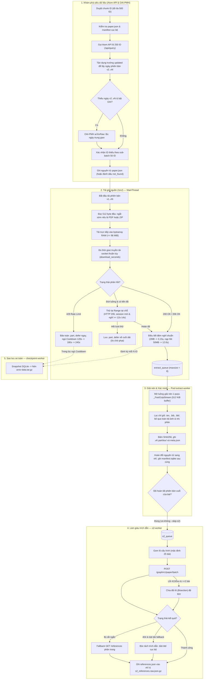

# arxiv-pipeline — Mô tả dự án và luồng xử lý hiện tại

> **Mục đích tài liệu:** Trình bày kiến trúc và luồng xử lý end-to-end hiện tại của crawler arXiv (Milestone 1) và thành phần phân tích cú pháp M2, phản ánh **chính xác 100% theo mã nguồn đang chạy**. Tài liệu tập trung vào nguyên lý vận hành, kiến trúc đa luồng, cơ chế điều phối nhịp độ mạng và cấu trúc dữ liệu, không ghi lại lịch sử cập nhật.

---

## 1. Tổng quan dự án

| Khía cạnh | Chi tiết kỹ thuật |
| :--- | :--- |
| **Mục tiêu dự án** | Thu thập toàn bộ các phiên bản (`v1..vN`) của các bài báo trong dải ID được giao; chỉ giữ lại mã nguồn `.tex`, `.bib` và `.bbl`; thu thập metadata arXiv và danh sách trích dẫn từ Semantic Scholar (S2); xuất dữ liệu chuẩn hóa phục vụ Milestone 2 & 3. |
| **Quy mô dữ liệu** | `src/id_ranges.csv`: **5 dải × 5.000 = 25.000 ID** gốc (tháng 06–08/2024), tính cả hai đầu (`inclusive`). |
| **Chế độ vận hành** | Thu thập tự động trên **một máy** qua `run_crawl.py`; hỗ trợ resume an toàn qua SQLite manifest; sử dụng khóa tệp hệ điều hành (`_acquire_workspace_lock`) để ngăn chặn việc chạy trùng tiến trình trên cùng thư mục dữ liệu. |
| **Hiệu năng hiện tại** | Hoàn tất dải 5.000 ID trong **~6,4 – 7,4 giờ** (tốc độ trung bình **~3,25s / lần tải** với gói thông thường, tuân thủ nghiêm ngặt chính sách rate limit và đạt **0% lỗi 429** từ phía crawler). |

---

## 2. Quy tắc lịch sự và Cấu hình mạng (Politeness Policy)

Hệ thống quản lý 2 kết nối độc lập với 2 dịch vụ bên ngoài tuân theo các ràng buộc sau:

### 2.1. Kết nối arXiv (`export.arxiv.org`)
- **Điểm truy cập duy nhất:** Chỉ sử dụng `export.arxiv.org`, tuyệt đối không gọi `arxiv.org`.
- **Giới hạn kết nối:** Sử dụng kết nối đơn qua `_SingleConnAdapter(pool_connections=1, pool_maxsize=1)` với `TCP_NODELAY = 1`, giữ ấm kết nối HTTP Keep-Alive và bảo toàn cơ chế tự động mở rộng cửa sổ nhận mạng của Linux (`tcp_rmem` lên tới 6 MiB).
- **Bộ điều phối nhịp độ (`RateLimiter`):**
  - **Nhịp khởi đầu (Start-to-Start):** `arxiv_min_interval = 3.15s` kết hợp jitter ngẫu nhiên `0..0.20s` (loại bỏ xung nhịp bot cố định).
  - **Sàn nghỉ socket (End-to-Start):** `arxiv_min_idle_gap = 3.05s`. Bất kể gói trước tải nhanh hay chậm, crawler **luôn đảm bảo socket nghỉ tối thiểu 3.05s** từ thời điểm đóng socket trước đến khi gửi request tiếp theo. Do $3.05\text{ s} > 3.00\text{ s}$, crawler không bao giờ vi phạm quy định $\ge 3\text{ s}$ của arXiv. Khi dính 429 hoặc cảnh báo nhiệt, `_min_idle_gap` tự động co giãn tỷ lệ theo `_min_interval` nhằm đảm bảo socket luôn có khoảng đệm làm nguội thực tế.
  - **Xoay vòng phiên kết nối:** Tự động gọi `recycle_session()` sau mỗi 120 request hoặc ngay khi gặp đứt luồng socket để làm mới trạng thái TCP.
  - **Tản nhiệt chủ động (v3.10 Clean Lean Turbo):** Đặt mặc định `arxiv_proactive_cooldown_every_ids = 0` (tắt tự động ngủ 60s định kỳ; crawler chỉ ngủ khi arXiv THỰC SỰ trả về HTTP 429 hoặc khi được cấu hình rõ). Việc này xóa bỏ hơn 40 phút ngủ tự nguyện lãng phí trên dải 5.000 ID.

### 2.2. Kết nối Semantic Scholar (`api.semanticscholar.org`)
- **Tần suất yêu cầu:** Giới hạn tối thiểu **1.1 giây / request** (End-to-Start) qua `AdaptiveRateLimiter`.
- **Gom lô thông minh:** Sử dụng API `POST /graph/v1/paper/batch` (mặc định 25 ID/lô, cấu hình qua `--s2-batch-size`) để gom nhiều bài báo vào một truy vấn duy nhất, giảm thiểu tới 98% số lượng request qua mạng.
- **Chia đôi lô tự động (Bisection):** Khi gặp mã lỗi `HTTP 413 Payload Too Large` hoặc `5xx` trên mẻ có từ 2 bài trở lên, hệ thống tự động chia đôi danh sách ($N/2$) và gửi đệ quy nhằm cô lập các bài chứa danh sách trích dẫn quá lớn mà không làm thất bại cả mẻ.
- **Dự phòng trích dẫn cục bộ (Dual-Engine Reference Fallback):** Khi Semantic Scholar chưa lập chỉ mục bài báo (`HTTP 404`), crawler tự động bóc tách trích dẫn từ các tệp `.bib` và `.bbl` có sẵn trong thư mục mã nguồn bài viết khi kích hoạt cờ `--enable-bib-fallback`.
- **Tách luồng linh hoạt (`--skip-s2`):** Hỗ trợ cờ `--skip-s2` để bỏ qua hoàn toàn truy vấn S2 trong luồng cào chính, ưu tiên tối đa thông lượng tải arXiv và để dành việc bù trích dẫn sau qua chế độ `--s2-only`.
- **Bảo mật khóa API:** Tự động đính kèm `x-api-key` (từ biến `S2_API_KEY`); toàn bộ nhật ký ghi log đều được lọc qua `SecretRedactingFilter` để che giấu khóa API.

---

## 3. Kiến trúc Đa luồng (5 nhóm luồng)

Crawler được thiết kế theo mô hình **Producer–Consumer** phi tập trung nhằm tách rời luồng mạng khỏi tác vụ tính toán CPU và ghi đĩa:

```
[MainThread: Network Producer]
       │
       ▼ (gói nguồn <= 96MB trong RAM)
[extract_queue: maxsize=8, trần 192MB RAM]
       │
       ├─────────────────────────┐
       ▼                         ▼
[extract-worker #1]       [extract-worker #2] (CPU / Disk Consumer)
       │                         │
       └────────────┬────────────┘
                    ▼ (khi phiên bản cuối hoàn tất)
              [s2_queue]
                    │
                    ▼
              [s2-worker] (Semantic Scholar Batch)

[checkpoint-worker] (Chạy ngầm định kỳ / khi cooldown)
[resource-sampler]  (Daemon đo RAM & Disk O(1))
```

| Nhóm luồng | Vai trò & Trách nhiệm | Cơ chế cô lập tài nguyên |
| :--- | :--- | :--- |
| **1. `MainThread`** *(arXiv Producer)* | Phân chia chunk ID; khám phá Atom API (lô 250); tải gói `/src/{id}vK` trực tiếp vào RAM; điều tiết nhịp độ và xử lý phản hồi 429/lỗi mạng; đẩy gói hoàn tất vào `extract_queue`. | Chỉ giao tiếp với `export.arxiv.org`; không giải nén file, không gọi S2. |
| **2. Pool `extract-worker`** *(Consumer - 2 luồng)* | Lấy gói từ `extract_queue`; giải nén 1-pass trong bộ nhớ; lọc giữ `.tex`, `.bib`, `.bbl`; tính hash SHA256; hoán đổi tệp nguyên tử; ghi `manifest.sqlite`; kiểm tra bộ đếm phiên bản nguyên tử để đẩy sang `s2_queue`. | Thuần xử lý CPU & Disk I/O; chạy song song 100% với việc tải mạng của bài tiếp theo. |
| **3. `s2-worker`** *(Metadata Worker)* | Gom các bài đã xử lý xong từ `s2_queue`; gửi `POST /paper/batch` tới Semantic Scholar (mặc định 25 bài/lô); tự chia đôi lô (Bisection) nếu gặp 413/5xx; fallback phân trang nếu trích dẫn bị cắt hoặc bóc tách `.bib/.bbl` nếu S2 404 (khi bật bib fallback); lưu `references.json` vào mọi phiên bản và ghi marker `s2_references.raw.json.gz`. | Chỉ giao tiếp với Semantic Scholar; chạy hoàn toàn độc lập với arXiv; tự động bỏ qua khi bật `--skip-s2`. |
| **4. `checkpoint-worker`** *(Backup Worker)* | Chụp snapshot SQLite qua `sqlite3.backup`; đóng gói dữ liệu sang `arxiv-data.tar.gz` kèm cơ chế chống tụt lùi dữ liệu (`shrink protection`); tự động bỏ qua nếu dữ liệu không đổi (`skip_if_unchanged=True`). | Chạy nền song song khi ngủ cooldown hoặc định kỳ; không làm gián đoạn tải mạng. |
| **5. `resource-sampler`** *(Telemetry Daemon)* | Lấy mẫu tài nguyên định kỳ (RAM mỗi 5s, đĩa mỗi 300s); cung cấp dữ liệu tức thì $O(1)$ cho hệ thống đo đạc mà không tốn chi phí quét tiến trình. | Luồng daemon nền nhẹ. |

---

## 4. Luồng xử lý chi tiết (End-to-End Flow)



### 4.1. Khám phá siêu dữ liệu (Discovery)
1. **Chia chunk:** Danh sách ID được duyệt theo từng chunk `500 ID` (hoặc cấu hình theo `backup_every_ids`).
2. **Kiểm tra trạng thái cục bộ:** Bỏ qua các ID đã hoàn tất hoặc đã xác nhận `not_found` trong manifest. Các bài có phiên bản nhưng thiếu ngày trung gian được đưa vào danh sách tự sửa đổi (`auto-heal`).
3. **Truy vấn Atom API theo lô 250:** Gửi truy vấn `GET /api/query?id_list=...&max_results=250`. Tách phiên bản từ thẻ `<id>` và lấy ngày nộp từ thẻ `<published>`.
4. **Tối ưu hóa thẻ `<updated>` & Bù ngày OAI-PMH:** Với các bài có 2 phiên bản, thẻ `<updated>` chính là ngày của `v2` $\rightarrow$ gán trực tiếp mà không cần thêm truy vấn phụ. Với các bài $\ge 3$ phiên bản, hệ thống truy vấn bổ sung các bản trung gian `v2..v{N-1}`. Nếu Atom API vẫn thiếu ngày và cờ `--enable-oai-dates` được kích hoạt, crawler tự động truy vấn OAI-PMH (`arXivRaw`) để bóc tách ngày chính thức của các bản $v_2..v_N$, đảm bảo `len(paper.revised_dates) == paper.num_versions - 1`.
5. **Xác nhận ID vắng mặt:** Các ID không trả về kết quả trong lô lớn được kiểm tra lại qua các cụm nhỏ 50 ID để đảm bảo không bỏ sót bài báo trước khi ghi nhận `not_found`.
6. **Lưu trữ:** Ghi nguyên tử thông tin vào `data/papers/<dirname>/paper.json`.

### 4.2. Tải gói nguồn (`/src/`)
1. **Kiểm tra trạng thái:** Bỏ qua các cặp `(arxiv_id, version)` đã ở trạng thái kết thúc (`ok`, `ok_no_tex`, `no_source`, `not_found`, `corrupt`).
2. **Ngắt sớm định dạng không phải TeX:** Ngay khi đọc đủ 512 byte đầu tiên, nếu phát hiện magic byte `%PDF` hoặc `ZIP`, luồng tải dừng ngay lập tức. Ghi nhận kích thước đầy đủ từ `Content-Length` và đánh dấu `no_source` (tiết kiệm hơn 95% băng thông cho bài PDF).
3. **Đệm RAM Zero-Copy:** Mọi gói nguồn $\le 96\text{ MiB}$ (chiếm >99.5% kho arXiv) được lưu trực tiếp vào RAM, không sinh file tạm trên đĩa. Chỉ gói $> 96\text{ MiB}$ mới tràn ra file tạm `.part`.
4. **Bấm giờ thuần socket wire (`download_seconds`):** Thời gian tải được bấm giờ trực tiếp trong vòng lặp đọc socket, hoàn toàn tách rời khỏi thời gian chờ của bộ điều nhịp, loại bỏ triệt để các sai số timing.

### 4.3. Giải nén và Lọc nội dung (`extract_tex_bib`)
1. **Luồng giải nén `_FastGzipStream`:** Sử dụng bộ giải nén khối `512 KiB` trực tiếp từ bộ nhớ với `zlib.decompressobj(16 + zlib.MAX_WBITS)` ở tầng C, mở Gzip một lần duy nhất.
2. **Lọc tệp nghiêm ngặt:** Chỉ trích xuất các tệp có đuôi `.tex`, `.bib` và `.bbl`. Bỏ qua toàn bộ ảnh (`.png`, `.pdf`, `.eps`), video và tệp nhị phân nhằm tối ưu dung lượng lưu trữ.
3. **Bảo mật đường dẫn:** Ngăn chặn triệt để lỗ hổng Path Traversal (`..`, đường dẫn tuyệt đối, ký tự điều khiển hệ thống).
4. **Ghi tệp và Hoán đổi nguyên tử:** Ghi dữ liệu vào thư mục tạm `.vK.part/`, băm SHA256 từng tệp, tạo `meta.json`, và thực hiện hoán đổi nguyên tử (`replace`) sang thư mục chính thức `vK/`.
5. **Cập nhật Manifest:** Ghi nhận kết quả vào `manifest.sqlite` ở bước cuối cùng để đảm bảo tính toàn vẹn khi xảy ra sự cố nguồn điện.
6. **Điều phối bài hoàn tất:** Sử dụng bộ đếm nguyên tử `paper_pending_versions[arxiv_id]`. Khi tất cả các phiên bản của một bài báo đã giải nén xong, bài báo mới được đưa vào `s2_queue` để lấy trích dẫn.

### 4.4. Thu thập trích dẫn Semantic Scholar (`s2-worker`)
1. **Gom lô trích dẫn:** Gom tối đa 25 bài (hoặc cấu hình tùy chỉnh qua `s2_batch_size` / `--s2-batch-size`) từ `s2_queue` trong cửa sổ chờ 45 giây. Nếu bật `--skip-s2`, bước xử lý S2 được bỏ qua hoàn toàn để dồn băng thông cào gói arXiv.
2. **Truy vấn Batch & Chia đôi lô (Bisection):** Gửi `POST /graph/v1/paper/batch` kèm danh sách ID. Khi gặp mã lỗi `HTTP 413` hoặc lỗi tạm thời `5xx` trên mẻ có $\ge 2$ bài, hệ thống tự động chia đôi mẻ ($N/2$) và gửi đệ quy nhằm cô lập bài gây quá tải mà không làm thất bại các bài còn lại.
3. **Fallback phân trang:** Nếu trường `referenceCount` lớn hơn số lượng trích dẫn trả về trong batch, worker tự động gọi thêm `GET /paper/{id}/references?limit=1000` để lấy trọn vẹn danh sách.
4. **Dự phòng trích dẫn cục bộ (Dual-Engine Reference Fallback):** Với các bài S2 trả về `null` (404 - chưa index), nếu cờ `--enable-bib-fallback` được bật, worker tự động đọc và trích xuất danh sách trích dẫn từ các tệp `.bib` và `.bbl` có sẵn trong thư mục mã nguồn bài viết.
5. **Lưu trữ đồng bộ:** Ghi cùng một file `references.json` vào tất cả các thư mục phiên bản `v1..vN` của bài và nén file gốc thành `s2_references.raw.json.gz` (hoặc đánh dấu `source: local_bib`) làm marker hoàn tất.

---

## 5. Cơ chế Phòng ngừa & Xử lý sự cố mạng

### 5.1. Phân cấp đệm nghỉ theo dung lượng (Tránh cạn Token Bucket)
Để ngăn ngừa việc CDN Fastly bóp băng thông sau khi tải các gói lớn mà vẫn giữ tốc độ tối ưu:
- **Gói thông thường (< 2 MiB, ~85% kho bài):** Chạy theo nhịp cơ sở (Start-to-Start 3.15s, sàn nghỉ socket 3.05s).
- **Phản ứng trễ mạng (TTFB v3.10 Clean Lean Turbo):** Khi thời gian chờ header phản hồi `last_header_elapsed >= 3.5s`, crawler xoay vòng session để làm mới kết nối TCP tránh nghẽn socket, **tuyệt đối không gọi `note_429()`** trên mã `200 OK` (không tự phạt chính mình, giữ nguyên nhịp 3.15s).
- **Gói trung bình & lớn ($\ge 2\text{ MiB}$ hoặc truyền socket $\ge 2.5\text{ s}$ hoặc có nối Range):** Nghỉ đệm lịch sự chuẩn `3.15s` End-to-Start (xóa bỏ hình phạt ngủ 6.0s thừa thãi của `_GIANT_TRANSFER_BREATHER_SECONDS`).
- **Nạp hồi băng thông trượt (Mỗi 50 MiB):** Sau mỗi 50 MiB dữ liệu tải thực qua mạng (`_BANDWIDTH_WINDOW_MAX_BYTES = 50 MiB`), crawler tự động xoay vòng socket và nghỉ `12.0s` để làm mới hạn mức burst của CDN khi gặp chùm bài khổng lồ liên tiếp, không ngắt quãng việc tải các bài bình thường.

### 5.2. Điều tiết lưu lượng (Paced Streaming) và Nối tiếp tại chỗ (In-Place Multi-Slice Range Resume)
- **Điều tiết lưu lượng luồng tải (Paced Streaming 4.5 MiB/s):** Với các gói nhỏ $\le 512\text{ KiB}$ (~75–80% kho bài), crawler đọc trực tiếp với tốc độ tối đa không độ trễ. Khi dung lượng vượt $512\text{ KiB}$, tốc độ đọc socket được điều tiết ở mức **$4,5\text{ MiB/s}$** (`_MAX_SUSTAINED_STREAM_BPS`, cho phép ghi đè qua biến môi trường `CRAWLER_MAX_STREAM_MBPS`). Mức 4.5 MiB/s vừa đủ nhanh để bài 20 MB tải xong trong ~4 giây (thay vì 15 giây), vừa đủ mượt để bảo vệ Token Bucket băng thông của Fastly không bị tràn buffer.
- **Thử lại Range tại chỗ cho file lớn (In-Place Multi-Slice Resume v3.9.9 / v3.11.1):** Khi gặp đứt stream trên file lớn ($\ge 1\text{ MiB}$), crawler tự động xoay vòng session mới (`recycle_session()`), áp dụng đệm nghỉ an toàn $\ge \mathbf{12,0\text{ s} - 14,0\text{ s}}$ (`_HEAVY_STREAM_BREAK_BONUS = 9.0s`) để token bucket Fastly CDN edge sạc đầy, sau đó gửi ngay `Range: bytes={written}-` (`HTTP 206 Partial Content`). Nhờ đó các file khổng lồ 20–40 MB hoàn tất sau 2 slice ngay tại chỗ trong ~13.5s mà không bị Fastly trả 429 hay dồn toa sang cuối dải.
- **Bảo toàn byte tải dở (Zero-Loss Range Resume):** Toàn bộ byte tải được lưu an toàn trong `.resume-{id}-v{version}.part` để nối tiếp qua `HTTP 206 Range`. **Tuyệt đối không xóa `.part` khi gặp HTTP 429** (429 là giới hạn tần suất/băng thông, không phải từ chối Range); chỉ xóa `.part` khi nhận mã 403 (cấm truy cập) hoặc 416 (dải byte không hợp lệ).
- **Tách bạch đứt stream khỏi chuỗi phạt 429 (v3.9.7 / v3.11.1):** Đứt luồng do socket Fastly ngắt kết nối (`ChunkedEncodingError`) sau khi đã thử lại tại chỗ được lưu an toàn vào `.part` và **defer bài báo về cuối dải (0s chờ phạt)**, tiếp tục cào ngay bài tiếp theo (`need_cd = False`). Nếu request Range dở dang gặp mã 429, hệ thống nhận diện `is_stream_break` để cách ly: chỉ ngủ breather cố định 60s, **tuyệt đối không tăng `arxiv_429_streak` leo thang**. Chỉ khi có $\ge 2$ bài liên tiếp bị đứt stream thì hệ thống mới ngủ breather cố định 60s để ổn định mạng mà không tăng streak.
- **Lượt vét cuối dải (`deferred_ids`):** Sau khi hoàn tất danh sách chính, crawler duyệt lại các bài trong hàng đợi hoãn (tối đa 5 vòng), tiếp tục tải phần còn lại qua `HTTP 206 Range` khi endpoint đã nguội.

### 5.3. Xử lý HTTP 429 & Cooldown leo thang
- **Tuyệt đối không phạt gói thành công:** Mã HTTP `200 OK` không bao giờ gọi hàm phạt hay tăng thời gian chờ.
- **Khi gặp HTTP 429 trên `/src/`:**
  - Đẩy ngay bài báo vào `deferred_ids`.
  - Đóng kết nối cũ qua `recycle_session()`.
  - Ngủ **Cooldown leo thang có giới hạn:** `120s → 180s → 240s` (khóa trần tối đa 240 giây, loại bỏ hoàn toàn các mức ngủ sâu 600s).
  - Tự động hạ bậc phạt: Sau **6 bài liên tiếp tải thành công (200 OK)**, mức streak được hạ 1 bậc.

### 5.4. Cơ chế Checkpoint nền và Khôi phục an toàn
- **Sao lưu song song không chặn luồng:** `checkpoint-worker` đóng gói `data/` thành `arxiv-data.tar.gz` trong nền trong lúc luồng chính đang ngủ cooldown hoặc định kỳ mỗi 1.000 ID.
- **Bỏ qua khi không có dữ liệu mới (`skip_if_unchanged=True`):** So sánh chữ ký tiến độ `(final_pairs, s2_done)` trước khi nén; nếu không có bài mới, thời gian sao lưu = `0 giây`.
- **Chống tụt lùi dữ liệu (`Shrink Protection`):** Kèm file `.meta.json` kiểm soát số lượng bài; bản sao lưu mới không bao giờ ghi đè nếu có số cặp phiên bản ít hơn bản cũ.
- **Khóa OS Mutex liên tiến trình:** Sử dụng file khóa cấp hệ điều hành tại thư mục temp (`_acquire_workspace_lock`) cùng file `data/logs/rate_state.json` để đồng bộ thời gian phạt giữa các lần chạy lại.

---

## 6. Cấu trúc thư mục dữ liệu (`data/`)

```text
data/
├── manifest.sqlite                     # Bảng version_pairs: (arxiv_id, version) -> status, metrics, sha256
├── logs/
│   ├── crawl.log                       # Log chi tiết (tự che khóa API qua SecretRedactingFilter)
│   ├── metrics.json                    # Thống kê thời gian từng giai đoạn, đỉnh RAM/Disk, phần cứng
│   ├── diagnostics.jsonl               # Nhật ký sự kiện ngoại lệ (HTTP 429/403/5xx, đứt stream, gói >= 50MB)
│   └── rate_state.json                 # Lưu mốc cooldown liên tiến trình
├── .tmp/                               # Thư mục tạm (trống >99,5% thời gian nhờ đệm RAM)
├── papers/
│   └── <dirname>/                      # Mã bài (ví dụ: 2408.01045)
│       ├── paper.json                  # PaperMeta (tiêu đề, tác giả, ngày nộp, ngày sửa, venue)
│       ├── s2_references.raw.json.gz   # Phản hồi Semantic Scholar thô (marker hoàn tất S2)
│       ├── v1/
│       │   ├── meta.json               # VersionMeta (trạng thái, dung lượng, danh sách tệp kèm sha256)
│       │   ├── references.json         # Danh sách trích dẫn chuẩn hóa từ S2
│       │   └── tex/                    # Thư mục chứa các tệp .tex, .bib, .bbl giữ nguyên cấu trúc
│       └── v2/
│           └── ...
└── stats/                              # Kết xuất từ src/export_data.py
    ├── papers.parquet / .csv           # Bảng dữ liệu papers cho Hugging Face
    ├── references.parquet / .csv       # Bảng trích dẫn (chỉ giữ trích dẫn có ref_arxiv_id)
    ├── summary.json                    # Thống kê tổng hợp báo cáo & tỷ lệ trùng lặp cross_version_dedup
    └── performance.json                # Tổng hợp tài nguyên và thời gian chạy
```

---

## 7. Hợp đồng dữ liệu (Data Contracts)

- **Định dạng dữ liệu (`src/crawler/models.py` — `SCHEMA_VERSION = 1`):**
  - `PaperMeta`: `arxiv_id`, `title`, `authors`, `submission_date`, `revised_dates`, `venue`.
  - `VersionMeta`: `arxiv_id`, `version`, `status`, `raw_archive_bytes`, `kept_bytes`, `files` (danh sách `FileEntry`), `version_date`.
  - `FileEntry`: `path`, `size`, `sha256`.
  - `Reference`: `ref_s2_id`, `ref_arxiv_id`, `ref_title`, `ref_authors`, `ref_submission_date`.
- **Hai bảng xuất phục vụ nộp bài (Milestone 3):**
  - **Bảng `papers`:** Chứa toàn bộ bài báo thành công và siêu dữ liệu đầy đủ.
  - **Bảng `references`:** Chỉ giữ các trích dẫn **có mã arXiv (`ref_arxiv_id`)** để phục vụ bài toán trích dẫn nội bộ.

---

## 8. Lệnh vận hành nhanh (Quick Reference)

```bash
# 1. Kiểm tra danh sách ID mở rộng (chạy thử, không gọi mạng)
python src/run_crawl.py --ranges src/id_ranges.csv --dry-run

# 2. Chạy thử nghiệm Pilot (30 ID đầu dải)
python src/run_crawl.py --ranges src/id_ranges.csv --limit 30 --data-dir data --auto-resume-rate-limit

# 3. Chạy thu thập thực tế toàn bộ dải ID (kèm sao lưu định kỳ, tự vượt 429 & bù trích dẫn/ngày)
# (Trong giờ cao điểm có thể thêm --skip-s2 để ưu tiên cào arXiv nhanh và tránh 429 từ Semantic Scholar)
python src/run_crawl.py \
  --ranges src/id_ranges.csv \
  --data-dir data \
  --backup-dir /path/to/drive/arxiv-data.tar.gz \
  --backup-every-ids 1000 \
  --auto-resume-rate-limit \
  --enable-bib-fallback \
  --enable-oai-dates

# 4. Chế độ chỉ cào bù trích dẫn Semantic Scholar (không chạm arXiv)
python src/run_crawl.py --ranges src/id_ranges.csv --data-dir data --s2-only --enable-bib-fallback

# 5. Làm giàu trích dẫn offline từ file .bib/.bbl có sẵn (100% offline, không tốn mạng)
python src/enrich_references.py --data-dir data --dry-run
python src/enrich_references.py --data-dir data

# 6. Kiểm toán tính toàn vẹn kho dữ liệu trên đĩa vs manifest và xuất báo cáo JSON
python src/audit_corpus.py --data-dir data --output data/stats/audit_report.json

# 7. Kiểm tra tính toàn vẹn và xuất thống kê báo cáo
python src/validate_corpus.py --data-dir data
python src/export_data.py --data-dir data --out-dir data/stats

# 8. Kiểm tra chất lượng mã nguồn (linter, format, unit test)
ruff check . && ruff format . && pytest -q
```

**Các mã thoát (`Exit codes`):**
- `0`: Hoàn tất thu thập toàn bộ dải ID thành công.
- `2`: Lỗi cấu hình đầu vào (thiếu email `CRAWLER_CONTACT` hoặc sai cú pháp dải ID).
- `3`: Dừng bắt buộc (`StopCrawl`) khi arXiv trả về HTTP `403`, hoặc vượt số lần thử lại khi không bật `--auto-resume-rate-limit`.
- `130`: Người dùng chủ động ngắt tiến trình (`Ctrl+C` — dữ liệu được lưu an toàn).

---

## 9. Giới hạn đã biết & Lưu ý khi viết Báo cáo

1. **Điểm nhấn kỹ thuật trong báo cáo Jupyter Book:**
   - **Tuân thủ tuyệt đối chuẩn lịch sự (`Start-to-Start >= 3,0 s`, 1 kết nối tới `export.arxiv.org`)** nhưng vẫn kéo thời gian thực tế 5.000 ID về sát trần vật lý lý thuyết (`~6,4 – 7,4 giờ`) nhờ kiến trúc **Producer–Consumer đa luồng (`extract_workers = 2`)**, đệm RAM Zero-Copy `96 MiB` (`memoryview`, trần hàng đợi `192 MiB`), giải nén 1-pass `512 KiB` (`_FastGzipStream`) giữ `.tex`/`.bib`/`.bbl`, nối luồng đứt bằng `HTTP 206 Range` lịch sự (`_HEAVY_STREAM_BREAK_BONUS = 9.0s`, đệm nghỉ 12-14s), **Defer tức thì + Cooldown có giới hạn `120 → 180 → 240 s`** và **Backup nền song song có kiểm tra thay đổi (`skip_if_unchanged=True`)**.
   - **Thống kê đa phiên chuẩn xác (`benchmark_summary` & `cross_version_dedup`):** Bóc tách tường minh thời gian chạy thực (`active_wall_seconds`) khỏi thời gian nghỉ giữa các phiên Colab (`idle_gap_seconds`) và thời gian chờ phạt (`cooldown_retry_seconds`), đồng thời định lượng tỷ lệ trùng lặp mã nguồn giữa các phiên bản bằng `sha256` làm cầu nối sang Milestone 2.
2. **Môi trường Windows:** Trình diệt virus (Windows Defender) đôi khi quét file trong `.vK.part` lúc `os.replace`; `pipeline.py` đã bọc bắt lỗi `OSError`, khôi phục bản cũ và đánh dấu `failed` để lần chạy sau tự retry (rủi ro R8).
3. **Đóng băng nộp bài (R6):** Trước khi nộp link repo mã Milestone 1, cần dọn các file quản trị nội bộ (`STATUS.md`, `AGENTS.md`, `CONTRIBUTING.md`, `docs/`, `project requirements/`) theo đúng quy định đề bài (chỉ giữ `.py`, `.ipynb`, `requirements.txt`, `README.md`).

---

## 10. Phần C của M2: gom nguồn và dựng cây (08/11)

`parsing.pipeline.process_paper` đã có điểm gọi hai module C thật:

```text
Corpus.tex_files(id, version)
  → gathering.gather_compilation_unit(id, version, raw_files)
  → CompilationUnit
  → hierarchy.build_raw_hierarchy(unit, CleanerHooks của B)
  → RawNode[] + bibliography bổ sung → các stage tham khảo/dedup của D
```

- Gathering chỉ đọc từ điển bytes đầu vào: giải mã, khử comment có bảo vệ literal,
  chọn root đa tín hiệu, DFS include có chặn chu trình/độ sâu 15 và đếm file duy nhất.
  Điểm include chỉ cộng khi đích tìm được trong mapping từ thư mục root ứng viên;
  không thưởng include thiếu của file mẫu. Sửa root sai ở `2408.11049` v4/v5:
  từ template dùng 1/14 TeX sang `main.tex` dùng 8/14 TeX và nhận bibliography.
  Không tải lại mạng, không thực thi TeX, không sửa corpus. Lỗi include được log
  với ID/version/path; có cảnh báo đồng nghĩa kết quả có thể chỉ là một phần.
- Hierarchy dùng stack cấp bậc, có list/item lồng nhau và lá sentence/formula/figure.
  Gọi `CleanerHooks` được inject, không import trực tiếp module B. Giữ Abstract,
  Acknowledgements và Appendix; tách References khỏi mọi nội dung nút, kể cả list/item.
  Phiên bản không có root trả `([], [])`; lỗi hook được đưa lên pipeline.
- Môi trường thiếu dấu đóng được phục hồi tại đề mục tiếp theo; cấu trúc lồng quá
  64 mức báo lỗi rõ ràng, không âm thầm tạo cây sai. Đây là parser giới hạn theo
  đặc tả, không mô phỏng toàn bộ lệnh/điều kiện/package TeX.
- `.bbl` liên quan được xử lý khi có trong `raw_files`, nhưng `Corpus.tex_files()`
  hiện vẫn lọc `.tex/.bib`: cần A/D nối đường truyền `.bbl` trước tích hợp đầy đủ.
  Schema và module các owner khác được giữ nguyên trong phần C.
- Unit test C và test tích hợp `Stages` dùng nguồn tổng hợp, B/D giả: **98 test C**,
  toàn suite **394 passed**. Không gọi mạng trong unit test.
- Corpus leader cung cấp ở `arxiv-data/`: metadata **1.000 bài / 1.678 phiên bản**;
  349 tệp của mẫu 10 bài khớp kích thước/SHA-256. Đã gọi trực tiếp hai hàm C trên
  **26 phiên bản + 3 đối chứng** với hook truyền nguyên văn: cây/marker References đạt,
  dùng **265/324 TeX**. Sáu phiên bản mẫu thiếu bibliography trong subset; không có
  `.bbl` để thử đường dữ liệu thật. Chưa đối chiếu gói gốc hoặc validate toàn subset.
- M2-C còn 🟡: chưa chứng minh clean/math/split B, tham khảo/dedup/export D, validator E,
  pipeline end-to-end hoặc benchmark Colab. Bản thảo giao E:
  `docs/reports/m2/01_parsing_hierarchy.md`; bằng chứng và đầu việc tích hợp ở
  `docs/reports/m2/02_c_real_sample_check.md` + `c_real_sample_check.json`.

*Tài liệu được rà soát và đồng bộ với mã nguồn `arxiv-pipeline` ngày **10/11/2026**.*
