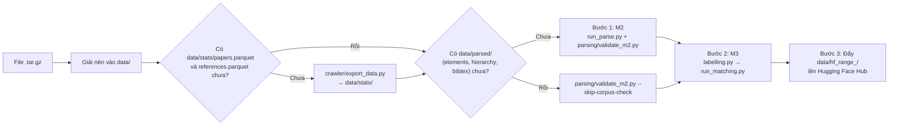

# Hướng dẫn chạy Local từ file `.tar.gz`: Milestone 2 → Milestone 3 → Hugging Face Dataset

Tài liệu này hướng dẫn từng bước chạy **hoàn toàn trên máy cá nhân (Windows PowerShell / Linux / macOS)** bắt đầu từ **file `.tar.gz` dữ liệu đã có** → chạy **Milestone 2** (parse LaTeX/BibTeX) → **Milestone 3** (gán nhãn, trích 21 đặc trưng, huấn luyện & đánh giá `MRR@5`, xuất hình Poster) → đóng gói và đẩy **Hugging Face Dataset (6 bảng Parquet)** theo từng dải 5.000 ID.



---

## Bước 0 — Cài môi trường & Giải nén `.tar.gz` trên máy local

### 0.1. Cài đặt môi trường Python

> [!IMPORTANT]
> Luôn đứng ở **thư mục gốc của repo** (`arxiv-pipeline/`) khi chạy mọi lệnh trong hướng dẫn này, vì mặc định `--ranges` của `run_matching.py` và `labelling.py` là `src/id_ranges.csv`.

**Windows (PowerShell):**

```powershell
git clone https://github.com/GiaaPhuc/arxiv-pipeline.git
cd arxiv-pipeline

python -m venv .venv
.\.venv\Scripts\Activate.ps1
pip install -r src/requirements.txt
```

**Linux / macOS:**

```bash
git clone https://github.com/GiaaPhuc/arxiv-pipeline.git
cd arxiv-pipeline

python3 -m venv .venv
source .venv/bin/activate
pip install -r src/requirements.txt
```

*(Nếu đã clone repo sẵn, chỉ cần `git pull` / `git checkout <nhánh>`, kích hoạt `.venv` và chạy `pip install -r src/requirements.txt`.)*

### 0.2. Giải nén file `.tar.gz` vào `data/`

Lệnh `tar` đã có sẵn trên **Windows 10/11 (CMD & PowerShell)**, **macOS** và **Linux**:

```bash
# Tạo thư mục data/ tại gốc repo và giải nén (thay đường dẫn file .tar.gz của bạn)
mkdir data
tar -xzf path/to/your-archive.tar.gz -C data
```

**Kiểm tra cấu trúc ngay sau khi giải nén (rất quan trọng):**
Mở xem thư mục `data/` vừa giải nén. Bên trong `data/` cần chứa **trực tiếp** các thư mục con như `papers/`, `stats/`, `parsed/` (tùy loại `.tar.gz` bạn có):

```text
data/
├── manifest.sqlite    # (nếu là gói M1)
├── papers/            # nguồn .tex / .bib theo từng bài (bắt buộc nếu chạy M2)
├── stats/             # papers.parquet, references.parquet, ...
└── parsed/            # elements/, hierarchy/, bibtex/ (có sau M2)
```

- Nếu giải nén ra thấy bị lồng thêm một lớp thư mục, ví dụ `data/data/papers/...` hoặc `data/arxiv-data/papers/...`, hãy **dời toàn bộ thư mục con lên thẳng `data/`** (hoặc dùng `--data-dir data/arxiv-data` ở mọi lệnh).
- *(Mẹo riêng cho gói M1 `arxiv-data.tar.gz` có sẵn `manifest.sqlite` + `papers/` nhưng chưa có `data/stats/`):* Thay vì `tar -xzf`, bạn có thể chạy thẳng một lệnh vừa giải nén an toàn vừa tạo `data/stats/`:
  ```bash
  python src/crawler/export_data.py --backup path/to/arxiv-data.tar.gz --data-dir data
  ```
  *(Thêm `--allow-incomplete` nếu gói backup crawl dở có bài thiếu `references.json`.)*

### 0.3. Xác định bước tiếp theo theo dữ liệu vừa giải nén

| Bên trong `data/` hiện có gì? | Việc cần làm tiếp |
| :--- | :--- |
| Chỉ có `papers/` (chưa có `stats/papers.parquet` & `stats/references.parquet`) | Chạy `python src/crawler/export_data.py --data-dir data` → làm **Bước 1 → Bước 2 → Bước 3**. |
| Đã có `papers/` + `stats/` (`papers.parquet`, `references.parquet`), chưa có `parsed/` | Bắt đầu từ **Bước 1 (M2) → Bước 2 (M3) → Bước 3 (HF)**. |
| Đã có sẵn cả `stats/` lẫn `parsed/` (`elements/`, `hierarchy/`, `bibtex/`) | Chạy `python src/parsing/validate_m2.py --data-dir data --skip-corpus-check` (thấy `PASS`) → nhảy thẳng **Bước 2 (M3) → Bước 3 (HF)**. |

> [!NOTE]
> Ở Milestone 3, thư mục `data/papers/` là **tùy chọn**: nếu có `data/papers/*/s2_references.raw.json.gz`, pipeline tận dụng thêm DOI thô từ Semantic Scholar; nếu file `.tar.gz` bạn có chỉ gồm `stats/` + `parsed/`, M3 vẫn chạy đầy đủ bình thường.

### 0.4. Tra chỉ số dải 5.000 ID (`--range-index`)

Chọn đúng `<k>` theo [`src/id_ranges.csv`](../src/id_ranges.csv):

| `--range-index` | Khoảng arXiv ID | Số lượng ID |
| :---: | :--- | :---: |
| `0` | `2408.11045` → `2408.16044` | 5.000 |
| `1` | `2408.06045` → `2408.11044` | 5.000 |
| `2` | `2408.01045` → `2408.06044` | 5.000 |
| `3` | `2407.07839` → `2407.12838` | 5.000 |
| `4` | `2406.07938` → `2406.12937` | 5.000 |
| `all` | Toàn bộ 25.000 ID (khi tổng hợp nội bộ cả nhóm) | 25.000 |

---

## Bước 1 — Chạy Milestone 2 (Parse TeX/BibTeX → Parquet & Validate)

> Nếu trong `data/` đã có sẵn `parsed/` (`elements/`, `hierarchy/`, `bibtex/`), bỏ qua **1.1** và **1.2**, chỉ chạy **1.3**.

### 1.1. Kiểm tra số bài cần parse (`--dry-run`)

```bash
python src/run_parse.py --data-dir data --dry-run
```

### 1.2. Chạy parser (an toàn khi dừng giữa chừng)

```bash
# (Tùy chọn) Chạy thử 100 bài đầu để kiểm tra:
python src/run_parse.py --data-dir data --limit 100 --workers 1

# Chạy toàn bộ (hoặc tiếp tục sau pilot / sau khi bấm Ctrl+C):
# Giữ --resume nếu data/parsed/ đã tồn tại từ lần chạy trước
python src/run_parse.py --data-dir data --workers 4 --batch-size 500 --resume
```

- Điều chỉnh `--workers` theo số luồng CPU và RAM máy bạn (máy phổ thông 8–16 GB RAM nên để `4`–`8`).
- Nếu bấm **Ctrl+C** (exit code `130`), chạy lại đúng lệnh có `--resume`: các bài đã ghi shard (trong `data/parsed/_done.txt`) được bỏ qua, các bài lỗi trước đó sẽ được thử lại.

### 1.3. Kiểm định đầu ra M2 (`src/parsing/validate_m2.py`)

```bash
# Nếu có đủ data/papers/, data/stats/ và data/parsed/:
python src/parsing/validate_m2.py --data-dir data

# Nếu file .tar.gz chỉ có data/stats/ và data/parsed/ (không có data/papers/):
python src/parsing/validate_m2.py --data-dir data --skip-corpus-check
```

Kết quả bắt buộc phải in **`PASS`** ở dòng cuối (exit code `0`). Đầu ra sau Bước 1:
- `data/parsed/elements/*.parquet`, `data/parsed/hierarchy/*.parquet`, `data/parsed/bibtex/*.parquet`
- `data/stats/m2_papers_stats.csv`, `m2_elements_kind.csv`, `m2_summary.json`, `m2_performance.json`

---

## Bước 2 — Chạy Milestone 3 (Gán nhãn, Train/Eval & Xuất HF Local)

Thay `<k>` bằng số `0`, `1`, `2`, `3` hoặc `4` của bạn.

### 2.1. Kiểm tra nhanh đầu vào M3 cho dải `<k>` (`--dry-run`)

```bash
python src/run_matching.py --data-dir data --range-index <k> --dry-run
```

Kiểm tra `bibtex_rows`, `bibtex_papers`, `reference_rows`, `reference_papers` khớp với dải `<k>` của bạn.

### 2.2. Gán nhãn thủ công (`matching.labelling`) — Bắt buộc trước khi chạy pipeline

Pipeline yêu cầu `data/groundtruth/range_<k>/manual_annotations.json` thỏa mãn đồng thời:
1. Ít nhất **5 bài báo** thuộc dải `<k>` (mỗi bài đủ $\ge 20$ mục BibTeX và $\ge 5$ arXiv reference).
2. Gán đủ **100% mục BibTeX** trong các bài đã chọn (`complete = true`), tổng cộng **$\ge 100$ mục**.
3. Trong số đó có tối thiểu **2 bài** đạt chuẩn đánh giá `valid`/`test` (`qualified_eval_papers >= 2`): mỗi bài có $\ge 20$ mục, tối thiểu **3 nhãn dương** (`groundtrutharxivid != null`) và tối thiểu **3 nhãn âm** (`groundtrutharxivid == null`).

**Bước a — Liệt kê các bài đủ điều kiện trong dải `<k>`:**

- **Windows (PowerShell):**
  ```powershell
  $env:PYTHONPATH="src"; python -m matching.labelling --range-index <k> --data-dir data
  ```
- **Linux / macOS:**
  ```bash
  PYTHONPATH=src python -m matching.labelling --range-index <k> --data-dir data
  ```

**Bước b — Gán nhãn tương tác cho $\ge 5$ bài đã chọn từ danh sách trên:**

- **Windows (PowerShell):**
  ```powershell
  $env:PYTHONPATH="src"; python -m matching.labelling --range-index <k> --data-dir data --paper-ids <ARXIV_ID_1> <ARXIV_ID_2> <ARXIV_ID_3> <ARXIV_ID_4> <ARXIV_ID_5>
  ```
- **Linux / macOS:**
  ```bash
  PYTHONPATH=src python -m matching.labelling --range-index <k> --data-dir data --paper-ids <ARXIV_ID_1> <ARXIV_ID_2> <ARXIV_ID_3> <ARXIV_ID_4> <ARXIV_ID_5>
  ```

Thao tác trên CLI:
- Nhập **`1..N`** để chọn đúng `ref_arxiv_id` gợi ý.
- Nhập **`0`** nếu mục BibTeX không khớp tham chiếu arXiv nào (`null`).
- Nhập **`all`** để hiện toàn bộ danh sách arXiv candidate của bài đó.
- Nhập **`q`** để thoát (mỗi câu trả lời đều được lưu ngay vào `data/groundtruth/range_<k>/manual_annotations.json`, chạy lại đúng lệnh trên để làm tiếp từ chỗ dừng).
- Khi xong đủ, kiểm tra JSON cuối CLI in ra có **`"manual_pool_ready": true`**.

**Bước c — (Tùy chọn) Đo Cohen's Kappa chéo giữa 2 thành viên:**

```powershell
# Windows (PowerShell) — người thứ 2 gán chung >= 1 bài sang manual_peer.json:
$env:PYTHONPATH="src"; python -m matching.labelling --range-index <k> --data-dir data --paper-ids <ARXIV_ID_1> --out-path data/groundtruth/range_<k>/manual_peer.json

# Tính Kappa → xuất data/groundtruth/range_<k>/kappa.json:
$env:PYTHONPATH="src"; python -m matching.labelling --range-index <k> --data-dir data --compare-path data/groundtruth/range_<k>/manual_peer.json
```

*(Trên Linux/macOS đổi `$env:PYTHONPATH="src";` thành `PYTHONPATH=src`.)*

### 2.3. (Tùy chọn) Kiểm tra trước Auto-Matcher, Audit & Coverage

```powershell
# Windows (PowerShell):
$env:PYTHONPATH="src"; python -m matching.auto_matcher --range-index <k> --data-dir data --auto-fraction 0.10

# Linux / macOS:
PYTHONPATH=src python -m matching.auto_matcher --range-index <k> --data-dir data --auto-fraction 0.10
```

Nếu thấy cảnh báo `assigned_coverage ... < 0.10` (do một số ID trong dải 5.000 bài là `no_source` hoặc không có BibTeX nên 10% số bài `eligible` nhỏ hơn 10% tổng dải), tăng `--auto-fraction` lên (ví dụ `0.12` hoặc `0.15`) khi chạy bước 2.4.

### 2.4. Chạy End-to-End Matching + Xuất & Kiểm định 6 bảng HF + Vẽ hình Poster

Chạy một lệnh duy nhất (thêm `--auto-fraction 0.12` nếu cần ở bước 2.3):

```bash
python src/run_matching.py --data-dir data --range-index <k> --auto-fraction 0.10 --export-hf --verify-hf --plot-figures
```

*(Trên PowerShell muốn xuống dòng lệnh dài thì dùng dấu `` ` ``; hoặc cứ để nguyên 1 dòng như trên cho gọn.)*

Lệnh này thực hiện trọn gói:
1. Preclean `bibtex` & `references` (+ đọc DOI từ `data/papers/*/s2_references.raw.json.gz` nếu có).
2. Auto-match $\ge 10\%$ bài còn lại, kiểm toán P/R/F1 trên tập Manual, tách `splits.json` theo bài báo (`test`: 1 manual + 1 auto; `valid`: 1 manual + 1 auto; `train`: còn lại) và ghi `auto_annotations.parquet`.
3. Trích **21 đặc trưng** (`15` lexical B + `3` M2 AST E + `3` query-relative A; tự bật Stage-1 blocking khi $n > 50$).
4. Huấn luyện `MatchingRanker` (`LightGBM LambdaMART` với trọng số `Manual=3.0`, `Auto=1.0`, early stopping trên `Valid-Manual`), kèm so sánh **4 mô hình** (`Title Fuzzy`, `TF-IDF Cosine`, `Logistic Regression`, `LightGBM LambdaMART`) và **Ablation M2** (`18 Features (No M2)` vs `21 Features (+ M2 AST)`).
5. Ghi kết quả tại `data/matching/range_<k>/`:
   - `predictions.parquet` (`arxivid`, `partition`, `citationkey`, `groundtrutharxivid`, `cand1..cand5`)
   - `evaluation_results.json`, `ranker_metadata.json`, `matching_summary.json`
   - `figures/model_comparison.png`, `ablation_feature_importance.png`, `audit_and_error_breakdown.png` (300 DPI)
6. Đóng gói **6 bảng Parquet ZSTD** ($\le 80\text{ MB}$/shard) vào `data/hf_range_<k>/` và chạy `datasets.load_dataset()` kiểm tra toàn bộ 6 bảng.

*(Nếu muốn vẽ lại 3 ảnh Poster ra thư mục khác từ JSON kết quả: `python -m matching.plots --input data/matching/range_<k>/evaluation_results.json --out-dir docs/poster/figures` nhớ kèm `PYTHONPATH=src`.)*

---

## Bước 3 — Kiểm tra & Đẩy Dataset lên Hugging Face Hub

### 3.1. Kiểm tra thư mục `data/hf_range_<k>/`

```text
data/hf_range_<k>/
├── README.md                                  # Dataset Card kèm YAML configs 6 bảng
└── data/
    ├── papers/train-00000-of-0000N.parquet
    ├── references/train-00000-of-0000N.parquet
    ├── elements/train-00000-of-0000N.parquet
    ├── hierarchy/train-00000-of-0000N.parquet
    ├── bibtex/train-00000-of-0000N.parquet
    └── predictions/train-00000-of-0000N.parquet
```

Kiểm tra nhanh trước khi upload:
- [ ] `run_matching.py` ở Bước 2.4 kết thúc với exit code `0` và JSON kết quả có `"hf_verified_counts"` đủ 6 bảng (`papers`, `references`, `elements`, `hierarchy`, `bibtex`, `predictions`).
- [ ] File `data/hf_range_<k>/README.md` giữ nguyên hoàn toàn khối YAML `--- configs: ... ---` ở đầu file (nếu muốn viết thêm mô tả chi tiết, chỉ chèn ở phía dưới dấu `---` thứ hai).
- [ ] Không commit `data/`, `.env`, hoặc token lên Git repo nhóm.

### 3.2. Tạo Token & Repository Public trên Hugging Face

1. Vào [huggingface.co](https://huggingface.co/) → **Settings → Access Tokens → Create new token** với quyền **Write**.
2. Đảm bảo đang kích hoạt `.venv` (CLI `hf` và `huggingface_hub` đã có sẵn khi cài `datasets>=2.20` từ `src/requirements.txt`).

### 3.3. Upload từ máy local bằng CLI `hf`

Thay `<hf_username>` bằng username Hugging Face của bạn và `<k>` bằng `0..4`:

```bash
# 1. Đăng nhập (chỉ cần 1 lần, dán Write token khi CLI hỏi)
hf auth login

# 2. Tạo dataset repo công khai trên Hub
hf repos create <hf_username>/arxiv-reference-matching-range-<k> --repo-type dataset --public --exist-ok

# 3. Upload toàn bộ data/hf_range_<k>/ lên thư mục gốc của repo (chú ý dấu '.' ở cuối)
hf upload <hf_username>/arxiv-reference-matching-range-<k> data/hf_range_<k> . --repo-type dataset --commit-message "Upload Milestone 3 dataset (range <k>)"
```

> [!WARNING]
> Tham số thứ 3 của `hf upload` **bắt buộc là `.`** (`PATH_IN_REPO`) để `README.md` và thư mục `data/` nằm ngay ở gốc repo Hugging Face (khớp `path: data/<table>/*.parquet` trong YAML `README.md`). Nếu upload bị đứt mạng giữa chừng, chạy lại đúng lệnh `hf upload` trên để tiếp tục.

*(Nếu muốn upload bằng Python script với biến môi trường `HF_TOKEN`, dùng `HfApi(token=os.environ["HF_TOKEN"]).upload_folder(folder_path=Path("data/hf_range_<k>"), path_in_repo="", repo_id=..., repo_type="dataset")`.)*

### 3.4. Xác minh lại trực tiếp từ Hugging Face Hub

1. Mở `https://huggingface.co/datasets/<hf_username>/arxiv-reference-matching-range-<k>`, kiểm tra **Dataset Viewer** hiển thị đủ **6 config**: `papers`, `references`, `elements`, `hierarchy`, `bibtex`, `predictions`.
2. Kiểm tra tải bằng Python từ Hub:

```python
from datasets import load_dataset

repo_id = "<hf_username>/arxiv-reference-matching-range-<k>"
for cfg in ("papers", "references", "elements", "hierarchy", "bibtex", "predictions"):
    ds = load_dataset(repo_id, name=cfg, split="train")
    print(f"{cfg}: {len(ds)} rows | cols={ds.column_names}")
```

---

## Xử lý các lỗi thường gặp trên local

| Lỗi / Hiện tượng | Nguyên nhân | Cách xử lý |
| :--- | :--- | :--- |
| Giải nén `.tar.gz` xong không thấy `data/papers/` mà thấy `data/data/...` hoặc `data/arxiv-data/...` | Archive đóng gói sẵn thư mục cha | Dời nội dung bên trong lên thẳng `data/`, hoặc truyền đúng đường dẫn đó vào `--data-dir`. |
| `Missing Parquet input for table 'papers'` hoặc `'references'` | Chưa chạy bước xuất bảng M1 | Chạy `python src/crawler/export_data.py --data-dir data` (thêm `--allow-incomplete` nếu cần). |
| `Missing Parquet input for table 'bibtex'` / `'elements'` / `'hierarchy'` | Chưa chạy M2 `run_parse.py` | Chạy Bước 1 (`python src/run_parse.py --data-dir data --workers 4 --resume`). |
| `ShardedParquetExporter` báo `FileExistsError` ở M2 | Đã có `data/parsed/` trước đó mà thiếu `--resume` | Thêm `--resume` vào lệnh `run_parse.py`. |
| `error: ranges CSV not found: src/id_ranges.csv` | Đang chạy lệnh bên trong `src/` thay vì gốc repo | `cd ..` về thư mục gốc `arxiv-pipeline/` (hoặc thêm `--ranges id_ranges.csv`). |
| `Manual pool requires >=5 papers, >=20 queries/paper and >=100 total` | Chưa gán đủ 5 bài / chưa gán hết mục trong bài | Chạy lại `matching.labelling --paper-ids ...` để hoàn tất đủ $\ge 5$ bài. |
| `Need 2 qualified manual papers for valid/test` | Không đủ 2 bài manual có đồng thời $\ge 3$ nhãn dương và $\ge 3$ nhãn âm | Chọn/gán thêm bài có cả ref khớp arXiv (`>=3`) và ref ngoài arXiv (`>=3`). |
| `logger.warning: assigned_coverage ... < 0.10` | Dải có nhiều bài `no_source`/thiếu BibTeX | Tăng `--auto-fraction 0.12` (hoặc `0.15`) khi chạy `run_matching.py`. |
