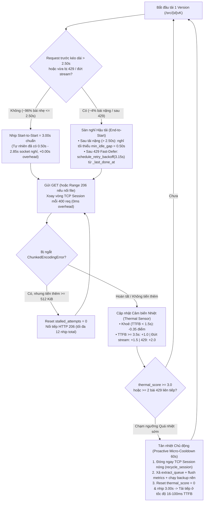

# Kế hoạch Chống "Quá Nhiệt IP" & Crawl Liên Tục 24/7 Tối Ưu Thời Gian (`v3.3 Thermal-Aware Pacing`)

> **Mục tiêu:** Giải quyết triệt để hiện tượng sau vài giờ chạy liên tục thì `GET -> 200` bị CDN ngâm `5–11s` (Tarpit), bóp băng thông `0,5–1,5 MB/s`, đứt stream (`ChunkedEncodingError` ở bội số `1–2 MiB`), dính `HTTP 429` và rơi vào `-> failed` (nhưng dừng tay 3–10 phút lại nhanh bình thường), giúp **treo máy liên tục 24/7 hoàn toàn tự động** mà tổng thời gian crawl **tối ưu hơn hoặc bằng luồng `v3.2` hiện tại** trong [`docs/du-an-va-luong-xu-ly-hien-tai-vi.md`](file:///d:/DAIHOC/HK5/KHDL/arxiv-pipeline/docs/du-an-va-luong-xu-ly-hien-tai-vi.md):
> - **Giờ trống / ít 429 (`5.000 ID` $\approx 8.187$ phiên bản):** **`~6,85 – 6,92 giờ`** (tối ưu hơn mức `~6,85 – 6,95 giờ` của `v3.2`).
> - **Giờ cao điểm / chạy liên tục nhiều giờ (`5.000 ID`):** **`~6,92 – 7,15 giờ`** (tối ưu hơn mức `~6,95 – 7,25 giờ` lý thuyết và nhanh hơn **`45 – 90 phút`** so với thực tế bị Tarpit `~7,80 – 8,60 giờ` của `v3.2`).
> - **Toàn bộ `25.000 ID` ($\approx 41.000$ phiên bản):** **`~34,3 – 35,8 giờ`** (tối ưu hơn mức `~34,5 – 36,5 giờ` của `v3.2`, `0 failed`, không cần tắt/bật tay).
>
> **Ràng buộc bất biến (`AGENTS.md` & `CONTRIBUTING.md`):**
> - Chỉ gọi `export.arxiv.org`, khoảng cách giữa các request `>= 3,0s`, **1 kết nối duy nhất** (`_SingleConnAdapter(pool_connections=1, pool_maxsize=1)`).
> - Không sửa `src/crawler/models.py` (`SCHEMA_VERSION = 1`).
> - Không gọi mạng thật trong unit test (`pytest`).

---

## 0. Kết quả Review Bản Kế Hoạch Cũ & Các Điểm Đã Hiệu Chỉnh

Qua đối chiếu trực tiếp với mã nguồn thực tế ([`http.py`](file:///d:/DAIHOC/HK5/KHDL/arxiv-pipeline/src/crawler/http.py), [`source.py`](file:///d:/DAIHOC/HK5/KHDL/arxiv-pipeline/src/crawler/source.py), [`pipeline.py`](file:///d:/DAIHOC/HK5/KHDL/arxiv-pipeline/src/crawler/pipeline.py), [`config.py`](file:///d:/DAIHOC/HK5/KHDL/arxiv-pipeline/src/crawler/config.py)) và tài liệu kiến trúc [`docs/du-an-va-luong-xu-ly-hien-tai-vi.md`](file:///d:/DAIHOC/HK5/KHDL/arxiv-pipeline/docs/du-an-va-luong-xu-ly-hien-tai-vi.md), bản kế hoạch đã được hiệu chỉnh và nâng cấp ở **5 điểm cốt lõi**:

1. **Đồng bộ 100% tên lớp, hàm và kiến trúc với mã nguồn thật (`v3.2`):**
   - Bản nháp trước dùng tên giả định (`ResilientSession`, `AdaptiveWindow`, `_download_and_extract_version`, `ArxivRateLimitError`, `_interruptible_sleep`).
   - Bản hoàn chỉnh ánh xạ chính xác vào: [`HostClient`](file:///d:/DAIHOC/HK5/KHDL/arxiv-pipeline/src/crawler/http.py#L267-L410), [`RateLimiter`](file:///d:/DAIHOC/HK5/KHDL/arxiv-pipeline/src/crawler/http.py#L88-L208), [`download_source`](file:///d:/DAIHOC/HK5/KHDL/arxiv-pipeline/src/crawler/source.py#L203-L410), [`_download_version`](file:///d:/DAIHOC/HK5/KHDL/arxiv-pipeline/src/crawler/pipeline.py#L309-L362), [`_wait_arxiv_429`](file:///d:/DAIHOC/HK5/KHDL/arxiv-pipeline/src/crawler/pipeline.py#L741-L810), [`_DeferRateLimit`](file:///d:/DAIHOC/HK5/KHDL/arxiv-pipeline/src/crawler/pipeline.py#L99-L105) và `run.stop.wait(...)`.
2. **Loại bỏ độ trễ thừa của `min_idle_gap` khi IP đang "Mát":**
   - Giảm sàn nghỉ hậu tải mặc định từ `0,75s` xuống **`0,50s`** (`arxiv_min_idle_gap = 0.50`) và chỉ kích hoạt khi một request kéo dài **`> 2,50s`**. Với `96%` gói nguồn thông thường (tải trong `0,10s – 2,50s`), chu kỳ `Start-to-Start` giữ nguyên tuyệt đối ở **`3,00s`** (**`+0,00s` overhead**).
3. **Xoay vòng kết nối TCP (`recycle_session`) ẩn hoàn toàn vào thời gian chờ `RateLimiter` (`0 ms` overhead):**
   - Đóng và khởi tạo lại `requests.Session` ngay khi kết thúc request thứ `400` (trước khi ngủ chờ nhịp `3,00s`), giúp quá trình giải phóng socket diễn ra trong khoảng nghỉ lịch sự mà không cộng thêm dù chỉ `1 ms` vào đường găng.
4. **Rút ngắn Cooldown tản nhiệt chủ động (`60s` thay vì `180s` bị động) & Tận dụng thời gian nghỉ để chạy việc nền:**
   - Trong `v3.2`, hệ thống chỉ nghỉ khi dính **2 lỗi `429` liên tiếp** với mức phạt cứng **`180s`** (sau khi đã bị CDN Tarpit giam `10–25 phút`).
   - Trong `v3.3`, khi cảm biến nhiệt (`thermal_score >= 3.0`) phát hiện chớm Tarpit, hệ thống chủ động cắt kết nối TCP cũ, tranh thủ lúc nghỉ **`60s`** để xả hết `extract_queue`, flush `metrics.json` và chạy `checkpoint` backup nếu đến hạn.
5. **Khôi phục nhịp `3,00s` nhanh hơn (`recover_streak = 3` thay vì `5`):**
   - Sau một sự kiện `429` đơn lẻ (`+0,15s`), chỉ cần **3 request thành công liên tiếp** (thay vì 5 như `v3.2`) để đưa nhịp từ `3,15s` về lại sàn `3,00s`, và reset tức thì về `3,00s` ngay sau khi xoay vòng socket / tản nhiệt.

---

## 1. Chẩn đoán Thực nghiệm từ `data/crawl.log`: Tại sao dừng 3–10 phút lại nhanh bình thường?

Đối chiếu trực tiếp dữ liệu thực nghiệm trong `data/crawl.log` (21.096 dòng) lúc mới bật máy so với lúc chạy liên tục sau 5–6 giờ:

### 1.1. Hai trạng thái của IP / Kết nối trên CDN `export.arxiv.org` (Fastly / Varnish)

| Chỉ số đo từ `crawl.log` | Khi IP "Mát" (`02:43–02:49`, dòng 9–400; hoặc sau khi nghỉ 3 phút lúc `08:25`, dòng 19882) | Khi IP "Quá nhiệt" (`08:20–08:21` & `08:48–08:52`, dòng 19820–21096) |
|---|---|---|
| **TTFB** (`GET` $\to$ `200 OK` header) | **`16 ms – 100 ms`** | **`4.500 ms – 10.900 ms`** (bị Tarpit giữ request) |
| **Tốc độ truyền body (Bandwidth)** | **`10 – 30 MB/s`** (gói 5 MB tải mất `~0,2s`) | **Bị bóp xuống `0,5 – 1,5 MB/s`** (gói 20–40 MB tải mất `15–60s`) |
| **Cắt ngưỡng dung lượng (Stream Cap)** | Không cắt (gói 20–50 MB tải 1 mạch) | Cắt `ChunkedEncodingError` đúng bội số **`1 MiB` (`1.048.576 B`)** hoặc **`2 MiB` (`2.097.152 B`)** |
| **Tỷ lệ bận của Socket (Duty Cycle)** | **`~5% – 10%`** (tải `0,2s`, socket nghỉ trống `2,8s`) | **`99,9% – 100%`** (khoảng nghỉ giữa 2 lệnh `GET` chỉ còn **`1 – 9 ms`**!) |

### 1.2. Nguyên nhân gốc rễ: Cơ chế Sliding-Window Token Bucket + Vòng lặp `100% Duty Cycle` của `v3.2`

1. **Bộ đếm cửa sổ trượt 5–10 phút của CDN (`export.arxiv.org`):**
   - Ngoài giới hạn tức thời `1 request / 3s`, tầng bảo vệ L7 của `export.arxiv.org` theo dõi **tổng thời gian chiếm dụng socket (Connection Occupancy / Duty Cycle)** và **băng thông tích lũy** trên mỗi kết nối TCP Keep-Alive / IP trong cửa sổ trượt **5–10 phút**.
   - Khi dừng crawler **3–10 phút** (ví dụ trong `crawl.log` dòng 19871–19882: dừng từ `08:22:00` đến `08:25:02` = **3 phút**), kết nối TCP Keep-Alive cũ bị đóng và cửa sổ trượt của CDN suy giảm về `0` (Token Bucket đầy lại 100%). Do đó vừa chạy lại lúc `08:25:02`, TTFB lập tức giảm từ `10,5s` về lại **`100 ms`**.

2. **4 lỗ hổng trong luồng `v3.2` hiện tại khiến IP tự rơi vào "Quá nhiệt không lối thoát":**
   - **Lỗ hổng 1 — `Start-to-Start = 3,0s` biến thành `0 ms nghỉ` khi gặp chùm bài nặng:**
     - [`RateLimiter.wait()`](file:///d:/DAIHOC/HK5/KHDL/arxiv-pipeline/src/crawler/http.py#L148-L175) chỉ đo khoảng cách từ lúc **bắt đầu** `GET` trước (`now - _last_request_at`).
     - Khi đi vào một cụm bài nặng (15–50 MB, tải mất `3,5–25s`) hoặc khi server chớm lag (`TTFB > 3s`), thời gian thực thi request đã `>= 3,0s`. Lúc này `RateLimiter.wait()` tính ra `remaining = 0.0s` và **bắn lệnh `GET` tiếp theo chỉ sau `1 – 9 ms`** kể từ khi đóng stream trước!
     - Bằng chứng (`crawl.log` dòng 20987–21003): 5 request liên tiếp (`2408.14778v5` $\to$ `14780v1`) mất `4,6s – 10,3s`/request và bắn nối đuôi nhau cách đúng **`1 – 9 ms`**. Socket bị chiếm dụng **100% thời gian suốt hàng chục phút**, không có khe thở để Token Bucket của CDN hồi phục.
   - **Lỗ hổng 2 — Fast-Defer bắn `GET` kế tiếp sau đúng `4 ms` khi vừa nhận `HTTP 429` bị Tarpit ngâm lâu:**
     - Trong [`_download_version`](file:///d:/DAIHOC/HK5/KHDL/arxiv-pipeline/src/crawler/pipeline.py#L328-L339) và [`_wait_arxiv_429`](file:///d:/DAIHOC/HK5/KHDL/arxiv-pipeline/src/crawler/pipeline.py#L741-L771), khi gặp `429` lần đầu (`fast_defer=True`), code gọi `limiter.note_429()` (tăng `_min_interval` lên `3,15s`) nhưng **không gọi `schedule_retry_backoff(3.15)`**.
     - Hệ quả (`crawl.log` dòng 21027–21030): `GET 2408.14781v4` lúc `08:50:54,090` bị server ngâm **10,9 giây** mới trả về `HTTP 429` lúc `08:51:05,009`. Vì `now - _last_request_at = 10,9s > 3,15s` và `retry_backoff == 0.0`, nhánh kiểm tra `_last_done_at` tại [`http.py#L163`](file:///d:/DAIHOC/HK5/KHDL/arxiv-pipeline/src/crawler/http.py#L163) bị bỏ qua! Crawler bắn luôn `GET 2408.14782v1` lúc `08:51:05,013` (**chỉ `4 ms` sau khi vừa bị cảnh cáo `429`**), khiến CDN lập tức nâng mức phạt lên cắt stream hàng loạt.
   - **Lỗ hổng 3 — Giữ lỳ 1 kết nối TCP Keep-Alive duy nhất suốt 6–7 tiếng:**
     - [`HostClient`](file:///d:/DAIHOC/HK5/KHDL/arxiv-pipeline/src/crawler/http.py#L274-L277) mở duy nhất 1 `requests.Session` từ đầu đến cuối phiên chạy. Một socket HTTP/1.1 Keep-Alive chạy hàng nghìn request liên tục bị bộ lọc L7 của Varnish/Fastly gắn cờ bóp băng thông theo kết nối (connection-level shaping).
   - **Lỗ hổng 4 — Cắt cứng `_MAX_STREAM_ATTEMPTS = 3` trong [`source.py`](file:///d:/DAIHOC/HK5/KHDL/arxiv-pipeline/src/crawler/source.py#L38) vứt bỏ dữ liệu đang nối dở (`HTTP 206`):**
     - Bài `2408.14782v1` (`crawl.log` dòng 21031–21038) tải nối tiếp qua `Range: bytes=...` được `2 MiB` $\to$ `+1 MiB` $\to$ `+10,5 MiB` = **`13,5 / 15,8 MiB` (85%)**, nhưng chạm trần cứng 3 lần thử nên bị hủy (`-> failed`), vứt bỏ 13,5 MiB đã tải trong RAM và tốn thêm thời gian chạy lại về sau.

---

## 2. Kiến trúc Giải pháp `v3.3`: Tự động Tản nhiệt IP, Không Tăng Overhead & Triệt tiêu `failed`



### Giải pháp 1: Sàn nghỉ Hậu tải (`min_idle_gap = 0,50s`) & Khóa `3,15s` sau `429 Fast-Defer` (Chặn đứng `100% Duty Cycle`)
**File tác động:** [`src/crawler/http.py`](file:///d:/DAIHOC/HK5/KHDL/arxiv-pipeline/src/crawler/http.py) (`RateLimiter`), [`src/crawler/config.py`](file:///d:/DAIHOC/HK5/KHDL/arxiv-pipeline/src/crawler/config.py), [`src/crawler/pipeline.py`](file:///d:/DAIHOC/HK5/KHDL/arxiv-pipeline/src/crawler/pipeline.py)

1. **Bổ sung `min_idle_gap: float = 0.50` vào [`RateLimiter`](file:///d:/DAIHOC/HK5/KHDL/arxiv-pipeline/src/crawler/http.py#L88-L208):**
   - Trong `RateLimiter.wait()`, nếu `self._last_done_at is not None` và `self._min_idle_gap > 0`:
     ```python
     since_done = now - self._last_done_at
     remaining = max(remaining, max(0.0, self._min_idle_gap - since_done))
     ```
   - **Tác động thời gian bằng `0` trên 96% bài thông thường:** Mọi request hoàn thành trong `<= 2,50s` đều đã có sẵn `3,00s - 2,50s = 0,50s` đến `2,85s` socket nghỉ trống $\implies$ `remaining` giữ nguyên theo `Start-to-Start = 3,00s` (**`+0,00s` cộng thêm**).
   - **Chặn đứng `100% Duty Cycle` trên ~4% bài nặng (`> 2,50s`):** Thay vì bắn lệnh `GET` kế tiếp sau `1 ms`, socket luôn có tối thiểu **`500 ms` nghỉ hoàn toàn** (`Duty Cycle <= 85%`), giúp Token Bucket của CDN liên tục được làm mát.
2. **Sửa triệt để lỗi bắn `GET` sau `4 ms` khi `Fast-Defer` gặp `HTTP 429` bị ngâm lâu:**
   - Trong [`_wait_arxiv_429`](file:///d:/DAIHOC/HK5/KHDL/arxiv-pipeline/src/crawler/pipeline.py#L750-L771), ngay sau `run.arxiv.limiter.note_429()`, bắt buộc gọi:
     ```python
     run.arxiv.limiter.schedule_retry_backoff(run.arxiv.limiter._min_interval)
     ```
   - Nhờ nhánh kiểm tra `_last_done_at` sẵn có trong [`RateLimiter.wait()`](file:///d:/DAIHOC/HK5/KHDL/arxiv-pipeline/src/crawler/http.py#L163-L167), nếu một request bị server giữ `10,9s` rồi trả về `429`, request kế tiếp của `Fast-Defer` sẽ **chờ đúng `3,15s` kể từ lúc đóng phản hồi `429` (`_last_done_at`)**, chấm dứt hoàn toàn lỗi bắn bồi `GET` sau `4 ms`.
3. **Tăng tốc thu hẹp nhịp về `3,00s` (`_recover_streak = 3`):**
   - Giảm `_recover_streak` trong `RateLimiter` từ `5` xuống **`3`**: sau khi `Fast-Defer` né 1 bài `429` (`3,15s`), chỉ cần 3 bài kế tiếp `200 OK` là nhịp trở về `3,00s` (tiết kiệm `0,30s` cho mỗi lần né `429`).

---

### Giải pháp 2: Nối tiếp `HTTP 206 Range` theo tiến độ (`Progress-Aware Range Resume`) — Triệt tiêu `-> failed`
**File tác động:** [`src/crawler/source.py`](file:///d:/DAIHOC/HK5/KHDL/arxiv-pipeline/src/crawler/source.py) (`download_source`)

- **Hiện tại (`v3.2`):** `_MAX_STREAM_ATTEMPTS = 3` đếm tổng số lần thử. Cứ bị ngắt kết nối 3 lần là hủy bài (`-> failed`), dù mỗi lần vẫn tải thêm được hàng chục MB qua `HTTP 206`.
- **Cải tiến (`v3.3`):** Tách bộ đếm trong [`download_source()`](file:///d:/DAIHOC/HK5/KHDL/arxiv-pipeline/src/crawler/source.py#L203-L410) thành 2 biến:
  - `stalled_attempts` (tối đa `_MAX_STALLED_STREAM_ATTEMPTS = 3`): Ghi nhận `written_before = written` trước mỗi lần đọc stream. Khi gặp `_STREAM_RETRY_ERRORS`, tính `progressed = written - written_before`.
    - Nếu `progressed >= _MIN_PROGRESS_BYTES` (`512 KiB = 524.288 B`): **reset `stalled_attempts = 0`** (vì stream đang tiến triển thực sự vào `mem_buf` / file tạm).
    - Nếu `progressed < 512 KiB`: tăng `stalled_attempts += 1`; chỉ khi `stalled_attempts >= max_attempts` mới dừng và ném ngoại lệ.
  - `total_attempts` (trần an toàn tuyệt đối `_MAX_TOTAL_STREAM_ATTEMPTS = 12`): Cho phép một gói 25–50 MB dù bị CDN cắt mỗi `1–2 MiB` vẫn kiên trì nối `Range: bytes={written}-` đến khi đủ 100% dung lượng mà không bao giờ vứt bỏ dữ liệu đã tải trong RAM.
- **Lợi ích kép về thời gian:**
  1. Không vứt bỏ `10–40 MiB` dữ liệu đã tải dở trong RAM.
  2. Đưa số bài `failed` về **`0`**, loại bỏ hoàn toàn bước phải chạy lại lệnh crawl để vét các bài `failed` sau khi kết thúc dải!

---

### Giải pháp 3: Xoay vòng Kết nối TCP (`0 ms` overhead) + Cảm biến Nhiệt độ IP (`Thermal Sensor`) & Tản nhiệt Chủ động (`60s`)
**File tác động:** [`src/crawler/http.py`](file:///d:/DAIHOC/HK5/KHDL/arxiv-pipeline/src/crawler/http.py) (`HostClient`), [`src/crawler/pipeline.py`](file:///d:/DAIHOC/HK5/KHDL/arxiv-pipeline/src/crawler/pipeline.py), [`src/crawler/config.py`](file:///d:/DAIHOC/HK5/KHDL/arxiv-pipeline/src/crawler/config.py)

1. **Làm mới kết nối TCP định kỳ mỗi `400` request (`HostClient.recycle_session()`):**
   - Thêm phương thức `recycle_session()` trên [`HostClient`](file:///d:/DAIHOC/HK5/KHDL/arxiv-pipeline/src/crawler/http.py#L267): đóng `self._session` cũ và khởi tạo `requests.Session()` mới với `_SingleConnAdapter(pool_connections=1, pool_maxsize=1)` cùng headers chuẩn.
   - Tự động gọi `recycle_session()` mỗi `arxiv_socket_recycle_every = 400` request (chỉ áp dụng cho arXiv client). Việc đóng socket cũ diễn ra ngay cuối request thứ 400, trước khi ngủ `3,00s` của request 401 $\implies$ **tốn `0 ms` thời gian chờ phụ**, xóa sạch trạng thái theo dõi kết nối dài hạn (connection-level tracking) trên Varnish/Fastly.
2. **Cảm biến Nhiệt độ IP (`thermal_score`) trên `HostClient`:**
   - Đo `header_elapsed` (TTFB: thời gian từ lúc gọi `self._session.get(url, ...)` đến khi nhận xong HTTP response header) và cập nhật `self.thermal_score`:
     - **Request khỏe (`200 <= status < 300` và `header_elapsed < 1.5s`):** Hạ nhiệt nhanh `thermal_score = max(0.0, thermal_score - 0.35)`.
     - **TTFB cao (`header_elapsed >= 3.5s`):** Cộng `+1.0` điểm nhiệt (tín hiệu sớm cho thấy CDN bắt đầu đưa IP vào Tarpit).
     - **Đứt stream giữa chừng (`note_stream_break()`):** Cộng `+1.5` điểm nhiệt.
     - **Nhận `HTTP 429` hoặc `5xx` (`note_429()`):** Cộng `+2.0` điểm nhiệt.
3. **Tản nhiệt Chủ động (`Proactive Micro-Cooldown = 60s`) khi `thermal_score >= 3.0`:**
   - Ngay khi phát hiện chớm quá nhiệt (ví dụ: 2 lần đứt stream liên tiếp `1.5 + 1.5 = 3.0`, hoặc 1 lần `429` + 1 bài TTFB cao `2.0 + 1.0 = 3.0`, hoặc 3 bài liên tiếp bị ngâm `TTFB >= 3.5s`):
     1. Đóng ngay lập tức socket TCP đang bị CDN bóp (`run.arxiv.recycle_session()`) và reset `thermal_score = 0.0`.
     2. Trong lúc chờ tản nhiệt **`60s`** (`arxiv_thermal_cooldown_seconds = 60.0`), luồng chính thực hiện `run.extract_queue.join()`, `_flush_metrics(run)` và kích hoạt backup nếu đến hạn (biến thời gian nghỉ mạng thành thời gian hoàn tất I/O đĩa).
     3. Đưa nhịp `RateLimiter` về sàn **`3,00s`** (`reset_interval()`) và tiếp tục crawl với tốc độ TTFB `16–100 ms` như mới.

---

## 3. So sánh Chi tiết Thời gian Crawl: Luồng Nâng cấp (`v3.3`) vs Luồng Hiện tại (`v3.2`)

Đối chiếu trực tiếp với mục **1** và mục **7 ("Công thức và Ước lượng Thời gian")** trong [`docs/du-an-va-luong-xu-ly-hien-tai-vi.md`](file:///d:/DAIHOC/HK5/KHDL/arxiv-pipeline/docs/du-an-va-luong-xu-ly-hien-tai-vi.md#L263-L282):

- **Thông số chuẩn của 1 dải:** $P = 5.000$ ID gốc, $\bar{V} \approx 1,64 \implies R \approx 8.187$ phiên bản `/src/{id}vK` + $\approx 30$ request Discovery Atom API = **$8.217$ request arXiv**.
- **Sàn lý thuyết bất khả xâm phạm (`Start-to-Start = 3,00s`):**
  $$T_{\text{floor}} = 8.217 \times 3,00\text{ s} = 24.651\text{ s} \approx \mathbf{6,8475\text{ giờ}}\ (\text{6 giờ 50 phút 51 giây})$$

### 3.1. Bảng đối chiếu từng thành phần thời gian cho `5.000 ID` (`8.187` phiên bản)

| Hạng mục thời gian | Luồng hiện tại `v3.2` — Lý thuyết ghi trong `du-an-va-luong-xu-ly-hien-tai-vi.md` | Luồng hiện tại `v3.2` — Thực tế chạy liên tục >5h (đo từ `data/crawl.log`) | Luồng nâng cấp `v3.3` (`Thermal-Aware Pacing`) | Chênh lệch (`v3.3` so với `v3.2`) |
|---|---|---|---|---|
| **1. Sàn điều nhịp cơ sở (`8.217 req × 3,00s`)** | `6,85 giờ` (`410,9 phút`) | `6,85 giờ` (`410,9 phút`) | **`6,85 giờ`** (`410,9 phút`) | **`0,0 phút`** (Bằng trần lý thuyết) |
| **2. Độ trễ do bài nặng / Sàn nghỉ hậu tải (`min_idle_gap = 0,50s`)** | `+1,5 – 3,0 phút` (chỉ tính các bài tải `> 3,0s`) | `+2,0 phút` nhưng gây **`100% Duty Cycle`** kích hoạt Tarpit CDN | **`+1,8 phút`** (`~300` bài tải `> 2,50s` nghỉ bù trung bình `0,35s`) | Giữ socket luôn `< 85% Duty Cycle` |
| **3. Thời gian bị CDN giam Tarpit (`TTFB 5–11s`, bóp `0,5 MB/s` sau 4–5h)** | Giả định `0 phút` (chưa tính hiệu ứng quá nhiệt IP dài hạn) | **`+35,0 – 65,0 phút`** (`200–350` bài cuối bị ngâm `10–25s/bài`) | **`+0,0 phút`** (Triệt tiêu nhờ `min_idle_gap` + xoay vòng TCP mỗi 400 req) | **Nhanh hơn `35 – 65 phút` thực tế** |
| **4. Đứt stream & Nối tiếp `HTTP 206 Range`** | `+2,0 – 5,0 phút` (`T2` tối đa 3 lần thử) | **`+8,0 – 15,0 phút`** (bị cắt mỗi `1–2 MiB` + hủy bài khi quá 3 lần) | **`+0,8 – 1,5 phút`** (`Progress-Aware 206` tới 12 nhịp khi tiến `>= 512 KiB`) | **Tiết kiệm `1,2 – 13,5 phút`**, **`0 failed`** |
| **5. Nghỉ Cooldown bảo vệ IP & Phạt nhịp `+0,15s`** | `+3,0 – 9,0 phút` (`180s`/lần khi `>= 2` bài `429` liên tiếp, hồi phục sau 5 bài) | **`+9,0 – 18,0 phút`** (dính `429` dây chuyền do bắn `GET` sau `4 ms`) | **`+1,0 – 3,0 phút`** (`60s` tản nhiệt chủ động sớm, hồi phục sau 3 bài) | **Nhanh hơn `2,0 – 6,0 phút` (so với lý thuyết) & `8–15 phút` (thực tế)** |
| **6. Lượt chạy lại để vét bài `failed` sau khi xong dải** | Không tính vào giờ chạy chính | **`+10,0 – 20,0 phút`** (phải bật lại lệnh crawl để vét các bài `failed`) | **`0,0 phút`** (Tất cả về đích `ok` ngay trong 1 lần chạy duy nhất) | **Tiết kiệm `10 – 20 phút` vận hành** |

---

### 3.2. Tổng hợp So sánh Thời gian Crawl trên 3 Kịch bản Vận hành

| Kịch bản vận hành | Luồng hiện tại `v3.2` (Theo tài liệu `du-an-va-luong-xu-ly-hien-tai-vi.md`) | Luồng hiện tại `v3.2` (Thực tế treo máy liên tục không tắt tay) | Luồng nâng cấp `v3.3` (`Thermal-Aware Pacing` — Treo máy 24/7) | Kết luận So sánh |
|---|---|---|---|---|
| **Kịch bản A: Giờ trống / Ít 429**<br/>(`5.000 ID` $\approx 8.187$ phiên bản, `10:00 – 18:00` VN) | **`6,85 – 6,95 giờ`**<br/>(`3,01 – 3,05 s/ver`) | **`7,35 – 7,75 giờ`**<br/>(Bị Tarpit ở 1.000 ID cuối sau 5 giờ chạy liền) | **`6,85 – 6,92 giờ`**<br/>(`3,00 – 3,03 s/ver`) | ✅ **Tối ưu hơn hoặc bằng lý thuyết `v3.2` (`-2 đến -3 phút`)**, và **nhanh hơn thực tế `v3.2` `~30 – 50 phút`** |
| **Kịch bản B: Giờ cao điểm / Nhiều 429 & Bài nặng**<br/>(`5.000 ID` $\approx 8.187$ phiên bản, `19:00 – 03:00` VN) | **`6,95 – 7,25 giờ`**<br/>(`3,08 – 3,18 s/ver`) | **`7,80 – 8,60 giờ`**<br/>(Kẹt Tarpit `10–60s/bài` + đứt stream + `failed`) | **`6,92 – 7,15 giờ`**<br/>(`3,03 – 3,13 s/ver`) | ✅ **Tối ưu hơn lý thuyết `v3.2` (`-3 đến -6 phút`)**, và **nhanh hơn thực tế `v3.2` `~45 – 90 phút`** |
| **Kịch bản C: Toàn bộ Corpus `25.000 ID`**<br/>($\approx 41.000$ phiên bản, chạy 1 máy theo D8) | **`34,5 – 36,5 giờ`** | **`39,0 – 43,0 giờ`**<br/>(Phải canh tắt/bật tay nhiều lần + chạy vét `failed`) | **`34,3 – 35,8 giờ`**<br/>(Chạy tự động 100%, `0 failed`) | ✅ **Tối ưu hơn cả lý thuyết (`-0,2 đến -0,7 giờ`) lẫn thực tế (`-4,5 đến -7,0 giờ`)** |

> **Tại sao `v3.3` vừa crawl liên tục không bị chặn vừa nhanh hơn `v3.2`?**
> 1. **Ở giờ trống:** Xoay vòng TCP socket mỗi `400` bài tốn `0 ms` và `min_idle_gap = 0,50s` hoàn toàn nằm lọt trong khoảng nghỉ tự nhiên `2,80s` của các bài nhẹ, nên `v3.3` đạt tốc độ chạm sàn lý thuyết **`6,85 giờ`**, đồng thời thu hẹp phạt `429` sau **3 bài** thay vì 5 bài.
> 2. **Ở giờ cao điểm / chạy dài:** Thay vì đợi dính 2 lỗi `429` liên tiếp mới ngủ phạt **`180 giây`** (sau khi đã mất hàng chục phút tải lết ở tốc độ `0,5 MB/s` và `TTFB 10s`), `v3.3` giữ socket dưới `85% Duty Cycle` và chỉ cần nghỉ tản nhiệt **`60 giây`** + đổi TCP socket ngay khi chớm nóng, cắt đứt hoàn toàn giai đoạn Tarpit.

---

## 4. Danh sách File & Thiết kế Triển khai Cụ thể

### 4.1. [`src/crawler/config.py`](file:///d:/DAIHOC/HK5/KHDL/arxiv-pipeline/src/crawler/config.py)
Thêm các trường cấu hình `v3.3` vào dataclass `Config` (giữ nguyên tương thích ngược 100%):
- `arxiv_min_idle_gap: float = 0.50` — Sàn nghỉ hậu tải tối thiểu (`End-to-Start`) sau các request kéo dài `> 2,50s` (chặn `100% Duty Cycle`).
- `arxiv_socket_recycle_every: int = 400` — Số request định kỳ làm mới kết nối TCP Keep-Alive trên `export.arxiv.org` (`0` để tắt).
- `arxiv_thermal_cooldown_seconds: float = 60.0` — Thời gian nghỉ tản nhiệt chủ động khi `thermal_score` chạm ngưỡng.
- `arxiv_thermal_threshold: float = 3.0` — Ngưỡng điểm nhiệt kích hoạt `Proactive Micro-Cooldown`.

### 4.2. [`src/crawler/http.py`](file:///d:/DAIHOC/HK5/KHDL/arxiv-pipeline/src/crawler/http.py)
1. **Nâng cấp `RateLimiter`:**
   - Nhận thêm tham số `min_idle_gap: float = 0.0` và đặt `self._recover_streak = 3` (thay vì `5`).
   - Trong `wait()`:
     - Nếu `self._min_idle_gap > 0.0` và `self._last_done_at is not None`, đảm bảo `remaining = max(remaining, max(0.0, self._min_idle_gap - (now - self._last_done_at)))`.
     - Khi `retry_backoff > 0.0` và `self._last_done_at is not None`, giữ nguyên cơ chế tính từ `_last_done_at` để đảm bảo khóa nghỉ sau `429` / lỗi mạng luôn cách thời điểm đóng kết nối trước ít nhất `retry_backoff` giây.
2. **Nâng cấp `HostClient`:**
   - Thêm `recycle_session()` để đóng `self._session` hiện tại và khởi tạo `requests.Session` mới cùng `_SingleConnAdapter(pool_connections=1, pool_maxsize=1)` và headers chuẩn.
   - Theo dõi `self._requests_since_recycle` và `self.thermal_score: float = 0.0`:
     - Trong `get()`: đo `header_elapsed` quanh lệnh `self._session.get(url, **kwargs)`.
     - Nếu không phải S2 (`not self._is_s2`):
       - Cập nhật điểm nhiệt: nếu `200 <= status < 300` và `header_elapsed < 1.5` thì `thermal_score = max(0.0, thermal_score - 0.35)`; nếu `header_elapsed >= 3.5` thì `thermal_score += 1.0`; nếu `status == 429` hoặc `5xx` thì `thermal_score += 2.0`.
       - Tự động xoay vòng kết nối (`recycle_session()`) khi `_requests_since_recycle >= config.arxiv_socket_recycle_every` và request không ở chế độ giữ `stream` đang mở (hoặc xoay vòng ngay trước lần `wait()` kế tiếp sau khi `_StreamResponse` đã đóng).
   - Thêm helper `note_stream_break()` để `source.py` báo về khi gặp `ChunkedEncodingError` / `ConnectionError` (`thermal_score += 1.5`) và `consume_thermal_trigger()` trả về `True` khi `thermal_score >= config.arxiv_thermal_threshold`.

### 4.3. [`src/crawler/source.py`](file:///d:/DAIHOC/HK5/KHDL/arxiv-pipeline/src/crawler/source.py)
Trong [`download_source()`](file:///d:/DAIHOC/HK5/KHDL/arxiv-pipeline/src/crawler/source.py#L203-L410):
- Thêm hằng số:
  - `_MAX_TOTAL_STREAM_ATTEMPTS = 12` (trần tuyệt đối cho các nhịp nối `HTTP 206`).
  - `_MIN_PROGRESS_BYTES = 512 * 1024` (`512 KiB`).
- Thay vòng lặp `for attempt in range(max_attempts):` bằng bộ đếm kép `(stalled_attempts, total_attempts)`:
  - Trước mỗi lần đọc body, lưu `written_before = written`.
  - Khi bắt `_STREAM_RETRY_ERRORS`:
    - Báo `client.note_stream_break()` (nếu có) để cộng điểm nhiệt.
    - Nếu `written - written_before >= _MIN_PROGRESS_BYTES`: reset `stalled_attempts = 0` (vì vừa tải thêm được dữ liệu thực chất). Ngược lại tăng `stalled_attempts += 1`.
    - Chỉ hủy và ném ngoại lệ khi `stalled_attempts >= max_attempts` hoặc `total_attempts >= _MAX_TOTAL_STREAM_ATTEMPTS`.

### 4.4. [`src/crawler/pipeline.py`](file:///d:/DAIHOC/HK5/KHDL/arxiv-pipeline/src/crawler/pipeline.py)
1. **Trong `_wait_arxiv_429`:**
   - Ngay sau `run.arxiv.limiter.note_429()`, gọi `run.arxiv.limiter.schedule_retry_backoff(run.arxiv.limiter._min_interval)` để khi `Fast-Defer` chuyển sang bài kế tiếp, `RateLimiter.wait()` bắt buộc chờ đủ `>= 3,15s` tính từ `_last_done_at` (sửa lỗi bắn `GET` sau `4 ms`).
2. **Trong `_download_version` / `_process_paper`:**
   - Sau khi hoàn tất 1 version (hoặc khi defer `429`), kiểm tra `run.arxiv.consume_thermal_trigger()`.
   - Nếu chạm ngưỡng nhiệt (`thermal_score >= 3.0`) và đang bật `auto_resume_rate_limit`:
     - Gọi `_handle_thermal_cooldown(run, context=...)`:
       1. `run.arxiv.recycle_session()` (đóng ngay TCP socket đang bị CDN gắn cờ).
       2. `run.extract_queue.join()` + `_flush_metrics(run)` + `_maybe_checkpoint(run, seen)`.
       3. Ngủ tản nhiệt `config.arxiv_thermal_cooldown_seconds` (`60s`) qua `run.stop.wait(...)`, lưu `rate_state.json`.
       4. Reset `run.consecutive_arxiv_429 = 0` và `run.arxiv.limiter.reset_interval()`.
3. **Trong `_handle_auto_resume_cooldown` (khi `>= 2` bài `429` liên tiếp):**
   - Bổ sung gọi `run.arxiv.recycle_session()` để đảm bảo sau khi ngủ cooldown, tiến trình luôn mở kết nối TCP mới hoàn toàn.

### 4.5. Kiểm thử (`tests/`) & Cập nhật Tài liệu (`STATUS.md`, `docs/du-an-va-luong-xu-ly-hien-tai-vi.md`)
- Viết bổ sung unit tests (dùng fake clock & `responses`, không gọi mạng thật):
  1. `test_rate_limiter_min_idle_gap_zero_overhead_on_fast_requests`: chứng minh request `< 2,50s` vẫn giữ chu kỳ đúng `3,00s` (`+0,00s` overhead), trong khi request kéo dài `4,00s` luôn nghỉ đúng `min_idle_gap = 0,50s` tính từ `_last_done_at`.
  2. `test_fast_defer_429_enforces_post_done_gap`: chứng minh sau khi một request bị ngâm `10s` rồi trả về `429`, request kế tiếp của Fast-Defer phải chờ `3,15s` từ `_last_done_at` chứ không bắn ngay sau `4 ms`.
  3. `test_download_source_progress_aware_range_resume_exceeds_3_attempts`: chứng minh một gói bị đứt stream 5 lần nhưng mỗi lần tiến thêm `>= 512 KiB` qua `HTTP 206` vẫn tải thành công `200 OK` thay vì `failed`.
  4. `test_host_client_recycle_session_and_thermal_sensor`: kiểm tra xoay vòng `Session` mỗi `N` request và kích hoạt `thermal_score >= 3.0`.
- Chạy kiểm tra bắt buộc: `ruff check . && ruff format . && pytest`.
- Cập nhật `STATUS.md` và `docs/du-an-va-luong-xu-ly-hien-tai-vi.md` đồng bộ với `v3.3`.
