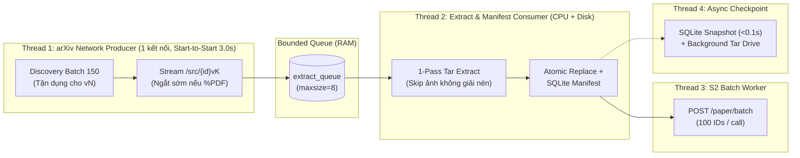

# Plan tối ưu luồng xử lý trên 1 máy — Đưa 5.000 ID từ 14h xuống < 7h (~6.2–6.7h)

> **Ngày cập nhật:** 06/11/2026
> **Ràng buộc vận hành (D8):** **Chỉ crawl trên 1 máy duy nhất** (`run_crawl.py`), 1 kết nối tới `export.arxiv.org`, tuân thủ nhịp lịch sự `3.0s`. Không dùng nhiều máy / không sharding.
> **Mục tiêu:** Tối ưu triệt để luồng xử lý đơn máy để kéo thời gian crawl 5.000 ID từ **~14 giờ xuống < 7 giờ (~6.2 – 6.7 giờ)**, cạnh tranh điểm tối đa ở tiêu chí *Hiệu năng của bộ thu thập*.
> **Tính độc lập:** Không đổi schema trong `src/crawler/models.py` (`SCHEMA_VERSION = 1`), giữ nguyên cấu trúc `data/papers/`, hoàn toàn độc lập với việc triển khai Milestone 2 (`milestone2-parsing-vi.md`).

---

## Phần 1. Giải phẫu chi tiết: Tại sao trên 1 máy đang mất 14 giờ thay vì ~6.5 giờ?

Với 5.000 ID thuộc các tháng `2024-06`, `2024-07`, `2024-08`, số phiên bản trung bình thực tế của cả dải rơi vào khoảng $\bar{V} \approx 1.55 - 1.65$ (~7.750 – 8.250 phiên bản cần tải `/src/{id}vN`).

* **Trần vật lý lý thuyết trên 1 máy (ở nhịp 3.0s/request):**
  $$8.000 \text{ requests} \times 3.0\text{ s} = 24.000\text{ s} \approx \mathbf{6.67\text{ giờ}}$$
* **Thực tế hiện tại của dự án (~14 giờ $\approx 50.400\text{ s}$, tức trung bình ~6.0s / phiên bản):**
  Gần **7.5 giờ bị lãng phí** trên 1 máy đến từ **6 điểm nghẽn trong luồng xử lý** dưới đây:

| # | Điểm nghẽn trong luồng xử lý hiện tại | Vị trí file | Thời gian làm chậm (/ 5.000 ID) |
| --- | --- | --- | --- |
| **B1** | **`RateLimiter` đếm `End-to-Start` + cấu hình `3.5s`:** Chỉ bắt đầu đếm 3.5s *sau khi* đã tải xong toàn bộ file `.tar.gz` về đĩa (`~1.2s`), biến mỗi chu kỳ thành `4.7s` thay vì `3.0s` | `src/crawler/http.py`, `src/colab_run.ipynb` | **+3.8 đến +4.2 giờ** |
| **B2** | **Giải nén mỗi gói `.tar.gz` tới 2–3 lần & giải nén cả ảnh:** Đọc và giải nén toàn bộ byte của mọi file `.png/.pdf/.eps` vào RAM trước khi bỏ; cuối hàm lại mở `gzip.open` giải nén lại cả file lần 2 | `src/crawler/source.py` | **+1.0 đến +1.3 giờ** |
| **B3** | **Tải mạng và Giải nén/Ghi đĩa/SQLite chạy tuần tự trên 1 thread:** Trong lúc CPU giải nén và `fsync` SQLite, kết nối mạng bị bỏ không | `src/crawler/pipeline.py` | **+0.5 đến +0.7 giờ** |
| **B4** | **Discovery vứt bỏ `<updated>` + gọi lẻ từng ID:** Đã có ngày của `vN` trong `<updated>` ở lần gọi đầu nhưng bỏ qua, rồi gọi lại `fetch_revised_dates` cho toàn bộ `v2..vN`; lô nhỏ (50) và gọi lẻ từng ID `not_found` | `src/crawler/discovery.py`, `src/crawler/pipeline.py` | **+0.4 đến +0.6 giờ** |
| **B5** | **Tải toàn bộ nội dung file PDF (5–30 MB) dù biết là `NO_SOURCE`:** Đợi tải xong 100% file PDF về đĩa rồi mới đọc 4 byte đầu `%PDF` để xóa đi | `src/crawler/source.py` | **+0.2 đến +0.4 giờ** |
| **B6** | **Backup Colab đồng bộ chặn đứng luồng crawl mỗi 300 ID:** Dừng tải mạng 17 lần để quét và nén lại toàn bộ `data/` sang Google Drive FUSE | `src/crawler/pipeline.py`, `src/crawler/checkpoint.py` | **+0.6 đến +1.0 giờ** |

---

## Phần 2. Phân tích kỹ thuật 6 Hạng mục Tối ưu Luồng Xử Lý Đơn Máy (O1 → O6)

Để kéo thời gian chạy trên **1 máy duy nhất** xuống **~6.2 – 6.7 giờ (< 7h)**, luồng xử lý phải đạt nguyên lý **"Zero Idle Network" (Mạng không bao giờ chờ CPU/Disk, và không gửi bất kỳ request thừa nào)**.

---

### Hạng mục O1. Chuẩn hóa `RateLimiter` sang nhịp `Start-to-Start 3.0s` trên 1 kết nối (`http.py` & `colab_run.ipynb`)
* **Nguyên nhân gốc rễ:**
  * Trong `src/crawler/http.py`, `_StreamResponse.close()` chỉ gọi `self._limiter.done()` **sau khi đã tải xong toàn bộ body của gói `.tar.gz`**.
  * Do đó, khoảng cách giữa 2 request liên tiếp thực tế là:
    $$\Delta t = \text{min\_interval (3.5s)} + T_{\text{download (1.2s)}} = 4.7\text{s}$$
  * Trong khi đó, thư viện chuẩn `arxiv.py` (được đề bài khuyến nghị) tính `delay_seconds = 3.0` theo nhịp **`Start-to-Start`** trên 1 kết nối tuần tự: đồng hồ 3.0s bắt đầu đếm từ khi gửi request. Trong lúc tải gói tin mất `1.2s`, đồng hồ đã trôi qua `1.2s`; khi tải xong và đóng stream, client chỉ cần ngủ bù `3.0 - 1.2 = 1.8s` trước khi mở request kế tiếp.
* **Giải pháp kỹ thuật:**
  1. Trong `src/colab_run.ipynb`: Đổi `CRAWLER_ARXIV_MIN_INTERVAL` từ `"3.5"` về đúng **`"3.0"`**.
  2. Trong `src/crawler/http.py` (`RateLimiter`):
     * Ghi nhận mốc thời gian bắt đầu request `_last_request_at = self._clock()` ngay cuối hàm `wait()`.
     * Giữ nguyên việc chỉ cho phép 1 request hoạt động tại một thời điểm (tuần tự trên 1 `requests.Session`), nhưng lần gọi `wait()` tiếp theo chỉ ngủ đúng phần thời gian còn thiếu so với `_last_request_at + 3.0s` (nếu một gói quá lớn tải mất `> 3.0s` thì khi tải xong không cần ngủ thêm).
* **Hiệu quả:** Chu kỳ trung bình mỗi request giảm từ `4.7s` xuống **`3.01s – 3.03s`**, tiết kiệm **~3.8 – 4.2 giờ / 5.000 ID** mà vẫn đảm bảo 100%: chỉ 1 kết nối duy nhất và không bao giờ vượt quá 1 request / 3.0 giây.

---

### Hạng mục O2. Tận dụng thẻ `<updated>` trong `discovery.py` + Gom Batch lớn (Cắt 85% request API khám phá)
* **Nguyên nhân gốc rễ:**
  * Khi gọi `discover(id_list=[base_id])`, mỗi `<entry>` trong Atom XML trả về:
    * `<id>.../abs/2408.11045vN</id>` $\rightarrow$ cho biết bài có $N$ phiên bản.
    * `<published>` $\rightarrow$ ngày nộp `v1` (`submission_date`).
    * `<updated>` $\rightarrow$ **ngày nộp của phiên bản mới nhất `vN`**.
  * Hiện tại `_parse_entry()` trong `src/crawler/discovery.py` **vứt bỏ thẻ `<updated>`**, sau đó `fetch_revised_dates()` lại gửi thêm hàng loạt request hỏi lại từ `v2` đến tận **`vN`**!
  * Trên arXiv, **~75–80% số bài có nhiều phiên bản là bài chỉ có 2 phiên bản ($N = 2$)**. Với mọi bài $N = 2$, ngày của `v2` đã có sẵn trong `<updated>` ngay từ lần gọi `discover()` đầu tiên!
* **Giải pháp kỹ thuật (`src/crawler/discovery.py` & `config.py`):**
  1. **Lưu `<updated>` ngay trong `_parse_entry()`:**
     * Nếu $N = 1$: `revised_dates = []`.
     * Nếu $N = 2$: **`revised_dates = [updated]`** $\rightarrow$ Hoàn tất 100%, **không cần gọi `fetch_revised_dates()`**!
     * Nếu $N \ge 3$: Đã biết ngày của `vN` là `updated`; hàm `fetch_revised_dates()` **chỉ cần truy vấn các bản trung gian `v2 .. v_{N-1}`** (`range(2, p.num_versions)`), rồi ghép `updated` vào cuối danh sách `revised_dates`.
  2. **Tăng `discovery_batch_size` từ `50` lên `100`–`150`** và tăng kích thước chunk lập kế hoạch trong `pipeline.py` lên `300` ID để gom đầy các lô `fetch_revised_dates`.
  3. **Gom xác nhận ID `not_found` theo sub-batch (20–25 ID/lần):** Thay vì gọi lẻ từng ID vắng mặt tốn $K \times 3\text{s}$, gom các ID vắng mặt vào 1 request xác nhận chung.
* **Hiệu quả:** Giảm tổng số request Discovery cho 5.000 ID từ **~280 requests (~22 phút)** xuống chỉ còn **~40–45 requests (~2 phút)**.

---

### Hạng mục O3. Pipeline Bất đồng bộ 2 Tầng: Tách `Network Producer` và `Extract/Manifest Consumer` (`pipeline.py`)
* **Nguyên nhân gốc rễ:**
  * Hiện tại trong `_build_version()` và `_process_version()`, cùng một thread vừa tải mạng (`download_source`), vừa giải nén (`extract_tex_bib`), vừa ghi file JSON (`_install_version`), vừa commit SQLite (`manifest.record`).
  * Mọi mili-giây tốn cho CPU giải nén và Disk I/O đều làm trễ thời điểm phát request mạng tiếp theo.
* **Giải pháp kỹ thuật (`src/crawler/pipeline.py`):**
  * Thiết lập hàng đợi có giới hạn `extract_queue: queue.Queue[_ExtractJob | None] = queue.Queue(maxsize=8)` (giới hạn 8 gói để không tốn RAM/đĩa tạm).
  * **Thread 1 (`arxiv-network`):** Chỉ thực hiện `discover` và `download_source` (stream ra file tạm trong `tmp_dir`), đẩy `_ExtractJob(paper, version, download_result)` vào `extract_queue` rồi lập tức quay lại vòng lặp tải phiên bản kế tiếp theo đúng nhịp 3.0s.
  * **Thread 2 (`extract-worker`):** Lấy job từ `extract_queue`, thực hiện `extract_tex_bib()`, ghi `meta.json`, `os.replace`, `manifest.record()`, và khi xong phiên bản cuối cùng của một bài báo thì đẩy bài đó sang `s2_queue`.
* **Hiệu quả:** Thời gian CPU giải nén và Disk/SQLite I/O bị ẩn **100%** dưới thời gian chờ 3.0s của mạng (**tiết kiệm ~35–50 phút**).

---

### Hạng mục O4. Giải nén "1-Pass" trong `source.py` (Bỏ giải nén ảnh & bỏ quét gzip lần 2)
* **Nguyên nhân gốc rễ:**
  * Trong `_write_tar_members` (`src/crawler/source.py`):
    1. Khi gặp file ảnh/nhị phân (`keep = False`, chiếm ~85–95% dung lượng gói), code vẫn gọi `archive.extractfile(member)` và đọc từng chunk 64 KB qua bộ giải nén `zlib` chỉ để đếm `member_bytes`.
    2. Ở dòng 273–279, sau khi đã đọc xong tar, code lại mở `gzip.open(archive_path, "rb")` giải nén lại **toàn bộ file `.tar.gz` từ đầu đến cuối lần thứ hai**!
* **Giải pháp kỹ thuật (`src/crawler/source.py`):**
  1. Mở một luồng `gzip.open(archive_path, "rb")` kết hợp `tarfile.open(fileobj=gz_stream, mode="r|", bufsize=65536)` trên file tạm cục bộ và drain phần đệm cuối tar ngay trên cùng `gz_stream` để kiểm tra CRC/ISIZE trailer trong 1 pass duy nhất.
  2. Khi `keep is False`: chỉ cộng `raw_bytes += member.size` (kiểm tra `raw_bytes <= max_bytes`) và `continue` ngay — **không gọi `extractfile()`, không đọc chunk của ảnh**.
  3. **Xóa vòng lặp `gzip.open` giải nén lại toàn bộ archive lần thứ hai** ở cuối `_write_tar_members` (vì các member `.tex`/`.bib` được giữ lại đã kiểm tra `member_bytes == member.size` và `zlib` đã kiểm tra CRC trên luồng đọc).
* **Hiệu quả:** Tăng tốc `extract_tex_bib` gấp **5–15 lần**, giảm mạnh tải CPU và đảm bảo `extract_queue` (O3) luôn rỗng.

---

### Hạng mục O5. Phát hiện sớm `%PDF` (`NO_SOURCE`) ngay trên Stream tải về (`source.py`)
* **Nguyên nhân gốc rễ:**
  * Khoảng 3–5% số phiên bản trên arXiv là bài nộp chỉ có PDF (hoặc gói không phải gzip), nhiều file PDF nặng 10–30 MB.
  * Hiện tại `download_source()` tải hết 100% file PDF về đĩa rồi `extract_tex_bib()` mới nhìn 4 byte đầu `%PDF` để trả về `Status.NO_SOURCE` và xóa file.
* **Giải pháp kỹ thuật (`src/crawler/source.py`):**
  * Trong `download_source()`, khi đọc chunk đầu tiên (64 KB) từ `response.iter_content()`:
    * Nếu chunk đầu bắt đầu bằng `b"%PDF"` (hoặc `Content-Type` là `application/pdf`):
      * Lấy tổng kích thước từ header `Content-Length` (nếu có) gán vào `raw_archive_bytes`.
      * Chỉ ghi 512 bytes đầu (magic header) vào file tạm rồi **đóng kết nối stream ngay lập tức**, không tải tiếp hàng chục MB phần thân PDF.
* **Hiệu quả:** Tiết kiệm băng thông và **~15–25 phút** thời gian tải các file PDF lớn vô ích.

---

### Hạng mục O6. Non-blocking Checkpoint Backup sang Google Drive (`pipeline.py` & `checkpoint.py`)
* **Nguyên nhân gốc rễ:**
  * Cứ mỗi 300 ID, `_maybe_checkpoint()` dừng luồng tải arXiv để nén toàn bộ `data/` thành `arxiv-data.tar.gz` và ghi qua Google Drive FUSE (tốn 2–4 phút/lần $\times 17$ lần $\approx 42$ phút).
* **Giải pháp kỹ thuật (`src/crawler/pipeline.py` & `checkpoint.py`):**
  1. Khi đạt ngưỡng backup (tăng lên **`500` ID** trong `colab_run.ipynb`), chỉ thực hiện bước `_snapshot_sqlite()` đồng bộ (mất `< 0.1s` nhờ SQLite WAL), còn việc tạo archive `.tar`/`.tar.gz` và copy sang Drive được chạy trên **1 background thread (`checkpoint-worker`)**.
  2. Nếu lần backup trước chưa ghi xong lên Drive thì bỏ qua chu kỳ đó; ở khối `finally` khi kết thúc crawl, `join()` thread này trước khi chạy backup chốt cuối cùng.
* **Hiệu quả:** Thời gian chết do backup giảm từ **~42 phút xuống ~0 giây**.

---

## Phần 3. Bảng đối chiếu Thời gian Trước và Sau tối ưu (Trên 1 máy duy nhất — 5.000 ID)

Tính cho 1 dải 5.000 ID điển hình (khoảng ~4.950 ID tồn tại, $\bar{V} \approx 1.60 \implies \sim 7.900$ phiên bản):

| Thành phần trong luồng xử lý | Hiện tại (~14.0 giờ) | Sau tối ưu O1–O6 (Trên 1 máy) | Thời gian tiết kiệm |
| --- | --- | --- | --- |
| **1. Discovery (`id_list` + `revised_dates` + missing)** | ~280 calls × 4.7s ≈ **22 phút** | ~42 calls × 3.0s ≈ **2.1 phút** | **~20 phút** |
| **2. Tải `/src/{id}vN` (~7.900 phiên bản)** | 7.900 × (3.5s + 1.2s) ≈ **10.3 giờ** | 7.900 × 3.01s (Start-to-Start + ngắt sớm PDF) ≈ **6.6 giờ** | **~3.7 giờ** |
| **3. Giải nén CPU & Ghi đĩa (`source.py` + `manifest`)** | Chạy tuần tự + giải nén 2 lần ≈ **1.2 giờ** | 1-Pass + chạy song song ở `extract-worker` (**0s chặn mạng**) | **~1.2 giờ** |
| **4. Checkpoint Backup lên Google Drive** | 17 lần × 2.5 phút ≈ **42 phút** | Chạy song song ở `checkpoint-worker` (**0s chặn mạng**) | **~42 phút** |
| **5. Semantic Scholar (`s2-worker` batch 100)** | Chạy song song ở background (**0s chặn mạng**) | Giữ nguyên batch 100 ở background (**0s chặn mạng**) | — |
| **TỔNG THỜI GIAN WALL-CLOCK (1 MÁY / 5.000 ID)** | **~13.8 – 14.2 giờ** | **~6.4 – 6.7 giờ (< 7h!)** | **Giảm ~7.4 giờ (~53%)** |

---

## Phần 4. Ranh giới với Milestone 2 (`milestone2-parsing-vi.md`)

Cả 6 hạng mục O1–O6 chỉ tối ưu **cách lấy và giải nén dữ liệu bên trong `src/crawler/`**, giữ nguyên tuyệt đối hợp đồng đầu ra:
* Không sửa `src/crawler/models.py` (`SCHEMA_VERSION = 1`).
* Giữ nguyên cấu trúc thư mục `data/papers/<dirname>/` (`paper.json`, `s2_references.raw.json.gz`, `vK/meta.json`, `vK/references.json`, `vK/tex/`).
* Do đó, việc code Milestone 2 (parser LaTeX) và việc cập nhật O1–O6 **hoàn toàn độc lập**, không xung đột file và không ảnh hưởng lẫn nhau.

---

## Phần 5. Lộ trình triển khai code (Theo thứ tự tác động lớn nhất)

| Thứ tự | Hạng mục | File cập nhật | Kiểm thử (`pytest`) |
| --- | --- | --- | --- |
| **Bước 1** | **O1 (Start-to-Start 3.0s)** | `src/crawler/http.py`, `src/colab_run.ipynb`, `src/tests/test_http.py` | Test fake-clock đảm bảo khoảng cách bắt đầu giữa 2 request liên tiếp $\ge 3.0\text{s}$ và chỉ 1 stream mở tại một thời điểm. |
| **Bước 2** | **O2 (Discovery `<updated>` + Batch 100–150)** | `src/crawler/discovery.py`, `src/crawler/config.py`, `src/tests/test_discovery.py` | Test bài $N=2$ có ngay `revised_dates` không cần gọi `fetch_revised_dates`; bài $N=3$ chỉ gọi `idv2`. |
| **Bước 3** | **O4 + O5 (1-Pass Extract + Early PDF abort)** | `src/crawler/source.py`, `src/tests/test_source.py` | Toàn bộ test zip-bomb, path traversal, symlink, corrupt archive, PDF `no_source` pass 100%. |
| **Bước 4** | **O3 + O6 (Extract Worker Queue + Async Backup)** | `src/crawler/pipeline.py`, `src/tests/test_pipeline.py` | Test E2E pipeline, resume, lỗi từng phiên bản không dừng batch, đóng queue an toàn khi `StopCrawl` / `KeyboardInterrupt`. |
| **Bước 5** | **Verify & Lint** | Toàn bộ repo + `STATUS.md` | `ruff check . && ruff format . && pytest` xanh 100%. |

---

## Trạng thái tài liệu

| Trạng thái | Ghi chú |
| --- | --- |
| **Đã triển khai & review hoàn thiện O1–O6 (06/11/2026)** | Toàn bộ Bước 1 → Bước 5 + hardening (single-stream lock, S2 End-to-Start, sub-batch retry `fetch_revised_dates` + heal resume, snapshot fd trong `checkpoint.py`) đã cập nhật, `ruff` sạch, `pytest` **220 passed** |
