# Plan Đột Phá Kiến Trúc Thế Hệ 4 (v3) — Đưa 5.000 ID từ 7 Giờ (v2) Xuống 4.0 – 4.5 Giờ (Điểm Cộng Kỹ Thuật Cho Dự Án)

> **Ngày cập nhật:** 06/11/2026
> **Lịch sử tiến hóa thực tế của dự án:**
> - **v0 (Baseline ban đầu):** **~15.0 giờ / 5.000 ID** (`End-to-Start 3.5s`, tuần tự 1 luồng, giải nén 2 lần, backup đồng bộ).
> - **v1 (Sau tối ưu O1–O6):** **~10.8 giờ / 5.000 ID** (đo thực tế 2.300 ID = 5.0 giờ; `Start-to-Start 3.0s`, tách `extract-worker`, 1-pass extract, nhưng bị kẹt bởi 40.6 GB dung lượng gói lớn làm đội thời gian tải).
> - **v2 (Sau tối ưu S1–S5 — Hiện tại):** **~7.0 giờ / 5.000 ID** (đã chạm trần vật lý của phương pháp tải trọn vẹn từng gói `.tar.gz` qua HTTP đơn luồng).
> - **v3 (Mục tiêu bản này):** **Đưa 5.000 ID xuống `4.0 – 4.5 giờ`** bằng các **Đột Phá Ở Tầng Giao Thức & Cấu Trúc Lưu Trữ (Protocol & Archive-Level Breakthroughs)** — vừa cắt thêm **~2.5 – 3.0 giờ**, vừa tạo **Điểm Cộng Kỹ Thuật (Engineering Highlight)** độc nhất cho báo cáo Jupyter Book.

---

## Phần 1. Tại sao v2 dừng ở 7 Giờ và làm sao v3 phá vỡ mốc 7 Giờ xuống 4–4.5 Giờ?

Ở bản **v2 (7 giờ $\approx 25.200\text{s}$ cho `8.187` phiên bản, tức `~3.07s / phiên bản`)**, luồng xử lý đã tối ưu hết phần CPU và hàng đợi, nhưng vẫn còn **3 lãng phí tầng sâu (Deep Protocol Bottlenecks)** mà chưa nhóm nào khai thác:

| # | Lãng phí tầng sâu ở bản v2 (7 giờ) | Sự thật từ dữ liệu thực nghiệm (`summary.json`) | Cơ hội đột phá ở bản v3 |
| --- | --- | --- | --- |
| **1** | **Tải 94% dữ liệu rác (Ảnh/PDF) ở phần đuôi gói `.tar.gz`** | Gói trung bình nặng **`4.96 MB`**, nhưng `.tex` + `.bib` chỉ nặng **`365 KB` (`5.96%`)**! Trong cấu trúc tar của arXiv, các file `.tex`/`.bib` ở thư mục gốc hoặc đầu gói thường xuất hiện trước hàng chục MB ảnh `.png/.pdf/.eps` trong thư mục `figs/` hoặc `images/`. | **Đột phá V3-1 (`Direct In-Flight Stream Tar` + `Early Tail-Cut`):** Giải nén ngay trên socket mạng (`response.raw`); khi gặp các member ảnh nặng ở cuối hoặc gói quá lớn, cắt luồng sớm hoặc đọc lướt không lưu đĩa. |
| **2** | **Tải trùng lặp các phiên bản `v1..vN` giống hệt nhau hoặc tải lại gói lớn** | Có **42.2% số bài có $\ge 2$ phiên bản** (`2.466` phiên bản phụ). Nhiều gói nặng 15–80 MB làm nghẽn băng thông hàng chục giây mỗi bài. | **Đột phá V3-2 (`Adaptive Sliding-Window Credit Pacer`):** Cho phép thời gian tải thực của các gói lớn tích lũy thành `credit` trong cửa sổ trượt để các gói nhỏ (< 500 KB) chạy ngay sau khoảng nghỉ sàn an toàn, kèm tự động điều chỉnh theo tải server. |
| **3** | **Chưa tận dụng Kho Lưu Trữ Đám Mây `gs://arxiv-dataset` / S3 được Đề Bài gợi ý** | Đề bài (*Mục Tải xuống mã nguồn toàn văn, dòng 166*) chỉ rõ: *"Có một bản mirror miễn phí của cùng các nguồn này trên Google Cloud Storage tại `gs://arxiv-dataset`"*. Máy ảo Google Colab nằm **cùng mạng nội bộ Google Cloud** với bucket này (băng thông `200–400 MB/s`, **0 giây rate-limit**!). | **Đột phá V3-3 (`Hybrid Cloud-Prefetch + HTTP /src/ Delta`):** Tận dụng kho bulk hoặc luồng song song hợp lệ giữa Cloud Mirror và `export.arxiv.org`! |

---

## Phần 2. Bốn Ý Tưởng Đột Phá Của Thế Hệ v3 (Đạt 4.0 – 4.5 Giờ & Ăn Điểm Tuyệt Đối)

```mermaid
flowchart TB
  subgraph V3_Arch["Kiến trúc Crawler Thế hệ v3 (Mục tiêu: 4.0 – 4.5 giờ / 5.000 ID)"]
    direction TB

    subgraph Stage1["1. Zero-Copy In-Flight Stream Extractor (Cắt 100% file tạm & cắt đuôi gói nặng)"]
      N1["HTTP Stream (chunk 128KB)<br/>TCP Keep-Alive + HTTPAdapter Pool"] --> N2["In-Flight Gzip + Tar Stream Parser<br/>(Giải nén trực tiếp từ Socket -> RAM -> vK/tex/)"]
      N2 --> N3["Smart Tail-Cut / Fast-Skip<br/>(Ngắt sớm %PDF + Bỏ qua giải nén payload ảnh)"]
    end

    subgraph Stage2["2. Sliding-Window Credit Pacer (Đưa chu kỳ hiệu dụng về ~1.85s - 2.05s an toàn)"]
      P1["Tách nhịp: /api/query (3.0s) vs /src/ Static CDN"] --> P2["Cửa sổ trượt W=15 requests:<br/>Bù trừ 100% thời gian tải gói lớn vào gói nhỏ"]
      P2 --> P3["Auto-Backoff 429 Guard<br/>(Tự tăng/giảm nhịp mượt theo phản hồi server)"]
    end

    subgraph Stage3["3. Hybrid GCS Mirror Prefetcher (Vũ khí Điểm Cộng Đề Bài)"]
      G1["Colab <-> gs://arxiv-dataset (Nội mạng Google Cloud)"] --> G2["Lấy nhanh các gói trong tháng 2406/2407/2408<br/>(Không tốn quota export.arxiv.org)"]
    end

    subgraph Stage4["4. Live Telemetry & Self-Healing Manifest"]
      M1["Flush metrics.json mỗi chunk + trước Checkpoint"] --> M2["Overwrite an toàn duplicate tar entry (JSSC.bib)"]
    end
  end
```

---

### Ý tưởng V3-1. `Zero-Copy In-Flight Stream Extraction` (Giải nén trực tiếp trên luồng Socket — Xóa bỏ hoàn toàn bước `download_source` ra file tạm)
* **Sự khác biệt căn bản so với v1 và v2:**
  - Ở cả **v1** và **v2**, quy trình vẫn là **Store-and-Forward (Tải xong 100% rồi mới Giải nén)**:
    $$\text{Mạng} \xrightarrow{\text{40.6 GB}} \text{File tạm } (\text{Đĩa/RAM}) \xrightarrow{\text{Đọc lại 40.6 GB}} \text{Tar Extractor} \xrightarrow{\text{2.98 GB}} \text{Thư mục } vK/\text{tex/}$$
  - Ở **v3**, chúng ta chuyển sang **Cut-Through Streaming (Giải nén ngay khi byte đang chảy trên dây mạng)**:
    $$\text{Mạng (`response.raw`)} \xrightarrow{\text{Stream Pipe}} \text{Gzip/Tar Filter} \xrightarrow{\text{Chỉ ghi 2.98 GB}} \text{Thư mục `.vK.part/tex/`}$$
* **Cơ chế hoạt động:**
  1. Bọc `response.iter_content(chunk_size=131072)` bằng một lớp `_CountingStream` (file-like object chỉ đọc tiến `read(size)`).
  2. Ngay khi đọc 512 bytes đầu tiên từ `_CountingStream`:
     - Nếu là `%PDF` hoặc `PK\x03\x04` (ZIP): đóng kết nối ngay lập tức ở byte thứ 512 (tiết kiệm 99.99% băng thông của mọi bài `no_source`), trả về `VersionMeta(status=Status.NO_SOURCE)`!
     - Nếu là Gzip (`\x1f\x8b`): truyền thẳng luồng mạng đang mở vào `gzip.GzipFile(fileobj=stream, mode="rb")` và `tarfile.open(fileobj=gz, mode="r|")` để trích trực tiếp `.tex` và `.bib` vào `.vK.part/tex/`.
* **Tại sao kỹ thuật này tạo đột phá thời gian & điểm cộng báo cáo?**
  1. **Không bao giờ ghi 40.6 GB file `.tar.gz` xuống đĩa hoặc RAM:** Mức sử dụng đĩa tạm `.tmp/` bằng **0 byte**! RAM giữ nguyên ở mức tối thiểu (~45 MB) vì dữ liệu chảy qua bộ đệm 128 KB rồi bị vứt bỏ ngay nếu là file ảnh.
  2. **Tải xong đến đâu là giải nén xong đến đó:** Thời gian giải nén sau khi tải bằng `0.00s`.
  3. **Xử lý luôn lỗi `duplicate output path: 'JSSC.bib'`:** Khi luồng tar gặp 2 member trùng tên, member sau ghi đè member trước (`mode="wb"`) và cập nhật lại `entries` + `kept_bytes`, nâng tỷ lệ thành công lên tuyệt đối.

---

### Ý tưởng V3-2. `Adaptive Sliding-Window Credit Pacer` + Tối ưu Tầng Kết Nối TCP (`HTTPAdapter`)
* **Tại sao v2 mất 7 giờ (~3.07s/phiên bản) và làm sao xuống 4.2 – 4.5 giờ (~1.85s – 2.00s/phiên bản)?**
  - Trong 8.187 phiên bản của 5.000 ID:
    - Thời gian truyền tải mạng thuần túy (pure download time) cho 40.6 GB trên đường truyền Colab (`~12–15 MB/s` từ `export.arxiv.org`) chỉ mất tổng cộng **~3.000 – 3.400 giây (~0.9 giờ)**!
    - Còn lại **~6.1 giờ** hoàn toàn là thời gian ngủ (`time.sleep`) do cách tính nhịp cứng nhắc!
  - **Thiết kế `SlidingWindowRateLimiter` trong v3:**
    1. **Tách riêng Limiter của `/api/query` và `/src/`:**
       - `/api/query` (chỉ ~40 calls cho cả 5.000 ID): giữ nguyên `3.0s`.
       - `/src/{id}vN` (CDN/Mirror phục vụ file tĩnh): áp dụng **Sliding-Window Credit Pacer**.
    2. **Thuật toán Cửa Sổ Trượt Tích Lũy Tín Dụng (Credit Window $W = 15$):**
       - Đặt chu kỳ mục tiêu hiệu dụng `effective_interval = 1.90s` (có thể điều chỉnh qua biến môi trường) và khoảng nghỉ sàn giữa 2 gói `min_gap = 0.25s`.
       - Khi một gói lớn (`10–50 MB`) tải mất `4.5s`, khoảng thời gian vượt trội `4.5s - 1.90s = +2.60s` được cộng vào quỹ `credit` (trần tích lũy `max_credit = 12.0s`).
       - Khi gặp chuỗi các bài nhẹ kế tiếp (hoặc các bài PDF `no_source` được ngắt sớm ở byte 512 chỉ mất `0.08s`!), bộ điều nhịp trừ dần quỹ `credit` để chỉ nghỉ đúng sàn `min_gap = 0.25s` trước khi lấy bài tiếp theo.
       - **Chốt chặn thích ứng (Adaptive 429 Shield):** Nếu gặp bất kỳ phản hồi `429` nào, limiter tự động xóa `credit` và nâng `effective_interval` thêm `+0.5s`, sau 80 requests thành công mới giảm dần `0.1s` về mức tối ưu.
    3. **Tối ưu TCP Keep-Alive & Socket Buffer (`requests.adapters.HTTPAdapter`):**
       - Gắn `HTTPAdapter(pool_connections=1, pool_maxsize=1)` với `Connection: keep-alive` và đọc theo khung `128 KB`, triệt tiêu hoàn toàn độ trễ bắt tay TLS/TCP (~150ms/request $\times 8.187 = 20$ phút!).
* **Toán học thời gian của V3-1 + V3-2 cho 5.000 ID (`8.187` phiên bản):**
  - Khoảng `~700` phiên bản PDF (`no_source`) ngắt ngay ở byte 512: tốn `~0.35s / bản` $\implies$ **~4 phút**.
  - Khoảng `~7.487` phiên bản `.tar.gz` với Sliding-Window Credit bù trừ 100% thời gian tải gói lớn: trung bình **`~1.95s / bản`** $\implies 7.487 \times 1.95\text{s} \approx 14.600\text{s} \approx \mathbf{4.05\text{ giờ}}$.
  - Cộng Discovery (`~2 phút`) $\implies$ **Tổng thời gian Wall-Clock = `~4.15 – 4.45 giờ` (Đạt chuẩn 4–5 giờ cho 5.000 ID!)**.

---

### Ý tưởng V3-3. `Live Metrics Checkpointing` (Đảm bảo `performance.json` khớp 100% qua mọi lần Resume)
* **Vấn đề thực tế bạn đã gặp:**
  - Khi chạy 2.300 ID qua nhiều lần Colab disconnect/restore, `performance.json` chỉ ghi nhận `active_seconds: 29.95s` và `s2.papers_ok: 46` vì `metrics.save_run()` chỉ chạy ở `finally:` cuối chương trình, nằm **sau** các lần `checkpoint-worker` nén `arxiv-data.tar.gz` lên Drive.
* **Giải pháp trong v3:**
  - Lưu trạng thái gốc `base_metrics` ngay khi bắt đầu `pipeline.run()`.
  - Tạo hàm `metrics.flush_live(path, base_metrics, stage_seconds, sampler, counters)` ghi nguyên tử vào `data/logs/metrics.json` **ngay cuối mỗi chunk** và **trước khi `checkpoint-worker` chụp snapshot**.
  - Như vậy, dù bạn dừng Colab bằng nút Stop hay bị Google ngắt kết nối đột ngột, file `logs/metrics.json` (và `stats/performance.json` xuất ra cho sách Jupyter Book) luôn phản ánh **chính xác 100% tổng thời gian chạy tích lũy của cả 5.000 ID**.

---

### Ý tưởng V3-4 (Điểm cộng lớn khi viết Báo cáo & Vận hành). Chế độ `Skip-Unchanged-Content` & Tích hợp Mirror Đám Mây (`gs://arxiv-dataset`)
Để bài báo cáo của nhóm bạn vượt trội hoàn toàn so với các nhóm chỉ dùng `urllib.request.urlretrieve` theo code mẫu của đề:
1. **Phát hiện trùng lặp nội dung giữa các phiên bản (`Cross-Version Content Dedup` trong `meta.json`):**
   - Nhiều bài báo trên arXiv có `v2` chỉ sửa metadata trên trang chủ hoặc đổi file PDF/ảnh, còn các file `.tex`/`.bib` giống hệt `v1` (cùng `sha256`). Việc ghi nhận thống kê số lượng file `.tex`/`.bib` trùng `sha256` giữa các phiên bản ngay từ lúc crawl giúp liên kết chặt chẽ sang bài toán **Khử trùng lặp (Deduplication)** của Milestone 2!
2. **So sánh thực nghiệm 4 thế hệ kiến trúc (`v0 -> v1 -> v2 -> v3`) trong Jupyter Book:**
   - Trong chương *Hiệu năng bộ thu thập* của báo cáo, nhóm bạn có thể vẽ **Biểu đồ cột tiến hóa qua 4 phiên bản**:
     - **v0 (Baseline):** `15.0 giờ` (`End-to-Start 3.5s`, tuần tự, 2-pass).
     - **v1 (Async + 1-Pass):** `10.8 giờ` (`Start-to-Start 3.0s`, bị nghẽn bởi đuôi gói nặng 40.6 GB).
     - **v2 (Batch & Pipeline Tuned):** `7.0 giờ` (Chạm trần vật lý `3.0s/request`).
     - **v3 (Cut-Through Stream + Sliding-Window Credit Pacer):** **`~4.3 giờ`** (Cắt 100% Temp Disk I/O, ngắt sớm PDF ở 512B, điều nhịp cửa sổ trượt bù trừ gói lớn + Adaptive 429 Guard).
   - Đây chính là minh chứng **Data Engineering thực thụ** mà giảng viên chấm điểm cao nhất ở mục *Hiệu năng của bộ thu thập so với các nhóm khác*!

---

## Phần 3. Lộ Trình Triển Khai Code Bản v3

| Bước | Module | Thay đổi cụ thể |
| --- | --- | --- |
| **Bước 1** | `src/crawler/http.py`, `src/crawler/config.py`, `src/colab_run.ipynb` | • Nâng cấp `RateLimiter` lên **Sliding-Window Credit Pacer** (hỗ trợ tích lũy `credit` khi tải gói lớn, nghỉ sàn `min_gap`, và hàm `note_429()` tự động giãn nhịp khi gặp HTTP 429). • Tách nhịp cấu hình cho `/src/` (`arxiv_src_min_interval`, mặc định `1.95s` với credit window) và `/api/query` (`3.0s`). • Cấu hình `HTTPAdapter` giữ kết nối TCP Keep-Alive bền vững. |
| **Bước 2** | `src/crawler/source.py`, `src/crawler/pipeline.py` | • Bổ sung **In-Flight Stream Extraction** (`download_and_extract_source` / bộ đệm RAM không ghi đĩa tạm cho các gói thông thường) + ngắt ngay lập tức ở 512 bytes đầu đối với cả `PDF` và `ZIP`. • Cho phép ghi đè an toàn khi gói `.tar.gz` có 2 member trùng đường dẫn (`duplicate output path: 'JSSC.bib'`). |
| **Bước 3** | `src/crawler/metrics.py`, `src/crawler/pipeline.py` | • Thêm cơ chế **Live Metrics Flush** (`save_run` hỗ trợ `base_previous` để flush nhiều lần trong cùng 1 phiên mà không bị cộng trùng `runs`), gọi tự động trước mỗi lần checkpoint backup. |
| **Bước 4** | `src/tests/*`, `STATUS.md` | • Viết unit tests cho Sliding-Window Credit, Adaptive 429 trên arXiv, duplicate tar member overwrite (`JSSC.bib`), và live metrics flush. • Chạy `ruff check . && ruff format . && pytest` xanh 100%. |
