# Plan Đột Phá Kiến Trúc Thế Hệ 4 (v3) — Tối Ưu Luồng Crawl 5.000 ID Với Chuẩn Lịch Sự Nghiêm Ngặt `Start-to-Start ≥ 3.0s` (Điểm Cộng Kỹ Thuật Cho Dự Án)

> **Ngày cập nhật:** 06/11/2026
> **Lịch sử tiến hóa thực tế của dự án:**
> - **v0 (Baseline ban đầu):** **~15.0 giờ / 5.000 ID** (`End-to-Start 3.5s`, tuần tự 1 luồng, giải nén 2 lần, backup đồng bộ).
> - **v1 (Sau tối ưu O1–O6):** **~10.8 giờ / 5.000 ID** (đo thực tế 2.300 ID = 5.0 giờ; `Start-to-Start 3.0s`, tách `extract-worker`, 1-pass extract, nhưng bị kẹt bởi 40.6 GB dung lượng gói lớn làm đội thời gian tải + IOPS đĩa tạm).
> - **v2 (Sau tối ưu S1–S5):** **~7.0 – 7.4 giờ / 5.000 ID** (đệm RAM 32 MiB, streaming backup, giảm nghẽn IOPS đĩa).
> - **v3 (Bản hiện tại):** **Đưa 5.000 ID về sát trần lý thuyết `~6.8 – 7.0 giờ` (giữ nghiêm ngặt chuẩn lịch sự `Start-to-Start ≥ 3.0s` trên 1 kết nối đơn)** bằng các **Đột Phá Ở Tầng Giao Thức, Bộ Đệm Zero-Copy `96 MiB` & Giải Nén Song Song (Protocol & Producer–Consumer Breakthroughs)** — vừa loại bỏ hoàn toàn thời gian trễ giải nén/backup khỏi đường găng mạng, vừa tạo **Điểm Cộng Kỹ Thuật (Engineering Highlight)** độc nhất cho báo cáo Jupyter Book.

---

## Phần 1. Tại sao cần nâng cấp từ v2 lên v3 trong khi vẫn giữ nghiêm ngặt chuẩn `≥ 3.0s`?

Ở bản **v2 (`~7.0 – 7.4 giờ` cho `8.187` phiên bản)**, để tuân thủ tuyệt đối quy định của đề bài và `AGENTS.md` (*"Chỉ `export.arxiv.org`, chờ ≥ 3 giây, một kết nối"*, **không** dùng Sliding-Window rút nhịp xuống dưới 3 giây), chu kỳ sàn lý thuyết của 8.187 phiên bản là $8.187 \times 3.0\text{s} \approx 24.561\text{s} \approx \mathbf{6.82\text{ giờ}}$. Muốn thời gian thực tế tiệm cận trần vật lý 6.82 giờ này mà không vi phạm rate-limit, v3 giải quyết **3 điểm nghẽn tầng sâu (Deep Protocol Bottlenecks)** còn sót lại:

| # | Lãng phí tầng sâu ở bản v2 | Sự thật từ dữ liệu thực nghiệm (`summary.json` & `crawl.log`) | Cơ hội đột phá ở bản v3 |
| --- | --- | --- | --- |
| **1** | **Tải 94% dữ liệu rác (Ảnh/PDF) và giữ kết nối lâu khi xử lý gói lớn** | Gói trung bình nặng **`4.96 MB`**, nhưng `.tex` + `.bib` chỉ nặng **`365 KB` (`5.96%`)**! Nếu vừa đọc socket vừa giải nén trên luồng chính sẽ làm giữ socket lâu và giãn chu kỳ `Start-to-Start` vượt quá 3.0s; còn nếu tràn ra đĩa tạm `.tmp/` (>32 MiB) sẽ gây nghẽn IOPS. | **Đột phá V3-1 (`Zero-Copy RAM Buffer ≤ 96 MiB` + `1-Pass Parallel Extract`):** Luồng mạng chỉ hút nhanh `256 KiB/chunk` vào `bytearray` zero-copy `≤ 96 MiB` (>99.5% gói `0 byte` `.tmp/`), đóng socket & nhả `RateLimiter` ngay tức thì để `extract-worker` giải nén 1-pass song song 100%! |
| **2** | **Kẹt nhịp thích ứng ở trần cao khi gặp `HTTP 429` & đứt stream tạm thời** | Log thực nghiệm 1.655 ID ghi nhận arXiv thỉnh thoảng trả `429` (~12 lần/giờ) và `ChunkedEncodingError` (98 lần). Trần thích ứng cũ (`6.0s`) làm nhịp crawl bị kẹt ở mức chậm gấp đôi (`3.77 -> 13.15s/bản`) suốt hàng trăm ID sau đó. | **Đột phá V3-2 (`Strict Polite Start-to-Start ≥ 3.0s` + `Bounded Adaptive 429 Guard`):** Giữ chung 1 bộ điều nhịp `Start-to-Start ≥ 3.0s` cho cả `/api/query` và `/src/` trên 1 kết nối `HTTPAdapter(pool_maxsize=1)`; khi gặp `429` chỉ nhích nhẹ `+0.5s` với trần `sàn + 1.0s` (`4.0s`) và hồi phục `-0.5s` sau mỗi 10 request thành công (không dùng Sliding-Window dưới 3.0s). |
| **3** | **Trùng lặp nội dung `.tex`/`.bib` giữa các phiên bản `v1..vN` chưa được định lượng cho M2** | Có **42.2% số bài có $\ge 2$ phiên bản** (`2.466` phiên bản phụ), trong đó rất nhiều phiên bản sửa đổi chỉ cập nhật PDF/ảnh hoặc metadata chứ không đổi mã nguồn `.tex`/`.bib`. | **Đột phá V3-3 & V3-4 (`O(1) Non-Blocking Telemetry` + `Cross-Version SHA-256 Dedup`):** Ghi `metrics.json` định kỳ trên `extract-worker` (không chặn luồng mạng bằng `psutil`) và thống kê `cross_version_dedup` ngay trong `summary.json` để nối trực tiếp sang bài toán Khử trùng lặp của Milestone 2! |

---

## Phần 2. Bốn Ý Tưởng Đột Phá Của Thế Hệ v3 (Bám Sát Trần Lý Thuyết & Ăn Điểm Tuyệt Đối)

```mermaid
flowchart TB
  subgraph V3_Arch["Kiến trúc Crawler Thế hệ v3 (Chuẩn lịch sự ≥ 3.0s — Tiệm cận trần lý thuyết ~6.8 – 7.0 giờ / 5.000 ID)"]
    direction TB

    subgraph Stage1["1. Zero-Copy RAM Buffer ≤ 96 MiB & 1-Pass Parallel Extractor"]
      N1["HTTP Stream (chunk 256 KiB)<br/>TCP Keep-Alive + HTTPAdapter(pool_maxsize=1)"] --> N2["Zero-Copy bytearray (≤ 96 MiB)<br/>Đóng socket & nhả RateLimiter ngay sau tải"]
      N2 --> N3["extract-worker (maxsize=8) chạy song song:<br/>Ngắt sớm %PDF/ZIP ở 512B + Giải nén 1-pass Gzip/Tar"]
    end

    subgraph Stage2["2. Strict Start-to-Start ≥ 3.0s + Bounded Adaptive 429 Guard"]
      P1["Chung 1 RateLimiter (export.arxiv.org)<br/>cho cả /api/query và /src/ (1 kết nối đơn)"] --> P2["Chu kỳ Start-to-Start ≥ 3.0s:<br/>Tải gói ( ~0.4s ) nằm gọn trong khoảng chờ 3.0s"]
      P2 --> P3["Bounded 429 Guard (Trần sàn + 1.0s = 4.0s):<br/>+0.5s khi 429, -0.5s mỗi 10 request thành công"]
    end

    subgraph Stage3["3. Cross-Version SHA-256 Dedup Analytics (M1 -> M2 Bridge)"]
      G1["So khớp SHA-256 các file .tex/.bib qua v1..vN"] --> G2["Xuất cross_version_dedup vào summary.json<br/>(Định lượng tỷ lệ phiên bản & byte trùng lặp)"]
    end

    subgraph Stage4["4. O(1) Live Telemetry & Self-Healing Manifest"]
      M1["ResourceSampler.snapshot() O(1) +<br/>Flush metrics.json trên extract-worker & trước Backup"] --> M2["Overwrite an toàn duplicate tar entry (JSSC.bib)<br/>+ Retry stream đứt giữa chừng (≤ 3 lần)"]
    end
  end
```

---

### Ý tưởng V3-1. `Zero-Copy RAM Buffer (≤ 96 MiB)` + `1-Pass Parallel Extraction` (Che phủ 100% thời gian giải nén & ghi đĩa)
* **Bài học thực nghiệm từ quá trình tiến hóa v1 $\to$ v2 $\to$ v3:**
  - Nếu giải nén trực tiếp ngay trên socket mạng (`Cut-Through` đồng bộ trên luồng chính), thời gian CPU giải nén `gzip`/`tar`, băm `sha256` và ghi hàng chục file `.tex` sẽ giữ kết nối HTTP mở lâu hơn, làm kéo dài khoảng cách giữa các request và khiến `extract-worker` bị bỏ không.
  - Ở bản **v3 hoàn chỉnh**, chúng ta kết hợp **Bộ đệm RAM Zero-Copy `bytearray` (`_IN_MEMORY_MAX_BYTES = 96 MiB`)** trên luồng mạng với **Giải nén 1-Pass (`_PrefixedReader`)** trên `extract-worker`:
    $$\text{Mạng (`256 KiB/chunk`)} \xrightarrow{\text{Zero-Copy `bytearray` }\le\text{ 96 MiB}} \text{Nhả Socket ngay} \xrightarrow{\text{Queue (`maxsize=8`)}} \text{`extract-worker` 1-Pass Gzip/Tar} \xrightarrow{\text{Chỉ ghi `.tex`/`.bib`}} \text{`.vK.part/tex/`}$$
* **Cơ chế hoạt động:**
  1. Ngay ở 512 bytes đầu tiên: nếu nhận diện magic bytes là `%PDF` hoặc `PK\x03\x04` (ZIP), đóng kết nối ngay lập tức ở byte thứ 512 (tiết kiệm >99.9% băng thông cho mọi bài `no_source`), trả về `VersionMeta(status=Status.NO_SOURCE)`.
  2. Với gói `.tar.gz`: luồng chính đọc nhanh các chunk `256 KiB` vào `bytearray` (nối trực tiếp `buf.extend(chunk)` không tạo bản sao `bytes(buf)`), đóng response để giải phóng `RateLimiter` ngay lập tức, rồi đẩy sang `extract-worker`. Hơn **99.5% số gói** nằm gọn trong RAM (`0 byte` ghi xuống `.tmp/`).
  3. Trên `extract-worker`, `extract_tex_bib` dùng `_PrefixedReader` + `_looks_like_tar_header` để **mở luồng Gzip duy nhất 1 lần (1-pass)**, chỉ trích `.tex`/`.bib`, bỏ qua toàn bộ payload ảnh và gom `staging.resolve()` ra ngoài vòng lặp.
  4. **Xử lý chuẩn POSIX cho lỗi `duplicate output path: 'JSSC.bib'`:** Khi gói `.tar.gz` có 2 member trùng đường dẫn, member sau ghi đè an toàn lên member trước và cập nhật lại `entries` + `kept_bytes`, không đánh nhầm `corrupt`.

---

### Ý tưởng V3-2. `Strict Start-to-Start ≥ 3.0s RateLimiter` + `Bounded Adaptive 429 Guard` & Tối ưu Kết Nối (`HTTPAdapter`)
* **Tại sao dự án KHÔNG dùng Sliding-Window Credit Pacer mà giữ chuẩn `Start-to-Start ≥ 3.0s`?**
  - Quy tắc bắt buộc của đề bài và `AGENTS.md`: mọi truy cập tới `export.arxiv.org` (`/api/query` và `/src/`) phải dùng **chung 1 kết nối tuần tự** và **chờ tối thiểu `3.0 giây`** giữa các request. Cơ chế Sliding-Window (bù trừ thời gian tải gói lớn để giảm khoảng cách giữa các gói nhỏ xuống `< 3.0s`) không được áp dụng để đảm bảo tuân thủ tuyệt đối chính sách lịch sự của arXiv và tránh kích hoạt đợt khoá IP (`HTTP 429`) hàng loạt trên Colab.
* **Thiết kế `RateLimiter` và tầng HTTP trong v3 (`src/crawler/http.py`):**
  1. **Một `RateLimiter` duy nhất (`Start-to-Start ≥ 3.0s`) khóa 1 kết nối đơn:**
     - Cả `/api/query` và `/src/{id}vN` dùng chung một thực thể `RateLimiter(config.arxiv_min_interval)` với `arxiv_min_interval = 3.0s` và một ` threading.Lock()` đảm bảo chỉ có đúng **1 request đang hoạt động** tại mọi thời điểm.
     - Chu kỳ `Start-to-Start 3.0s`: thời điểm bắt đầu request $k+1$ cách thời điểm bắt đầu request $k$ tối thiểu `3.0s` (nếu request $k$ tải mất `0.6s`, luồng chỉ ngủ bù `2.4s`; nếu gói lớn tải mất `4.2s > 3.0s`, request kế tiếp được phép chạy ngay khi socket trước vừa đóng mà không ngủ thêm).
  2. **Cơ chế thích ứng có trần thấp (`Bounded Adaptive 429 Guard`):**
     - Qua thực nghiệm 1.655 ID trên Colab, khi arXiv throttle nhẹ (~12 lần `429`/giờ), trần thích ứng cũ (`6.0s`) giữ nhịp ở mức quá cao làm giảm một nửa thông lượng.
     - Trong v3, `RateLimiter` đặt trần thích ứng ở **`_max_adaptive_interval = _base_floor + 1.0s` (`4.0s`)**:
       - Mỗi khi gặp `HTTP 429` (`note_429()`): tăng khoảng cách thêm **`+0.5s`** (tối đa `4.0s`) và xoá chuỗi thành công.
       - Mỗi khi đạt **10 request thành công liên tiếp** (`note_success()`): giảm khoảng cách đi **`-0.5s`** cho tới khi về lại sàn chuẩn **`3.0s`**.
  3. **Tối ưu TCP Keep-Alive, `Accept-Encoding: identity` & Retry Stream đứt giữa chừng:**
     - Gắn `HTTPAdapter(pool_connections=1, pool_maxsize=1)` giữ kết nối TLS/TCP bền vững (tiết kiệm ~150ms bắt tay mỗi request $\times 8.187 \approx 20$ phút).
     - Đặt `Accept-Encoding: identity` cho `/src/` để tránh việc server/urllib3 nén chồng hoặc bung nén tự động file `.tar.gz`.
     - Giới hạn retry tối đa **3 lần** khi luồng tải bị đứt giữa chừng (`ChunkedEncodingError` / `ConnectionError` / `IncompleteRead`) trước khi ghi nhận trạng thái, tránh treo phiên chạy.
* **Toán học thời gian thực tế của V3-1 + V3-2 cho 5.000 ID (`8.187` phiên bản):**
  - Với hơn 90% số gói được tải xong trong `< 3.0s` (nhờ đường truyền Colab ~12–15 MB/s, bộ đệm RAM `256 KiB` nhả socket ngay, và ngắt sớm PDF/ZIP ở byte 512) cộng với giải nén chạy nền 100% trên `extract-worker`:
  - Chu kỳ trung bình thực tế đạt **`~3.00s – 3.10s / phiên bản`** $\implies 8.187 \times 3.02\text{s} \approx 24.725\text{s} \approx \mathbf{6.87\text{ giờ}}$ (bám sát trần vật lý lý thuyết $6.82\text{ giờ}$ của chuẩn `3.0s/request`).

---

### Ý tưởng V3-3. `O(1) Non-Blocking Live Metrics Checkpointing` (Đảm bảo `performance.json` khớp 100% qua mọi lần Resume mà không chặn mạng)
* **Vấn đề thực tế đã gặp:**
  - Khi chạy qua nhiều lần Colab disconnect/restore, nếu chỉ ghi `metrics.json` ở `finally:` cuối chương trình thì dữ liệu thời gian bị mất khi Colab ngắt đột ngột; ngược lại, nếu gọi `psutil.Process().children(recursive=True)` và ghi đĩa đồng bộ ngay trên luồng mạng mỗi 15 giây thì lệnh hệ thống `psutil` làm trễ nhịp `Start-to-Start 3.0s`.
* **Giải pháp trong v3:**
  - `ResourceSampler.snapshot()` chỉ đọc biến nhớ dưới khóa trong **`O(1)`**, tách hẳn khỏi luồng quét `psutil` chạy nền.
  - Lưu trạng thái gốc `base_metrics` ngay khi bắt đầu `pipeline.run()`.
  - Dời việc ghi định kỳ `metrics.flush_live(...)` (mỗi **60 giây**) sang **`extract-worker`**, đồng thời flush ở **cuối mỗi chunk** và **ngay trước mỗi lần `checkpoint-worker` nén `arxiv-data.tar.gz`**.
  - Nhờ đó, luồng mạng hoàn toàn không bị chặn bởi I/O thống kê, và `logs/metrics.json` (cùng `stats/performance.json` trên Jupyter Book) luôn phản ánh **chính xác 100% tổng thời gian chạy tích lũy**.

---

### Ý tưởng V3-4 (Điểm cộng lớn khi viết Báo cáo & Vận hành). `Cross-Version SHA-256 Content Dedup` & Biểu Đồ Tiến Hóa 4 Thế Hệ
Để bài báo cáo của nhóm vượt trội hoàn toàn so với cách tải tuần tự đơn giản:
1. **Phát hiện trùng lặp nội dung giữa các phiên bản (`cross_version_dedup` trong `summary.json`):**
   - Nhiều bài báo trên arXiv có `v2..vN` chỉ sửa metadata hoặc đổi file PDF/ảnh, còn các file `.tex`/`.bib` giống hệt bản trước (cùng mã băm `sha256`). `export_stats` tự động đối sánh `sha256` giữa các phiên bản của cùng một bài để xuất ra số cặp phiên bản giữ nguyên 100% mã nguồn và tỷ lệ byte `.tex`/`.bib` trùng lặp, tạo cầu nối trực tiếp sang bài toán **Khử trùng lặp (Deduplication)** của Milestone 2 mà không cần sửa schema `models.py`!
2. **So sánh thực nghiệm 4 thế hệ kiến trúc (`v0 -> v1 -> v2 -> v3`) trong Jupyter Book:**
   - Trong chương *Hiệu năng bộ thu thập* của báo cáo, nhóm trình bày **Biểu đồ tiến hóa qua 4 phiên bản**:
     - **v0 (Baseline):** `~15.0 giờ` (`End-to-Start 3.5s`, tuần tự, 2-pass extract, backup chặn luồng).
     - **v1 (Async + 1-Pass O1–O6):** `~10.8 giờ` (`Start-to-Start 3.0s`, tách `extract-worker`, nhưng còn nghẽn IOPS đĩa tạm `.tmp/` khi tải 40.6 GB).
     - **v2 (RAM 32 MiB & Streaming Backup S1–S7):** `~7.0 – 7.4 giờ` (Giảm nghẽn đĩa tạm, nhưng còn kẹt trần adaptive 429 `6.0s` và overhead giải nén/psutil).
     - **v3 (Zero-Copy RAM 96 MiB + 1-Pass Parallel Extract + Bounded 429 Guard):** **`~6.8 – 7.0 giờ`** (Tiệm cận trần lý thuyết `6.82 giờ` của chuẩn lịch sự `≥ 3.0s`: >99.5% gói `0 byte` `.tmp/`, ngắt sớm PDF/ZIP ở 512B, nhả socket tức thì, hạ trần adaptive 429 xuống `sàn + 1.0s`).
   - Đây chính là minh chứng **Data Engineering thực thụ**: tối ưu hóa sát giới hạn vật lý của phần cứng và mạng trong khi vẫn tuân thủ nghiêm ngặt quy tắc đạo đức thu thập dữ liệu (`≥ 3.0s`, 1 kết nối).

---

## Phần 3. Lộ Trình Triển Khai Code Bản v3, v3.1 (`U1–U6`) & v3.2 (`T1–T5`) (Đã Hoàn Tất & Kiểm Chứng)

| Bước | Module | Thay đổi cụ thể |
| --- | --- | --- |
| **Bước 1** | `src/crawler/http.py`, `src/crawler/config.py`, `src/crawler/discovery.py` | • Giữ nghiêm ngặt 1 `RateLimiter` duy nhất theo chuẩn **`Start-to-Start ≥ 3.0s`** trên 1 kết nối đơn cho toàn bộ `export.arxiv.org` (không dùng Sliding-Window dưới 3.0s). • **T1 (v3.2):** Xóa phạt kép 429 — tăng nhẹ `+0.15s` khi gặp 429 với trần `min_interval + 0.30s` (`3.30s`), hồi phục `-0.15s` sau mỗi 5 request thành công về sàn `3.0s`, và `reset_interval()` sau cooldown. • **T3 (v3.2):** Nâng `discovery_batch_size` lên `250` và `_CONFIRM_BATCH_SIZE` lên `50`. • **T4 (v3.2):** Đồng bộ `schedule_retry_backoff` với `RateLimiter.wait()` để retry chỉ ngủ `max(min_interval, 2**attempt)`. • **U3 (v3.1) & T5 (v3.2):** Lưu/nạp `rate_state.json` liên tiến trình và tối ưu `_SingleConnAdapter` (`pool_maxsize=1`, `SO_RCVBUF = 1 MiB`, `Accept-Encoding: identity`). |
| **Bước 2** | `src/crawler/source.py`, `src/crawler/pipeline.py`, `src/run_crawl.py`, `src/validate_corpus.py` | • Bộ đệm RAM zero-copy `bytearray` **`96 MiB`** + `_ZeroCopyBytesReader` (`memoryview`) không nhân bản bộ nhớ và chunk `512 KiB` cho gói lớn `> 25 MiB` (**T5**). • **T2 (v3.2):** Tự động gửi `Range: bytes={written}-` và nối tiếp luồng tải bằng `HTTP 206 Partial Content` khi đứt stream giữa chừng. • **U1 (v3.1):** Cờ `--auto-resume-rate-limit` (`CRAWLER_AUTO_RESUME_RATE_LIMIT=1`) tự động defer ID/chunk bị 429, flush backup, ngủ cooldown và chạy tiếp. • **U2 (v3.1):** Cờ `--s2-only` vét độc lập các bài thiếu `s2_references.raw.json.gz` mà không gọi arXiv. • **U3 (v3.1):** Khóa tiến trình cục bộ `_acquire_workspace_lock` tại `tempfile.gettempdir()`. • **U4 (v3.1):** Giữ cả **`.tex`, `.bib` và `.bbl`** khi giải nén 1-pass vào `vK/tex/`. |
| **Bước 3** | `src/crawler/metrics.py`, `src/crawler/export.py`, `src/crawler/pipeline.py` | • `ResourceSampler.snapshot()` `O(1)` + Live Metrics Flush trên `extract-worker`. • **U5 (v3.1):** Hàm `redact_secrets()`, `SecretRedactingFilter`, `source_code_hash()` và nhật ký sự kiện bất thường `data/logs/diagnostics.jsonl`. • **U6 (v3.1):** Bộ tổng hợp `aggregate_sessions()` khử trùng lặp phiên chạy, loại bỏ `idle_gap_seconds` giữa các phiên Colab, tách bạch `active_wall_seconds` và `cooldown_retry_seconds` trong `summary.json` (`benchmark_summary`). |
| **Bước 4** | `src/tests/*`, `STATUS.md` | • Cập nhật và bổ sung đầy đủ unit tests cho toàn bộ `v3`, `v3.1 (U1–U6)` và `v3.2 (T1–T5)`. • Chạy `ruff check . && ruff format . && pytest` đạt **243/243 passed**. |

---

## Phần 4. Lộ Trình Nâng Cấp Vận Hành Dài Hạn & Chuẩn Hóa QA (`v3.1 Resilience & QA Alignment`)

Khi mở rộng quy mô thu thập từ 5.000 ID lên toàn bộ **25.000 ID** (treo máy dài hạn qua nhiều phiên Colab hoặc máy cá nhân), nhóm xác định rõ **4 trụ cột kiến trúc `v3` phải giữ vững tuyệt đối** và **6 nâng cấp vận hành – bảo toàn dữ liệu (`U1–U6`)** để hoàn thiện thế hệ `v3.1`:

### 4.1. Bốn trụ cột kiến trúc của `v3` giữ vững tuyệt đối (So với thiết kế tuần tự truyền thống)

| Khía cạnh | Thiết kế tuần tự truyền thống (Baseline / Naive Batch) | Kiến trúc `v3` hiện tại của dự án | Lý do giữ vững |
| --- | --- | --- | --- |
| **Luồng thực thi** | Tuần tự theo từng lô (Discovery $\to$ Prefetch S2 $\to$ Tải & giải nén từng bài $\to$ Flush). Các pha chặn (block) lẫn nhau. | **Producer–Consumer 5 luồng song song:** giải nén 1-pass, S2 batch 100 ID và nén backup chạy nền hoàn toàn bên dưới nhịp chờ 3.0s của arXiv. | Nhanh hơn **~35–45% thời gian thực tế**; giải nén và S2 bị che khuất hoàn toàn khỏi đường găng mạng. |
| **Xử lý gói nguồn `/src/`** | Tải nguyên file `.tar.gz` xuống đĩa $\to$ giải nén toàn bộ cả ảnh nặng ra thư mục tạm $\to$ quét xóa file ảnh/rác (tốn 2 lần Disk I/O, ~80 GB ghi/xóa). | Đọc vào **`bytearray` RAM $\le 96\text{ MiB}$**, ngắt sớm PDF/ZIP ở **512 B**, nhả socket ngay; giải nén 1-pass chỉ trích file nguồn ngay trên stream. | Tiết kiệm **>99.5% Disk I/O tạm**, bảo vệ ổ đĩa và tránh nghẽn IOPS trên Google Colab. |
| **Quản lý trạng thái & Đầu ra** | Ghi hàng nghìn file Parquet phân mảnh sau mỗi bài báo; khi resume phải đọc và hợp nhất hàng chục nghìn file nhỏ trên đĩa/Drive. | **SQLite `manifest.sqlite` ($O(1)$)** + cây thư mục `data/papers/<id>/vK/tex/` khớp trực tiếp đầu vào Milestone 2 (`src/parsing/`). | Không bị phân mảnh IOPS trên Google Drive FUSE mount; bảo toàn nguyên vẹn hợp đồng `models.py` M1 & M2. |
| **Politeness Policy** | Rút ngắn nhịp tải `/src/` xuống `0.5s – 1.0s` (vi phạm quy định $\ge 3.0\text{s}$ của đề bài và kích hoạt đợt khóa IP `HTTP 429` kéo dài). | Nghiêm ngặt **`Start-to-Start ≥ 3.0s`** trên 1 kết nối đơn (`export.arxiv.org`) kèm `Bounded Adaptive 429 Guard` trần `4.0s`. | Tuân thủ tuyệt đối quy chế học phần và giữ tốc độ ổn định xuyên suốt hàng chục nghìn request. |

### 4.2. Sáu nâng cấp vận hành & bảo toàn dữ liệu cho phiên chạy dài hạn (Lộ trình `v3.1` — Không đổi `models.py`)

Dù tốc độ xử lý đường găng (critical path) của `v3` đã chạm trần lý thuyết `~6.8 – 7.0 giờ / 5.000 ID`, khi treo máy chạy 25.000 ID qua nhiều phiên Colab kết hợp với các giải đáp QA chính thức của học phần, nhóm bổ sung **6 cơ chế chịu lỗi và bảo toàn dữ liệu (`U1–U6`)**:

| Mã | Hạng mục nâng cấp (`v3.1`) | Vấn đề thực tế giải quyết | Thiết kế tích hợp vào `arxiv-pipeline` |
| --- | --- | --- | --- |
| **U1** | **Auto-Resume Rate-Limit & Defer ID nghẽn** (`--auto-resume-rate-limit`) | Hiện tại sau 4 lần retry `429` liên tiếp trên cùng 1 request, `pipeline.py` ném `StopCrawl` (exit `3`) làm dừng phiên treo máy qua đêm nếu arXiv bảo trì/throttle 10–15 phút. | • Khi vượt ngưỡng retry `429` của một bài/lô và bật `--auto-resume-rate-limit`: 1. Đợi `extract_queue.join()`, flush `metrics.json` và chạy 1 bản backup an toàn. 2. Đẩy ID/chunk đang bị kẹt vào cuối hàng đợi (`deferred_ids`) để không vấp lại ngay. 3. Ngủ chờ hết chu kỳ cooldown (`180s – 600s`, log tiến độ mỗi 15s), reset nhịp limiter về sàn `3.0s` và **tự động chạy tiếp** trong cùng tiến trình. |
| **U2** | **Chế độ vét & làm giàu Semantic Scholar độc lập** (`--s2-only` — hoàn thiện mục `S4`) | Khi `s2-worker` tạm ngắt (`s2_disabled=True`) do S2 lỗi/429 kéo dài, hoặc khi đã tải xong 100% gói nguồn arXiv nhưng còn khuyết trích dẫn của một số bài. | • Thêm cờ CLI `--s2-only` vào `src/run_crawl.py`. • Khi bật: bỏ qua hoàn toàn tầng mạng arXiv (`export.arxiv.org`), chỉ quét các bài đã có `paper.json` nhưng chưa có `s2_references.raw.json.gz` (hoặc cần làm giàu lại ngày nộp `ref_submission_date`), gom lô 100 ID đẩy vào `s2_queue` cho đến khi vét sạch 100% S2. |
| **U3** | **Lưu trạng thái Cooldown liên tiến trình & Khóa tiến trình cục bộ** (`Persistent Rate State & Local OS Mutex`) | Khi Colab bị ngắt hoặc người dùng tắt/bật lại lệnh chạy ngay lúc đang trong thời gian phạt `Retry-After`, tiến trình mới không biết cooldown cũ nên gọi API ngay và bị phạt nặng hơn; đồng thời khóa file trên Google Drive FUSE dễ bị treo. | • Lưu thời điểm hết hạn cooldown (`arxiv_cooldown_until`, `s2_cooldown_until`) vào file JSON nhỏ trong `data/logs/rate_state.json`; khi khởi động lại tiến trình, `RateLimiter` nạp lại thời gian chờ còn dư. • Tạo khóa tiến trình (`msvcrt` trên Windows / `fcntl` trên Linux) tại thư mục tạm ổ đĩa cục bộ (`tempfile.gettempdir()`) để chống chạy trùng 2 tiến trình trên cùng một workspace mà không phụ thuộc FUSE lock của Google Drive. |
| **U4** | **Trích xuất thêm tệp `.bbl` phụ trợ trong gói nguồn** (`Supplementary Compiled Bibliography`) | Nhiều bài báo trên arXiv không nộp file `.bib` mà chỉ đính kèm file `.bbl` đã biên dịch sẵn từ BibTeX/Biber. Nếu chỉ giữ `.tex` và `.bib` ở M1 sẽ làm mất nguồn tham chiếu của các bài này khi sang M2. | • Cập nhật bộ lọc đuôi tệp trong `src/crawler/source.py`: giữ cả **`.tex`, `.bib` và `.bbl`** khi giải nén 1-pass vào `vK/tex/`. • Không làm thay đổi schema `models.py` của M1, nhưng bảo toàn 100% dữ liệu tham chiếu phụ trợ để bộ phân tích `bib_extractor.py` ở Milestone 2 đọc `.bbl` khi thiếu `.bib`. |
| **U5** | **Nhật ký chẩn đoán tự động che khóa (`diagnostics.jsonl`) & `source_code_hash`** | Khó truy vết nhanh lịch sử `429`, `ChunkedEncodingError` nếu chỉ grep file text `crawl.log`, và nguy cơ lộ `S2_API_KEY` trong log khi chia sẻ/đính kèm báo cáo. | • Ghi sự kiện bất thường (HTTP `429`/`403`/`5xx`, đứt stream, gói $> 50\text{ MiB}$) thành từng dòng JSON vào `data/logs/diagnostics.jsonl` (chỉ ghi khi có sự kiện $\to$ $0$ overhead I/O). • Áp dụng hàm lọc bảo mật `redact_secrets()` tự động che mọi chuỗi API key / Bearer token trước khi ghi log; đính kèm `git_commit` / `source_code_hash` vào `metrics.json` & `performance.json`. |
| **U6** | **Bộ tổng hợp Benchmark đa phiên Colab** (`Multi-Session Benchmark Aggregator`) | Khi thu thập 25.000 ID phải chia qua nhiều phiên Colab (do giới hạn runtime 6–12h của Colab), cần công cụ hợp nhất số đo chuẩn xác cho báo cáo Jupyter Book. | • Bổ sung tiện ích tổng hợp các phiên chạy trong `metrics.py` / `export.py`: tự động gộp lịch sử các lượt chạy không trùng lắp, loại bỏ khoảng thời gian chết (idle gap) giữa 2 phiên Colab, và bóc tách tường minh **Thời gian xử lý thực (Active Wall Time)** so với **Thời gian chờ phạt/Retry (Cooldown/Retry Time)**. |

### 4.3. Năm kỹ thuật ép thời gian thực tế xuống `< 7,5 giờ` và chạm `< 7,0 giờ` (`v3.2 Sub-7h Speed Tuning` — Tuân thủ 100% chuẩn `≥ 3.0s`)

Để kéo thời gian chạy thực tế có throttle của `v3.1` từ `~7.5 – 8.1 giờ` xuống **dưới `7.5 giờ` (và chạm `~6.88 – 6.98 giờ`, tức `< 7.0 giờ` cho `8.187` phiên bản)** mà **không vi phạm** quy tắc `export.arxiv.org`, `Start-to-Start ≥ 3.0s`, 1 kết nối đơn, nhóm bổ sung 5 kỹ thuật cắt bỏ toàn bộ ~45–70 phút độ trễ phụ (`T1–T5`):

| Mã | Kỹ thuật tối ưu (`v3.2 Sub-7h`) | Điểm rò rỉ thời gian ở `v3.1` | Thiết kế giải quyết & Thời gian tiết kiệm |
| --- | --- | --- | --- |
| **T1** | **Xóa "Hình phạt kép 429" & Backoff bậc thang** (`No Double-Penalty 429`) | Khi gặp `HTTP 429`, `_retry_after` ép ngủ mặc định `60s` (sàn `30s`) dù không có header `Retry-After`, sau đó `RateLimiter.note_429()` lại cộng thêm `+0.5s` (lên `3.5s – 4.0s`) suốt 10–20 request kế tiếp $\to$ mất `~35–45 phút` cho ~70 lần 429. | • Khi đã ngủ đủ `Retry-After`, cửa sổ rate-limit của arXiv đã reset: chỉ nhích nhẹ bước thích ứng **`+0.15s`** (trần `3.30s` thay vì `4.0s`) và hồi phục về `3.0s` ngay sau **5 request thành công**. • Khi 429 không kèm header `Retry-After`, dùng backoff bậc thang `15s → 30s → 60s` theo `rate_attempt` thay vì ép cứng `60s` ngay lần đầu. • **Tiết kiệm: `~25 – 35 phút`.** |
| **T2** | **Khôi phục luồng tải đứt bằng `HTTP Range (206 Partial Content)`** (`Byte-Range Stream Resume`) | Khi gói nặng (15–50 MB) bị `ChunkedEncodingError` ở 80% chặng đường (~98 lần trong log), `download_source()` xóa sạch `mem_buf` và tải lại từ byte `0` ở lần retry kế tiếp. | • Giữ nguyên `mem_buf` (hoặc file tạm đang ghi) giữa các lần retry của cùng 1 phiên bản. • Gửi kèm header `Range: bytes={written}-` ở lần retry kế tiếp: nếu server trả `206 Partial Content`, chỉ tải nốt phần đuôi còn thiếu trong `< 0.2s` (nếu trả `200 OK` mới xóa `mem_buf` tải lại từ đầu). • **Tiết kiệm: `~6 – 10 phút`.** |
| **T3** | **Tối ưu lô Discovery `250 ID` & Sub-batch `50 ID`** (`High-Density Discovery Batching`) | `discovery_batch_size = 150` và `_CONFIRM_BATCH_SIZE = 20`, cộng với gọi `fetch_revised_dates` lẻ tẻ trên từng chunk 300 ID làm tốn ~65–85 request `/api/query`. | • Nâng `discovery_batch_size` từ `150 → 250` và `_CONFIRM_BATCH_SIZE` từ `20 → 50`; gom `fetch_revised_dates` theo lô lớn. • Giảm tổng số request `/api/query` cho 5.000 ID từ ~70 xuống **~28–30 request** ($\approx 90\text{s}$). • **Tiết kiệm: `~2.5 – 3.5 phút`.** |
| **T4** | **Đồng bộ hóa `_sleep_for_retry` với đồng hồ `RateLimiter`** (`Unified Retry Clock`) | Trong `HostClient.get()`, khi retry lỗi mạng/5xx, `limiter.done()` chạy trước rồi `_sleep_for_retry(attempt)` ngủ `2^attempt` giây, sau đó vòng lặp mới lại gọi `limiter.wait()` gây ngủ chồng 2 lần. | • Tính thời gian ngủ retry dựa trên mốc `_last_request_at` của `RateLimiter` sao cho tổng khoảng cách từ lần gọi trước đúng bằng `max(min_interval, 2**attempt)`, không cộng dồn. • **Tiết kiệm: `~2 – 4 phút`.** |
| **T5** | **Tối ưu Socket Receive Buffer & Streaming Giải nén sớm cho gói khổng lồ `> 25 MiB`** (`Giant-Package Spillover Reduction`) | ~5% số gói nặng `25 – 80 MB` mất `3.5s – 6.0s` để tải xong, phần vượt quá `3.0s` cộng thẳng vào đường găng (~8–12 phút). | • Tăng kích thước buffer đọc socket và cho phép đẩy luồng chunk sang `extract-worker` ngay khi đóng socket mà không cấp phát lại bộ nhớ, giảm tối đa thời gian tải lố `> 3.0s` của gói lớn. • **Tiết kiệm: `~5 – 8 phút`.** |

---

## Phần 5. Chốt Tổng Kết: Tối Ưu Được Gì & Ước Lượng Thời Gian Crawl 5.000 ID

### 5.1. Tóm tắt giá trị tối ưu đạt được

1. **Về tốc độ thuần (Active Crawl Speed):** Đã chạm **sàn vật lý của chuẩn lịch sự `Start-to-Start ≥ 3.0s`** (`~3.01s – 3.05s / phiên bản`). Không thể rút ngắn hơn nữa nếu không vi phạm luật `≥ 3.0s` trên 1 kết nối đơn của đề bài.
2. **Về tài nguyên (RAM & Disk IOPS):**
   - Đỉnh RAM giữ ổn định ở mức **`~40 – 135 MB`** (nhờ giới hạn bộ đệm `bytearray <= 96 MiB` và `extract_queue` tối đa 8 phần tử).
   - Loại bỏ **>99.5% lượt ghi/đọc file tạm** (`.tmp/`) và loại bỏ **100% việc ghi file ảnh/rác xuống đĩa** rồi mới xóa như cách làm của nhóm khác.
3. **Về độ bền vận hành & tốc độ thực tế khi có throttle (`v3.1 U1–U6` + `v3.2 T1–T5`):** Kéo thời gian chạy thực tế 5.000 ID (có arXiv throttle nhẹ & đứt stream) từ `~7.5 – 8.1 giờ` xuống **`~6.95 – 7.25 giờ` (dưới 7,5 giờ)**, và đạt **`~6.85 – 6.95 giờ` (dưới 7,0 giờ)** khi mạng ổn định.

### 5.2. Bảng chốt thời gian ước lượng cho 1 dải 5.000 ID (`~8.187` phiên bản)

*(Thông số cơ sở từ thực nghiệm: $P = 5.000$ ID gốc; tỷ lệ phiên bản trung bình thực tế $\bar{V} \approx 1.64 \implies R \approx 8.187$ phiên bản, hoặc nếu lấy $\bar{V}_{\text{pilot}} \approx 1.90 \implies R \approx 9.500$ phiên bản; Discovery 250 ID/lô + `<updated>` tốn $\approx 30$ requests).*

| Kịch bản / Phiên bản kiến trúc | Chu kỳ trung bình / phiên bản | Thời gian cho **5.000 ID** ($\bar{V} \approx 1.64$, $8.187$ bản) | Thời gian cho **5.000 ID** ($\bar{V} \approx 1.90$, $9.500$ bản) | Ghi chú vận hành thực tế |
| --- | --- | --- | --- | --- |
| **Trần lý thuyết tuyệt đối** (`3.00s` $\times$ số request arXiv) | `3.00 s` | **6.85 giờ** (~6h51p) | **7.94 giờ** (~7h56p) | Giới hạn toán học cứng của quy tắc `≥ 3.0s` trên 1 kết nối. |
| **v0 — Baseline tuần tự** (`End-to-Start 3.5s`, 2-pass, sync backup) | `~6.60 s` | **~15.0 giờ** | **~17.4 giờ** | Nghẽn kép: thời gian tải + giải nén + backup cộng dồn trực tiếp vào chu kỳ mạng. |
| **v1 — Async cơ bản (O1–O6)** (`Start-to-Start 3.0s`, `.tmp/` trên đĩa) | `~4.75 s` | **~10.8 giờ** | **~12.5 giờ** | Đã tách `extract-worker` nhưng bị kẹt IOPS đĩa tạm và trần adaptive 429 `6.0s`. |
| **v2 — Đệm RAM 32 MiB (S1–S7)** | `~3.15 – 3.25 s` | **~7.0 – 7.4 giờ** | **~8.3 – 8.6 giờ** | Giảm nghẽn đĩa, nhưng khi gặp đợt 429 trên Colab vẫn bị ghim nhịp ở `6.0s`. |
| **v3 — Điều kiện mạng sạch / ít 429** (`RAM 96 MiB` + `1-pass` + `Trần 429 4.0s`) | **`~3.02 – 3.08 s`** | **~6.85 – 7.0 giờ** | **~8.0 – 8.2 giờ** | **Đạt ~98–99% hiệu suất lý thuyết.** Giải nén & S2 bị che khuất hoàn toàn. |
| **v3.1 (`U1–U6`) — Thực tế có arXiv throttle (~10–12 lần 429/giờ)** | **`~3.30 – 3.55 s`** *(còn phạt kép 429 & tải lại từ đầu khi đứt stream)* | **~7.5 – 8.1 giờ** | **~8.7 – 9.4 giờ** | Nhờ `Auto-Resume` không bị văng `StopCrawl`, nhưng còn mất ~45–70p chờ phạt kép. |
| **v3.2 (`U1–U6` + `T1–T5` Sub-7h) — Tối ưu chạm đáy thực tế** | **`~3.01 – 3.05 s`** *(mạng sạch)* **`~3.06 – 3.18 s`** *(có throttle nhẹ)* | **~6.85 – 6.95 giờ (< 7,0h)** *(mạng sạch)* **~6.95 – 7.25 giờ (< 7,5h)** *(có throttle)* | **~7.95 – 8.05 giờ** *(mạng sạch)* **~8.08 – 8.40 giờ** *(có throttle)* | **Bỏ phạt kép 429 (`+0.15s`, trần `3.3s`), `HTTP Range 206` khi đứt stream, lô Discovery `250 ID`.** |

> **Chốt con số báo cáo & lập kế hoạch:**
> - **Thời gian crawl 5.000 ID (1 dải thành viên, $\bar{V} \approx 1.64$):** **`~6.85 – 6.95 giờ` (< 7,0 giờ)** trong điều kiện mạng tiêu chuẩn và **`~6.95 – 7.25 giờ` (< 7,5 giờ)** ngay cả khi tự phục hồi qua các đợt throttle nhẹ của arXiv.
> - **Thời gian crawl toàn bộ 25.000 ID (5 dải gom 1 máy theo D8):** **`~34.5 – 36.5 giờ`** chạy tích lũy (~1,5 ngày treo máy liên tục với cơ chế `Auto-Resume` + `Backup Google Drive` mỗi 1.000 ID).
