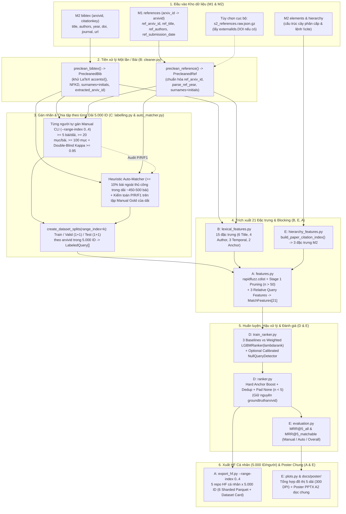
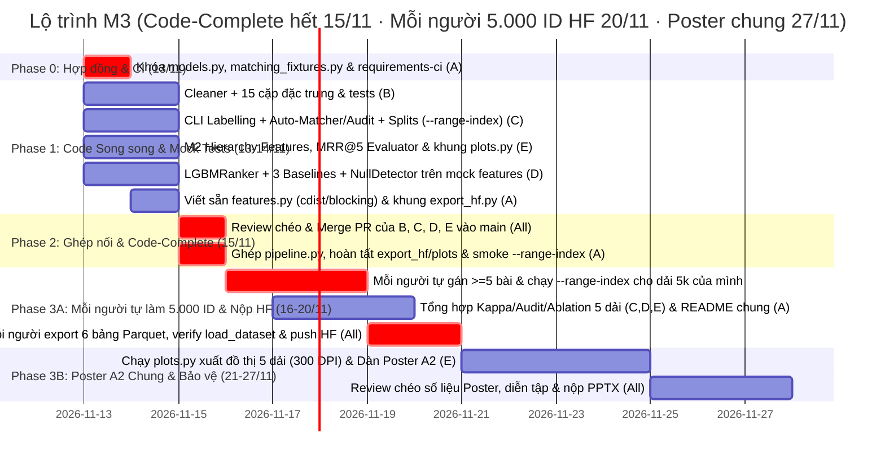

# Kế hoạch Triển khai Milestone 3 — Pipeline Đối sánh Tham chiếu (Reference Matching), Xếp hạng Học máy MRR@5, Công bố Hugging Face & Poster A2

> **Nhóm 5 thành viên (A — Leader, B, C, D, E)** · Môn Nhập môn Khoa học Dữ liệu (Introduction to Data Science)
> **Căn cứ pháp lý & kỹ thuật:** [`milestone3-matching-vi.md`](../../project%20requirements/milestone3-matching-vi.md), [`milestone2-parsing-vi.md`](../../project%20requirements/milestone2-parsing-vi.md), [`milestone1-data-crawling-vi.md`](../../project%20requirements/milestone1-data-crawling-vi.md), [`arxiv-project-statement-vi.md`](../../project%20requirements/arxiv-project-statement-vi.md).
> **Tài liệu đồng bộ:** [`milestone3-phan-cong-task-B-E-vi.md`](./milestone3-phan-cong-task-B-E-vi.md).
> **Khả năng tương thích:** Khớp 100% với hợp đồng dữ liệu khóa cứng [`src/crawler/models.py`](../../../src/crawler/models.py) (`SCHEMA_VERSION = 1`), [`src/parsing/models.py`](../../../src/parsing/models.py) (`SCHEMA_VERSION = 1`), [`src/crawler/export.py`](../../../src/crawler/export.py) và [`src/validate_m2.py`](../../../src/validate_m2.py).
> **Trạng thái:** Đã chuẩn hóa kiến trúc (13/11/2026) — **Code-Complete xong toàn bộ mã chung trước 16/11 (hết 15/11)**; giai đoạn **16–20/11 mỗi thành viên tự chạy trên dải 5.000 ID (`src/id_ranges.csv`) và nộp Hugging Face cá nhân đúng hạn 20/11**.

---

## 0. Tóm tắt một trang & Triết lý Giải quyết Vấn đề (Executive Summary)

### 0.1. Bài toán Cốt lõi
Từ 2 nguồn dữ liệu độc lập đã hoàn thiện ở các cột mốc trước cho từng công bố arXiv (`arxiv_id` ở M1 / `arxivid` ở M2):
1. **Bảng `bibtex` (Cột mốc 2 — `BibtexRow`):** Các mục tham chiếu trích xuất từ mã nguồn LaTeX đã khử trùng lặp và hợp nhất trường xuyên phiên bản: `arxivid`, `citationkey`, `entrytype`, `title`, `authors`, `year`, `doi`, `journal`, `url` *(lưu ý: không có cột `note` hay `eprint` trong schema M2 đã khóa)*.
2. **Bảng `references` (Cột mốc 1 — `Reference`):** Siêu dữ liệu tham khảo ngoài thu thập qua Semantic Scholar API / fallback nội bộ cho công bố đó, chỉ giữ các tham khảo **đã xác định được arXiv ID**: `arxiv_id`, `ref_arxiv_id`, `ref_title`, `ref_authors`, `ref_submission_date`, `ref_s2_id` *(lưu ý: bảng `references` đã khóa không có cột `ref.doi` hay `ref.year` tách riêng)*.

**Mục tiêu:** Với mỗi mục BibTeX $b_i$ trong các bài báo thuộc tập đối sánh (`train`, `valid`, `test`), xác định tham chiếu có khóa arXiv $r_j$ tương ứng trong bảng `references` của cùng công bố đó (hoặc ghi nhận là dòng toàn âm nếu tài liệu là sách, kỷ yếu ngoài arXiv, hoặc không có trong tập `references` đã crawl). Xuất ra danh sách xếp hạng Top-5 ứng viên (`cand1` $\dots$ `cand5`) trong bảng `predictions`, tối ưu hóa **Mean Reciprocal Rank @5 (MRR@5)** trên Test Set, đóng gói bộ dữ liệu 6 bảng Parquet công khai trên Hugging Face Hub (trước **20/11/2026 23:59**) và hoàn tất Poster một trang khổ A2 dọc (trước **27/11/2026 23:59**).

> **Ràng buộc Tuân thủ Chấm điểm (`milestone3-matching-vi.md`):** Tuyệt đối **không** dùng LLM hay mô hình tiền huấn luyện (pretrained embeddings / BERT) để tránh bị đưa vào diện chấm riêng biệt. Toàn bộ pipeline chỉ sử dụng đặc trưng chuỗi/thống kê/cấu trúc M2 và học máy cổ điển (LightGBM, TF-IDF nội bộ, Logistic Regression).

---

### 0.2. Vì sao bài toán này khó và Đâu là Điểm nhấn Phân hóa (Grading Differentiator)?

1. **Bất đối xứng dữ liệu văn bản (Text Asymmetry):**
   - M2 `cleaner.py` hiện chỉ xóa lệnh trình bày và mở rộng macro cơ bản; tiêu đề trong `bibtex` vẫn có thể chứa ngoặc nhọn bảo vệ chữ hoa (`{BERT}`, `{Transformer}`), chuỗi thoát dấu LaTeX (`\'e`, `\"a`, `\c{c}`, `{\o}`), hoặc phụ đề bị rút gọn; trong khi `ref_title` từ Semantic Scholar là văn bản thuần Unicode.
   - Tên tác giả trong BibTeX thường viết dạng `"Vaswani, Ashish"` hoặc `"A. Vaswani and others"`, còn S2 trả `"Ashish Vaswani"`. Nếu chỉ lấy họ (`Vaswani`), các họ phổ biến (`Zhang`, `Wang`, `Li`, `Smith`) sẽ dễ va chạm; cần kết hợp `(surname, first_initial)`.
2. **Nhiễu thời gian & Ấn bản Preprint vs Journal:**
   - `ref_submission_date` trên arXiv/S2 thường là ngày nộp bản gốc hoặc năm xuất bản (`"YYYY-MM-DD"` hoặc `"YYYY"`), có thể lệch 1–2 năm so với `bibtex.year` khi bài được đăng hội nghị/tạp chí sau đó.
3. **Mất cân bằng lớp & Bẫy Học máy (Imbalance + Zero-Gradient Groups):**
   - Trong một bài báo có $m = 40$ mục BibTeX và $n = 40$ tham chiếu arXiv ($m \times n = 1.600$ cặp), mỗi dòng $i$ có **nhiều nhất 1 nhãn dương** và tối thiểu 39 nhãn âm.
   - Khoảng ~40–50% mục BibTeX trong bài báo thật **không có trên arXiv** (dòng toàn âm). Trong `LGBMRanker(lambdarank)`, nhóm truy vấn toàn nhãn `0` sinh **gradient bằng 0** và điểm logit của `lambdarank` chỉ mang tính tương đối trong từng truy vấn (shift-invariant) — không thể đem cắt ngưỡng toàn cục $\theta_{\text{null}}$ một cách ngây thơ!
4. **Hợp nhất Khóa & Bảo toàn Ground Truth:**
   - M1 dùng tên cột `arxiv_id`; M2 và M3 `predictions` dùng `arxivid` và `citationkey`. Ngoài ra, `groundtrutharxivid` trong `predictions` là **nhãn thật** từ gán nhãn, tuyệt đối không được để mô hình ghi đè thành `None`.

---

### 0.3. Bảy Quyết định Thiết kế & Trụ cột Thuật toán Đột phá (M1 – M7)

| Mã | Thách thức trong đề bài | Giải pháp kỹ thuật Tối ưu (Best-in-Class Solution) | Điểm nhấn Chấm bài (Grading Differentiator) |
| :--- | :--- | :--- | :--- |
| **M1** | **Làm sạch văn bản chuyên biệt (`src/matching/cleaner.py`)** | **Academic Entity Cleaner + NFKD Folding:** Giải mã dấu LaTeX (`\'e` $\rightarrow$ `é`, `\"a` $\rightarrow$ `ä`, `\c{c}` $\rightarrow$ `ç`), bóc ngoặc `{...}`, chuẩn hóa Unicode NFKD khử dấu (để `Müller` khớp `Muller`), loại stop-words học thuật (`a, an, the, on, for, with`), và phân tách tác giả đa văn hóa thành `(surnames, surname_initials)` qua `PrecleanedBib` / `PrecleanedRef`. | Tiền xử lý một lần mỗi bài (`Precleaned`), tăng độ tương đồng chuỗi thực tế giữa `{BERT}` / `\'e` và văn bản S2 lên mức tối đa mà không tốn chi phí lặp $m \times n$. |
| **M2** | **Gán nhãn chuẩn Ground Truth (`labelling.py` & `auto_matcher.py`)** | **Audited Dual-Engine Per-Slice Annotation:** (1) Mỗi thành viên tự dùng CLI gán nhãn thủ công $\ge 5$ bài ($\ge 20$ mục/bài, tổng $\ge 100$ nhãn) **trong dải 5.000 ID được giao**, kèm kiểm tra chéo cặp $\kappa \ge 0.95$; (2) **Heuristic Auto-Matcher** chạy trên văn bản đã làm sạch (arXiv ID từ `url`/`journal`/arXiv DOI `10.48550/arXiv.<id>` $\rightarrow$ optional S2 DOI $\rightarrow$ Fuzzy Title + Author + Year an toàn khi thiếu năm) cho $\ge 10\%$ bài ngoài tập thủ công **trong từng dải 5.000 ID** ($\sim 450\text{–}500$ bài/người, gán **100%** mục BibTeX của bài đó). | Từng bộ Hugging Face 5.000 ID độc lập đều đạt chuẩn $\ge 5$ bài thủ công + $\ge 10\%$ tự động; đo **Precision / Recall / F1** của Auto-Matcher ngay trên 5+ bài Manual Gold để chứng minh chất lượng trên Poster. |
| **M3** | **Đặc trưng Đa chiều tận dụng Cấu trúc M2 (`lexical_features.py`, `hierarchy_features.py`, `features.py`)** | **21-Feature Fusion (15 B + 3 E + 3 A):** Kết hợp (a) 6 đặc trưng tiêu đề (`rapidfuzz` + TF-IDF nội bộ bài báo, không rò rỉ Test); (b) 4 đặc trưng tác giả (gồm `first_author_initial_match`); (c) 3 đặc trưng thời gian (`parse_ref_year` an toàn); (d) 2 mỏ neo định danh; (e) **3 đặc trưng M2** (`cite_frequency`, `first_cite_section_type`, `first_cite_section_depth` trích từ index $O(\|E\|+\|H\|)$); (f) 3 đặc trưng tương đối cấp truy vấn. | Khai thác thực chất cấu trúc phân cấp M2 theo đúng gợi ý điểm thưởng của đề bài và chứng minh bằng **Ablation Study** (có vs không có M2 features). |
| **M4** | **Định hình Học máy Xếp hạng (`ranker.py`, `train_ranker.py`)** | **Weighted `LGBMRanker` (LambdaMART) + Decoupled Null Detector:** Train `LGBMRanker(lambdarank)` trên các truy vấn có nhãn dương với `sample_weight` ưu tiên nhãn Manual (`3.0` vs `1.0`) để tránh overfit nhãn âm giả của Heuristic. Tách riêng `NullQueryDetector` (binary calibrated classifier trên Top-1 + margin) phục vụ phân tích độ tự tin. | Giải quyết triệt để điểm mù toán học của `lambdarank` với nhóm toàn 0 và bẫy học vẹt luật Heuristic; huấn luyện $< 15$ giây trên CPU cho mỗi dải 5.000 ID, dễ giải thích Feature Importance. |
| **M5** | **Hậu xử lý Top-5 & Đánh giá MRR@5 Đa chiều (`evaluation.py`)** | **Anchor-Safe Top-5 + Dual MRR@5 Reporting:** Giữ nguyên `groundtrutharxivid` bất biến; ưu tiên Hard Anchor (`arXiv ID`/`DOI`), chống trùng `cand1..cand5`, đệm `None` khi $n < 5$ (kể cả $n=0$). Báo cáo đồng thời `MRR@5_all` (đúng công thức (1) trên mọi `|Q|`, dòng toàn âm tính `0`) và `MRR@5_matchable` (trên các mục có tham chiếu arXiv thật), tách `Manual` / `Auto` / `Overall`. | Minh bạch hoàn toàn công thức chấm bài, tránh hiểu nhầm trần lý thuyết ~0,50 (toàn tập) với ~0,88–0,92 (trên tập matchable), đồng thời phát hiện overfit vào Auto-Matcher. |
| **M6** | **Xuất 6 Bảng Parquet theo Dải 5.000 ID (`export_hf.py`)** | **Per-Member 5.000-ID Slice Packaging (`--range-index <0..4>`):** Mặc định lọc toàn bộ 6 bảng (`papers`, `references`, `elements`, `hierarchy`, `bibtex`, `predictions`) theo đúng 5.000 ID của thành viên từ `src/id_ranges.csv`, đóng gói shard `< 80 MB` theo `data/<table>/train-00000-of-0000N.parquet` (nén `ZSTD`), tự sinh `README.md` YAML chuẩn Hub, kiểm tra bằng `datasets.load_dataset` *(kèm `--range-index all` cho đánh giá nội bộ 25k)*. | Tương thích 100% Hugging Face Viewer streaming; bảo đảm 5 repo Hugging Face cá nhân tách biệt gọn, sạch và tự khép kín theo đúng Quyết định D8. |
| **M7** | **Poster A2 Dọc & Kịch bản Trình bày (`plots.py`, `docs/poster/`)** | **Reproducible Charts + A2 Portrait Layout ($420 \times 594\text{ mm}$):** Sinh tự động đồ thị 300 DPI bằng `plots.py` từ kết quả tổng hợp 5 dải (So sánh 4 mô hình, Ablation Study có/không có M2 Hierarchy, Feature Importance, Error Analysis, Thống kê 3 Milestone) gắn vào template PowerPoint 5 khối khoa học. | Đảm bảo số liệu trên Poster đồng bộ 100% với code chạy thật trên 5 dải và nêu bật câu chuyện khoa học dữ liệu đầu–cuối từ M1 $\rightarrow$ M2 $\rightarrow$ M3. |

---

### 0.4. Bài học từ M1 & 5 Nguyên tắc Thiết kế Chống nghẽn (Zero-Friction Principles)

| Bài học từ M1 | Nguy cơ tương đương ở M3 | Giải pháp Kỹ thuật & Ràng buộc Bắt buộc cho M3 |
| :--- | :--- | :--- |
| **1. Bùng nổ Quy mô (Scale Shock)** | ~500 bài/dải $\times$ 1.600 cặp $\approx 800\text{k}$ cặp/người (hoặc ~2.500 bài / 4M cặp khi tổng hợp 5 dải). Nếu dùng `fuzzywuzzy` hoặc gọi `clean_title()` / `TfidfVectorizer` lặp bên trong vòng for từng cặp $\rightarrow$ chậm hàng giờ hoặc OOM. | **Pre-clean 1 lần + `rapidfuzz.process.cdist` theo từng bài:** Làm sạch toàn bộ `BibtexRow` và `Reference` của 1 bài **trước** khi tạo cặp. Dùng `rapidfuzz.process.cdist` tính ma trận $m \times n$ ở tầng C++ (~0,5 ms/bài). Chỉ kích hoạt Stage 1 Pruning khi $n > 50$ và luôn bảo toàn Hard Anchors + Top-20 `QRatio` + khớp họ đầu để giữ recall $\ge 99.5\%$. |
| **2. Nghẽn Bàn giao (Sequential Blocker)** | B, C, D, E ngồi chờ 25k crawl (M1 T4.1) mới code được hoặc kẹt nhau khi nộp HF 20/11. | **Mock-First + Tự chủ 5.000 ID / người:** Leader A khóa `src/matching/models.py` và `src/tests/matching_fixtures.py` trong ngày 13/11. Cả 5 người đóng băng toàn bộ mã chung **trước 16/11 (hết 15/11)**; từ 16/11, từng người chạy độc lập `--range-index <k>` trên dải 5.000 ID của mình để nộp HF cá nhân không chờ ai. |
| **3. Lệch Hợp đồng & Giả định Sai Trường** | Code M3 gọi `ref.doi`, `ref.year`, `bib.note`, `bib.eprint` (không tồn tại trong `models.py` M1/M2!) hoặc join lệch giữa `arxiv_id` và `arxivid`, hoặc quên `n < 5` / `n = 0`. | **Khóa chặt với Schema Thật:** Mọi ID đi qua `normalize_arxiv_id()` (hỗ trợ cả `2408.11045v2` lẫn `hep-th/9901001`); chuẩn hóa khóa join `arxiv_id` $\leftrightarrow$ `arxivid`; năm của `Reference` trích từ `ref_submission_date[:4]`; chỉ dùng arXiv DOI từ `bib.doi` (kèm tùy chọn đọc `s2_references.raw.json.gz`); đệm `None` an toàn khi $n < 5$. |
| **4. Rò rỉ Dữ liệu & Nhãn Thiên lệch** | (a) Fit TF-IDF trên cả tập Test; (b) chia tập theo cặp thay vì theo `arxivid`; (c) Auto-Matcher gán âm giả cho các bài khớp ở mức `0.80–0.94` làm mô hình học vẹt heuristic. | **Group Split + Zero-Leakage TF-IDF + Weighted Training:** Chia tập theo `arxivid`; TF-IDF tính cục bộ trong từng bài (hoặc chỉ fit trên `Train`); gán `sample_weight` cao hơn cho `Manual` (`3.0` vs `1.0`), validate early stopping trên `Valid-Manual`, và tách riêng `MRR@5_manual` khi đánh giá. |
| **5. Vỡ CI & Trễ Hạn Nộp Kép** | Thêm `rapidfuzz`/`lightgbm` nhưng quên `src/requirements-ci.txt` làm CI đỏ; dồn lịch code sát ngày 20/11 khiến 5 người không kịp tự chạy dải & kiểm chứng HF. | **Đồng bộ CI ngay 13/11 + Tách 3 Mốc Rõ Ràng:** Cập nhật `src/requirements.txt` & `src/requirements-ci.txt` ngay trong ngày 13/11; tách rõ **hết 15/11 (Code-Complete chung)**, **20/11 (5 repo Dataset HF cá nhân × 5.000 ID & Repo code)** và **27/11 (Poster A2 chung + Bảo vệ)**. |

---

## 1. Phân tích Yêu cầu Đề bài $\rightarrow$ Hợp đồng & Khóa Liên kết Dữ liệu

### 1.1. Bảng Đối chiếu Yêu cầu Đề bài sang Thiết kế Hệ thống

| Hạng mục trong đề (`milestone3-matching-vi.md`) | Quy định chi tiết của Giảng viên (áp dụng cho từng bộ 5.000 ID cá nhân) | Hệ quả Thiết kế trong `src/matching/` |
| :--- | :--- | :--- |
| **Làm sạch dữ liệu** | Tiền xử lý văn bản bổ sung: chữ thường, stop-word, tokenization riêng cho tên tác giả và tiêu đề. | `src/matching/cleaner.py`: giải mã LaTeX accents, bỏ ngoặc `{}`, Unicode NFKD folding, stop-words học thuật, tách `(surnames, surname_initials)` qua `PrecleanedBib` / `PrecleanedRef`. |
| **Gán nhãn thủ công** | $\ge 5$ công bố **trong bộ 5.000 ID nộp HF**; mỗi bài $\ge 20$ mục BibTeX ($Q \ge 20$); tổng $\ge 100$ mục. | `src/matching/labelling.py`: CLI `--range-index <k>` giúp từng thành viên tự gán nhãn $\ge 5$ bài ($m \ge 20$) thuộc dải mình; kiểm tra $Q \ge 20$/bài, tổng $\ge 100$; hỗ trợ kiểm tra chéo Cohen's Kappa $\kappa \ge 0.95$. |
| **Gán nhãn tự động** | Regex / heuristic độ tương đồng chuỗi; áp dụng cho $\ge 10\%$ số công bố ngoài tập thủ công **của bộ 5.000 ID đó**; gán nhãn cho **mọi** mục BibTeX của các công bố đó. | `src/matching/auto_matcher.py`: chạy `--range-index <k>` trên dữ liệu đã làm sạch ($\sim 450\text{–}500$ bài/người); kiểm toán Precision/Recall/F1 trên 5 bài thủ công của dải đó. |
| **Ma trận Ứng viên & Ground Truth** | Ma trận $m \times n$ ($m$ BibTeX $\times$ $n$ `references` có arXiv ID của cùng bài). Tối đa 1 ô `yes`, còn lại `no`; không khớp tạo dòng toàn `no`. | Biểu diễn chuẩn qua `LabeledQuery(arxivid, citationkey, groundtrutharxivid, source, partition)` và `CandidatePair` (`label in {0, 1}`). Ghi rõ định dạng file JSON/Parquet trong `README.md`. |
| **Chia tập Dữ liệu** | **Test:** 1 bài thủ công + 1 bài tự động.<br/>**Valid:** 1 bài thủ công + 1 bài tự động.<br/>**Train:** Tất cả bài còn lại (thủ công + tự động) trong dải 5.000 ID. | `create_dataset_splits(..., range_index=k)`: chia theo `arxivid` cục bộ trong từng dải với seed cố định; kiểm tra Valid/Test có $Q \ge 20$, đủ nhãn dương/âm; lưu `data/groundtruth/range_<k>/splits.json`. |
| **Kỹ thuật Đặc trưng** | Định hình học có giám sát; xây dựng đặc trưng từ đơn giản đến thống kê; **được dùng cấu trúc phân cấp M2**; biện minh trên poster và `README.md`. | 21 đặc trưng chia 3 module: `lexical_features.py` (**B**, 15 đặc trưng), `hierarchy_features.py` (**E**, 3 đặc trưng M2), `features.py` (**A**, 3 đặc trưng tương đối + blocking + ghép vector). |
| **Mô hình hóa & Đánh giá** | Xuất Top-5 (`cand1` $\dots$ `cand5`); cho phép hậu xử lý; đánh giá bằng **MRR@5** trên Test Set theo công thức (1). Không dùng LLM/pretrained để chấm chung thang điểm. | `ranker.py` & `train_ranker.py` (**D**) + `evaluation.py` (**E**): 3 baselines + `LGBMRanker(lambdarank)` + Hard Anchor Boost + báo cáo `MRR@5_all`, `MRR@5_matchable` (Manual/Auto/Overall). |
| **Bảng `predictions`** | Chỉ chứa các bài nằm trong `train`, `valid`, `test` của dải đó. Cột: `arxivid`, `partition`, `citationkey`, `groundtrutharxivid`, `cand1` $\dots$ `cand5`. | `predictions.parquet` đúng kiểu PyArrow (`partition` dùng `dictionary` hoặc `string` — kiểm chứng tương thích `datasets`), giữ nguyên `groundtrutharxivid`, đệm `None` nếu $n < 5$. |
| **Nộp Hugging Face & Poster** | Mỗi thành viên tự nộp **1 Dataset HF (5.000 ID)** gồm 6 bảng Parquet phân mảnh + `README.md` Dataset Card YAML. Cả nhóm nộp chung 1 Poster `.pptx` khổ A2 dọc. | `export_hf.py --range-index <k>` (**A**) giúp từng thành viên xuất trọn 6 bảng đúng 5.000 ID của mình. `plots.py` + `docs/poster/` (**E**) tổng hợp số liệu cho Poster A2 ($420 \times 594\text{ mm}$). |

---

### 1.2. Bản đồ Khóa Liên kết Giữa M1 – M2 – M3 & Schema Bảng `predictions`

#### Khóa Join chuẩn hóa giữa các bảng
| Bảng | Nguồn | Cột khóa bài báo | Cột khóa mục / tham chiếu | Lưu ý chuẩn hóa khi nạp trong M3 |
| :--- | :---: | :--- | :--- | :--- |
| `papers` | M1 (`export.py`) | `arxiv_id` | — | Map `arxiv_id` $\rightarrow$ `arxivid` khi đối chiếu hoặc đóng gói |
| `references` | M1 (`export.py`) | `arxiv_id` | `ref_arxiv_id` | Chuẩn hóa `ref_arxiv_id` bằng `normalize_arxiv_id()` (bỏ `vN`, giữ nguyên `hep-th/9901001`) |
| `elements` | M2 (`export_m2.py`) | `arxivid` | `elementid` (`<dirname>#<disc>`) | Đọc mọi shard `parsed/elements/*.parquet` |
| `hierarchy` | M2 (`export_m2.py`) | `arxivid` | `version`, `elementid`, `parentid` | Chỉ số hóa theo `max(version)` có dữ liệu (hoặc hợp nhất) |
| `bibtex` | M2 (`export_m2.py`) | `arxivid` | `citationkey` | Mỗi `(arxivid, citationkey)` là duy nhất |
| `predictions` | M3 (`pipeline.py`) | `arxivid` | `citationkey`, `cand1..cand5` | Chỉ chứa các bài thuộc `train`, `valid`, `test` |

#### Đặc tả Schema Bảng `predictions` (PyArrow)
| Cột | Kiểu PyArrow | Nullable | Quy ước Giá trị & Bất biến Bắt buộc |
| :--- | :--- | :---: | :--- |
| `arxivid` | `pa.string()` | `False` | Mã arXiv gốc của công bố trích dẫn (khớp `bibtex.arxivid`, vd: `2408.11045`). |
| `partition` | `pa.dictionary(pa.int8(), pa.string())` | `False` | Giá trị thuộc `{'train', 'valid', 'test'}`. |
| `citationkey` | `pa.string()` | `False` | Khóa trích dẫn đại diện của mục BibTeX (khớp `bibtex.citationkey`). |
| `groundtrutharxivid` | `pa.string()` | `True` | arXiv ID chuẩn từ tập gán nhãn (`None` nếu là dòng toàn âm). **Không bao giờ bị mô hình ghi đè.** |
| `cand1` .. `cand5` | `pa.string()` | `True` | Top-5 `ref_arxiv_id` ứng viên không trùng lặp thuộc bảng `references` của cùng `arxivid`. Điền `None` cho các vị trí dư nếu $n < 5$ (hoặc $n = 0$). |

#### Cấu trúc Kho Dữ liệu Hugging Face (`<dataset-repo>/`)
```text
└── <dataset-repo>/
    ├── README.md                              # Dataset Card YAML (configs cho 6 bảng, split: train)
    └── data/
        ├── papers/train-00000-of-00001.parquet
        ├── references/train-00000-of-00001.parquet
        ├── elements/train-00000-of-0000N.parquet    # Shard ~50-80 MB / file
        ├── hierarchy/train-00000-of-0000N.parquet   # Shard ~50-80 MB / file
        ├── bibtex/train-00000-of-00001.parquet
        └── predictions/train-00000-of-00001.parquet
```

---

## 2. Kiến trúc Luồng Xử lý Đầu–Cuối (End-to-End Matching Pipeline)



---

## 3. Thiết kế Chi tiết 5 Trụ cột Kỹ thuật

### 3.1. Trụ cột 1: Tiền xử lý & Chuẩn hóa Thực thể (`src/matching/cleaner.py`)
*Phụ trách chính: Thành viên **B** (Sơn)*

M2 `cleaner.py` chỉ bỏ thẻ định dạng (`\textbf`, `\textit`) mà **không** giải mã dấu LaTeX hay ngoặc nhọn trong `bibtex.title`. Vì vậy `src/matching/cleaner.py` thực hiện:
1. **`decode_latex_accents_and_braces(text)`:**
   - Giải mã ký tự thoát LaTeX phổ biến (`\'e` $\rightarrow$ `é`, `\"a` $\rightarrow$ `ä`, `\c{c}` $\rightarrow$ `ç`, `\~n` $\rightarrow$ `ñ`, `\v{s}` $\rightarrow$ `š`, `{\o}` $\rightarrow$ `ø`, `\ss` $\rightarrow$ `ß`).
   - Loại bỏ toàn bộ ngoặc nhọn `{...}` dùng để bảo vệ chữ hoa trong BibTeX (`{BERT}` $\rightarrow$ `BERT`).
2. **`clean_title(title)` & `fold_ascii(text)`:**
   - Chuẩn hóa Unicode `NFKD` + bỏ dấu tổ hợp (`combining`) để so khớp xuyên bảng mã (`Schölkopf` $\equiv$ `Scholkopf`), chuyển chữ thường, đổi gạch nối (`-`, `–`, `—`) và dấu câu thành khoảng trắng, gộp khoảng trắng thừa.
   - Cung cấp bản **full cleaned** (dùng cho exact match & Levenshtein) và bản **content tokens** (loại stop-words đầu/cuối ít phân biệt như `a, an, the, on, for, with, of, in, to, towards, via, using`).
3. **`extract_author_tokens(authors: list[str]) -> AuthorTokens`:**
   - Xóa cụm rác `"et al."`, `"and others"`, `"collaboration"`.
   - Hỗ trợ cả 2 định dạng `"Họ, Tên Tên_Đệm"` và `"Tên Tên_Đệm Họ"`, giữ nguyên tiền tố họ phức hợp (`van`, `van der`, `von`, `de`, `del`, `di`, `al-`, `mac`, `mc`).
   - Trả về `AuthorTokens(surnames: frozenset[str], surname_initials: frozenset[tuple[str, str]], first_surname: str | None, first_initial: str | None, count: int)`.
4. **Helper Chuẩn hóa Định danh & Thời gian (đặt chung tại `models.py` / `cleaner.py`):**
   - `normalize_arxiv_id(raw)`: bóc tiền tố `arxiv:`, `https://arxiv.org/abs/...`, `https://arxiv.org/pdf/...`, bỏ hậu tố phiên bản `vN` (`2408.11045v2` $\rightarrow$ `2408.11045`), giữ nguyên ID cũ (`hep-th/9901001`), kiểm tra định dạng hợp lệ để không bắt nhầm số thập phân.
   - `extract_arxiv_id_from_bib(bib: BibtexRow) -> str | None`: kiểm tra theo thứ tự ưu tiên: `bib.url` $\rightarrow$ arXiv DOI `10.48550/arXiv.<id>` trong `bib.doi` $\rightarrow$ mẫu `arXiv:<id>` trong `bib.journal`.
   - `parse_ref_year(ref_submission_date: str | None) -> int | None`: trích 4 chữ số đầu `(19\d{2}|20\d{2})`.
5. **Pre-cleaning Một lần (`PrecleanedBib`, `PrecleanedRef`):** Hàm `preclean_bibtex(row)` và `preclean_reference(row, s2_doi=None)` chạy đúng 1 lần cho mỗi bản ghi trước khi tạo cặp $m \times n$.

---

### 3.2. Trụ cột 2: Khung Gán nhãn Chuẩn & Chia tập (`labelling.py`, `auto_matcher.py`)
*Phụ trách chính: Thành viên **C** (Quỳnh)*

#### A. Gán nhãn Thủ công Theo Dải 5.000 ID (`labelling.py --range-index <0..4>`)
- **Phân chia 5 Dải Độc lập (`src/id_ranges.csv`) & Chiến lược Chọn bài:**
  - Vì mỗi thành viên tự xuất **1 bộ dữ liệu Hugging Face cá nhân (5.000 ID)**, mỗi bộ phải tự thỏa mãn đủ tiêu chuẩn gán nhãn của đề bài. Cụ thể, mỗi thành viên chọn tối thiểu **5 công bố** ($m \ge 20$ mục BibTeX/bài, $n \ge 5$ tham chiếu arXiv) nằm **trực tiếp trong dải 5.000 ID của mình** (tổng cả nhóm $\ge 25$ bài thủ công):
    - **Dải `0` (`2408.11045–2408.16044`)** · **Dải `1` (`2408.06045–2408.11044`)** · **Dải `2` (`2408.01045–2408.06044`)** · **Dải `3` (`2407.07839–2407.12838`)** · **Dải `4` (`2406.07938–2406.12937`)**.
  - Gán nhãn **100% mục BibTeX** trong mỗi bài đã chọn (bảo đảm $Q \ge 20$/bài, tổng $\ge 100$/người, và bảng `predictions` đủ mọi dòng của bài đó).
- **Công cụ CLI Tương tác (`run_manual_labeling_cli`):**
  - Hiển thị thông tin mục BibTeX (`citationkey`, `title`, `authors`, `year`, `doi`, `url`) cùng danh sách Top-5 gợi ý từ `PrecleanedRef` sắp xếp nhanh theo điểm chữ.
  - Người gán nhập số `1..5` (hoặc tra cứu toàn bộ $n$ tham chiếu của bài) để chọn `ref_arxiv_id` đúng, hoặc nhập `0` cho dòng toàn âm (`groundtrutharxivid = None`).
  - Lưu vào `data/groundtruth/range_<k>/manual_annotations.json` (ghi rõ schema JSON trong `README.md`) và hỗ trợ hàm `compute_cohens_kappa(ann_a, ann_b)` kiểm tra chéo mù đôi tối thiểu 1 bài/cặp thành viên ($\kappa \ge 0.95$) để lấy số liệu cho Poster.

#### B. Bộ Đối sánh Tự động Đã kiểm toán (`auto_matcher.py --range-index <0..4>`)
Mỗi thành viên chạy tự động trên **ít nhất 10%** số công bố ngoài tập thủ công **trong dải 5.000 ID của mình** ($\approx 450\text{–}500$ bài/dải, tùy số bài `ok` có BibTeX) và gán nhãn cho **100% mục BibTeX** của các bài đó:

```python
from rapidfuzz import fuzz


def heuristic_match(
    bib: PrecleanedBib,
    candidates: list[PrecleanedRef],
) -> str | None:
    """Cascade 3 cấp trên dữ liệu đã làm sạch (Precision > 99%)."""
    # Cấp 1: Mỏ neo cứng arXiv ID (từ bib.url, bib.journal, hoặc DOI 10.48550/arXiv.*)
    if bib.extracted_arxiv_id:
        for ref in candidates:
            if ref.norm_arxiv_id == bib.extracted_arxiv_id:
                return ref.norm_arxiv_id

    # Cấp 2: Khớp chính xác DOI (chỉ kích hoạt khi có s2_doi từ s2_references.raw.json.gz)
    if bib.norm_doi:
        for ref in candidates:
            if ref.norm_doi and ref.norm_doi == bib.norm_doi:
                return ref.norm_arxiv_id

    # Cấp 3: Khớp chuỗi nghiêm ngặt trên tiêu đề ĐÃ LÀM SẠCH
    best_id: str | None = None
    best_score = 0.0
    for ref in candidates:
        if not bib.clean_title or not ref.clean_title:
            continue
        len_ratio = min(len(bib.clean_title), len(ref.clean_title)) / max(
            len(bib.clean_title), len(ref.clean_title)
        )
        if len_ratio < 0.70:
            continue

        title_sim = fuzz.token_sort_ratio(bib.clean_title, ref.clean_title) / 100.0
        surname_ok = bool(
            bib.authors.first_surname
            and ref.authors.first_surname
            and bib.authors.first_surname == ref.authors.first_surname
        )

        # Không giả định year_diff = 0 khi thiếu năm!
        if bib.year is not None and ref.year is not None:
            year_ok = abs(bib.year - ref.year) <= 1
            min_title_sim = 0.94
        else:
            year_ok = True
            min_title_sim = 0.97  # Siết chặt hơn nếu thiếu thông tin năm

        if title_sim >= min_title_sim and surname_ok and year_ok:
            if title_sim > best_score:
                best_score = title_sim
                best_id = ref.norm_arxiv_id

    return best_id
```

- **Kiểm soát Chất lượng Auto-Matcher (Bắt buộc):**
  1. Chạy `audit_auto_matcher_on_manual()` trên toàn bộ tập thủ công để đo **Precision, Recall, F1** của `heuristic_match` so với nhãn người (mục tiêu Precision $\ge 98\%$).
  2. **Kiểm tra xung đột 1-nhiều (`resolve_paper_auto_matches`):** Nếu 2 `BibtexRow` khác nhau trong cùng 1 bài báo đều khớp vào cùng một `ref_arxiv_id`, giữ cặp có cấp ưu tiên/điểm cao hơn và cảnh báo log hoặc đặt nhãn mục yếu hơn thành `None` nếu điểm Cấp 3 thấp.

#### C. Quy tắc Chia tập Dữ liệu Cục bộ Từng Dải (`create_dataset_splits`)
Áp dụng độc lập trong phạm vi **5.000 ID của mỗi thành viên** (mức **Bài báo `arxivid`** với `seed=42`, lưu ra `data/groundtruth/range_<k>/splits.json`):
- **Tập Kiểm tra (`test`):** 1 bài thủ công + 1 bài tự động thuộc dải `<k>`.
- **Tập Kiểm định (`valid`):** 1 bài thủ công + 1 bài tự động thuộc dải `<k>`.
- **Tập Huấn luyện (`train`):** Toàn bộ các bài đã gán nhãn còn lại của dải `<k>` ($\ge 3$ bài thủ công + $\sim 450$ bài tự động).
- **Ràng buộc chọn bài `valid` & `test`:** Cả bài thủ công lẫn bài tự động được chọn cho `valid`/`test` đều phải có $Q \ge 20$ mục BibTeX, có $\ge 3$ tham chiếu arXiv đúng (`groundtrutharxivid != None`), và $\ge 3$ dòng âm để tránh tập kiểm thử suy biến. Nhờ đó bảng `predictions` trong mỗi repo HF cá nhân tự khép kín 100% quy tắc chia tập.

---

### 3.3. Trụ cột 3: Bộ 21 Đặc trưng Đa chiều & Blocking (`lexical_features.py`, `hierarchy_features.py`, `features.py`)
*Phụ trách chính: **B** (15 đặc trưng cặp), **E** (3 đặc trưng M2), **A** (Blocking + 3 đặc trưng tương đối + ghép `MatchFeatures`)*

#### Bảng Đặc tả Chính thức 21 Đặc trưng (`MatchFeatures`)

| # | Tên trường trong `MatchFeatures` | Kiểu | Nhóm & Owner | Công thức / Nguồn & Ý nghĩa Biện minh Khoa học |
| :-: | :--- | :---: | :--- | :--- |
| 1 | `title_exact_match` | `int` (0/1) | Title (**B**) | `1` nếu `bib.clean_title == ref.clean_title` (khác rỗng). Tín hiệu khớp tuyệt đối. |
| 2 | `title_levenshtein_ratio` | `float` [0,1] | Title (**B**) | `rapidfuzz.fuzz.ratio(bib.clean_title, ref.clean_title) / 100.0`. Bắt lỗi chính tả/ký tự. |
| 3 | `title_token_sort_ratio` | `float` [0,1] | Title (**B**) | `rapidfuzz.fuzz.token_sort_ratio(...) / 100.0`. Kháng đảo trật tự từ (`A: B` vs `B - A`). |
| 4 | `title_jaccard_word_3gram` | `float` [0,1] | Title (**B**) | Jaccard của tập cụm 3 từ (hoặc word 1–2 gram khi tiêu đề ngắn $< 3$ từ). |
| 5 | `title_tfidf_cosine` | `float` [0,1] | Title (**B**) | Cosine TF-IDF (char n-gram 3–5) fit **nội bộ trên các tiêu đề của chính bài báo đó** (không bao giờ fit trên Test $\rightarrow$ 0% rò rỉ). |
| 6 | `title_length_ratio` | `float` [0,1] | Title (**B**) | $\min(L_1, L_2) / \max(L_1, L_2)$ trên `clean_title`. Loại trừ trường hợp trích đoạn ngắn. |
| 7 | `first_author_surname_match` | `int` (0/1) | Author (**B**) | `1` nếu họ tác giả đầu khớp (`bib.authors.first_surname == ref.authors.first_surname`). |
| 8 | `first_author_initial_match` | `int` (0/1) | Author (**B**) | `1` nếu cả họ lẫn chữ cái đầu tên của tác giả đầu khớp (giảm nhiễu trùng họ `Zhang`/`Wang`). |
| 9 | `authors_jaccard_sim` | `float` [0,1] | Author (**B**) | Jaccard giữa `bib.authors.surnames` và `ref.authors.surnames`. |
| 10 | `author_count_diff` | `int` ($\ge 0$) | Author (**B**) | `abs(bib.authors.count - ref.authors.count)` (nếu một bên rỗng, gán `99`). |
| 11 | `year_diff` | `int` ($\ge 0$) | Temporal (**B**) | `abs(bib.year - ref.year)` nếu đủ cả hai năm; nếu thiếu gán `999`. |
| 12 | `year_match` | `int` (0/1) | Temporal (**B**) | `1` nếu đủ cả hai năm và `bib.year == ref.year`. |
| 13 | `year_missing` | `int` (0/1) | Temporal (**B**) | `1` nếu `bib.year is None or ref.year is None` (giúp cây tách `year_diff = 999` khỏi chênh lệch thật). |
| 14 | `arxiv_id_in_bib_text` | `int` (0/1) | Anchor (**B**) | `1` nếu `bib.extracted_arxiv_id == ref.norm_arxiv_id`. |
| 15 | `doi_exact_match` | `int` (0/1) | Anchor (**B**) | `1` nếu arXiv DOI của `bib.doi` khớp `ref.norm_arxiv_id`, hoặc `bib.norm_doi == ref.norm_doi` (khi có S2 raw DOI). |
| 16 | `cite_frequency` | `int` ($\ge 0$) | M2 AST (**E**) | Tổng số lần `citationkey` xuất hiện trong các nút `elements` thuộc phiên bản chọn của bài báo (tài liệu nền/kinh điển thường được trích nhiều lần và hay có arXiv ID). |
| 17 | `first_cite_section_type` | `int` (-1..3) | M2 AST (**E**) | Nhóm mục chứa lần trích dẫn đầu tiên: `0=Intro/Abstract`, `1=Related Work/Background`, `2=Method/Model/Experiment`, `3=Conclusion/Appendix/Other`, `-1=Không có AST`. |
| 18 | `first_cite_section_depth` | `int` ($\ge 0$) | M2 AST (**E**) | Độ sâu cây từ `#root{v}` tới nút chứa lần trích dẫn đầu tiên (`0` nếu không tìm thấy/lỗi M2). |
| 19 | `title_sim_rank_in_query` | `int` ($\ge 1$) | Relative (**A**) | Thứ hạng (`1` = cao nhất) của `title_token_sort_ratio` giữa các ứng viên của cùng `citationkey`. |
| 20 | `title_sim_diff_from_max` | `float` ($\le 0$) | Relative (**A**) | `title_token_sort_ratio(i, j) - max_k title_token_sort_ratio(i, k)` — đo khoảng cách tương đối tới ứng viên dẫn đầu trong nhóm truy vấn. |
| 21 | `title_sim_margin_to_top2` | `float` ($\ge 0$) | Relative (**A**) | Hiệu `top1_sim - top2_sim` trong truy vấn `i` (đặc trưng tương tác cho `LGBMRanker` và đầu vào chính cho `NullQueryDetector`). |

#### Chi tiết Xử lý Tối ưu cho M2 Index (`hierarchy_features.py` — E) & Vector Blocking (`features.py` — A)
1. **Lập chỉ mục AST một lần mỗi bài (`build_paper_citation_index`):**
   - Chọn phiên bản mục tiêu theo `version_strategy="latest"` (`max(row.version)` có mặt trong `hierarchy` của bài đó; tránh đếm lặp qua `v1..vN`).
   - Dựng cây cha–con trong $O(\|E\| + \|H\|)$ bằng `dict`, dùng chung biểu thức regex nhận diện `\cite` như [`src/validate_m2.py`](../../../src/validate_m2.py) (`cite[tp]?|citeal[pt]|citeauthor|citeyear|parencite|textcite|autocite`) để không sót biến thể trích dẫn chưa gộp.
   - Khi một bài không có `elements`/`hierarchy` (bản `no_source` hoặc lỗi parse M2), trả ngay fallback an toàn `(0, -1, 0)`.
2. **Tính Nhanh C++ & Blocking Giữ Recall $\ge 99.5\%$ (`features.py`):**
   - Với các bài $n \le 50$ tham chiếu: tính toàn bộ ma trận $m \times n$ qua `rapidfuzz.process.cdist` (`workers=1` hoặc đa luồng theo bài) vì $40 \times 40 = 1.600$ cặp chỉ tốn $< 0.5\text{ ms/bài}$ (tương đương $\sim 1.3\text{ giây}$ cho 2.500 bài!).
   - Khi bài có $n > 50$: áp dụng Stage 1 Blocking giữ lại hợp của **(a) Mọi ứng viên khớp Hard Anchor (`arxiv_id` / `doi`) + (b) Mọi ứng viên khớp `first_author_surname_match` + (c) Top-20 ứng viên có điểm `rapidfuzz.fuzz.QRatio` cao nhất**. Cách hợp này bảo đảm không cắt nhầm ứng viên đúng dù tiêu đề bị rút gọn hay tác giả bị thiếu.

---

### 3.4. Trụ cột 4: Mô hình Học máy Xếp hạng & Đánh giá (`ranker.py`, `train_ranker.py`, `evaluation.py`)
*Phụ trách chính: Thành viên **D** (Thụ — Mô hình) & Thành viên **E** (Triệu — Đánh giá)*

#### A. Định hình Learning-to-Rank & Giao diện Thuần Đặc trưng (Zero-Coupling)
- **Tách phụ thuộc tuyệt đối:** `MatchingRanker` chỉ nhận đầu vào là danh sách `MatchFeatures` (hoặc `pd.DataFrame` 21 cột + `groups`), **không** nhập `BibtexRow` hay `Reference` thô vào `ranker.py` để D lập trình và chạy test độc lập 100% với B và E.
- **Huấn luyện `LGBMRanker` (`objective="lambdarank"`, `metric="ndcg"`, `ndcg_eval_at=[1, 3, 5]`):**
  - Lọc **chỉ đưa vào `LGBMRanker` các truy vấn có $\ge 1$ nhãn dương** (vì nhóm toàn 0 không sinh gradient cặp trong LambdaMART).
  - Áp dụng **trọng số mẫu theo nguồn nhãn (`sample_weight`):** `Manual Gold = 3.0`, `Auto Silver = 1.0`, kết hợp early stopping trên tập `Valid-Manual` để chống overfit vào các nhãn âm giả của Heuristic (khoảng tương đồng `0.80–0.94`).
- **Bộ Phát hiện Dòng Toàn âm Độc lập (`NullQueryDetector` — Tùy chọn cho Phân tích Lỗi):**
  - Huấn luyện một bộ phân loại nhị phân đã hiệu chuẩn (Logistic / LightGBM Binary) trên **tất cả** các truy vấn (kể cả dòng toàn âm!), dùng vectơ đặc trưng của ứng viên Top-1 + `title_sim_margin_to_top2` + độ dài tiêu đề để dự đoán xác suất truy vấn thực sự có bản arXiv hay không (`is_matchable_prob >= θ_null`, tối ưu F1 trên `Valid`).
  - **Quy tắc bất biến:** Quyết định của `NullQueryDetector` **chỉ** lưu ở trường báo cáo/phân tích lỗi, **tuyệt đối không ghi đè cột `groundtrutharxivid`** trong bảng `predictions`.
- **3 Baselines So sánh (bắt buộc chạy qua cùng bộ `evaluation.py` cho Poster):**
  1. *Baseline 1 (Heuristic String Rule):* Xếp hạng thuần theo `title_token_sort_ratio`.
  2. *Baseline 2 (IR Unsupervised):* Xếp hạng thuần theo `title_tfidf_cosine` (hoặc kết hợp BM25).
  3. *Baseline 3 (Pointwise Classification):* `LogisticRegression` (chuẩn hóa `StandardScaler`) dự đoán xác suất khớp từng cặp rồi xếp hạng theo xác suất giảm dần trong truy vấn.
  4. *Proposed Model:* **`LightGBM LambdaMART Ranker`** trên đầy đủ 21 đặc trưng (và bản **Ablation without M2** dùng 18 đặc trưng để đo mức tăng MRR nhờ cấu trúc M2!).

#### B. Hậu xử lý & An toàn Schema `predictions`
1. **Hard Anchor Boost:** Nếu bất kỳ ứng viên nào trong truy vấn có `arxiv_id_in_bib_text == 1` hoặc `doi_exact_match == 1`, đẩy lên đầu danh sách xếp hạng (giữ thứ tự điểm mô hình nếu có nhiều hơn 1).
2. **Loại trùng & Đệm `None` an toàn:** Khử trùng lặp `ref_arxiv_id` trên `cand1..cand5`; nếu bài có $n < 5$ tham chiếu (kể cả $n = 0$), gán `None` cho các cột `cand` còn thiếu — tuyệt đối không lặp ID hoặc điền chuỗi rỗng `""`.

#### C. Đánh giá MRR@5 Chuẩn Xác & Đa chiều (`evaluation.py`)
Theo công thức (1) của đề bài:
$$\text{MRR@5} = \frac{1}{|Q|} \sum_{i=1}^{|Q|} \frac{1}{\text{rank}_i}$$
trong đó $\text{rank}_i \in \{1, 2, 3, 4, 5\}$ nếu `groundtrutharxivid` nằm trong `[cand1..cand5]`, ngược lại đóng góp bằng `0.0`.
Để không rơi vào bẫy nhầm lẫn khi bài có ~40–50% mục BibTeX là sách/bài báo ngoài arXiv (`groundtrutharxivid is None`):
- `evaluate_mrr5(predictions, ground_truth=None)` (đọc trực tiếp `row.groundtrutharxivid` nếu `ground_truth is None`, hoặc nhận `dict[tuple[str, str], str | None]`) sẽ xuất **cả 2 chỉ số song song**:
  1. **`mrr_at_5_all`:** Chia cho toàn bộ `|Q|` mục đã gán nhãn (đúng chữ công thức đề bài; mọi dòng toàn âm đóng góp `0`).
  2. **`mrr_at_5_matchable`:** Chia cho số mục **thực sự có arXiv ground truth** (`groundtrutharxivid is not None`) — thước đo năng lực xếp hạng của mô hình, đặt mục tiêu nghiệm thu **`>= 0.85`** (kỳ vọng `0.88–0.94`).
  3. Kèm `hit_at_1`, `hit_at_3`, `hit_at_5`, `mean_average_precision`, `null_detection_f1`, và bảng tách riêng theo **`manual`** (Gold Standard), **`auto`** (Silver Standard) và **`overall`**.

---

### 3.5. Trụ cột 5: Xuất bản Hugging Face, Tài liệu Hóa & Poster A2 Dọc
*Phụ trách chính: Thành viên **A** (`export_hf.py`, `README.md`) & Thành viên **E** (`plots.py`, Poster `.pptx`)*

#### A. Đóng gói 6 Bảng Parquet Cá nhân 5.000 ID (`export_hf.py --range-index <0..4>`)
1. Nạp dữ liệu từ cả 3 cột mốc:
   - M1: `data/stats/papers.parquet` và `data/stats/references.parquet` (chuẩn hóa cột `arxiv_id` nhất quán).
   - M2: `data/parsed/elements/*.parquet`, `hierarchy/*.parquet`, `bibtex/*.parquet`.
   - M3: `data/matching/range_<k>/predictions.parquet` (chỉ gồm các bài thuộc `train`, `valid`, `test` của dải `<k>`).
2. Hỗ trợ hai chế độ xuất:
   - **Chế độ Nộp Cá nhân theo Dải 5.000 ID (`--range-index <0..4>` — Bắt buộc cho 20/11):** Đọc `src/id_ranges.csv`, lọc toàn bộ 6 bảng (`papers`, `references`, `elements`, `hierarchy`, `bibtex`, `predictions`) theo đúng tập 5.000 ID của thành viên đó; xuất ra `<hf-out>/data/<table>/train-00000-of-0000N.parquet` với kích thước tối đa mỗi shard $\le 80\text{ MB}$ (nén `ZSTD`), schema phẳng 100%, giúp từng thành viên tự đẩy lên tài khoản Hugging Face cá nhân.
   - **Chế độ Tổng hợp Nội bộ (`--range-index all`):** Dùng để kiểm tra hợp nhất toàn bộ 25.000 ID và phục vụ tổng kết số liệu cho Poster A2 chung.
3. Sinh `README.md` (Dataset Card) có metadata YAML đầy đủ 6 `configs` (ghi rõ khoảng ID 5.000 bài của thành viên + link repo mã chung), và chạy bước **kiểm chứng bắt buộc** bằng `datasets.load_dataset(str(hf_out), name=cfg)` cho từng bảng trước khi đẩy lên Hub.

#### B. Cập nhật Tài liệu Kho Mã (`README.md`) & Môi trường (`src/requirements*.txt`)
- Cập nhật `src/requirements.txt` (runtime M3) và `src/requirements-ci.txt` (thêm `rapidfuzz`, `numpy`, `scikit-learn`, `lightgbm` hoặc tách test ML nặng hợp lý để CI GitHub Actions luôn xanh).
- Cập nhật `README.md` gốc theo yêu cầu đề bài: hướng dẫn cài đặt & chạy pipeline M3, **đặc tả định dạng nhãn nội bộ** (`manual_annotations.json`, `auto_annotations.parquet`, `splits.json`), và **bảng giải thích 21 đặc trưng** + **lưu ý không dùng mô hình pretrained/LLM**.

#### C. Thiết kế Poster Khổ A2 Dọc ($420 \times 594\text{ mm}$) (`plots.py` & `docs/poster/`)
- `src/matching/plots.py` tự động sinh các biểu đồ 300 DPI không chữ đè từ log đánh giá thật:
  1. Biểu đồ cột so sánh **4 mô hình** (`Title Fuzzy`, `TF-IDF Cosine`, `Logistic Regression`, `LightGBM LambdaMART`) theo `MRR@5_matchable` & `Hit@1/3/5` trên Test-Manual vs Test-Auto.
  2. Biểu đồ **Ablation Study** (18 đặc trưng cơ bản vs **21 đặc trưng có M2 Hierarchy**) + Feature Importance (Top-10 Gain).
  3. Biểu đồ **Auto-Matcher Audit** (Precision/Recall/F1 trên tập Manual Gold) & **Phân tích Lỗi** (Error Breakdown).
- Bố cục Poster A2 dọc 5 khối khoa học (1 trang `.pptx` nộp qua Moodle, không commit nhị phân lớn nếu vi phạm checklist đóng băng repo mã cuối kỳ):
  - **Header:** Tên đề tài, thành viên nhóm, GV hướng dẫn, logo HCMUS.
  - **Khối 1 — Tổng quan Pipeline & Thách thức:** Chuỗi M1 (25k ID) $\rightarrow$ M2 (AST + Dedup) $\rightarrow$ M3 (Entity Resolution); ví dụ trực quan bất đối xứng BibTeX vs S2.
  - **Khối 2 — Gán nhãn & Kiểm soát Chất lượng:** Khung gán nhãn 2 tầng (Manual $\kappa \ge 0.95$ + Auto-Matcher kiểm toán P/R/F1), ma trận $m \times n$, chia tập theo `arxivid` chống rò rỉ.
  - **Khối 3 — Kỹ thuật Đặc trưng & Đóng góp của M2:** Sơ đồ 21 đặc trưng + biểu đồ Ablation Study chứng minh giá trị của cấu trúc phân cấp M2.
  - **Khối 4 — Mô hình Xếp hạng & Đánh giá MRR@5:** So sánh LambdaMART vs Baselines (`MRR@5_matchable` & `MRR@5_all`), giải pháp xử lý dòng toàn âm & phân tích lỗi điển hình.
  - **Khối 5 — Thống kê Pipeline & Kho Lưu trữ Mở:** Thông số M1–M3, mã QR tới GitHub repo, Jupyter Book và Dataset Hugging Face Hub.

---

## 4. Hợp đồng Giao tiếp Nội bộ (`src/matching/models.py`)

Khóa cứng ngay tại Phase 0 để cả 5 thành viên code và chạy `pytest` độc lập 100%:

```python
"""Data contracts shared across Milestone 3 reference matching submodules.

Owner: A | Reviewer: Team | Task: M3-A0
Compatible with ``crawler.models`` (SCHEMA_VERSION=1) and ``parsing.models`` (SCHEMA_VERSION=1).
"""

from __future__ import annotations

from dataclasses import dataclass, field
from enum import Enum


class Partition(str, Enum):
    TRAIN = "train"
    VALID = "valid"
    TEST = "test"


class AnnotationSource(str, Enum):
    MANUAL = "manual"
    AUTO = "auto"


@dataclass(frozen=True)
class AuthorTokens:
    """Normalized multi-cultural author surname and initial representations."""

    surnames: frozenset[str]
    surname_initials: frozenset[tuple[str, str]]
    first_surname: str | None = None
    first_initial: str | None = None
    count: int = 0


@dataclass(frozen=True)
class PrecleanedBib:
    """BibTeX entry normalized once per paper by cleaner.py."""

    arxivid: str
    citationkey: str
    clean_title: str
    title_tokens_nostop: tuple[str, ...]
    authors: AuthorTokens
    year: int | None
    norm_doi: str | None
    extracted_arxiv_id: str | None  # from url, journal, or arXiv DOI 10.48550/arXiv.*


@dataclass(frozen=True)
class PrecleanedRef:
    """Crawled Reference normalized once per paper by cleaner.py."""

    arxivid: str  # normalized base id of citing paper
    norm_arxiv_id: str  # normalized ref_arxiv_id
    raw_ref_arxiv_id: str  # original string matching references table
    clean_title: str
    title_tokens_nostop: tuple[str, ...]
    authors: AuthorTokens
    year: int | None  # parsed from ref_submission_date[:4]
    norm_doi: str | None = None  # optional enrichment from s2_references.raw.json.gz


@dataclass(frozen=True)
class LabeledQuery:
    """Ground truth for one BibTeX item inside a labeled paper."""

    arxivid: str
    citationkey: str
    groundtrutharxivid: str | None  # None = all-negative row (no crawled arXiv match)
    source: AnnotationSource
    partition: Partition


@dataclass(frozen=True)
class CandidatePair:
    """One (BibTeX item, crawled candidate reference) pair inside the same paper."""

    arxivid: str
    citationkey: str
    ref_arxiv_id: str
    label: int = 0  # 1 = positive match, 0 = negative


@dataclass
class MatchFeatures:
    """21-feature vector extracted for one (BibTeX, Candidate Reference) pair."""

    arxivid: str
    citationkey: str
    ref_arxiv_id: str

    # 1..6: Lexical title features (Owner: B)
    title_exact_match: int = 0
    title_levenshtein_ratio: float = 0.0
    title_token_sort_ratio: float = 0.0
    title_jaccard_word_3gram: float = 0.0
    title_tfidf_cosine: float = 0.0
    title_length_ratio: float = 0.0

    # 7..10: Author entity features (Owner: B)
    first_author_surname_match: int = 0
    first_author_initial_match: int = 0
    authors_jaccard_sim: float = 0.0
    author_count_diff: int = 0

    # 11..13: Temporal features (Owner: B)
    year_diff: int = 999
    year_match: int = 0
    year_missing: int = 1

    # 14..15: Identifier anchor features (Owner: B)
    arxiv_id_in_bib_text: int = 0
    doi_exact_match: int = 0

    # 16..18: M2 Hierarchy & structural context features (Owner: E)
    cite_frequency: int = 0
    first_cite_section_type: int = -1  # -1=none, 0=intro/abs, 1=related, 2=method, 3=other
    first_cite_section_depth: int = 0

    # 19..21: Relative query-level features (Owner: A)
    title_sim_rank_in_query: int = 1
    title_sim_diff_from_max: float = 0.0
    title_sim_margin_to_top2: float = 0.0


FEATURE_COLUMNS: tuple[str, ...] = (
    "title_exact_match",
    "title_levenshtein_ratio",
    "title_token_sort_ratio",
    "title_jaccard_word_3gram",
    "title_tfidf_cosine",
    "title_length_ratio",
    "first_author_surname_match",
    "first_author_initial_match",
    "authors_jaccard_sim",
    "author_count_diff",
    "year_diff",
    "year_match",
    "year_missing",
    "arxiv_id_in_bib_text",
    "doi_exact_match",
    "cite_frequency",
    "first_cite_section_type",
    "first_cite_section_depth",
    "title_sim_rank_in_query",
    "title_sim_diff_from_max",
    "title_sim_margin_to_top2",
)


@dataclass
class PredictionRow:
    """Exact row schema for the Milestone 3 ``predictions`` table."""

    arxivid: str
    partition: str  # 'train', 'valid', 'test'
    citationkey: str
    groundtrutharxivid: str | None = None
    cand1: str | None = None
    cand2: str | None = None
    cand3: str | None = None
    cand4: str | None = None
    cand5: str | None = None


@dataclass
class EvaluationMetrics:
    """Comprehensive evaluation summary for a partition or annotation slice."""

    partition: str
    subset: str  # 'overall', 'manual', 'auto'
    num_queries: int
    num_matchable_queries: int
    num_negative_only_queries: int
    mrr_at_5_all: float  # eq. (1) over all |Q| (negative-only rows = 0.0)
    mrr_at_5_matchable: float  # eq. (1) over queries with groundtrutharxivid != None
    hit_at_1: float
    hit_at_3: float
    hit_at_5: float
    mean_average_precision: float
    null_detection_f1: float | None = None
    extra: dict[str, float] = field(default_factory=dict)
```

---

## 5. Phân công Công việc 5 Thành viên — Song song Hóa Độc lập (Zero-Wait Parallelism)

Chi tiết chữ ký hàm và điều kiện xong từng file xem tại [`milestone3-phan-cong-task-B-E-vi.md`](./milestone3-phan-cong-task-B-E-vi.md). Tóm tắt đầu vào giả lập & ranh giới chống xung đột:

| Thành viên | Trụ cột & File sở hữu | Đầu vào Độc lập (Mock-First) | Điều kiện Xong Độc lập (`Code chung <16/11` · `Chạy 5.000 ID 16–20/11`) | Bẫy Phòng ngừa |
| :--- | :--- | :--- | :--- | :--- |
| **A — Phúc** *(Leader)* | `src/matching/models.py`<br/>`src/matching/features.py`<br/>`src/matching/pipeline.py`<br/>`src/matching/export_hf.py`<br/>`src/run_matching.py`<br/>`src/tests/matching_fixtures.py`<br/>`src/requirements*.txt`, `README.md` | Hợp đồng M1/M2 + dữ liệu giả từ `matching_fixtures.py` | 1. Khóa `models.py`, fixture chung & `requirements*.txt` (13/11);<br/>2. `features.py` & `pipeline.py` (`--range-index <0..4>`) xong trước 16/11;<br/>3. `export_hf.py` lọc 6 bảng theo dải 5.000 ID + YAML pass `datasets.load_dataset`; tự nộp HF dải của A & cập nhật `README.md`. | **Bẫy:** Lệch khóa `arxiv_id`/`arxivid` hoặc không lọc đồng bộ 6 bảng khi xuất dải 5.000 ID.<br/>**Khóa:** Lọc cùng `range_ids` & dùng 100% kiểu PyArrow phẳng. |
| **B — Sơn** | `src/matching/cleaner.py`<br/>`src/matching/lexical_features.py`<br/>`src/tests/test_matching_cleaner.py`<br/>`src/tests/test_lexical_features.py` | Chuỗi `BibtexRow` & `Reference` từ `matching_fixtures.py` | 1. Giải mã LaTeX accents, `{}` & NFKD ASCII folding;<br/>2. Tách `AuthorTokens` (surname + initial);<br/>3. Tính **15 đặc trưng cặp** trước 16/11; tự gán nhãn + chạy `--range-index` & nộp HF cá nhân 5.000 ID của B (16–20/11). | **Bẫy:** Dùng `fuzzywuzzy` chậm hoặc quên `normalize_arxiv_id` khi bắt mỏ neo.<br/>**Khóa:** Bắt buộc `rapidfuzz` + tiền xử lý 1 lần qua `PrecleanedBib`/`Ref`. |
| **C — Quỳnh** | `src/matching/labelling.py`<br/>`src/matching/auto_matcher.py`<br/>`src/tests/test_labelling.py` | `PrecleanedBib`/`Ref` từ B (hoặc mock) + bài thật trong `arxiv-data/` | 1. Hoàn thiện CLI gán nhãn, `auto_matcher.py` & `create_dataset_splits()` (`--range-index`) trước 16/11;<br/>2. Tự gán & nộp HF 5.000 ID của C; hướng dẫn 4 thành viên còn lại gán $\ge 5$ bài/dải, tổ chức kiểm tra chéo $\kappa \ge 0.95$ & tổng hợp audit P/R/F1. | **Bẫy:** Gọi `ref.doi`/`ref.year` không tồn tại, hoặc thiếu năm mặc định `year_diff = 0`.<br/>**Khóa:** Dùng `PrecleanedRef.year` & kiểm tra đủ điều kiện bài Valid/Test trong từng dải. |
| **D — Thụ** | `src/matching/ranker.py`<br/>`src/matching/train_ranker.py`<br/>`src/tests/test_ranker.py` | Danh sách `MatchFeatures` & `LabeledQuery` tổng hợp từ `matching_fixtures.py` | 1. Cài đặt 3 baselines + `LGBMRanker(lambdarank)` + optional `NullQueryDetector` + hậu xử lý Top-5 (thuần nhận `MatchFeatures`) trước 16/11;<br/>2. Tự nộp HF 5.000 ID của D; phối hợp E chạy Ablation 18 vs 21 (đạt `MRR@5_matchable >= 0.85`) trên 5 dải. | **Bẫy:** `ranker.py` phụ thuộc ngược vào `cleaner.py`/`hierarchy_features.py`, hoặc truyền nhóm toàn 0 vào `lambdarank`.<br/>**Khóa:** Chỉ nhận `MatchFeatures`. |
| **E — Triệu** | `src/matching/hierarchy_features.py`<br/>`src/matching/evaluation.py`<br/>`src/matching/plots.py`<br/>`docs/poster/`<br/>`src/tests/test_hierarchy_features.py`<br/>`src/tests/test_evaluation.py` | `ElementRow`, `HierarchyRow` & `PredictionRow` từ `matching_fixtures.py` | 1. `build_paper_citation_index()` (3 đặc trưng M2), `evaluate_mrr5()` & mã `plots.py` xong trước 16/11;<br/>2. Tự nộp HF 5.000 ID của E (16–20/11); tổng hợp biểu đồ 300 DPI 5 dải & hoàn thiện Poster `.pptx` A2 dọc chung (21–27/11). | **Bẫy:** Quét $O(m \cdot (\|E\|+\|H\|))$ lặp lại, lệch regex `\cite`, hoặc `ground_truth` dict không hỗ trợ dòng `None`.<br/>**Khóa:** Index 1 lần/bài & hỗ trợ `str | None`. |

---

## 6. Lộ trình Triển khai — Đóng băng Mã nguồn Trước 16/11 & Tự Nộp 5.000 ID / Người (Hạn HF 20/11)

Để giữ trọn **5 ngày (16–20/11)** cho từng thành viên tự gán nhãn & chạy pipeline trên **dải 5.000 ID** của mình và kịp xử lý lỗi khi đẩy Hugging Face cá nhân, toàn bộ mã nguồn chung `.py` + unit test phải đạt trạng thái **Code-Complete trước 16/11 (hết CN 15/11 23:59)**:



#### Bảng Mốc Kiểm soát Sprint 72 Giờ Đóng băng Mã nguồn (13/11 $\rightarrow$ Hết 15/11) & Tuần Nộp Cá nhân

| Mốc thời gian | Giai đoạn | Người phụ trách | Đầu ra Bắt buộc để Không Trễ Nhịp |
| :--- | :--- | :---: | :--- |
| **T6 13/11 — 18:00** | Phase 0 (Mở khóa cả nhóm) | **A** | Merge `src/matching/models.py`, `src/tests/matching_fixtures.py`, `src/requirements*.txt`; CI xanh 100%. |
| **T7 14/11 — 22:00** | Phase 1 (Mở PR độc lập) | **B, C, D, E** & **A** | **B/C/D/E** mở PR hoàn chỉnh code + unit test offline; **C** gán nhãn nháp $\ge 5$ bài trong `arxiv-data/`; **A** xong khung `features.py` & `export_hf.py` hỗ trợ `--range-index`. |
| **CN 15/11 — 12:00** | Phase 2A (Hợp nhất nhánh) | **Cả nhóm** | Review chéo & merge sạch 100% PR của **B, C, D, E** lên `main` không xung đột. |
| **CN 15/11 — 23:59** | **Phase 2B (Cổng Code-Complete trước 16/11)** | **A, E, All** | **A** chốt `pipeline.py`, `run_matching.py`, `export_hf.py`; **E** chốt code `plots.py`; chạy E2E (kể cả `--range-index`) trên `arxiv-data/`; `ruff check . && ruff format --check . && pytest` **xanh 100%**. |
| **16/11 – 20/11 23:59** | **Phase 3A (Tự làm 5.000 ID & Nộp HF Cá nhân)** | **Từng thành viên (A–E)** | Mỗi người tự gán $\ge 5$ bài manual trong dải 5.000 ID của mình, chạy `run_matching.py --range-index <k>` + `export_hf.py --range-index <k>`, verify `datasets.load_dataset` và đẩy lên **Hugging Face cá nhân**; C/D/E gom số liệu Audit/Ablation 5 dải & A chốt `README.md` repo chung. |

---

## 7. Kế hoạch Kiểm thử & Cổng Nghiệm thu (`pytest` + `ruff` + HF Verification)

Tuân thủ tuyệt đối quy tắc dự án: **100% unit test không gọi mạng**, dùng synthetic fixtures trong `src/tests/`, kiểm tra sạch trước PR bằng `ruff check . && ruff format --check . && pytest`.

1. **`test_matching_cleaner.py` (B):**
   - Giải mã LaTeX accents (`\'e`, `\"a`, `\c{c}`), gỡ `{BERT}`, chuẩn hóa Unicode NFKD (`Müller` == `Muller`).
   - Tách họ tên đa văn hóa (`van der Waals`, `A. Vaswani`, `Vaswani, Ashish`), kiểm tra `first_initial` phân biệt `A. Smith` vs `J. Smith`.
   - Chuẩn hóa ID (`2408.11045v2` $\rightarrow$ `2408.11045`, `hep-th/9901001`, arXiv DOI `10.48550/arXiv.2408.11045`).
2. **`test_lexical_features.py` (B):**
   - Kiểm tra miền giá trị 15 đặc trưng cặp (`[0, 1]` cho ratio/sim, `>= 0` cho `author_count_diff`, `999` + `year_missing=1` khi thiếu năm).
   - Kiểm tra TF-IDF nội bộ không bị rò rỉ giữa các bài báo.
3. **`test_labelling.py` (C):**
   - Kiểm tra `heuristic_match` qua `PrecleanedBib`/`Ref` đạt 100% trên fixture; kiểm tra quy tắc an toàn khi thiếu năm (`min_title_sim >= 0.97`) và xử lý xung đột 2 BibTeX trỏ cùng 1 `ref_arxiv_id`.
   - Kiểm tra ràng buộc $Q \ge 20$/bài, tổng $\ge 100$, và `create_dataset_splits()` không giao thoa `arxivid` giữa Train/Valid/Test.
4. **`test_hierarchy_features.py` (E):**
   - Kiểm tra `build_paper_citation_index()` chọn đúng `max(version)`, bắt cả `\cite`, `\citealp`, `\autocite`, đếm đúng `cite_frequency`, `first_cite_section_type`, `first_cite_section_depth`.
   - Kiểm tra fallback `(0, -1, 0)` khi bài báo thiếu cây AST M2.
5. **`test_evaluation.py` (E):**
   - Kiểm tra các biên `MRR@5`: `cand1` $\rightarrow 1.0$, `cand5` $\rightarrow 0.2$, ngoài Top-5 $\rightarrow 0.0$.
   - Kiểm tra dòng toàn âm (`groundtrutharxivid=None`): tính `0.0` trong `mrr_at_5_all` và không tính vào mẫu số `mrr_at_5_matchable`.
   - Kiểm tra tách báo cáo `manual`, `auto`, `overall`.
6. **`test_ranker.py` (D):**
   - Huấn luyện và suy luận trên mock `MatchFeatures`, kiểm tra xử lý an toàn khi tập huấn luyện có lẫn dòng toàn 0 (không làm crash `LGBMRanker`).
   - Kiểm tra Hard Anchor Boost, không trùng `cand1..cand5`, đệm `None` khi $n = 3$ và $n = 0$.
7. **`test_matching_pipeline.py` & `test_export_hf.py` (A):**
   - Kiểm tra luồng E2E từ bảng M1/M2 giả lập $\rightarrow$ `features.py` (kiểm tra cả Stage 1 blocking khi $n > 50$) $\rightarrow$ `ranker` $\rightarrow$ `predictions.parquet`.
   - Kiểm tra `predictions` **chỉ chứa các bài thuộc `train/valid/test`**, `groundtrutharxivid` giữ nguyên nhãn gốc, schema 6 bảng Parquet khớp 100% kiểu PyArrow phẳng và nạp thành công qua `datasets.load_dataset`.
