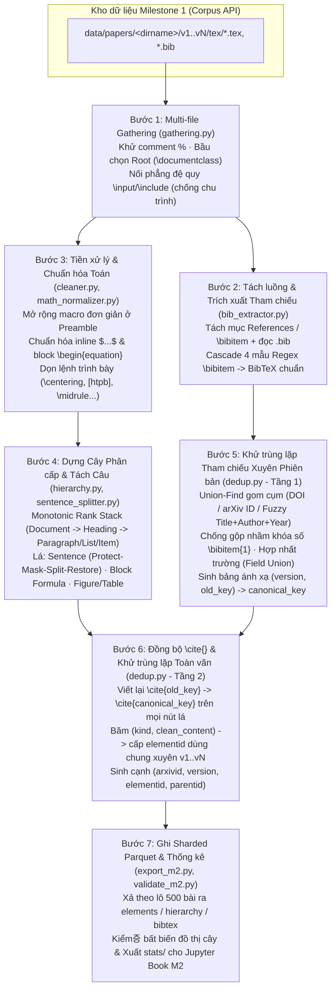

# Kế hoạch Triển khai Milestone 2 — Phân tích Cú pháp Phân cấp, Chuẩn hóa và Khử trùng lặp LaTeX

> **Nhóm 5 thành viên (A — Leader, B, C, D, E)** · Môn Nhập môn Khoa học Dữ liệu
> **Căn cứ:** `docs/project requirements/milestone2-parsing-vi.md`, `docs/project requirements/milestone3-matching-vi.md`, `docs/project requirements/arxiv-project-statement-vi.md`.
> **Tài liệu đi kèm:** Phiếu phân công chi tiết cho 4 thành viên B $\rightarrow$ E tại [`milestone2-phan-cong-task-B-E-vi.md`](./milestone2-phan-cong-task-B-E-vi.md).
> **Trạng thái:** Bản thiết kế kỹ thuật & giải pháp thuật toán cho Milestone 2 (chuẩn bị sẵn sàng ngay khi đóng băng Milestone 1).

---

## 0. Tóm tắt một trang & Triết lý Giải quyết Vấn đề (Executive Summary)

**Bài toán.** Từ kho dữ liệu thô đã thu thập ở Milestone 1 (~25.000 bài báo arXiv, ~47.500 cặp `(bài, phiên bản)` chứa `.tex`/`.bib`), xây dựng một **bộ phân tích cú pháp (parser) tự động, chuẩn hóa và khử trùng lặp xuyên phiên bản** để biến mã nguồn LaTeX phi cấu trúc thành 3 bảng dữ liệu có cấu trúc chặt chẽ (`elements`, `hierarchy`, `bibtex`), đồng thời chuẩn bị đầu vào chất lượng cao nhất cho bài toán Học máy đối sánh tham chiếu (MRR@5) ở Milestone 3.

**Vì sao bài toán này khó và chấm điểm nặng ở "Ý tưởng giải quyết vấn đề"?**
Mã nguồn LaTeX thực tế trên arXiv không tuân theo một ngữ pháp CFG (Context-Free Grammar) cố định: tác giả tự định nghĩa macro (`\def`, `\newcommand`), chia nhỏ hàng chục file `.tex` lồng nhau (kèm các file nháp không biên dịch), nhảy cấp đề mục tùy ý (`\section` xuống thẳng `\paragraph`), viết phương trình bằng 8 kiểu môi trường khác nhau, viết dấu chấm câu bên trong công thức toán/từ viết tắt (`et al.`, `Fig. 1`, `3.14`), và viết tài liệu tham khảo `\bibitem` tự do không theo chuẩn BibTeX. Hơn nữa, ở quy mô **25.000 bài (~6–10 triệu nút cây)** trên **Google Colab chỉ CPU (12,7 GB RAM)**, cách làm ngây thơ (giữ toàn bộ cây trong RAM hoặc dùng regex đệ quy backtracking) sẽ **tràn bộ nhớ (OOM)** hoặc treo hàng chục giờ.

**7 Quyết định Thiết kế & Ý tưởng Thuật toán Cốt lõi (P1 – P7):**

| Mã | Vấn đề cốt lõi trong đề | Giải pháp kỹ thuật tốt nhất (Best-in-Class Solution) | Điểm ăn tiền khi chấm (Grading Differentiator) |
| :--- | :--- | :--- | :--- |
| **P1** | **Thu thập nhiều tệp (Multi-file Gathering):** Tìm đúng file gốc và đường biên dịch, bỏ file dư thừa và lệnh bị comment. | **Multi-Signal Root Election + Comment-Stripped DFS Flattening:** Khử comment `(?<!\\)%.*` (bảo toàn `\%` và `verbatim`) *trước* khi quét; chấm điểm chọn file gốc có `\documentclass` (ưu tiên có `\begin{document}`, số file con, tên `main/paper/ms.tex`); duyệt DFS `\input`/`\include`/`\subfile`/`\import` có **chống chu trình (cycle guard)** và tự động thử đường dẫn tương đối theo thư mục gốc lẫn thư mục hiện hành. | Không bị lừa bởi `% \documentclass` trong comment, file `standalone` của hình TikZ, hay file `rebuttal.tex` dư thừa; chống treo vô hạn khi 2 file `\input` chéo nhau. |
| **P2** | **Xây dựng cây phân cấp thích ứng (Adaptive Hierarchy):** Thứ tự đề mục mỗi bài một kiểu; xử lý `\section*`, `itemize`, `figure`/`table`. | **Dynamic Monotonic Rank Stack:** Gán trọng số cấp bậc (`part:0 < chapter:1 < section:2 < subsection:3 < subsubsection:4 < paragraph:5 < subparagraph:6`); dùng ngăn xếp đơn điệu tự động co giãn khi bài báo bỏ qua cấp trung gian. Phân loại `\section*` bằng từ khóa ngữ nghĩa: **giữ** `Acknowledgements`/`Appendix`, **cắt bỏ khỏi cây** `References`/`Bibliography` để chuyển sang luồng trích xuất BibTeX. | Cây phân cấp luôn liên thông, đúng thứ bậc tự nhiên của bài báo bất kể class `article`, `revtex4`, `llncs` hay `IEEEtran`; không bao giờ để lọt mục References vào bảng `elements`. |
| **P3** | **Làm sạch & Chuẩn hóa Toán học (Cleanup & Math Normalization):** Xóa lệnh trình bày vô nghĩa, đồng nhất inline `$...$` và block `\begin{equation}`. | **Preamble Safe Macro Expander + State-Machine Math Scanner:** Giải nén các macro không tham số / 1–3 tham số đơn giản (`\newcommand`, `\def` cho ký hiệu toán & môi trường) ở preamble với độ sâu giới hạn $\le 5$; dùng bộ quét trạng thái (state machine) phân biệt `\$` (tiền tệ), `$...$` (inline) và `$$...$$` (block); quy mọi môi trường toán khối (`\[...\]`, `$$...$$`, `align[*]`, `gather[*]`, `eqnarray[*]`) về `\begin{equation}...\end{equation}`. | Giải quyết triệt để lỗi vỡ parser do tác giả dùng `\def\beq{\begin{equation}}` hoặc ký hiệu `\$100` làm lệch dấu `$` đóng/mở. |
| **P4** | **Tách câu lá ngữ cảnh (Context-Aware Sentence Splitting):** Không tách nhầm ở dấu chấm trong toán, lệnh LaTeX, từ viết tắt (`i.e.`, `et al.`, `Fig. 1`), URL, số thập phân. | **Kiến trúc 4 bước Protect–Mask–Split–Restore $O(N)$:** (1) Đóng gói toàn bộ `$...$`, `\cite{...}`, `\ref{...}`, `\url{...}`, số thập phân `\d+\.\d+` thành token cố định `__MATH_i__`, `__CMD_i__`; (2) Thay dấu chấm sau >60 từ viết tắt học thuật & tên viết tắt `A. Einstein` bằng ký tự bảo vệ `\uE000`; (3) Tách câu trên dấu `[.!?]+` thật; (4) Khôi phục token & chuẩn hóa khoảng trắng. | Đạt độ chính xác tách câu cực cao trên văn bản khoa học mà không cần mô hình NLP nặng (như spaCy/Transformer), tốc độ xử lý hàng nghìn câu/giây trên CPU. |
| **P5** | **Trích xuất `\bibitem` $\rightarrow$ BibTeX chuẩn:** Định dạng `\bibitem` tự do theo từng tạp chí (APS, IEEE, Springer, NeurIPS, AMS). | **4-Template Cascade Regex + Anchor-First Extraction:** Trích xuất các "mỏ neo" có cấu trúc cứng trước (`DOI`, `URL`, `arXiv ID`, `Year`), sau đó chạy chuỗi 4 mẫu ngữ pháp học thuật (Quoted Title, Italic/Emph AMS/APS, Dot-Separated Author-Year, Preprint) kết hợp bộ tách tên tác giả để dựng `title`, `authors`, `year`, `doi`, `journal`, `url`, `entrytype`. | Tăng tối đa tỷ lệ lấp đầy trường `title`, `authors`, `year`, `url` (đặc biệt giữ dấu vết `arXiv ID` trong URL/note) — **đòn bẩy trực tiếp giúp Milestone 3 đạt MRR@5 cao vượt trội**. |
| **P6** | **Khử trùng lặp 2 tầng xuyên phiên bản (Dual Cross-Version Deduplication):** Hợp nhất trường BibTeX + đổi tên `\cite{}` + gộp phần tử văn bản trùng. | **Thứ tự vàng: Dedup Tham chiếu TRƯỚC $\rightarrow$ Đổi tên `\cite{}` $\rightarrow$ Dedup Toàn văn SAU:** Dùng **Union-Find** gom cụm tham chiếu trùng qua `(DOI \| arXiv_ID \| Title+Author+Year fuzzy)` có **chống gộp nhầm khóa số (`\bibitem{1}`)** khi tác giả chèn thêm trích dẫn ở v2; hợp nhất trường (field union); viết lại mọi lệnh `\cite{a, b}` về khóa chuẩn; cuối cùng dùng **Content-Addressed Hash Pool `(kind, clean_text)`** để cấp một `elementid` duy nhất cho các phần tử giống nhau giữa các phiên bản. | Nhờ đổi tên `\cite{vit_transformer}` $\rightarrow$ `\cite{vaswani2017}` *trước* khi băm câu văn, hai câu ở v1 và v2 chỉ khác nhau tên khóa trích dẫn sẽ **khớp toàn văn 100%** và được gộp vào cùng một `elementid` đúng như tinh thần đề bài! |
| **P7** | **Hiệu năng & Bộ nhớ trên Colab CPU:** Xử lý 25.000 bài báo mà không tràn RAM, tối ưu thời gian chạy. | **Paper-Level Multiprocessing + Streaming Sharded Parquet (`pyarrow` Dictionary Encoding):** Vì mọi phép khử trùng lặp đều nằm *bên trong từng bài báo (`arxivid`)*, các bài báo hoàn toàn độc lập. Xử lý song song theo lô bài báo bằng `ProcessPoolExecutor`, xả (flush) định kỳ mỗi 500 bài trực tiếp xuống các shard Parquet có nén `ZSTD` và kiểu `dictionary` cho `kind`/`entrytype`. | RAM đỉnh giữ phẳng **< 450 MB** (thay vì >12 GB nếu giữ trong list Python); thời gian xử lý toàn bộ 25.000 bài trên Colab CPU chỉ mất vài chục phút. |

---

## 1. Phân tích Yêu cầu Đề bài $\rightarrow$ Hệ quả Thiết kế & Hợp đồng Dữ liệu

### 1.1. Bảng ánh xạ yêu cầu đề bài sang thiết kế module

| Hạng mục trong đề (`milestone2-parsing-vi.md`) | Quy định chi tiết | Hệ quả thiết kế trong `src/parsing/` |
| :--- | :--- | :--- |
| **Thu thập nhiều tệp** | Tìm tệp gốc chứa `\documentclass`; lần theo `\input` và `\include` bắc cầu; coi lệnh bị comment là văn bản thường; bỏ qua tệp dư thừa. | Module `gathering.py`: hàm `resolve_compilation_unit(tex_files: dict[str, bytes])` trả về chuỗi LaTeX đã ghép phẳng theo đúng thứ tự biên dịch + danh sách file `.bib` liên quan + metadata đường biên dịch (số file tổng, số file dùng, số file bỏ). |
| **Phiên bản không có TeX** | Bản ghi rỗng từ M1 (`no_source`, `ok_no_tex`) không sinh phần tử nào; **phải ghi nhận là phiên bản rỗng** thay vì bỏ qua để thống kê độ bao phủ phản ánh đúng thực tế. | Đọc toàn bộ `Corpus.versions(arxiv_id)` từ M1. Phiên bản `status != Status.OK` được ghi nhận trong manifest/thống kê M2 với `num_elements = 0` (coverage = 0 phần tử), không bỏ qua bài hay phiên bản. |
| **Cấu trúc phân cấp & Nút lá** | Gốc là `Document` (`#root1`, `#root2`...). Cấp dưới: `Chapter`/`Section`, `Subsection`, `Paragraph`, `Itemize` $\rightarrow$ `Item`... Lá gồm: **Sentences**, **Block Formulas**, **Figures** (gồm cả **Tables**). | Module `hierarchy.py`: xây dựng AST với tập `kind` chuẩn hóa (dictionary-encoded): `document`, `heading` (hoặc chi tiết level), `paragraph`, `list`, `item`, `sentence`, `block_formula`, `figure`. |
| **Loại trừ & Bao gồm** | **Loại trừ:** mục `References` không đưa vào cây. **Bao gồm:** `Acknowledgements` và `Appendices` (thường là `\section*`). | Khi gặp `\section*` / `\section` có tiêu đề thuộc tập `{references, bibliography, literature cited}` hoặc môi trường `thebibliography`, cắt nhánh đó chuyển sang `bib_extractor.py`, không tạo nút trong `elements`/`hierarchy`. |
| **Làm sạch & Chuẩn hóa toán** | Xóa `\centering`, `[htpb]`, `\midrule`... Toán nội dòng về `$...$`; toán khối về `\begin{equation}...\end{equation}`. | Module `cleaner.py` & `math_normalizer.py`: chạy chuẩn hóa trước khi tách câu và trước khi tính hash khử trùng lặp. |
| **Trích xuất & Khử trùng lặp tham chiếu** | `\bibitem` $\rightarrow$ BibTeX bằng regex/code. Gộp tham chiếu trùng trong & xuyên phiên bản; chọn 1 `citationkey` duy nhất; **hợp nhất (union) các trường**; **đổi tên `\cite{}`** trong văn bản về khóa đã chọn. | Module `bib_extractor.py` & `dedup.py`: trích xuất từ cả `.bib` và `\bibitem`; gom cụm tham chiếu trùng; hợp nhất trường; cập nhật lại toàn bộ lệnh `\cite{...}` trong cây của từng phiên bản. |
| **Khử trùng lặp toàn văn** | Phần tử có nội dung sau làm sạch khớp chính xác xuyên các phiên bản chỉ chiếm **1 dòng duy nhất** trong `elements`; `hierarchy` lưu cạnh `(arxivid, version, elementid, parentid)`. | Module `dedup.py`: dùng bảng băm `(kind, normalized_content) -> elementid` cho mỗi công bố (`arxivid`). Nút `document` gốc mỗi phiên bản giữ định danh riêng (`<dirname>#root1`, `<dirname>#root2`). |
| **3 Bảng đầu ra** | `elements`, `hierarchy`, `bibtex` (sẵn sàng cho Parquet phân mảnh trên Hugging Face ở M3). | Module `export_m2.py`: xuất Parquet dùng `pyarrow` schema tường minh, hỗ trợ `dictionary` encoding cho cột `kind` và `entrytype`. |

### 1.2. Đặc tả Schema 3 Bảng Đầu ra (Chuẩn Parquet M2 & M3)

Theo bảng quy định trong `milestone2-parsing-vi.md` và `milestone3-matching-vi.md`:

#### Bảng 1: `elements`
Một dòng cho mỗi phần tử **phân biệt** xuyên suốt tất cả các phiên bản của một công bố:

| Cột | Kiểu PyArrow | Nullable | Mô tả & Quy ước |
| :--- | :--- | :--- | :--- |
| `elementid` | `pa.string()` | `False` | Định danh duy nhất: `<dirname>#<discriminant>` (vd: `2408-11045#root1`, `2408-11045#h1`, `2408-11045#s1`, `2408-11045#eq1`, `2408-11045#fig1`). |
| `arxivid` | `pa.string()` | `False` | Mã arXiv gốc nguyên văn của công bố (vd: `2408.11045` hoặc `hep-th/9901001`). |
| `kind` | `pa.dictionary(pa.int8(), pa.string())` | `False` | Loại phần tử: `'document'`, `'heading'`, `'paragraph'`, `'list'`, `'item'`, `'sentence'`, `'block_formula'`, `'figure'`. |
| `content` | `pa.string()` | `False` | Nội dung văn bản/LaTeX đã làm sạch, chuẩn hóa toán học và cập nhật khóa `\cite{}`. |

#### Bảng 2: `hierarchy`
Một dòng cho mỗi cạnh nút con – nút cha (`elementid -> parentid`) của từng phiên bản:

| Cột | Kiểu PyArrow | Nullable | Mô tả & Quy ước |
| :--- | :--- | :--- | :--- |
| `arxivid` | `pa.string()` | `False` | Mã arXiv gốc nguyên văn của công bố. |
| `version` | `pa.int32()` | `False` | Số thứ tự phiên bản ($1, 2, \dots, N$). |
| `elementid` | `pa.string()` | `False` | Định danh nút con (tham chiếu tới `elements.elementid`). |
| `parentid` | `pa.string()` | `False` | Định danh nút cha trong phiên bản `version` (tham chiếu tới `elements.elementid`). |

#### Bảng 3: `bibtex`
Một dòng cho mỗi mục BibTeX thống nhất sau khi loại trùng và hợp nhất trường xuyên suốt các phiên bản của một công bố:

| Cột | Kiểu PyArrow | Nullable | Mô tả & Quy ước |
| :--- | :--- | :--- | :--- |
| `arxivid` | `pa.string()` | `False` | Mã arXiv gốc nguyên văn của công bố chứa trích dẫn. |
| `citationkey` | `pa.string()` | `False` | Khóa trích dẫn đại diện duy nhất (canonical key) đã chọn cho mục tham chiếu. |
| `entrytype` | `pa.dictionary(pa.int8(), pa.string())` | `False` | Loại mục BibTeX chữ thường: `'article'`, `'inproceedings'`, `'book'`, `'misc'`, `'techreport'`, `'phdthesis'`... (mặc định `'misc'` hoặc `'article'` cho `\bibitem`). |
| `title` | `pa.string()` | `True` (hoặc `""`) | Tiêu đề tài liệu tham khảo đã làm sạch dấu ngoặc `{}` và lệnh định dạng. |
| `authors` | `pa.list_(pa.string())` | `False` | Danh sách tên các tác giả dạng phẳng `list[str]` (chuẩn hóa `"Họ, Tên"` hoặc `"Tên Họ"` nhất quán). |
| `year` | `pa.int32()` | `True` | Năm xuất bản (số nguyên 4 chữ số, `null` nếu không xác định được). |
| `doi` | `pa.string()` | `True` (hoặc `""`) | Chuỗi DOI chuẩn hóa (bỏ tiền tố `https://doi.org/`). |
| `journal` | `pa.string()` | `True` (hoặc `""`) | Tên tạp chí / hội nghị (`journal` hoặc `booktitle` / `eprint`). |
| `url` | `pa.string()` | `True` (hoặc `""`) | Đường dẫn URL (hoặc URL chuẩn `https://arxiv.org/abs/<id>` nếu phát hiện arXiv ID). |

---

## 2. Kiến trúc Luồng Xử lý Đầu–Cuối (End-to-End Pipeline Architecture)



---

## 3. Thiết kế Chi tiết Từng Giải pháp Thuật toán (Deep-Dive)

### 3.1. Giải pháp 1: Thu thập nhiều tệp & Xác định Đường biên dịch (`src/parsing/gathering.py`)

#### A. Bài toán & Cạm bẫy thực tế
Trong một thư mục `vK/tex/` của arXiv, ta thường gặp:
1. Lệnh `\documentclass` hoặc `\input{old_sec}` nằm sau dấu `%` (comment).
2. Nhiều tệp cùng có `\documentclass`: tệp chính `main.tex`, tệp phụ lục rời `supplement.tex`, tệp trả lời phản biện `response_to_reviewers.tex`, hoặc tệp hình vẽ độc lập `\documentclass[tikz]{standalone}`.
3. Lệnh nạp tệp đa dạng: `\input{sec/intro}`, `\input{sec/intro.tex}`, `\input sec/intro` (cú pháp TeX cổ điển cách bằng khoảng trắng), `\include{sec/method}`, `\subfile{sec/exp}`, `\import{chapters/}{ch1.tex}`.

#### B. Thuật toán 3 pha trong `gathering.py`
1. **Pha 1 — Giải mã an toàn & Khử comment bảo toàn ngữ nghĩa (`strip_latex_comments`)**:
   - Đọc bytes của từng tệp `.tex`: giải mã `utf-8-sig`, nếu lỗi dùng `latin-1` (đảm bảo 100% không văng `UnicodeDecodeError`).
   - Quét từng dòng nhưng **bảo toàn** môi trường `\begin{verbatim}...\end{verbatim}`, `\begin{lstlisting}...\end{lstlisting}` và lệnh `\verb|...|`.
   - Ngoài các vùng bảo toàn, xóa từ ký tự `%` **không bị escape** (tức đứng trước nó là một số chẵn dấu `\`, regex: `(?<!\\)(?:\\\\)*\K%.*` hoặc hàm quét ký tự tuyến tính $O(N)$). Nếu dòng chỉ toàn khoảng trắng + comment và kết thúc bằng `%`, nối dòng tiếp theo mà không chèn khoảng trắng giả (đúng chuẩn bộ đọc dòng của TeX).
2. **Pha 2 — Bầu chọn Tệp Gốc đa tín hiệu (`elect_root_tex_file`)**:
   - Lọc ứng viên có chứa `\documentclass` (hoặc `\documentstyle` cho LaTeX 2.09 cũ). Nếu không tệp nào có `\documentclass` (trường hợp hiếm khi tác giả chỉ nộp 1 file body dùng chung preamble mặc định của arXiv), chọn tệp có `\begin{document}` hoặc tệp có điểm cấu trúc cao nhất.
   - Với mỗi tệp ứng viên $f$, tính điểm $S(f)$:
     $$S(f) = 100 \cdot \mathbb{I}(\text{có }\texttt{\textbackslash begin\{document\}}) - 80 \cdot \mathbb{I}(\text{class là }\texttt{standalone/subfiles}) + 25 \cdot |\text{children}(f)| + 20 \cdot \mathbb{I}(\text{tên chuẩn}) + 15 \cdot \mathbb{I}(\text{có }\texttt{\textbackslash maketitle/\textbackslash abstract}) + \min\left(10, \frac{\text{len}(f)}{10000}\right)$$
     trong đó `tên chuẩn` $\in \{\texttt{main.tex}, \texttt{paper.tex}, \texttt{ms.tex}, \texttt{article.tex}, \texttt{root.tex}\}$. Tệp có $S(f)$ lớn nhất được chọn làm **Publication Root**.
3. **Pha 3 — Mở rộng Bắc cầu có Chống Chu trình (`flatten_compilation_path`)**:
   - Từ `root_file`, duyệt DFS để thay thế tại chỗ (in-place inline) các lệnh `\input{target}`, `\include{target}`, `\subfile{target}`, `\import{dir}{target}`:
     - Nếu `target` là một tệp `.bbl` (ví dụ `\input{main.bbl}`), giữ hoặc nạp nội dung `.bbl` nếu nó có trong thư mục để không mất `\bibitem`.
     - Chuẩn hóa đường dẫn `target`: thử lần lượt `(root_dir / target)`, `(root_dir / (target + ".tex"))`, `(current_file_dir / target)`, `(current_file_dir / (target + ".tex"))`.
     - Nếu tệp đích nằm trong tập `call_stack` (chu trình đệ quy $A \to B \to A$) hoặc độ sâu vượt `MAX_INCLUDE_DEPTH = 15`, bỏ qua và ghi cảnh báo.
     - Nếu lệnh là `\include{...}`, chèn `\par` trước và sau nội dung tệp con (vì `\include` trong LaTeX luôn ngắt trang/đoạn).
   - Trả về `CompilationUnit`: văn bản đã ghép phẳng, danh sách tệp `.tex` đã dùng (`used_tex_files`), danh sách tệp `.tex` dư thừa đã bỏ qua (`unused_tex_files`), và danh sách tệp `.bib` được tham chiếu trong đường biên dịch.

---

### 3.2. Giải pháp 2: Mở rộng Macro, Làm sạch LaTeX & Chuẩn hóa Toán (`cleaner.py`, `math_normalizer.py`)

#### A. Mở rộng Macro an toàn ở Preamble (`expand_preamble_macros`)
- Tách tài liệu tại `\begin{document}` thành `preamble` và `body` (nếu có `\end{document}`, cắt bỏ phần rác sau `\end{document}`).
- Trên `preamble`, thu thập các khai báo:
  - `\newcommand{\foo}[k][default]{body}`, `\renewcommand`, `\providecommand` ($0 \le k \le 3$).
  - `\def\foo{body}` và `\def\foo#1{body}` đơn giản.
- **Danh sách chặn bảo vệ (Protected Primitives):** Không bao giờ ghi đè các lệnh cấu trúc dùng cho parser (`\section`, `\subsection`, `\paragraph`, `\item`, `\begin`, `\end`, `\cite`, `\bibitem`, `\caption`, `\label`).
- Áp dụng thay thế trên `body` tối đa **5 vòng lặp** (dừng sớm nếu không còn macro nào khớp) với bộ đếm ngoặc nhọn cân bằng (`extract_braced_args`) để tránh mở rộng vô hạn.

#### B. Chuẩn hóa Toán học (`math_normalizer.py`)
Yêu cầu đề bài:
- Toàn bộ toán học nội dòng (inline) $\rightarrow$ `$...$`.
- Toàn bộ toán học dạng khối (block) $\rightarrow$ `\begin{equation}...\end{equation}`.

**Quy trình chuẩn hóa:**
1. **Bảo vệ ký tự `\$` thoát (escaped dollar):** Tạm thay `\$` bằng token `\uE001` trước khi quét toán.
2. **Chuẩn hóa toán khối (Block Math):**
   - Chuyển đổi tất cả các dạng sau về `\begin{equation} ... \end{equation}`:
     - `$$ ... $$`
     - `\[ ... \]`
     - `\begin{displaymath} ... \end{displaymath}`
     - `\begin{equation*} ... \end{equation*}`
     - `\begin{align} ... \end{align}`, `\begin{align*} ... \end{align*}`
     - `\begin{gather} ... \end{gather}`, `\begin{gather*} ... \end{gather*}`
     - `\begin{multline[*]} ... \end{multline[*]}`
     - `\begin{flalign[*]} ... \end{flalign[*]}`
     - `\begin{eqnarray[*]} ... \end{eqnarray[*]}`
   - Bên trong khối toán: xóa các lệnh chỉ phục vụ đánh số/căn lề hình thức không mang ngữ nghĩa toán học như `\nonumber`, `\notag`, `\allowdisplaybreaks`, và chuẩn hóa khoảng trắng nhiều dòng thành dòng gọn gàng để tăng tỷ lệ khớp khử trùng lặp giữa các phiên bản.
3. **Chuẩn hóa toán nội dòng (Inline Math):**
   - Chuyển `\(...\)`, `\begin{math}...\end{math}`, `\ensuremath{...}` $\rightarrow$ `$...$`.
   - Thu gọn khoảng trắng thừa sát dấu `$`: `$\s+([^$]+?)\s+$` $\rightarrow$ `$$1$`.
   - Khôi phục `\uE001` về `\$`.

#### C. Làm sạch LaTeX (`cleaner.py`)
1. **Loại bỏ hoàn toàn (Delete Command + Args):**
   - Các tùy chọn vị trí float: `\begin{figure}[htbp!]` $\rightarrow$ bỏ `[htbp!]`.
   - Các lệnh đường kẻ bảng & khoảng cách: `\toprule`, `\midrule`, `\bottomrule`, `\hline`, `\cline{...}`, `\vline`, `\vspace[*]{...}`, `\hspace[*]{...}`, `\vskip...`, `\hskip...`, `\smallskip`, `\medskip`, `\bigskip`, `\vfill`, `\hfill`.
   - Các lệnh bố cục & ngắt trang: `\centering`, `\raggedright`, `\raggedleft`, `\noindent`, `\indent`, `\newpage`, `\clearpage`, `\cleardoublepage`, `\pagebreak`, `\linebreak`, `\allowbreak`, `\sloppy`, `\fussy`.
   - Các lệnh khai báo siêu dữ liệu hình thức không thuộc nội dung câu: `\label{...}` (hoặc chuẩn hóa), `\bibliographystyle{...}`, `\pagenumbering{...}`, `\thispagestyle{...}`.
2. **Bóc vỏ giữ ruột (Unwrap Formatting Command, Keep Text Content):**
   - Với văn bản xuôi bên ngoài công thức toán: `\textbf{X}` $\rightarrow$ `X`, `\textit{X}` $\rightarrow$ `X`, `\emph{X}` $\rightarrow$ `X`, `\texttt{X}` $\rightarrow$ `X`, `\textsc{X}` $\rightarrow$ `X`, `\textsf{X}` $\rightarrow$ `X`, `\textrm{X}` $\rightarrow$ `X`, `\underline{X}` $\rightarrow$ `X`, `{\bf X}` $\rightarrow$ `X`, `{\it X}` $\rightarrow$ `X`, `{\em X}` $\rightarrow$ `X`.
   - Giải mã các ký tự tiếng nước ngoài trong LaTeX (`\"o` $\rightarrow$ `ö`, `\'e` $\rightarrow$ `é`, `\~n` $\rightarrow$ `ñ`, `---` $\rightarrow$ `—`, `--` $\rightarrow$ `–`, ```` `` ```` / `''` $\rightarrow$ `"`).
3. **Chuẩn hóa lệnh trích dẫn (`\cite` family):**
   - Giữ nguyên cấu trúc `\cite{k1,k2}` (hoặc chuẩn hóa `\citep{...}`, `\citet{...}`, `\citealp{...}`, `\parencite{...}`, `\textcite{...}` có tùy chọn `\cite[p.~5]{key}` về dạng chuẩn chứa khóa trích dẫn) để Bước 6 có thể đổi tên khóa trích dẫn chính xác 100%.

---

### 3.3. Giải pháp 3: Xây dựng Cấu trúc Phân cấp & Tách Câu Ngữ cảnh (`hierarchy.py`, `sentence_splitter.py`)

#### A. Cây Phân cấp Thích ứng bằng Ngăn xếp Đơn điệu (`hierarchy.py`)
- **Nút gốc:** Mỗi phiên bản $v$ (có mã nguồn TeX) bắt đầu bằng một nút gốc `Document`:
  - `elementid = f"{dirname}#root{version}"`
  - `kind = "document"`
  - `content = f"Version {version} root"` (theo đúng ví dụ mẫu trong đề bài).
- **Xử lý Abstract:** Nếu có `\begin{abstract}...\end{abstract}` hoặc `\abstract{...}`, tạo một nút `heading` có `content = "Abstract"` gắn vào `root{version}`, bên dưới là các đoạn/câu của phần tóm tắt.
- **Thang cấp bậc đề mục (Sectioning Rank Table):**
  - `\part` (0) $\rightarrow$ `\chapter` (1) $\rightarrow$ `\section` (2) $\rightarrow$ `\subsection` (3) $\rightarrow$ `\subsubsection` (4) $\rightarrow$ `\paragraph` (5) $\rightarrow$ `\subparagraph` (6).
  - Duy trì `heading_stack = [(root_id, -1)]`. Khi gặp một lệnh đề mục ở cấp `rank` với tiêu đề `title`:
    1. Kiểm tra `clean_title = clean_latex(title).lower().strip()`.
    2. **Bộ lọc Loại trừ / Bao gồm:**
       - Nếu `clean_title` thuộc `{"references", "bibliography", "literature cited", "works cited"}`: bật cờ `in_references_section = True` — bỏ qua toàn bộ nội dung mục này khỏi cây phân cấp (cho tới khi gặp đề mục cùng cấp tiếp theo như `\appendix` hoặc hết tài liệu).
       - Ngược lại (bao gồm cả `\section*{Acknowledgements}`, `\section*{Acknowledgments}`, `\section*{Appendix}`, `\appendix`): tắt cờ `in_references_section = False`, pop `heading_stack` cho tới khi `heading_stack[-1].rank < rank`, tạo nút `kind = "heading"`, gắn `parentid = heading_stack[-1].id`, rồi push `(new_heading_id, rank)` vào `heading_stack`.
- **Xử lý Danh sách Liệt kê (`itemize`, `enumerate`, `description`):**
  - Khi gặp `\begin{itemize}` (hoặc `enumerate`, `description`): tạo nút `kind = "list"`, `parentid` là nút chứa hiện tại (heading/paragraph hoặc một `item` cha nếu là danh sách lồng nhau!).
  - Tách nội dung bên trong theo `\item` ở cùng mức ngoặc: mỗi mục tạo một nút `kind = "item"` có `parentid = list_id`.
  - Bên trong mỗi `item`, nội dung tiếp tục được phân tích thành các nút lá (`sentence`, `block_formula`, `figure`) hoặc danh sách con (`list`).
- **Xử lý Nút lá Đặc biệt (`block_formula` và `figure`):**
  - **`block_formula`**: Mỗi khối `\begin{equation}...\end{equation}` (đã chuẩn hóa ở Bước 3) tạo thành một nút lá `kind = "block_formula"`, `content` là toàn bộ khối phương trình đã chuẩn hóa.
  - **`figure`** (bao gồm cả **Tables** theo quy định của đề): Mỗi khối `\begin{figure[*]}...\end{figure[*]}`, `\begin{table[*]}...\end{table[*]}`, `\begin{wrapfigure}...\end{wrapfigure}`, `\begin{algorithm[*]}...\end{algorithm[*]}` tạo thành một nút lá `kind = "figure"` với `content` đã làm sạch các tùy chọn vị trí `[htbp]` và lệnh định dạng thừa (`\centering`, `\midrule`, `\hline`).

#### B. Thuật toán Tách Câu "Protect–Mask–Split–Restore" (`sentence_splitter.py`)
Để tách một khối văn xuôi thành các nút lá `kind = "sentence"` mà **không bao giờ tách nhầm** ở các vị trí cấm của đề bài:

1. **Bước 1 — Masking (Che chắn các vùng bất khả xâm phạm):**
   - Thay thế mọi công thức nội dòng `$...$` bằng `__M0__`, `__M1__`, ...
   - Thay thế mọi lệnh LaTeX còn lại có tham số (như `\cite{...}`, `\ref{...}`, `\eqref{...}`, `\url{...}`, `\href{...}{...}`, `\footnote{...}`) bằng `__C0__`, `__C1__`, ...
   - Thay thế các URL trần (`https?://[^\s)+]+`) và số thập phân / số phiên bản (`\b\d+(?:\.\d+)+\b`) bằng `__U0__`, `__N0__`, ...
2. **Bước 2 — Bảo vệ Từ viết tắt & Chữ cái đầu tên riêng (Abbreviation Guard):**
   - Danh mục từ viết tắt học thuật (không phân biệt hoa thường):
     - Latin & Học thuật: `e.g.`, `i.e.`, `et al.`, `cf.`, `vs.`, `v.s.`, `viz.`, `etc.`, `w.r.t.`, `a.k.a.`, `r.v.`, `i.i.d.`, `s.t.`, `w.l.o.g.`, `resp.`
     - Tham chiếu trong bài: `fig.`, `figs.`, `eq.`, `eqs.`, `sec.`, `secs.`, `sect.`, `tab.`, `tabs.`, `alg.`, `algs.`, `thm.`, `lem.`, `prop.`, `cor.`, `def.`, `defs.`, `ex.`, `app.`, `ch.`, `chap.`, `ref.`, `refs.`, `vol.`, `vols.`, `no.`, `nos.`, `pp.`, `p.`, `art.`
     - Chức danh & Tổ chức: `dr.`, `prof.`, `mr.`, `mrs.`, `ms.`, `jr.`, `sr.`, `st.`, `inc.`, `ltd.`, `co.`, `corp.`
   - Thay dấu `.` trong các từ viết tắt trên, trong chuỗi viết tắt nhiều chữ (`U.S.`, `Ph.D.`, `B.Sc.`), dấu ba chấm (`...`), và sau chữ cái viết hoa đơn đứng trước tên (`\b[A-Z]\.(?=\s+[A-Z])`, ví dụ `A. Einstein`) bằng ký tự placeholder `\uE000`.
3. **Bước 3 — Phân tách biên câu (Sentence Boundary Detection):**
   - Tách văn bản tại ranh giới: `(?<=[.!?])\s+(?=[A-Z"'(0-9]|__M\d+__|__C\d+__)` (dấu kết câu thật theo sau bởi khoảng trắng và đầu câu mới là chữ hoa, dấu ngoặc kép, số, công thức toán hoặc lệnh).
4. **Bước 4 — Unmasking & Hậu kiểm:**
   - Khôi phục `\uE000` $\rightarrow$ `.` và hoàn trả `__M*__`, `__C*__`, `__U*__`, `__N*__`.
   - Loại bỏ các mảnh rỗng hoặc chỉ chứa dấu câu đơn lẻ (ghép vào câu liền trước nếu mảnh quá ngắn $< 2$ ký tự chữ/toán).

---

### 3.4. Giải pháp 4: Trích xuất Tham chiếu `\bibitem` & `.bib` (`src/parsing/bib_extractor.py`)

#### A. Luồng 1: Phân tích tệp `.bib` (Brace-Balanced Parser)
- Quét các khối `@<entrytype>{<citationkey>, ...}` bằng bộ đếm ngoặc nhọn `{...}` (hoặc ngoặc tròn `@article(...)`), bỏ qua `@comment` và `@preamble`, đồng thời thu thập `@string{short = "Full Journal Name"}` để thế vào các trường `journal`/`booktitle`.
- Trích xuất các cặp `field = value` (hỗ trợ cả `{...}`, `"..."`, và số nguyên trần cho `year = 2024`).
- Ánh xạ sang schema bảng `bibtex`:
  - `entrytype`: chuẩn hóa chữ thường (`inproceedings`, `article`, `book`, `misc`...).
  - `title`: làm sạch `{}` bảo vệ chữ hoa, giải mã dấu LaTeX, chuẩn hóa khoảng trắng.
  - `authors`: tách theo từ khóa ` and ` (ngoài ngoặc nhọn), chuẩn hóa từng tên tác giả thành chuỗi sạch.
  - `year`: ép kiểu `int` (trích 4 chữ số `(19|20)\d{2}`).
  - `doi`: chuẩn hóa bỏ `https://doi.org/` hoặc `doi:`.
  - `journal`: lấy từ `journal`; nếu trống lấy từ `booktitle`, `school`, `institution`, hoặc `howpublished`.
  - `url`: lấy từ `url`; nếu trống nhưng có trường `eprint` / `arxivid` (ví dụ `2310.12345`), sinh URL chuẩn `https://arxiv.org/abs/2310.12345` (hoặc lưu vào `journal = "arXiv:2310.12345"` nếu `journal` trống).

#### B. Luồng 2: Chuyển đổi `\bibitem` trong `.tex` sang BibTeX bằng Cascade 4 Tầng
Trong môi trường `\begin{thebibliography}...\end{thebibliography}`, mỗi mục bắt đầu bằng `\bibitem[label]{key}` hoặc `\bibitem{key}`:
1. **Tầng 0 — Tiền xử lý & Bắt Mỏ neo Cứng (Hard Anchors Extraction):**
   - Nối các dòng trong cùng một `\bibitem`, xóa lệnh `\newblock`, `\bibinfo{...}{...}`, `\bibinfo{...}{...}` (giữ nội dung bên trong `\bibinfo{title}{...}`, `\bibinfo{author}{...}`, `\bibinfo{year}{...}` — **Mẹo cực kỳ đắt giá:** rất nhiều file `.tex` trên arXiv thực chất được dán từ file `.bbl` do `revtex`/`apsrev` sinh ra có chứa thẻ `\bibinfo{author}{...}` và `\bibinfo{title}{...}`! Bắt trực tiếp `\bibinfo` sẽ cho độ chính xác gần như 100% trên các bài Vật lý!).
   - Bắt `doi`: `10\.\d{4,9}/[-._;()/:A-Za-z0-9]+`.
   - Bắt `url`: `\url{([^}]+)}` hoặc `\href{([^}]+)}{...}` hoặc `https?://[^\s,;}]+`.
   - Bắt `arXiv ID`: `(?:arXiv\s*:\s*|abs/)(\d{4}\.\d{4,5}|[a-z-]+/\d{7})` $\rightarrow$ điền vào `url` (`https://arxiv.org/abs/<id>`) nếu `url` trống.
   - Bắt `year`: ưu tiên năm trong ngoặc `\((\?:19|20)\d{2}[a-z]?\)` hoặc năm đứng sau dấu phẩy/chấm ở cuối mục.
2. **Tầng 1 — Mẫu RevTeX / BibInfo có cấu trúc:** Nếu mục chứa `\bibinfo{...}` hoặc `\enquote{...}`, trích trực tiếp `author`, `title`, `journal`, `year`.
3. **Tầng 2 — Mẫu Tiêu đề trong Ngoặc kép (IEEE / NeurIPS / Nature):**
   - Regex bắt cụm ```Title''` hoặc `"Title"` hoặc `\enquote{Title}`: phần đứng trước là `authors` (+ `year` nếu chuẩn APA), phần trong ngoặc là `title`, phần đứng sau là `journal`.
4. **Tầng 3 — Mẫu In nghiêng `\emph{...}` / `\textit{...}` (AMS / APS / Springer):**
   - Nếu có khối `\emph{A}` hoặc `\textit{A}`: kiểm tra xem `A` là `journal` (chứa từ khóa `J.`, `Phys.`, `Rev.`, `Proc.`, `Conf.`, `IEEE`, `ACM`, `Trans.`, `Lett.`, `Ann.`, `Math.` hoặc đi kèm số tập `\textbf{\d+}`) hay `A` là `title`.
   - Nếu `A` là `journal`: phần giữa `authors` và `\emph{A}` là `title`.
   - Nếu `A` là `title`: phần sau `\emph{A}` là `journal`.
5. **Tầng 4 — Phân đoạn theo Dấu chấm / Dấu phẩy (Fallback Heuristic Segmenter):**
   - Tách mục `\bibitem` theo dấu chấm `. ` (sau khi đã bảo vệ tên viết tắt `J. Smith`): đoạn 1 là `authors` (tách theo `, ` và ` and ` / `\&`), đoạn 2 là `title`, đoạn 3 là `journal` + `year`.
   - Suy diễn `entrytype`: nếu `journal` chứa `Proc.`, `Conf.`, `Workshop`, `Symposium`, `CVPR`, `NeurIPS`, `ICML`, `ACL`, `AAAI` $\rightarrow$ `'inproceedings'`; nếu có `Book`, `Press`, `Springer`, `Cambridge` $\rightarrow$ `'book'`; nếu có tên tạp chí/volume $\rightarrow$ `'article'`; còn lại $\rightarrow$ `'misc'`.

---

### 3.5. Giải pháp 5: Khử trùng lặp 2 Tầng Xuyên Phiên bản (`src/parsing/dedup.py`)

Đây là trái tim kết nối toàn bộ dữ liệu của một bài báo qua các phiên bản $v_1, v_2, \dots, v_N$.

#### Tầng 1: Khử trùng lặp Tham chiếu, Hợp nhất Trường & Đổi tên `\cite{}`
Giả sử công bố `arxiv_id` có tập các mục tham chiếu $\mathcal{R} = \{r_1, r_2, \dots, r_m\}$ thu được từ mọi phiên bản $v_1 \dots v_N$.

1. **Chuẩn hóa Chữ ký So khớp (Reference Fingerprinting):**
   - Với mỗi mục $r_i \in \mathcal{R}$, tính:
     - `norm_doi`: chữ thường, bỏ tiền tố URL.
     - `norm_arxiv`: mã arXiv gốc (nếu xuất hiện trong `url`, `journal`, hoặc `title`).
     - `norm_title`: chữ thường, chỉ giữ chữ cái và số `[a-z0-9 ]`, bỏ stopword ngắn ở đầu.
     - `first_author_surname`: họ của tác giả đầu tiên (chữ thường).
2. **Xây dựng Đồ thị Tương đương bằng Union-Find (Disjoint Set):**
   Hai mục $r_i$ và $r_j$ được nối vào cùng một cụm (cùng một tài liệu tham khảo thực tế) nếu thỏa **một trong các điều kiện**:
   - **Điều kiện A (Định danh cứng):** Cùng `norm_doi` (khác rỗng) HOẶC cùng `norm_arxiv` (khác rỗng).
   - **Điều kiện B (Khớp nội dung tiêu đề):** `norm_title` có độ dài $\ge 12$ ký tự và khớp chính xác (`norm_title_i == norm_title_j`), HOẶC độ tương đồng Token Jaccard / SequenceMatcher $\ge 0.85$ kết hợp cùng `year` hoặc cùng `first_author_surname`.
   - **Điều kiện C (Cùng `citationkey` giữa các phiên bản — Có Kiểm tra Chống Xung đột Khóa Số):**
     - Nếu $r_i$ và $r_j$ có cùng `citationkey`:
       - Kiểm tra xem chúng có xung đột nội dung rõ rệt không (ví dụ: khóa số `1`, `2`, `ref1` mà ở $v_1$ là bài của *Vaswani 2017*, sang $v_2$ tác giả chèn bài mới lên đầu nên khóa `1` đổi thành *Devlin 2019*!).
       - Nếu cả hai đều có `norm_title` khác nhau hoàn toàn (similarity $< 0.35$) và khác tác giả/năm $\rightarrow$ **KHÔNG gộp** (tách khóa nội bộ theo phiên bản trước khi chọn khóa đại diện).
       - Ngược lại (ví dụ như ví dụ trong đề bài: $v_2$ và $v_3$ cùng dùng khóa `vit_transformer`, trong đó $v_3$ bị khuyết trường `year`) $\rightarrow$ **Gộp vào cùng cụm!**
3. **Chọn Khóa Đại diện (`canonical_key`) & Hợp nhất Trường (Field Union):**
   - Với mỗi cụm liên thông $C$:
     - **Chọn `canonical_key`:** Ưu tiên khóa mang tính mô tả chữ-số (như `vaswani2017`) xuất hiện ở phiên bản sớm nhất (hoặc xuất hiện ở nhiều phiên bản nhất), đặt thứ tự từ điển làm tie-breaker để kết quả hoàn toàn tất định (deterministic).
     - **Hợp nhất trường (Union of Fields):**
       - `title`: chọn chuỗi không rỗng đầy đủ nhất (ưu tiên nguồn từ `.bib` hơn `\bibitem` nếu có cả hai).
       - `authors`: chọn danh sách tác giả dài nhất / đầy đủ họ tên nhất (hợp nhất thông tin nếu một bản viết tắt tên và bản kia viết đầy đủ).
       - `year`: lấy giá trị `year != None` đầu tiên.
       - `doi`: lấy giá trị `doi` không rỗng đầu tiên.
       - `journal`: lấy giá trị `journal` không rỗng dài nhất/rõ nhất (ưu tiên tên tạp chí chính thức hơn `"arXiv preprint"` khi bài đã xuất bản ở phiên bản sau!).
       - `url`: lấy giá trị `url` không rỗng đầu tiên.
       - `entrytype`: ưu tiên loại cụ thể (`article`, `inproceedings`, `book`) hơn `misc`.
4. **Ánh xạ và Đổi tên Lệnh `\cite{}` trong Văn bản:**
   - Với mỗi phiên bản $v$, lập bảng tra `key_map[v][old_key] = canonical_key`.
   - Quét mọi nút văn bản của phiên bản $v$, tìm các lệnh `\cite{k_1, k_2, ...}` (cùng các biến thể `\citet`, `\citep`...):
     - Thay từng $k_t$ bằng `key_map[v].get(k_t.strip(), k_t.strip())`.
     - Loại bỏ khóa trùng lặp ngay bên trong cùng một lệnh `\cite{...}` (nếu 2 khóa cũ trong cùng `\cite{a, b}` cùng ánh xạ về một `canonical_key`) và nối lại thành `\cite{canonical_1, canonical_2}`.

#### Tầng 2: Khử trùng lặp Nội dung Toàn văn Xuyên Phiên bản (`elements` & `hierarchy`)
Sau khi các nút trong cây của từng phiên bản $v_1 \dots v_N$ đã được làm sạch, chuẩn hóa toán học và đồng bộ hóa tên khóa `\cite{}`:
1. Khởi tạo kho phần tử dùng chung cho công bố `arxiv_id`:
   - `element_pool: dict[tuple[str, str], str] = {}` ánh xạ `(kind, normalized_content) -> elementid`.
   - Bộ đếm thứ tự theo loại để sinh `discriminant` dễ đọc đúng chuẩn ví dụ đề bài:
     - `heading` $\rightarrow$ `#h1`, `#h2`, ...
     - `paragraph` $\rightarrow$ `#p1`, `#p2`, ...
     - `list` $\rightarrow$ `#lst1`, `#lst2`, ...
     - `item` $\rightarrow$ `#itm1`, `#itm2`, ...
     - `sentence` $\rightarrow$ `#s1`, `#s2`, ...
     - `block_formula` $\rightarrow$ `#eq1`, `#eq2`, ...
     - `figure` $\rightarrow$ `#fig1`, `#fig2`, ...
2. Duyệt các phiên bản $v = 1 \dots N$ theo thứ tự tăng dần:
   - Nút gốc của phiên bản $v$ luôn có `elementid = f"{dirname}#root{v}"`, `kind = "document"`, `content = f"Version {v} root"`.
   - Với mỗi nút con `node` (khác `document`) trong cây của phiên bản $v$:
     - Khóa tra cứu là `pool_key = (node.kind, node.clean_content)`.
     - Nếu `pool_key` đã có trong `element_pool`: tái sử dụng `elem_id = element_pool[pool_key]`! (Không tạo dòng mới trong `elements`).
     - Nếu chưa có: cấp `elem_id = f"{dirname}#{prefix}{counter}"`, lưu vào `element_pool[pool_key] = elem_id` và thêm 1 dòng vào bảng `elements`.
     - Ghi cạnh `(arxiv_id, v, elem_id, parent_elem_id)` vào bảng `hierarchy` (khử trùng cạnh nếu cùng một câu lặp lại 2 lần liên tiếp dưới cùng một nút cha trong cùng phiên bản).

---

## 4. Kiến trúc Hiệu năng Cao & Tiết kiệm Bộ nhớ (Colab CPU Optimization)

Tiêu chí chấm điểm số 3 của đề bài nhấn mạnh:
> *"Hiệu năng của parser: Mức độ hiệu quả của parser thông qua thời gian chạy (end-to-end wall time & trung bình/công bố) và dung lượng bộ nhớ (RAM tối đa & dung lượng lưu trữ đầu ra) trên Google Colab chế độ chỉ CPU."*

Để đạt điểm tối đa ở tiêu chí này so với các nhóm khác, nhóm áp dụng 4 kỹ thuật tối ưu hệ thống:

1. **Streaming Sharded Parquet (`pyarrow.parquet.ParquetWriter`):**
   - Tuyệt đối không gom 25.000 bài báo vào một `pandas.DataFrame` khổng lồ trong RAM.
   - Cứ mỗi lô **500 công bố**, worker ghi ngay một shard `data/parsed/elements/part-000XX.parquet`, `hierarchy/part-000XX.parquet`, `bibtex/part-000XX.parquet` rồi giải phóng bộ nhớ (`gc.collect()`).
   - Cấu trúc `part-*.parquet` này cũng **khớp 100% với cấu trúc Sharded Parquet mà Hugging Face yêu cầu ở Milestone 3**!
2. **Dictionary Encoding & Nén ZSTD:**
   - Cột `kind` (chỉ có 8 giá trị chuỗi lặp lại 6 triệu lần) và `entrytype` dùng kiểu `pa.dictionary(pa.int8(), pa.string())` theo đúng đặc tả đề bài $\rightarrow$ giảm **~85% dung lượng RAM và đĩa** cho các cột phân loại.
3. **Xử lý Song song Mức Bài báo (`ProcessPoolExecutor`):**
   - Mỗi bài báo (`arxiv_id`) là một đơn vị tính toán khép kín (vì khử trùng lặp chỉ diễn ra giữa các phiên bản của cùng một bài báo).
   - Hỗ trợ tham số `--workers N` (mặc định dùng số vCPU của Colab, hoặc `1` khi cần đo profiling đơn luồng chuẩn xác).
4. **Biên dịch trước Biểu thức Chính quy (`re.compile` Module-Level) & Quét Tuyến tính:**
   - Toàn bộ regex được biên dịch một lần khi nạp module; không dùng regex đệ quy dễ gây catastrophic backtracking trên các khối toán dài.

---

## 5. Cấu trúc Thư mục Mã nguồn & Dữ liệu Làm việc (Milestone 2)

### 5.1. Cây thư mục mã nguồn trong `arxiv-pipeline` (Cộng dồn với Milestone 1)

```text
arxiv-pipeline/
├── src/
│   ├── crawler/                     # [Milestone 1 - Giữ nguyên]
│   ├── parsing/                     # [Milestone 2 - Package mới]
│   │   ├── __init__.py
│   │   ├── models.py                # Hợp đồng dữ liệu M2: Element, HierarchyEdge, BibEntry, ParseStats
│   │   ├── gathering.py             # (C) Tìm root \documentclass, khử comment %, nối phẳng \input/\include
│   │   ├── hierarchy.py             # (C) Dựng cây phân cấp thích ứng (Monotonic Stack), lọc References/Appendix
│   │   ├── cleaner.py               # (B) Mở rộng macro preamble, xóa lệnh định dạng thừa, chuẩn hóa \cite
│   │   ├── math_normalizer.py       # (B) Chuẩn hóa inline $...$ và block \begin{equation}...\end{equation}
│   │   ├── sentence_splitter.py     # (B) Tách câu lá Protect-Mask-Split-Restore (toán, lệnh, viết tắt, số, URL)
│   │   ├── bib_extractor.py         # (D) Parse .bib + Cascade 4 mẫu regex chuyển \bibitem -> BibTeX
│   │   ├── dedup.py                 # (D) Khử trùng lặp 2 tầng (Union-Find BibTeX + đổi tên \cite + Hash Pool Elements)
│   │   ├── export_m2.py             # (D) Ghi Sharded Parquet (elements, hierarchy, bibtex) + xuất stats JSON/CSV
│   │   └── pipeline.py              # (A) Điều phối luồng parse 25k bài, resume, multiprocessing, đo RAM/wall-time
│   ├── corpus.py                    # [M1 -> M2] Mở rộng thêm helper đọc dữ liệu đã parse cho M3
│   ├── run_parse.py                 # (A) CLI chạy parser đầu-cuối (--data-dir, --out-dir, --workers, --limit)
│   ├── validate_m2.py               # (E) Kiểm chứng bất biến cây phân cấp, khóa ngoại, schema Parquet M2
│   ├── colab_parse.ipynb            # (A+E) Notebook chạy benchmark M2 trên Colab CPU
│   ├── tests/
│   │   ├── test_gathering.py        # (C)
│   │   ├── test_hierarchy.py        # (C)
│   │   ├── test_cleaner_math.py     # (B)
│   │   ├── test_sentence_splitter.py# (B)
│   │   ├── test_bib_extractor.py    # (D)
│   │   ├── test_dedup.py            # (D)
│   │   ├── test_export_m2.py        # (D)
│   │   ├── test_validate_m2.py      # (E)
│   │   └── test_parse_pipeline.py   # (A)
│   └── requirements.txt
└── README.md
```

### 5.2. Cấu trúc sách báo cáo `arxiv-book` (Bổ sung Phần 2 cho Milestone 2)

```text
arxiv-book/
├── _config.yml
├── _toc.yml                         # Thêm Part 2: Milestone 2 — Phân tích cú pháp & Chuẩn hóa
├── stats/
│   ├── m2_summary.json              # Tỷ lệ parse thành công, độ bao phủ phiên bản, trước/sau dedup
│   ├── m2_papers_stats.csv          # Thống kê cấp bài báo (số version, số file tex, số element/bib trước & sau dedup)
│   ├── m2_elements_kind.csv         # Phân bố các loại phần tử (sentence, heading, block_formula, figure...)
│   ├── m2_performance.json          # Wall time, thời gian TB/bài, RAM peak/mean, dung lượng đĩa Parquet
└── m2/
    ├── 01_parsing_hierarchy.md      # Chương 1 M2: Thu thập đa tệp & Xây dựng cây phân cấp thích ứng
    ├── 02_standardization_dedup.md  # Chương 2 M2: Làm sạch, Chuẩn hóa toán, \bibitem -> BibTeX & Khử trùng 2 tầng
    ├── 03_parsing_statistics.ipynb  # Chương 3 M2: Thống kê độ bao phủ, phân phối cây & hiệu quả khử trùng lặp
    └── 04_parser_performance.ipynb  # Chương 4 M2: Đánh giá hiệu năng (Wall time, RAM, Disk) trên Colab CPU
```

---

## 6. Chiến lược Kiểm thử & Bất biến Xác thực (`validate_m2.py`)

Mọi module phải có unit test độc lập chạy bằng fixture tổng hợp trong bộ nhớ (0 mạng, 0 phụ thuộc dữ liệu thật), và sau khi chạy trên corpus thật phải vượt qua **8 bất biến bắt buộc** trong `validate_m2.py`:

1. **Bất biến Độ bao phủ Phiên bản (Version Coverage Invariant):**
   - Tổng số phiên bản được ghi nhận trong thống kê M2 phải khớp chính xác 100% với tổng số phiên bản trong `manifest.sqlite` / `Corpus.versions()` của M1. Các phiên bản `no_source` / `ok_no_tex` phải có mặt với `element_count = 0`.
2. **Bất biến Gốc Cây (Single Root Invariant):**
   - Mỗi phiên bản $v$ có mã nguồn TeX hợp lệ có đúng 1 nút `kind == "document"` (`<dirname>#root{v}`), và nút này không làm `elementid` con của bất kỳ nút nào khác trong `hierarchy`.
3. **Bất biến Toàn vẹn Tham chiếu Khóa ngoại (Referential Integrity):**
   - Mọi `elementid` và `parentid` xuất hiện trong bảng `hierarchy` của công bố `arxivid` đều phải tồn tại trong bảng `elements` của cùng `arxivid`.
4. **Bất biến Đồ thị Cây Không Chu trình (DAG / Tree Acyclicity):**
   - Với mỗi `(arxivid, version)`, các cạnh `(elementid -> parentid)` trong `hierarchy` tạo thành một cây có hướng hội tụ về `#root{version}`, không có chu trình và không có nút mồ côi (orphan node).
5. **Bất biến Loại trừ Mục Tài liệu Tham khảo (Zero Reference Leakage):**
   - Không có nút `heading` nào trong bảng `elements` có nội dung chuẩn hóa là `"references"` hoặc `"bibliography"`, và không có lệnh `\bibitem` nào lọt vào `content` của các nút `sentence`.
6. **Bất biến Khử trùng lặp Toàn văn (Strict Content Uniqueness per Paper):**
   - Trong phạm vi một `arxivid`, với mọi `kind != "document"`, không được tồn tại 2 dòng trong bảng `elements` có cùng cặp `(kind, content)`.
7. **Bất biến Đồng bộ Khóa Trích dẫn (`\cite` Consistency):**
   - Mọi khóa `citationkey` trong bảng `bibtex` của một `arxivid` là duy nhất (`unique`). Nếu một khóa cũ $k_{\text{old}}$ đã được gộp vào $k_{\text{canon}}$, $k_{\text{old}}$ không còn xuất hiện trong các lệnh `\cite{...}` của bảng `elements`.
8. **Bất biến Schema Parquet:**
   - Cả 3 bảng `elements`, `hierarchy`, `bibtex` đọc được bằng `pyarrow.parquet`, đúng tên cột, đúng kiểu dữ liệu (`dictionary` cho `kind` và `entrytype`, `list<string>` cho `authors`, `int32` cho `version` và `year`), không có `null` ở các cột non-null.

---

## 7. Các Số liệu & Biểu đồ Bắt buộc trong Báo cáo Jupyter Book (M2)

Để ăn trọn điểm tiêu chí **Báo cáo (Jupyter Book)** và **Thống kê**, cuốn sách cần sinh tự động (trong lúc `jupyter-book build`) các bảng và biểu đồ sau từ `stats/m2_*.{json,csv}`:

1. **Thống kê Đa tệp & Tỷ lệ Phân tích Thành công:**
   - Tỷ lệ phiên bản có TeX phân tích thành công (%), tỷ lệ phiên bản rỗng (`no_source` / `ok_no_tex`), tỷ lệ lỗi parse (mục tiêu: **0%** nhờ cơ chế fallback an toàn).
   - Phân phối số tệp `.tex` tổng cộng so với số tệp thực sự nằm trên đường biên dịch chính (chứng minh hiệu quả loại bỏ tệp dư thừa của `gathering.py`).
2. **Thống kê Cấu trúc Phân cấp:**
   - Phân phối số lượng phần tử theo `kind` (`sentence`, `heading`, `paragraph`, `block_formula`, `figure`, `list`, `item`).
   - Phân phối độ sâu của cây phân cấp (Tree Depth Distribution) và số câu trung bình mỗi bài báo / mỗi mục.
3. **Hiệu quả Khử trùng lặp Xuyên Phiên bản (Before vs. After Deduplication):**
   - Biểu đồ so sánh **Tổng số phần tử trước và sau khi khử trùng lặp toàn văn** theo số lượng phiên bản của bài báo ($N = 1, 2, 3, \ge 4$). (Bài có $\ge 2$ phiên bản thường giảm 35%–48% số dòng `elements` nhờ dùng chung `elementid`!).
   - Biểu đồ so sánh **Số mục tham chiếu trước và sau khi khử trùng lặp + hợp nhất trường** và tỷ lệ các trường (`title`, `authors`, `year`, `doi`, `journal`, `url`) được lấp đầy nhờ phép hợp nhất (Field Union Gain).
4. **Đánh giá Hiệu năng trên Google Colab CPU:**
   - Tổng thời gian thực đầu–cuối (End-to-End Wall Time) và thời gian trung bình xử lý 1 công bố (ms/paper), tách theo từng pha (`gathering`, `cleaning & math`, `hierarchy & sentence split`, `bib extraction`, `deduplication`, `parquet export`).
   - Biểu đồ RAM theo thời gian (Peak RSS vs. Mean RSS) chứng minh kiến trúc Streaming Sharded Parquet giữ bộ nhớ phẳng.
   - So sánh dung lượng lưu trữ: Thư mục `.tex`/`.bib` gốc vs. 3 bảng Parquet đầu ra (`elements`, `hierarchy`, `bibtex`).
