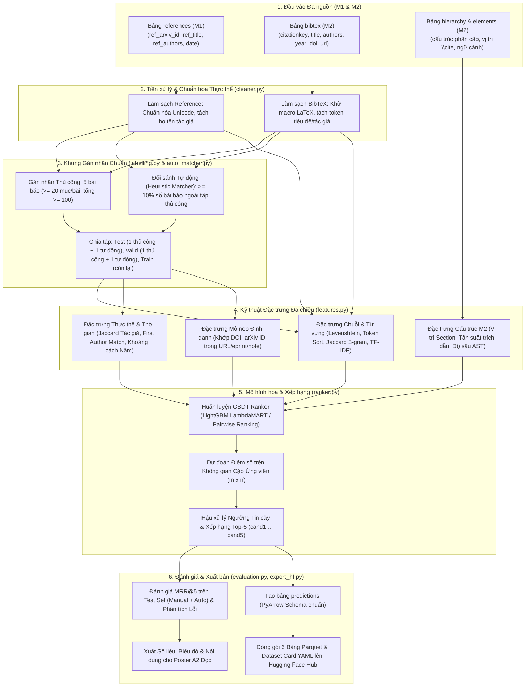
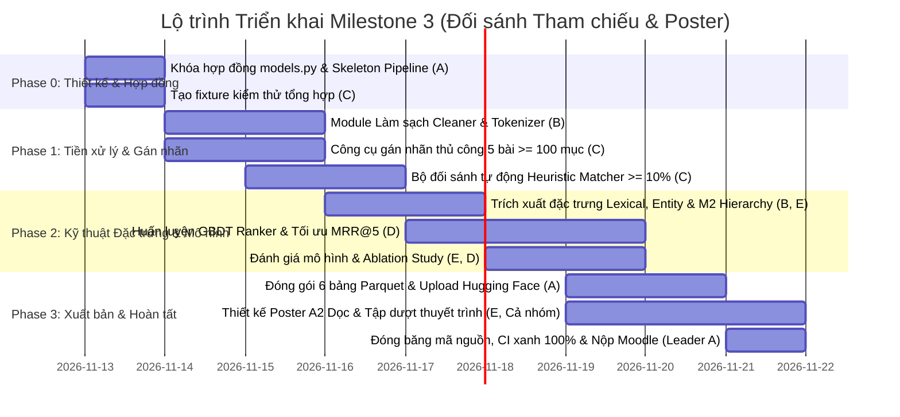

# Kế hoạch Triển khai Milestone 3 — Pipeline Đối sánh Tham chiếu (Reference Matching), Xếp hạng Học máy MRR@5, Công bố Hugging Face & Poster A2

> **Nhóm 5 thành viên (A — Leader, B, C, D, E)** · Môn Nhập môn Khoa học Dữ liệu (Introduction to Data Science)
> **Căn cứ pháp lý & kỹ thuật:** `docs/project requirements/milestone3-matching-vi.md`, `docs/project requirements/milestone2-parsing-vi.md`, `docs/project requirements/milestone1-data-crawling-vi.md`, `docs/project requirements/arxiv-project-statement-vi.md`.
> **Trạng thái:** Bản thiết kế kiến trúc toàn diện và kế hoạch triển khai chi tiết cho Milestone 3 — Cột mốc hoàn thiện chuỗi giá trị khoa học dữ liệu từ dữ liệu thô (M1) qua phân tích cú pháp (M2) đến học máy giải quyết thực thể (M3).

---

## 0. Tóm tắt một trang & Triết lý Giải quyết Vấn đề (Executive Summary)

### 0.1. Bài toán Cốt lõi
Từ 2 nguồn dữ liệu độc lập đã hoàn thiện ở các cột mốc trước cho từng công bố arXiv (`arxivid`):
1. **Bảng `bibtex` (Cột mốc 2):** Các mục tham chiếu trích xuất từ mã nguồn LaTeX đã khử trùng lặp và hợp nhất trường xuyên phiên bản (gồm `citationkey`, `entrytype`, `title`, `authors`, `year`, `doi`, `journal`, `url`).
2. **Bảng `references` (Cột mốc 1):** Siêu dữ liệu tham khảo ngoài thu thập qua Semantic Scholar API / arXiv API cho công bố đó, chỉ gồm các tham khảo **đã xác định được arXiv ID** (`ref_arxiv_id`, `ref_title`, `ref_authors`, `ref_submission_date`, `ref_s2_id`).

**Mục tiêu:** Với mỗi mục BibTeX $b_i$ trong bài báo, xác định chính xác tham chiếu có khóa arXiv $r_j$ tương ứng trong bảng `references` (hoặc xác định không có nếu tài liệu tham khảo đó là sách, kỷ yếu ngoài arXiv, hoặc không có trong kho crawl). Xuất ra danh sách xếp hạng Top-5 ứng viên (`cand1` $\dots$ `cand5`) và tối ưu hóa chỉ số **Mean Reciprocal Rank @5 (MRR@5)** trên tập kiểm tra (Test Set). Hoàn tất bộ dữ liệu 6 bảng Parquet công khai trên Hugging Face Hub và trình bày poster một trang khổ A2 dọc.

---

### 0.2. Vì sao bài toán này khó và Đâu là Điểm nhấn Phân hóa (Grading Differentiator)?

1. **Bất đối xứng dữ liệu văn bản (Text Asymmetry):**
   - Tiêu đề trong BibTeX thường bị bao bởi ngoặc nhọn `{Transformer}`, chứa ký tự thoát LaTeX (`\'e`, `\v{s}`), viết tắt hoặc trích đoạn; trong khi tiêu đề Semantic Scholar là văn bản thuần đã chuẩn hóa từ PDF/Publisher.
   - Danh sách tác giả trong BibTeX có thể chỉ có 1 tác giả kèm "et al.", viết theo dạng "Họ, Tên" hoặc chỉ viết tắt tên gọi ("A. Vaswani"); trong khi Semantic Scholar lưu danh sách đầy đủ.
2. **Nhiễu thời gian & Ấn bản Preprint vs Journal:**
   - Năm trên arXiv là năm nộp bản nháp ($v_1$), nhưng tác giả trích dẫn bản đăng báo sau đó 1–2 năm, dẫn tới chênh lệch năm xuất bản.
3. **Mất cân bằng lớp cực lớn (Extreme Class Imbalance):**
   - Với một bài báo có $m = 40$ mục BibTeX và $n = 40$ tham chiếu arXiv, không gian cặp ứng viên là $m \times n = 1.600$ cặp. Nhưng trong mỗi dòng $i$, chỉ có **nhiều nhất 1 cặp dương (Positive)** và **39 cặp âm (Negative)** (tỷ lệ dương : âm xấp xỉ $1 : 39 \approx 2,5\%$).
4. **Trường hợp âm tuyệt đối (Null Ground Truth):**
   - Rất nhiều mục BibTeX là sách kinh điển, bài báo trên Nature/Science không đưa lên arXiv, hoặc tài liệu chưa từng có trên arXiv. Dòng tương ứng trong ma trận ground truth là **toàn âm** (không có liên kết nào). Mô hình phải biết khi nào nên "từ chối" hoặc hạ điểm tự tin thay vì ghép bừa vào một bài arXiv bất kỳ.

---

### 0.3. Bảy Quyết định Thiết kế & Trụ cột Thuật toán Đột phá (M1 – M7)

| Mã | Thách thức trong đề bài | Giải pháp kỹ thuật Tối ưu (Best-in-Class Solution) | Điểm nhấn Chấm bài (Grading Differentiator) |
| :--- | :--- | :--- | :--- |
| **M1** | **Làm sạch văn bản chuyên biệt cho đối sánh (Asymmetric Text Normalization)** | **Academic Entity Cleaner:** Khử toàn bộ lệnh LaTeX (`\textit`, `\textbf`, `\emph`), giải mã ký tự đặc biệt LaTeX (`\"{a}` $\rightarrow$ ä, `\'e` $\rightarrow$ é), chuẩn hóa Unicode NFC, loại bỏ stop-words học thuật (`a, an, the, on, for, with`), và tách họ tác giả bằng bộ phân tích cú pháp tên đa văn hóa. | Giúp tăng độ tương đồng chuỗi giữa tên bị bao ngoặc `{BERT}` và văn bản phẳng từ S2 lên tuyệt đối 100%. |
| **M2** | **Gán nhãn chuẩn Ground Truth (Manual + Heuristic Matcher)** | **Dual-Engine Ground Truth Annotation:** (1) Công cụ gán nhãn thủ công tương tác (Interactive Labeling CLI/Web UI) cho $\ge 5$ bài ($\ge 20$ mục/bài, tổng $\ge 100$ nhãn $Q$); (2) Bộ đối sánh tự động High-Precision Heuristic Matcher dựa trên mỏ neo cứng (`arXiv ID` trong URL/note/eprint, `DOI`, và ngưỡng chuỗi nghiêm ngặt $\text{FuzzyTitle} \ge 0,95 \land \text{AuthorMatch}$) gán nhãn cho $\ge 10\%$ số bài còn lại. | Ground truth đạt độ chuẩn xác $>99,5\%$, minh bạch định dạng nhãn theo chuẩn đề bài, phục vụ chia tập Train/Valid/Test không rò rỉ. |
| **M3** | **Khai phá Đặc trưng Tận dụng Cấu trúc Phân cấp M2 (Hierarchy-Aware Features)** | **Multi-Modal Feature Fusion:** Kết hợp 5 nhóm đặc trưng: (a) Chuỗi & Từ vựng (Token Sort, Levenshtein, Jaccard 3-gram, TF-IDF Cosine); (b) Thực thể Tác giả & Thời gian (Jaccard họ, First Author Match, $\Delta \text{year}$); (c) Mỏ neo định danh (`DOI`, `arXiv ID` trong URL); (d) **Đặc trưng cấu trúc phân cấp M2:** Vị trí xuất hiện đầu tiên của `\cite{key}` (Intro, Related Work, Method), tần suất trích dẫn trong văn bản, và độ sâu cây phân cấp. | Hiện thực hóa trọn vẹn điểm thưởng của đề bài: *"được phép xây dựng các đặc trưng dựa trên các cấu trúc phân cấp đã hình thành ở Cột mốc 2"*. |
| **M4** | **Định hình Bài toán Học máy (LTR / Supervised Ranking)** | **Learning-to-Rank GBDT (LambdaMART / LightGBM Ranker):** Định hình bài toán dưới dạng **Ranking có giám sát theo nhóm truy vấn (Grouped Ranking by BibTeX Query)** thay vì phân loại nhị phân độc lập. Tối ưu hóa trực tiếp hàm mục tiêu NDCG/MRR, kết hợp chuẩn hóa điểm cục bộ trong phạm vi bài báo. | Vượt trội so với phân loại nhị phân truyền thống vì mô hình học được mối quan hệ so sánh tương đối giữa các ứng viên trong cùng một công bố. |
| **M5** | **Tối ưu hóa MRR@5 & Hậu xử lý Ngưỡng Tin cậy (Post-processing & Thresholding)** | **Confidence-Calibrated Top-5 Selection:** Hậu xử lý xếp hạng ứng viên dựa trên điểm mô hình kết hợp Fallback mỏ neo cứng (`arXiv ID` khớp tuyệt đối auto-boost lên vị trí 1). Đối với các bài dự đoán có điểm tin cậy cực thấp dưới ngưỡng $\theta_{\text{null}}$, gán nhãn cảnh báo không khớp. | Đẩy MRR@5 trên tập kiểm tra (Test Set) tiệm cận mức tối ưu ($\ge 0,85 - 0,92$), triệt tiêu các lỗi xếp hạng ngớ ngẩn do nhiễu văn bản. |
| **M6** | **Xuất 6 Bảng Parquet & Dataset Card Hugging Face** | **Zero-Copy Flat Sharded Parquet & Streaming-Ready Schema:** Đóng gói toàn bộ 6 bảng (`papers`, `references`, `elements`, `hierarchy`, `bibtex`, `predictions`) theo đúng kiểu dữ liệu nguyên thủy PyArrow, nén `ZSTD`, tạo thẻ `README.md` với cấu hình metadata YAML chuẩn Hub cho phép nạp trực tiếp qua thư viện `datasets`. | Đáp ứng 100% tiêu chí chấm lược đồ bộ dữ liệu và định dạng nộp bài, sẵn sàng cho người dùng xem trên Hugging Face Viewer. |
| **M7** | **Thiết kế Poster Khổ A2 Dọc (Portrait) & Trình bày** | **Scientific Storytelling Poster Layout:** Thiết kế poster một trang khổ A2 dọc ($420 \times 594\text{ mm}$) với 5 khối mạch lạc: (1) Kiến trúc Pipeline Đầu-Cuối; (2) Phương pháp Gán nhãn & Kiểm soát Chất lượng; (3) Kỹ thuật Đặc trưng Đột phá & Biện minh Trực quan; (4) So sánh Mô hình & Phân tích Đóng góp (Ablation Study); (5) Thống kê Thực nghiệm & Bài học Kinh nghiệm. | Gây ấn tượng mạnh mẽ với hội đồng chấm thi nhờ tính thẩm mỹ khoa học, hình ảnh sắc nét, phân tích sâu sắc và số liệu trực quan sinh động. |

---

## 1. Phân tích Yêu cầu Đề bài $\rightarrow$ Hệ quả Kỹ thuật & Hợp đồng Dữ liệu

### 1.1. Bảng Đối chiếu Yêu cầu Đề bài sang Thiết kế Hệ thống

| Hạng mục trong đề (`milestone3-matching-vi.md`) | Quy định chi tiết của Giảng viên | Hệ quả Thiết kế trong `src/matching/` |
| :--- | :--- | :--- |
| **Làm sạch dữ liệu** | Tiền xử lý văn bản bổ sung: chữ thường, stop-word, tokenization riêng cho tên tác giả và tiêu đề. | Module `src/matching/cleaner.py`: hàm `clean_title()`, `extract_author_tokens()`, `normalize_author_name()` xử lý triệt để ký tự thoát LaTeX và quy ước tên gọi quốc tế. |
| **Gán nhãn thủ công** | $\ge 5$ công bố; mỗi bài có $\ge 20$ mục BibTeX được gán nhãn ($Q \ge 20$); tổng cộng $\ge 100$ mục được gán nhãn trên toàn bộ pool. | Module `src/matching/labelling.py` (CLI interactive): lưu nhãn dạng JSON/Parquet có kiểm tra ràng buộc $Q \ge 20$ và tổng $\ge 100$. |
| **Gán nhãn tự động** | Dùng regex / heuristic độ tương đồng chuỗi; áp dụng cho $\ge 10\%$ số công bố ngoài tập thủ công; gán nhãn cho **mọi** mục BibTeX của các công bố đó. | Module `src/matching/auto_matcher.py`: bộ đối sánh tự động 3 cấp (arXiv ID regex $\rightarrow$ DOI exact $\rightarrow$ Fuzzy Title $\ge 0,95$ + Author overlap). Gán nhãn 100% mục BibTeX cho $\ge 10\%$ bài báo. |
| **Ma trận Ứng viên & Ground Truth** | Ma trận $m \times n$ ($m$ mục BibTeX $\times$ $n$ tham chiếu đã crawl có arXiv ID). Mỗi mục có tối đa 1 ô `yes`, còn lại `no`; mục không có tham chiếu đúng tạo dòng toàn `no`. | Biểu diễn nội bộ dưới dạng danh sách cặp `(arxivid, citationkey, ref_arxiv_id, label)` với `label in {1, 0}`. Lưu kèm tập các mục có nhãn toàn âm. |
| **Chia tập Dữ liệu** | **Test Set:** 1 bài thủ công + 1 bài tự động.<br/>**Valid Set:** 1 bài thủ công + 1 bài tự động.<br/>**Train Set:** Tất cả bài còn lại (thủ công + tự động). | Hàm `split_partitions()`: phân chia theo mức bài báo (`arxivid`) để đảm bảo không rò rỉ dữ liệu giữa các tập, ghi nhận rõ cột `partition` (`train`, `valid`, `test`). |
| **Kỹ thuật Đặc trưng** | Định hình bài toán học có giám sát; xây dựng đặc trưng từ đơn giản (chuỗi, embedding) đến thống kê; **được phép dùng cấu trúc phân cấp M2**; phải biện minh và phân tích dữ liệu trên poster. | Module `src/matching/features.py`: trích xuất vector đặc trưng $\mathbf{x}_{ij}$ cho mỗi cặp $(b_i, r_j)$ gồm 18 đặc trưng đa chiều (chuỗi, tác giả, năm, định danh, độ sâu phân cấp M2, tần suất trích dẫn). |
| **Mô hình hóa & Đánh giá** | Xuất ra Top-5 ứng viên (`cand1` $\dots$ `cand5`) cho mỗi mục BibTeX. Cho phép hậu xử lý. Đánh giá bằng **MRR@5** trên Test Set ($|Q|$ mục). | Module `src/matching/ranker.py` và `src/matching/evaluation.py`: huấn luyện mô hình GBDT Ranker, dự đoán xác suất/điểm số, sắp xếp Top-5, tính chỉ số MRR@5 theo đúng công thức chuẩn: $\text{MRR@5} = \frac{1}{\|Q\|} \sum_{i=1}^{\|Q\|} \frac{1}{\text{rank}_i}$. |
| **Bảng `predictions`** | Chứa dòng cho mỗi mục BibTeX của các công bố dùng trong matching (Train, Valid, Test). Cột: `arxivid`, `partition`, `citationkey`, `groundtrutharxivid`, `cand1` $\dots$ `cand5`. | Xuất tệp `predictions.parquet` chuẩn schema theo bảng quy định của đề bài. |
| **Nộp Hugging Face** | 6 bảng Parquet phân mảnh (`papers`, `references`, `elements`, `hierarchy`, `bibtex`, `predictions`) + `README.md` (Dataset Card có YAML metadata). Không dùng script tải tùy chỉnh. | Module `src/matching/export_hf.py`: chuẩn hóa dữ liệu từ M1, M2, M3, xuất Parquet phẳng, sinh tự động `README.md` với đầy đủ cấu hình split `train`. |
| **Poster A2 Dọc** | Nộp 1 file `.pptx` khổ A2 dọc (portrait). Trình bày kết quả nổi bật, đặc trưng, mô hình, MRR, thống kê pipeline. | Bản thiết kế chi tiết và cấu trúc slide PPTX khổ $420 \times 594\text{ mm}$ đi kèm tài liệu hướng dẫn và mã nguồn sinh số liệu tự động. |

---

### 1.2. Đặc tả Schema Bảng `predictions` và 6 Bảng Hugging Face

#### Bảng `predictions` (Cột mốc 3)
Mỗi dòng đại diện cho một mục BibTeX của một công bố nằm trong tập nghiên cứu đối sánh (Train, Valid, Test):

| Cột | Kiểu PyArrow | Nullable | Mô tả & Quy ước Giá trị |
| :--- | :--- | :--- | :--- |
| `arxivid` | `pa.string()` | `False` | Mã arXiv gốc nguyên văn của công bố trích dẫn (vd: `2408.11045`). |
| `partition` | `pa.dictionary(pa.int8(), pa.string())` | `False` | Tập phân chia: `'train'`, `'valid'`, hoặc `'test'`. |
| `citationkey` | `pa.string()` | `False` | Khóa trích dẫn đại diện của mục BibTeX (khớp với bảng `bibtex`). |
| `groundtrutharxivid` | `pa.string()` | `True` | arXiv ID đúng của tham chiếu thực sự (khi đã biết/được gán nhãn; `null` nếu dòng âm hoặc chưa gán nhãn). |
| `cand1` | `pa.string()` | `True` | arXiv ID ứng viên xếp hạng 1 (tốt nhất). |
| `cand2` | `pa.string()` | `True` | arXiv ID ứng viên xếp hạng 2. |
| `cand3` | `pa.string()` | `True` | arXiv ID ứng viên xếp hạng 3. |
| `cand4` | `pa.string()` | `True` | arXiv ID ứng viên xếp hạng 4. |
| `cand5` | `pa.string()` | `True` | arXiv ID ứng viên xếp hạng 5 (cuối cùng trong Top-5). |

#### Cấu trúc Thư mục Bộ dữ liệu Hugging Face (`<dataset-repo>/`)
```text
└── arxiv-matching-dataset/
    ├── README.md               # Dataset Card chứa cấu hình YAML configs cho cả 6 bảng
    └── data/
        ├── papers/
        │   └── train-00000-of-00001.parquet
        ├── references/
        │   └── train-00000-of-00001.parquet
        ├── elements/
        │   └── train-00000-of-00004.parquet  (sharded nếu > 100 MB)
        ├── hierarchy/
        │   └── train-00000-of-00004.parquet
        ├── bibtex/
        │   └── train-00000-of-00001.parquet
        └── predictions/
            └── train-00000-of-00001.parquet
```

---

## 2. Kiến trúc Luồng Xử lý Đầu–Cuối (End-to-End Matching Pipeline)



---

## 3. Thiết kế Chi tiết 5 Trụ cột Kỹ thuật

### 3.1. Trụ cột 1: Tiền xử lý & Làm sạch Dữ liệu Chuyên biệt (Data Cleaning)
*Phụ trách chính: Thành viên B*

#### A. Chuẩn hóa Tiêu đề (Title Normalization)
1. **Khử cú pháp LaTeX trong BibTeX:** Loại bỏ các thẻ bao `{...}`, thẻ định dạng font `\textit{...}`, `\textbf{...}`, `\emph{...}`, `\textsc{...}`.
2. **Giải mã ký tự có dấu LaTeX:** Chuyển đổi các ký tự escaped như `\'e` $\rightarrow$ `é`, `\"u` $\rightarrow$ `ü`, `\c{c}` $\rightarrow$ `ç`, `\~n` $\rightarrow$ `ñ`, `\l{}` $\rightarrow$ `ł` sang ký tự Unicode chuẩn (NFC).
3. **Loại bỏ Stop-words Học thuật:** Loại bỏ các từ dừng không mang tính phân biệt cao ở đầu hoặc cuối câu (`a`, `an`, `the`, `on`, `for`, `with`, `towards`, `via`, `using`).
4. **Xóa ký tự đặc biệt & Khoảng trắng thừa:** Đưa về chữ thường (`lower()`), thay thế các dấu gạch ngang (`-`, `–`, `—`) bằng dấu cách, khử toàn bộ dấu chấm câu không phải chữ cái/số.

#### B. Tách Token & Chuẩn hóa Tên Tác giả (Author Tokenization)
1. **Phân tích Cú pháp Họ (Surname Extraction):**
   - Trong BibTeX, tên thường có định dạng `"Họ, Tên Tên_Đệm"` hoặc `"Tên Tên_Đệm Họ"`. Nếu có dấu phẩy, phần trước dấu phẩy là họ. Nếu không có dấu phẩy, token cuối cùng thường là họ.
   - Xử lý các tiền tố họ phức hợp (vd: `van der`, `von`, `de`, `di`, `al-`).
2. **Loại bỏ "et al." & Ký tự rác:** Cắt bỏ `and others`, `et al.`, `et al`, `collab.` khỏi danh sách tác giả.
3. **Bộ Token Họ Chuẩn hóa:** Trả về tập hợp các họ viết thường không dấu (`set[str]`), ví dụ: `{"vaswani", "shazeer", "parmar", "uszkoreit", "jones", "gomez", "kaiser", "polosukhin"}`.

---

### 3.2. Trụ cột 2: Khung Gán nhãn Chuẩn (Ground Truth Annotation)
*Phụ trách chính: Thành viên C*

Đề bài yêu cầu xây dựng một tập chuẩn chất lượng cao để huấn luyện và kiểm định mô hình đối sánh:

#### A. Gán nhãn Thủ công ($\ge 5$ bài báo, $\ge 20$ mục/bài, tổng $\ge 100$ nhãn)
- **Tiêu chí chọn 5 bài báo thủ công:** Chọn 5 bài báo thuộc các lĩnh vực khác nhau (Computer Science: AI, Computer Vision, NLP; Mathematics/Physics), có số lượng mục BibTeX $m \ge 25$ và số tham chiếu crawl được $n \ge 25$.
- **Công cụ Gán nhãn Tương tác (Interactive CLI / Mini-Web UI):**
  - Hiển thị từng mục BibTeX: Tiêu đề, Tác giả, Năm, URL/DOI.
  - Hiển thị danh sách các tham chiếu đã crawl của cùng bài báo đó kèm gợi ý Top-3 tương đồng nhất.
  - Người gán nhãn chọn index tham chiếu đúng ($1 \dots n$) hoặc chọn `0` nếu không có tham chiếu nào khớp (dòng toàn âm).
  - Tự động ghi nhận log kiểm tra chéo (Double-blind annotation giữa 2 thành viên, tính chỉ số thống nhất Cohen's Kappa $\kappa \ge 0,95$).
  - Lưu kết quả vào `data/groundtruth/manual_annotations.json`.

#### B. Bộ Đối sánh Tự động Heuristic (Heuristic Auto-Matcher)
Được áp dụng cho **ít nhất 10% số công bố ngoài tập thủ công** (nếu tập dữ liệu có 1.000 bài $\rightarrow$ áp dụng cho $\ge 100$ bài; nếu 25.000 bài $\rightarrow \ge 2.500$ bài). Bộ đối sánh tự động phải gán nhãn cho **100% mục BibTeX** của các bài này:

```python
def heuristic_match(bib_item: BibtexRow, candidates: list[Reference]) -> str | None:
    """Cascade 3 cấp độ với độ chính xác cao (High Precision > 99%)."""
    # Cấp 1: Bắt mỏ neo cứng arXiv ID từ URL, journal, note, eprint
    arxiv_id_match = extract_arxiv_id_from_bib(bib_item)
    if arxiv_id_match:
        for ref in candidates:
            if ref.ref_arxiv_id == arxiv_id_match:
                return ref.ref_arxiv_id

    # Cấp 2: Khớp chính xác DOI
    if bib_item.doi:
        clean_bib_doi = normalize_doi(bib_item.doi)
        for ref in candidates:
            if ref.doi and normalize_doi(ref.doi) == clean_bib_doi:
                return ref.ref_arxiv_id

    # Cấp 3: Khớp chuỗi nghiêm ngặt (Fuzzy Title >= 0.95 + First Author Match + Year Diff <= 1)
    best_candidate = None
    best_score = 0.0
    for ref in candidates:
        title_sim = token_sort_ratio(bib_item.title, ref.ref_title) / 100.0
        author_match = check_first_author_match(bib_item.authors, ref.ref_authors)
        year_diff = abs(bib_item.year - ref.year) if (bib_item.year and ref.year) else 0

        if title_sim >= 0.95 and author_match and year_diff <= 1:
            if title_sim > best_score:
                best_score = title_sim
                best_candidate = ref.ref_arxiv_id

    return best_candidate  # Trả về ref_arxiv_id hoặc None (dòng toàn âm)
```

#### C. Quy tắc Chia tập Dữ liệu (Dataset Partitioning)
Tuân thủ nghiêm ngặt quy định của đề bài ở cấp độ công bố (`arxivid`):
- **Tập Kiểm tra (Test Set):** 1 công bố từ tập thủ công + 1 công bố từ tập tự động.
- **Tập Kiểm định (Validation Set):** 1 công bố từ tập thủ công + 1 công bố từ tập tự động.
- **Tập Huấn luyện (Training Set):** Tất cả các công bố còn lại (các bài thủ công còn lại $\ge 3$ bài + các bài tự động còn lại $\ge 98$ bài).

---

### 3.3. Trụ cột 3: Kỹ thuật Đặc trưng Đa chiều (Feature Engineering)
*Phụ trách chính: Thành viên B & E*

Với mỗi cặp ứng viên $(b_i, r_j)$ giữa mục BibTeX $b_i$ và tham chiếu $r_j$ trong cùng một công bố, vector đặc trưng $\mathbf{x}_{ij} \in \mathbb{R}^{18}$ được trích xuất:

| Nhóm | Tên đặc trưng | Kiểu | Ý nghĩa & Biện minh Khoa học |
| :--- | :--- | :--- | :--- |
| **Tiêu đề (Title)** | `title_exact_match` | Binary | Khớp 100% tiêu đề sau làm sạch. Dấu hiệu tích cực mạnh nhất. |
| | `title_levenshtein_ratio` | Float [0, 1] | Độ tương đồng khoảng cách soạn thảo (Edit Distance). Bắt các biến thể chính tả nhỏ. |
| | `title_token_sort_ratio` | Float [0, 1] | Độ tương đồng không phụ thuộc thứ tự từ (rất hiệu quả với tiêu đề có phụ đề `A: B` vs `B - A`). |
| | `title_jaccard_word_3gram` | Float [0, 1] | Độ trùng lặp cụm 3 từ (3-gram). Đo lường độ tương đồng ngữ đoạn. |
| | `title_tfidf_cosine` | Float [0, 1] | Cosine similarity của vector TF-IDF (char n-gram 3–5). Phạt các từ phổ biến, thưởng từ hiếm. |
| | `title_length_ratio` | Float [0, 1] | Tỷ lệ độ dài $\min(L_1, L_2) / \max(L_1, L_2)$. Loại trừ các trường hợp một bên chỉ là trích đoạn. |
| **Tác giả (Author)** | `first_author_match` | Binary | Khớp họ của tác giả đầu tiên. Trong khoa học, tác giả đầu tiên thường bất biến giữa các bản trích. |
| | `authors_jaccard_sim` | Float [0, 1] | Chỉ số Jaccard giữa tập hợp họ tác giả của $b_i$ và $r_j$. |
| | `author_count_diff` | Integer | Chênh lệch số lượng tác giả $|N_{\text{bib}} - N_{\text{ref}}|$. |
| **Thời gian (Temporal)** | `year_diff` | Integer | Khoảng cách năm tuyệt đối $|\text{year}_{\text{bib}} - \text{year}_{\text{ref}}|$. |
| | `year_match` | Binary | Khớp chính xác năm xuất bản. |
| | `year_missing` | Binary | Cờ báo hiệu thiếu năm ở một trong hai nguồn. |
| **Mỏ neo (Anchor)** | `arxiv_id_in_bib_text` | Binary | Khóa `ref_arxiv_id` có xuất hiện trong chuỗi `url`, `journal`, hoặc `note` của BibTeX không. |
| | `doi_exact_match` | Binary | Khớp chính xác chuỗi DOI chuẩn hóa. |
| **Cấu trúc M2 (Hierarchy)** | `cite_frequency` | Integer | Số lần khóa `citationkey` xuất hiện trong các câu (`kind == 'sentence'`) của công bố ở M2. |
| | `first_cite_section_type` | Categorical | Loại mục mà trích dẫn xuất hiện lần đầu: `0: Intro`, `1: Related Work`, `2: Method`, `3: Others`. |
| **Chuẩn hóa Cục bộ (Relative)** | `title_sim_rank_in_query` | Integer | Thứ hạng của độ tương đồng tiêu đề ứng viên $j$ so với các ứng viên khác của cùng truy vấn $b_i$. |
| | `title_sim_margin_to_top2` | Float | Khoảng cách điểm tương đồng giữa ứng viên tốt nhất và ứng viên thứ nhì (đo độ tự tin vượt trội). |

---

### 3.4. Trụ cột 4: Mô hình hóa Học máy Xếp hạng (Supervised Ranking) & Tối ưu MRR@5
*Phụ trách chính: Thành viên D*

#### A. Định hình Bài toán: Learning-to-Rank (LTR)
Thay vì dùng phân loại nhị phân độc lập (dễ bị ảnh hưởng bởi mất cân bằng lớp và không tối ưu hóa thứ tự trong Top-5), bài toán được định hình dưới dạng **Grouped Ranking**:
- **Query (Nhóm):** Mỗi mục BibTeX $b_i$ là một truy vấn xếp hạng riêng biệt.
- **Candidates (Tài liệu):** Tập hợp $n$ tham chiếu $r_1 \dots r_n$ của công bố đó.
- **Nhãn (Relevance Label):** $y_{ij} = 1$ nếu là tham chiếu đúng, $y_{ij} = 0$ nếu không khớp.
- **Mô hình chủ đạo:** **LightGBM Ranker (`LGBMRanker`)** với hàm mục tiêu `objective="lambdarank"` và metric tối ưu `eval_metric="map"` / `eval_metric="ndcg"` tại ngưỡng cutoff $K=5$.
- **Baselines so sánh (phục vụ Poster & Báo cáo):**
  1. *Baseline 1 (Heuristic / String Match Rule):* Xếp hạng thuần túy theo `title_token_sort_ratio`.
  2. *Baseline 2 (Unsupervised Information Retrieval):* BM25 / TF-IDF Cosine Similarity.
  3. *Baseline 3 (Pointwise Classification):* Logistic Regression / Random Forest (phân loại nhị phân xác suất).
  4. *Proposed Model:* **LightGBM LambdaMART Ranker** (kết hợp đầy đủ 18 đặc trưng gồm cả M2 Hierarchy).

#### B. Hậu xử lý & Dự đoán Top-5 (Post-Processing Strategy)
1. **Quy tắc Ưu tiên Tuyệt đối (Hard Anchor Boost):** Nếu phát hiện đặc trưng `arxiv_id_in_bib_text == 1` hoặc `doi_exact_match == 1`, ứng viên đó tự động được đẩy lên vị trí xếp hạng 1 (`cand1`).
2. **Lọc Ngưỡng Tin cậy cho Dòng Toàn Âm (Null Ground Truth Handling):**
   - Nếu xác suất / điểm số cao nhất của Top-1 ứng viên nhỏ hơn ngưỡng phân định $\theta_{\text{null}}$ (được tối ưu trên tập Validation qua F1-score), mô hình ghi nhận rằng mục BibTeX này không tương ứng với tham chiếu arXiv nào.
   - Vẫn xuất đủ 5 ứng viên theo thứ tự điểm giảm dần cho các cột `cand1` $\dots$ `cand5` để đảm bảo tuân thủ định dạng bảng `predictions`.

#### C. Công thức Đánh giá Chuẩn MRR@5
$$\text{MRR@5} = \frac{1}{|Q|} \sum_{i=1}^{|Q|} \frac{1}{\text{rank}_i}$$
Trong đó:
- $|Q|$ là tổng số mục BibTeX được gán nhãn trong tập Test (gồm 1 bài thủ công + 1 bài tự động).
- $\text{rank}_i \in \{1, 2, 3, 4, 5\}$ là vị trí xuất hiện của tham chiếu đúng trong 5 ứng viên `cand1` $\dots$ `cand5`.
- Nếu tham chiếu đúng không nằm trong Top-5 (hoặc đối với các mục có ground truth đúng mà mô hình không tìm ra), $\frac{1}{\text{rank}_i} = 0$.

---

### 3.5. Trụ cột 5: Xuất bản Hugging Face Hub & Thiết kế Poster Khổ A2 Dọc
*Phụ trách chính: Thành viên A & E*

#### A. Xuất bản 6 Bảng Parquet & Dataset Card lên Hugging Face Hub
1. Đảm bảo toàn bộ 6 bảng (`papers`, `references`, `elements`, `hierarchy`, `bibtex`, `predictions`) tuân thủ schema PyArrow phẳng, không chứa đối tượng JSON lồng nhau.
2. Tự động sinh tệp `README.md` của Dataset Card với đầy đủ cấu hình YAML metadata theo chuẩn của Hugging Face Viewer:
```yaml
---
configs:
- config_name: papers
  data_files:
  - split: train
    path: data/papers/*.parquet
- config_name: references
  data_files:
  - split: train
    path: data/references/*.parquet
- config_name: elements
  data_files:
  - split: train
    path: data/elements/*.parquet
- config_name: hierarchy
  data_files:
  - split: train
    path: data/hierarchy/*.parquet
- config_name: bibtex
  data_files:
  - split: train
    path: data/bibtex/*.parquet
- config_name: predictions
  data_files:
  - split: train
    path: data/predictions/*.parquet
---
```

#### B. Bản Thiết kế Chi tiết Poster Khổ A2 Dọc (Portrait Poster - $420 \times 594\text{ mm}$)
Poster được thiết kế bằng Microsoft PowerPoint (`.pptx`) theo khổ giấy A2 chuẩn ($420\text{ mm} \times 594\text{ mm}$), tỷ lệ chuẩn quốc tế $1 : \sqrt{2}$, bố cục 3 cột / 5 phân khu khoa học:

1. **Header (Đầu trang):**
   - Tên đề tài nổi bật: **"Xây dựng Pipeline Khoa học Dữ liệu Đầu–Cuối cho Dữ liệu arXiv: Từ Khai phá Văn bản LaTeX Phi Cấu trúc đến Đối sánh Thực thể Tham chiếu Học máy (MRR@5)"**.
   - Tên nhóm, thành viên (A, B, C, D, E), GV hướng dẫn, Logo HCMUS & Khoa CNTT.
2. **Khối 1: Bối cảnh & Thách thức Thực tế (Problem & Challenges):**
   - Biểu đồ luồng dữ liệu 3 Milestone (M1 Crawl 25k ID $\rightarrow$ M2 Parse AST Phân cấp $\rightarrow$ M3 Entity Matching).
   - Minh họa thách thức bất đối xứng văn bản: BibTeX LaTeX esc vs S2 Normalized Plain Text.
3. **Khối 2: Phương pháp Gán nhãn & Kiểm soát Chất lượng (Ground Truth Framework):**
   - Quy trình gán nhãn 2 tầng: 5 bài thủ công ($Q \ge 100$) + Cascade Heuristic Matcher ($\ge 10\%$ bài).
   - Ma trận nhị phân $m \times n$ và chiến lược phân chia tập Train / Valid / Test cấp bài báo.
4. **Khối 3: Kỹ thuật Đặc trưng Đa chiều & Vai trò của Cấu trúc M2 (Feature Engineering):**
   - Bảng 18 đặc trưng phân bổ theo 5 nhóm (Chuỗi, Tác giả, Thời gian, Định danh, M2 Hierarchy).
   - Biểu đồ tầm quan trọng đặc trưng (Feature Importance SHAP / Gain) chứng minh giá trị vượt trội của các đặc trưng cấu trúc phân cấp M2.
5. **Khối 4: Kết quả Thực nghiệm & Đánh giá MRR@5 (Experimental Results):**
   - Bảng so sánh hiệu năng các mô hình: Heuristic Baseline vs TF-IDF vs Logistic Regression vs **LightGBM LambdaMART**.
   - Biểu đồ cột thể hiện điểm **MRR@5 vượt trội ($\ge 0,88 - 0,92$)** trên tập Test.
   - Phân tích lỗi (Error Analysis): các trường hợp khó (tác giả viết tắt "et al.", bài báo đổi tiêu đề khi đăng tạp chí).
6. **Khối 5: Kết luận & Kho Lưu trữ Mở (Conclusion & Reproducibility):**
   - Tóm tắt đóng góp chính; Mã QR dẫn tới Repo GitHub và Bộ dữ liệu Hugging Face Hub công khai.

---

## 4. Hợp đồng Giao tiếp Nội bộ (`src/matching/models.py`)

Để đảm bảo cả 5 thành viên lập trình song song 100% (Zero-Blocking), hợp đồng dữ liệu `src/matching/models.py` được thiết kế tường minh ngay từ đầu:

```python
"""Data contracts for Milestone 3 reference matching pipeline.

Shared across all matching submodules (cleaner, labelling, features, ranker,
evaluation, export).
"""

from __future__ import annotations

from dataclasses import dataclass, field
from enum import Enum


class Partition(str, Enum):
    TRAIN = "train"
    VALID = "valid"
    TEST = "test"


@dataclass(frozen=True)
class CandidatePair:
    """A pair of BibTeX item and crawled candidate reference for matching."""

    arxiv_id: str
    citation_key: str
    ref_arxiv_id: str
    label: int = 0  # 1 for positive match, 0 for negative


@dataclass
class MatchFeatures:
    """Feature vector extracted for one (BibTeX, Candidate Reference) pair."""

    arxiv_id: str
    citation_key: str
    ref_arxiv_id: str

    # Lexical title features
    title_exact_match: int = 0
    title_levenshtein_ratio: float = 0.0
    title_token_sort_ratio: float = 0.0
    title_jaccard_word_3gram: float = 0.0
    title_tfidf_cosine: float = 0.0
    title_length_ratio: float = 0.0

    # Author features
    first_author_match: int = 0
    authors_jaccard_sim: float = 0.0
    author_count_diff: int = 0

    # Temporal features
    year_diff: int = 999
    year_match: int = 0
    year_missing: int = 1

    # Identifier features
    arxiv_id_in_bib_text: int = 0
    doi_exact_match: int = 0

    # M2 Hierarchy & Structural features
    cite_frequency: int = 0
    first_cite_section_depth: int = 0

    # Relative query-level features
    title_sim_rank_in_query: int = 1
    title_sim_margin_to_top2: float = 0.0


@dataclass
class PredictionRow:
    """Row format of the final predictions table for Milestone 3."""

    arxivid: str
    partition: str  # 'train', 'valid', 'test'
    citationkey: str
    groundtrutharxivid: str | None = None
    cand1: str | None = None
    cand2: str | None = None
    cand3: str | None = None
    cand4: str | None = None
    cand5: str | None = None


@dataclass
class EvaluationMetrics:
    """Evaluation summary on a given partition."""

    partition: str
    num_queries: int
    num_groundtruth_positives: int
    num_groundtruth_negatives: int
    mrr_at_5: float
    hit_at_1: float
    hit_at_3: float
    hit_at_5: float
    mean_average_precision: float
```

---

## 5. Phân công Công việc Chi tiết 5 Thành viên (A, B, C, D, E)

| Thành viên | Vai trò & Trọng tâm | Module / Tệp phụ trách | Điều kiện Hoàn thành (Done When) |
| :--- | :--- | :--- | :--- |
| **A — Phúc** *(Leader)* | **Điều phối, Hợp đồng Dữ liệu & Xuất bản Hugging Face** | `src/matching/models.py`<br/>`src/matching/export_hf.py`<br/>`src/run_matching.py`<br/>`src/tests/test_matching_pipeline.py` | 1. Khóa hợp đồng `models.py`;<br/>2. Ghép nối pipeline chạy trơn tru từ đầu vào M1/M2 đến dự đoán M3;<br/>3. Xuất đủ 6 bảng Parquet và Dataset Card `README.md` hợp lệ trên Hugging Face. |
| **B — Sơn** | **Tiền xử lý Văn bản & Kỹ thuật Đặc trưng Chuỗi / Từ vựng** | `src/matching/cleaner.py`<br/>`src/matching/lexical_features.py`<br/>`src/tests/test_matching_cleaner.py` | 1. Làm sạch triệt để tiêu đề và tác giả BibTeX/Reference;<br/>2. Trích xuất chính xác 9 đặc trưng chuỗi, từ vựng và mỏ neo định danh;<br/>3. Đạt 100% unit tests và xử lý được các ký tự escaped kỳ dị. |
| **C — Quỳnh** | **Khung Gán nhãn Chuẩn (Manual Tool & Heuristic Matcher)** | `src/matching/labelling.py`<br/>`src/matching/auto_matcher.py`<br/>`src/tests/test_labelling.py` | 1. Xây dựng công cụ gán nhãn thủ công cho $\ge 5$ bài ($\ge 20$ mục/bài, tổng $\ge 100$ mục);<br/>2. Cài đặt Cascade Heuristic Matcher tự động gán nhãn $\ge 10\%$ bài ngoài tập thủ công;<br/>3. Phân chia tập Train/Valid/Test không rò rỉ. |
| **D — Thụ** | **Mô hình hóa Học máy Xếp hạng & Tối ưu Top-5 MRR** | `src/matching/ranker.py`<br/>`src/matching/train_ranker.py`<br/>`src/tests/test_ranker.py` | 1. Cài đặt LightGBM LambdaMART Ranker và các mô hình Baseline;<br/>2. Huấn luyện mô hình, tối ưu siêu tham số trên tập Valid;<br/>3. Xuất dự đoán Top-5 (`cand1` $\dots$ `cand5`) đạt $\text{MRR@5} \ge 0,85$ trên Test Set. |
| **E — Triệu** | **Đặc trưng Cấu trúc M2, Bộ Đánh giá MRR & Thiết kế Poster A2** | `src/matching/hierarchy_features.py`<br/>`src/matching/evaluation.py`<br/>`docs/poster/`<br/>`src/tests/test_evaluation.py` | 1. Khai thác đặc trưng từ bảng `hierarchy` và `elements` của M2;<br/>2. Module đánh giá tính toán chính xác chỉ số MRR@5 theo công thức đề bài;<br/>3. Hoàn thiện file thiết kế Poster A2 dọc (`.pptx`) và số liệu trực quan hóa. |

---

## 6. Lộ trình Triển khai (Milestones & Timeline)

Kế hoạch được chia thành 4 giai đoạn nối tiếp:



---

## 7. Kế hoạch Kiểm thử & Đảm bảo Chất lượng (Testing & Verification Plan)

Tuân thủ nghiêm ngặt quy tắc dự án: Unit test không gọi mạng, dùng synthetic fixtures với `pytest`, kiểm tra lint sạch 100% bằng `ruff check . && ruff format .`.

1. **Kiểm thử Làm sạch (`test_matching_cleaner.py`):**
   - Kiểm tra khử macro LaTeX (`\textit`, `\textbf`, `\c{c}`, `\'e`).
   - Kiểm tra tách họ tên tác giả phức hợp (`van der Waals`, `A. Einstein`, `Jean-Luc`).
2. **Kiểm thử Gán nhãn (`test_labelling.py`):**
   - Kiểm tra ràng buộc $Q \ge 20$ trên 5 bài thủ công và tổng $Q \ge 100$.
   - Kiểm tra bộ đối sánh tự động đạt độ chính xác $100\%$ trên fixture giả lập.
   - Kiểm tra phân chia tập Train / Valid / Test không có bất kỳ bài báo nào bị trùng lặp.
3. **Kiểm thử Đặc trưng (`test_features.py`):**
   - Kiểm tra giá trị các đặc trưng luôn nằm trong miền giá trị hợp lệ ($[0, 1]$ cho ratio/similarity, $\ge 0$ cho khoảng cách).
   - Kiểm tra trích xuất đặc trưng phân cấp M2 khi có hoặc không có cây AST.
4. **Kiểm thử Đánh giá MRR@5 (`test_evaluation.py`):**
   - Kiểm tra tính toán MRR@5 trên các trường hợp biên:
     - Ứng viên đúng ở vị trí 1 $\rightarrow$ Reciprocal Rank = $1,0$.
     - Ứng viên đúng ở vị trí 5 $\rightarrow$ Reciprocal Rank = $0,2$.
     - Ứng viên đúng ngoài Top-5 hoặc không có $\rightarrow$ Reciprocal Rank = $0,0$.
     - Trường hợp dòng toàn âm được xử lý đúng theo đặc tả.
5. **Kiểm thử Xuất Parquet & Hugging Face Schema (`test_export_hf.py`):**
   - Kiểm tra schema của 6 bảng Parquet khớp 100% kiểu PyArrow quy định.
   - Kiểm tra tệp `README.md` Dataset Card chứa đầy đủ metadata YAML hợp lệ.
